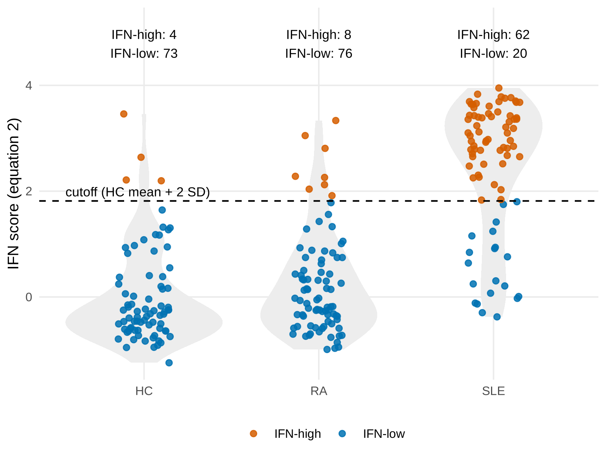
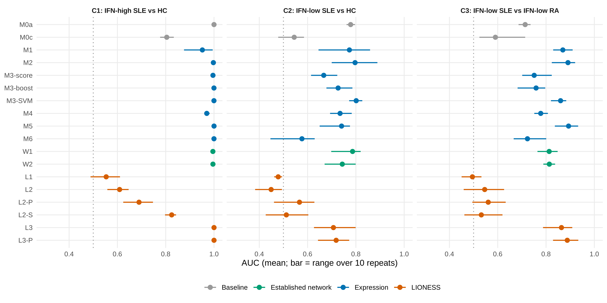
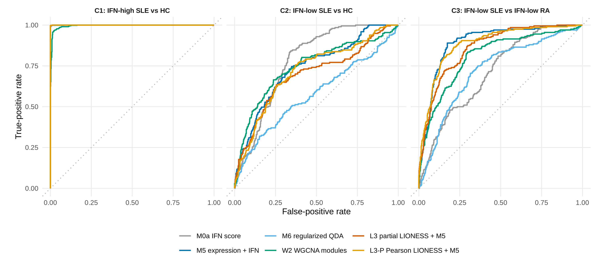
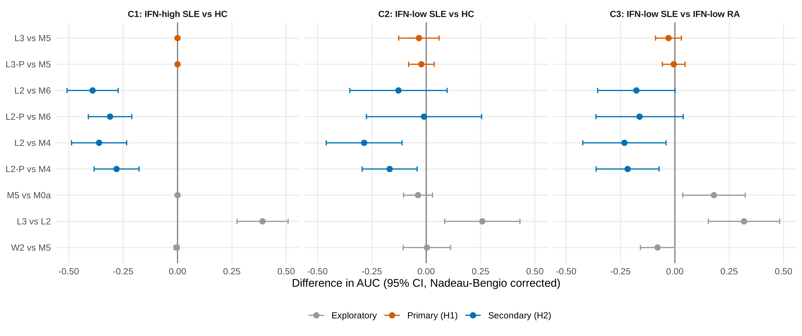
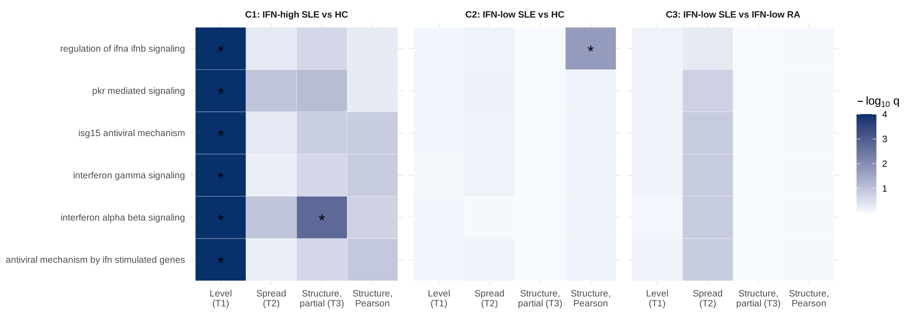
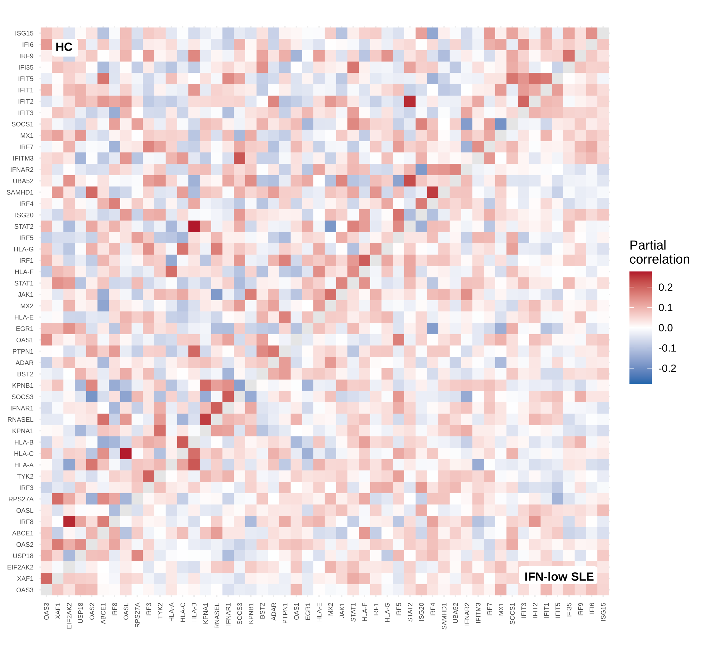
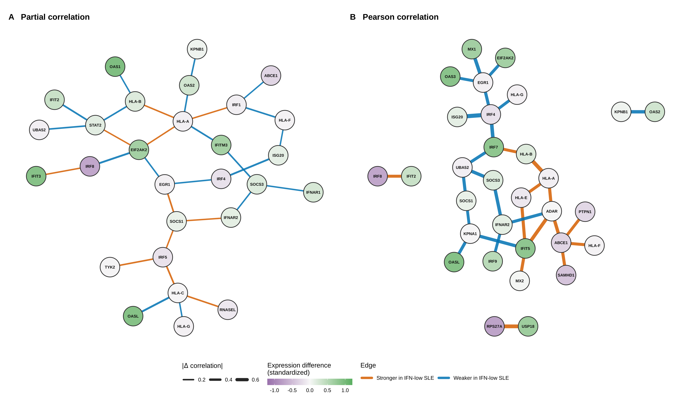
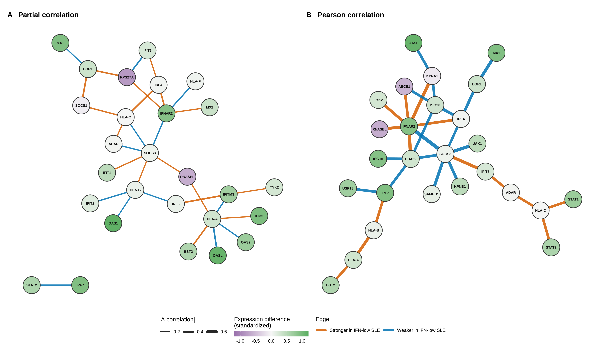
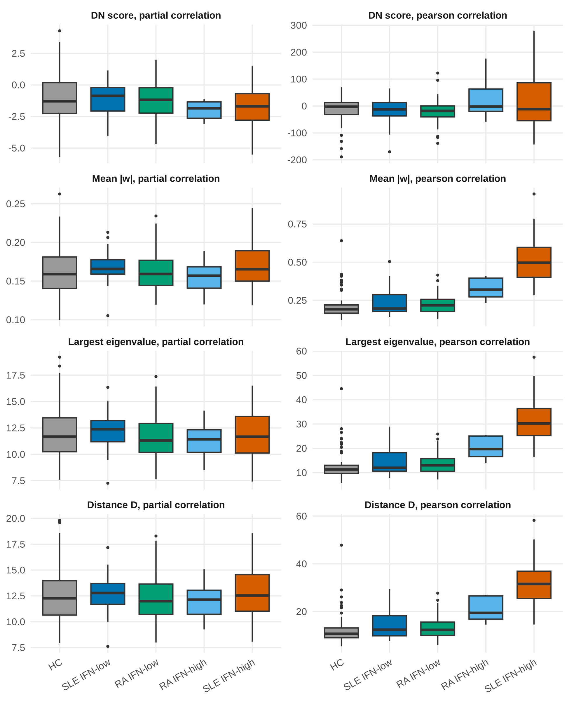
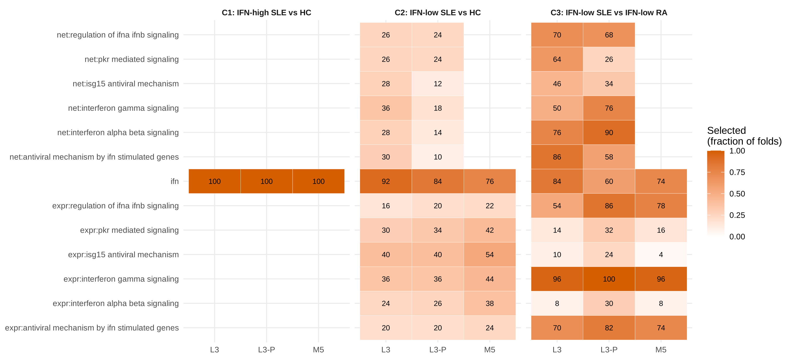

# Progress draft

**Status:** skeleton only. Sections are added one at a time.

## Title

[Not yet written]

## Key Points

[Not yet written]

## Abstract

[Not yet written]

<a id="sec-1"></a>

## 1. Introduction

Systemic lupus erythematosus (SLE) is a chronic autoimmune disease that can affect the skin, joints, kidneys, blood and nervous system, and its course differs widely between patients [[1]](https://doi.org/10.1038/nrdp.2016.39). Over the past two decades, much of what is known about SLE at the molecular level has come from gene expression measured in blood. Early microarray studies showed that many patients have high expression of genes induced by type I interferon (IFN), a pattern now called the IFN signature [[2]](https://pubmed.ncbi.nlm.nih.gov/12604793/), [[3]](https://pubmed.ncbi.nlm.nih.gov/12642603/). Later analyses of gene modules in adult patients showed that the signature is present in most patients and involves more than one type of interferon [[4]](https://pubmed.ncbi.nlm.nih.gov/24644022/), and it has since become the main molecular marker in the field. It is measured with short panels of IFN-stimulated genes, such as IFI27, IFI44, IFI44L and RSAD2, to divide patients into IFN-high and IFN-low groups [[5]](https://pubmed.ncbi.nlm.nih.gov/31660791/), and it guided the development of anifrolumab, an antibody that blocks the type I IFN receptor [[6]](https://pubmed.ncbi.nlm.nih.gov/31851795/).

Not all patients carry this signature. In the first blood studies about half of the patients showed raised expression of IFN genes [[2]](https://pubmed.ncbi.nlm.nih.gov/12604793/), and in the two phase III trials of tabalumab, about one patient in four was negative for the IFN signature at baseline [[7]](https://pubmed.ncbi.nlm.nih.gov/27723281/). The reported frequency depends on the cohort and on how the signature is measured, but the IFN-low group is consistently present. IFN-low patients can have active disease, yet their IFN score lies in the range of healthy people. Across several trial cohorts, IFN status was linked to serological features, such as anti-double-stranded DNA antibodies and low complement, but not to global disease activity scores [[8]](https://pubmed.ncbi.nlm.nih.gov/25861459/), and in a longitudinal cohort about 30% of patients were IFN-low at baseline and 87% of patients with repeated samples kept the same IFN status over time [[9]](https://doi.org/10.1136/lupus-2021-000625). IFN-low status is therefore usually a stable feature of the patient rather than a passing phase. Their blood expression differs from that of IFN-high patients [[5]](https://pubmed.ncbi.nlm.nih.gov/31660791/), and large studies that stratify patients by their molecular profile have found groups driven by other processes, such as inflammatory and lymphoid processes [[10]](https://pubmed.ncbi.nlm.nih.gov/27040498/), [[11]](https://pubmed.ncbi.nlm.nih.gov/?term=Barturen+Integrative+analysis+molecular+stratification+systemic+autoimmune+diseases). In the anifrolumab trial, the IFN-low group was small, and the authors noted that the treatment effect in this group needed further study [[6]](https://pubmed.ncbi.nlm.nih.gov/31851795/). IFN-low lupus is therefore a group of patients whose disease is poorly explained by the marker that dominates the field, and for whom blood-based tools offer little.

A possible reason is that current tools measure only how much each gene is expressed. A disease process can also change how genes work together, so that genes which normally rise and fall together lose their link, or new links appear, while the average level of each gene stays close to normal [[12]](https://doi.org/10.1016/j.tig.2010.05.001). Differential network analysis was developed to detect such changes by comparing gene co-expression between groups [[13]](https://pubmed.ncbi.nlm.nih.gov/30940863/), [[14]](https://pubmed.ncbi.nlm.nih.gov/36624383/). If the interferon pathway is rewired in IFN-low patients, their disease could be visible in the coordination of interferon genes even when the IFN score looks normal. A group-level network, however, gives one network for a whole group, so it cannot be used to classify an individual patient or to relate network changes to that patient's clinical features [[15]](https://pubmed.ncbi.nlm.nih.gov/30981959/).

Single-sample network methods remove this limitation by estimating a separate network for each sample. LIONESS (Linear Interpolation to Obtain Network Estimates for Single Samples) computes the edges of a sample's network from the difference between a network estimated with all reference samples and one estimated without that sample [[15]](https://pubmed.ncbi.nlm.nih.gov/30981959/), [[16]](https://pubmed.ncbi.nlm.nih.gov/31653243/). Related approaches build sample-specific networks from Pearson correlation [[17]](https://pubmed.ncbi.nlm.nih.gov/27596597/) and from partial correlation [[18]](https://pubmed.ncbi.nlm.nih.gov/32422654/). The LIONESS formula has the same form as the jackknife pseudo-value of classical statistics [[19]](https://scholar.google.com/scholar?q=Tukey+1958+Bias+and+confidence+in+not-quite+large+samples), which links it to pseudo-value methods for differential network analysis [[14]](https://pubmed.ncbi.nlm.nih.gov/36624383/). Because each patient receives a network, its edges and summary features can be used as predictors in the same way as gene expression values. Applications of LIONESS have so far come mainly from cancer and from model data sets [[15]](https://pubmed.ncbi.nlm.nih.gov/30981959/), [[16]](https://pubmed.ncbi.nlm.nih.gov/31653243/).

The interpretation of such networks is limited in several ways. It is not clear what a single-sample edge measures: a sample's edge is computed from its own expression values, so it may reflect how far the sample lies from the reference mean rather than a change in gene coordination; if so, network features may only repeat information that is already present in expression levels. In addition, network features have rarely been tested against strong expression-based models, including models that already use gene covariance at the group level, such as quadratic discriminant analysis [[20]](https://doi.org/10.2307/2289860), so a reported gain may reflect a weak comparator rather than added information. In SLE, moreover, several factors can produce network differences that are not caused by the disease: remaining IFN activity in patients just below the IFN cutoff, the change in gene correlations caused by selecting patients on their IFN score, treatment, since glucocorticoids suppress the IFN signature [[3]](https://pubmed.ncbi.nlm.nih.gov/12642603/), and technical batch [[21]](https://pubmed.ncbi.nlm.nih.gov/20838408/). Without a design that rules out these explanations, a network difference in real data cannot be interpreted with confidence.

IFN-low lupus offers a demanding test of these methods. In IFN-high patients the interferon pathway is strongly activated, so a network method will almost certainly find a difference, but it will be hard to tell whether the network adds anything to the IFN score. In IFN-low patients the main known signal has been largely removed by design. If single-sample networks still separate these patients from healthy people after the safeguards above, the signal must come from something beyond IFN activity; if they do not, this is equally useful, because it sets a limit on what these methods can detect in blood. Specificity is a further concern, because a subset of patients with rheumatoid arthritis (RA) also carry a type I IFN signature [[22]](https://pubmed.ncbi.nlm.nih.gov/17223656/); a difference between SLE and healthy people may reflect autoimmune inflammation in general rather than lupus. Comparing IFN-low SLE with IFN-low RA from the same study asks whether a network signal is specific to lupus when the IFN score cannot separate the two diseases.

The aim of this study was to determine whether single-sample co-expression networks of the interferon pathway carry information about IFN-low SLE that is not contained in gene expression levels or in the IFN score. The primary question was whether LIONESS networks, built from Pearson and from partial correlation, separate IFN-low SLE patients from healthy controls better than expression-based models that already include the residual IFN score. The secondary questions were whether any network difference reflects a change in gene coordination rather than residual IFN activity, selection on the IFN score, treatment or batch; and whether the same network features distinguish IFN-low SLE from IFN-low RA.

This study provides a rigorous evaluation of single-sample networks in a difficult clinical setting, establishing whether and when LIONESS adds information beyond the IFN score, clinical and cell-composition baselines, expression-based classifiers and established co-expression network methods. To interpret the edges, a first-order approximation of the LIONESS edge is given for Pearson and partial correlation, which shows that an edge is mainly the product of the sample's standardized deviations from the reference mean, plus a term that depends on the reference correlation, and therefore indicates which expression-based models a network method must be compared with. On this basis, single-sample networks are compared with seventeen models within one nested cross-validation framework, including baselines, expression-based classifiers, quadratic discriminant analysis and established network methods, with the primary comparison made against a reference model that already contains the residual IFN score. Safeguards against false network signals are built into the design through conditioning on the IFN score, controls matched on the IFN score, exclusion of treated patients and adjustment for batch. The pipeline is applied to IFN-low SLE in a public whole-blood cohort, compared both with healthy controls and with IFN-low RA. To our knowledge, single-sample networks have not previously been evaluated in IFN-low SLE under such a design.

The rest of the paper is organized as follows. [Section 2](#sec-2) describes the methods: the data, pre-processing and IFN-low definition are given in [Sections 2.1–2.3](#sec-2-1), the safeguards against confounding in [Sections 2.3](#sec-2-3) and [2.4](#sec-2-4), the theory of single-sample networks in [Section 2.6](#sec-2-6), the network estimation and features in [Sections 2.7](#sec-2-7) and [2.8](#sec-2-8), the comparator models in [Section 2.9](#sec-2-9), the contrasts and statistical inference in [Sections 2.10–2.12](#sec-2-10), the simulation study in [Section 2.13](#sec-2-13) and the application to the lupus cohort in [Section 2.14](#sec-2-14). [Section 3](#sec-3) reports the results of the analysis of GSE110169.

<a id="sec-2"></a>

## 2. Methods

<a id="sec-2-1"></a>

### 2.1 Data source

All data came from a single public whole-blood study, [GSE110169](https://www.ncbi.nlm.nih.gov/geo/query/acc.cgi?acc=GSE110169), deposited in the Gene Expression Omnibus (GEO) [[23]](https://pubmed.ncbi.nlm.nih.gov/23193258/) by Hu et al. [[24]](https://pubmed.ncbi.nlm.nih.gov/29534336/). The study profiled peripheral blood from 82 patients with systemic lupus erythematosus (SLE), 84 patients with rheumatoid arthritis (RA) and 77 healthy controls (HC) on the Affymetrix Human Genome U219 array (platform GPL13667). Blood was collected directly into PAXgene tubes, RNA extraction and array processing were carried out in four batches, and the sex of each participant and the glucocorticoid use of each patient were recorded. Because all three groups were collected and processed within the same study, differences between groups cannot arise from differences between studies, laboratories or platforms, which would otherwise be confounded with diagnosis. The characteristics of the cohort by group are given in [Supplementary Table S1](#table-s1).

Each GEO sample was treated as one participant. No sample title was repeated, and no two expression profiles were near-identical, so the same individual could not appear in both training and test data.

Before any model was fitted to the outcome, a feasibility check counted the IFN-high and IFN-low participants in each group, by inferred sex ([Section 2.4](#sec-2-4)) and by batch, using the IFN cutoff of [Section 2.3](#sec-2-3) estimated from all controls; glucocorticoid use was tabulated in the same way. The check was descriptive and was not used to select samples. Batch was required not to be confounded with group, meaning that patients and controls had not been processed in separate batches. Because the IFN-low groups were expected to be small, all contrasts were analysed whatever their group sizes, and their precision is reported with the results. As a rough guide, the 95% confidence interval for an area under the receiver operating characteristic curve (AUC) of 0.70 has a half-width of about ±0.14 with 20 patients and 73 controls, based on the standard error of Hanley and McNeil [[25]](https://pubmed.ncbi.nlm.nih.gov/7063747/). This figure assumes a single independent test set; the inference used for the actual model comparisons accounts for cross-validation and is described in [Section 2.11](#sec-2-11). Fixing these rules in advance ensured that the analysis could not be influenced by the results.

<a id="sec-2-2"></a>

### 2.2 Pre-processing

The normalized expression values supplied by the submitters were used. They were obtained by robust multi-array averaging (RMA) [[26]](https://pubmed.ncbi.nlm.nih.gov/12925520/) of the raw array files, are on the log2 scale and were not corrected for batch. Probes were mapped to gene symbols with the GEO annotation of the platform, and probes that mapped to no gene or to more than one gene were removed, leaving 47,320 probes for 19,040 genes. Where several probes mapped to the same gene, the probe with the highest variance in the training fold was kept. The four processing batches were not removed by correction; instead, cross-validation folds were stratified by batch, and batch was included as an adjustment covariate in the population-level tests ([Section 2.12](#sec-2-12)). Before network estimation, each gene was winsorized at ±4 standard deviations (SD), using means and SDs estimated in the training fold, to limit the influence of outlying values on the correlation estimates.

<a id="sec-2-3"></a>

### 2.3 IFN score and IFN-low definition

<a id="sec-2-3-1"></a>

#### 2.3.1 IFN score

Interferon (IFN) activity was measured with a score built from four interferon-stimulated genes: IFI27, IFI44, IFI44L and RSAD2. This panel is used in clinical trials of type I IFN blockade to divide patients into IFN-high and IFN-low groups [[5]](https://pubmed.ncbi.nlm.nih.gov/31660791/). To place every sample on the scale of healthy blood, the expression of each gene was first standardized against the healthy controls (HC) of the training fold:

```math
z_{gi} = \frac{x_{gi} - \hat{\mu}_g^{\mathrm{HC}}}{\hat{\sigma}_g^{\mathrm{HC}}} \qquad\qquad (1)
```

Here, $`x_{gi}`$ is the expression of gene $`g`$ in sample $`i`$, and $`\hat{\mu}_g^{\mathrm{HC}}`$ and $`\hat{\sigma}_g^{\mathrm{HC}}`$ are the mean and standard deviation (SD) of that gene among the training-fold controls. The IFN score of sample $`i`$, written $`I_i`$, is the mean of its four standardized values over the set $`\mathcal{G}_{\mathrm{IFN}}`$ of IFN-score genes:

```math
I_i = \frac{1}{4} \sum_{g \in \mathcal{G}_{\mathrm{IFN}}} z_{gi}, \qquad \mathcal{G}_{\mathrm{IFN}} = \lbrace \mathrm{IFI27},\;\mathrm{IFI44},\;\mathrm{IFI44L},\;\mathrm{RSAD2} \rbrace \qquad\qquad (2)
```

<a id="sec-2-3-2"></a>

#### 2.3.2 IFN-low cutoff

A sample was classified as IFN-low when its score lay no more than two SD above the control mean, that is, at or below the cutoff $`\theta`$:

```math
I_i \le \theta, \qquad \theta = \hat{\mu}_I^{\mathrm{HC}} + 2\,\hat{\sigma}_I^{\mathrm{HC}} \qquad\qquad (3)
```

Here, $`\hat{\mu}_I^{\mathrm{HC}}`$ and $`\hat{\sigma}_I^{\mathrm{HC}}`$ are the mean and SD of the score among the training-fold controls. The clinical-trial assay is a qualitative polymerase chain reaction (PCR) test with its own fixed threshold [[5]](https://pubmed.ncbi.nlm.nih.gov/31660791/), which cannot be transferred to microarray or sequencing data. The cutoff was therefore defined relative to the healthy controls of each cohort, a rule that can be applied in the same way on every platform.

Because the cutoff $`\theta`$ depends on the data, it was estimated within each training fold and then applied, without change, to the test samples of that fold. Controls were filtered by the same rule, so that patients and controls entered the analysis on an equal footing; if the score were normally distributed among controls, this would remove about 2.3% of them. The cutoff is estimated from a modest number of controls (about 62 per training fold, that is, 80% of the 77 controls), so its value varies between folds; this variation, and the number of patients classified as IFN-low in each fold, are reported. A stricter cutoff, $`\theta = \hat{\mu}_I^{\mathrm{HC}} + \hat{\sigma}_I^{\mathrm{HC}}`$, was examined in a sensitivity analysis.

<a id="sec-2-3-3"></a>

#### 2.3.3 Residual IFN signal

No cutoff can make IFN-low patients identical to controls in IFN activity, since patients who fall just below it may still carry a mildly raised signature. The residual IFN score was therefore kept as a baseline model that every other model had to outperform ([Section 2.9](#sec-2-9)). The network analysis was carried out on the interferon pathway itself ([Section 2.5](#sec-2-5)), and the four genes that make up the IFN score were removed from the network features. Because the other interferon genes move closely with these four, removing them does not by itself prevent the networks from re-measuring IFN activity, so three further safeguards were used. First, the IFN score was added to the set of variables on which each partial correlation was conditioned ([Section 2.7](#sec-2-7)), so that partial-correlation edges describe co-expression beyond the shared IFN signal; for Pearson networks, a sensitivity analysis recomputed the edges after regressing each gene on the IFN score within the training fold. Second, the primary comparison used a reference model that already contains the residual IFN score (M5, [Section 2.9](#sec-2-9)), so a network gain had to go beyond residual IFN activity. Third, a sensitivity analysis removed all genes of the *Interferon alpha/beta signaling* pathway (R-HSA-909733) [[27]](https://doi.org/10.1093/nar/gkab1028), leaving only the remaining interferon genes.

Selecting patients by their IFN score can itself change gene correlations. Restricting the range of a shared driver weakens the correlations among the genes it drives, so IFN-low patients could show weaker links between interferon genes than controls because of the selection rather than the disease. Applying the same cutoff to controls reduces this effect, and conditioning on the IFN score removes most of the shared driver from partial-correlation edges. In addition, a sensitivity analysis compared IFN-low patients with controls matched on IFN score, each patient being paired within the training fold with the control whose score was closest, so that both groups covered the same part of the IFN range. The expected size of this selection effect was also estimated by simulation ([Section 2.13](#sec-2-13)). Because LIONESS edges built from a balanced reference do not respond to differences in average expression ([Section 2.6](#sec-2-6)), a network difference that survives these safeguards indicates a change in how the interferon pathway genes are coordinated rather than in their overall level.

<a id="sec-2-3-4"></a>

#### 2.3.4 Treatment and IFN status

Treatment can lower the IFN signature, so some patients classified as IFN-low may be IFN-high patients whose signature has been suppressed. GSE110169 records whether each patient was receiving glucocorticoids, but not the use of hydroxychloroquine or immunosuppressants. The proportion of IFN-low patients was therefore compared between patients with and without recorded glucocorticoid use, and a sensitivity analysis repeated the contrasts after excluding glucocorticoid-treated patients. Because this exclusion leaves few IFN-low patients, the sensitivity analysis is reported descriptively.

<a id="sec-2-4"></a>

### 2.4 Confounding control

Differences between IFN-low patients and controls could arise from factors other than disease. Four such factors were addressed: sex, batch, treatment and cell composition. Each was handled either by the study design or by an explicit baseline model and adjustment covariate.

The first factor, sex, was inferred from the expression of Y-chromosome genes (RPS4Y1, DDX3Y, KDM5D, UTY and EIF1AY) rather than from XIST, because XIST expression is unreliable for this purpose in SLE: in a large RNA-sequencing cohort, 54% of male patients (22 of 41) showed elevated XIST expression [[28]](https://pubmed.ncbi.nlm.nih.gov/42039161/). Inferred sex was compared with reported sex. Because restricting the analysis to females would leave few IFN-low patients, both sexes were analysed: the Y-chromosome genes and XIST/TSIX were removed from the network features, and inferred sex was included as an adjustment covariate. X-chromosome genes were retained, because removing them would delete immune genes located on the X chromosome, such as TLR7, CXCR3, CD40LG and FOXP3. A sensitivity analysis was restricted to females.

Batch effects were controlled mainly by design: patients and controls were processed in the same four batches, and the feasibility check confirmed that every group was represented in each batch ([Section 2.1](#sec-2-1)). Cross-validation folds were stratified by batch, batch was included as an adjustment covariate in the population-level tests ([Section 2.2](#sec-2-2)), and the distribution of batches by group is reported.

Treatment was the third factor. Glucocorticoids change blood gene expression and could therefore create differences between patients and controls that are unrelated to disease. A glucocorticoid-response score was computed for each sample with singscore [[29]](https://doi.org/10.1186/s12859-018-2435-4) from the 64 genes that Hu et al. found to be up-regulated by glucocorticoids [[24]](https://pubmed.ncbi.nlm.nih.gov/29534336/). The score served three purposes: as a baseline model (M0b, [Section 2.9](#sec-2-9)), to define a sensitivity analysis in which its genes were removed from the network features, and as an adjustment covariate in the population-level tests. Because glucocorticoid use was recorded for each patient, we checked that the score was associated with the recorded use.

Cell composition required particular care, because gene co-expression in whole blood is strongly influenced by differences in the proportions of blood cell types between samples. For each sample, singscore [[29]](https://doi.org/10.1186/s12859-018-2435-4) was used to score marker gene sets for neutrophils, monocytes, B cells, plasmablasts, T cells, natural killer cells and eosinophils, with the marker sets fixed before analysis. Because each score uses only the sample being scored, it cannot carry information between training and test data. The cell-type scores served as a baseline model, as additional conditioning variables in the partial correlations ([Section 2.7](#sec-2-7)) and as adjustment covariates in the population-level tests.

Age and ancestry were not recorded in GSE110169, so their possible influence could not be assessed.

<a id="sec-2-5"></a>

### 2.5 Pathways

The primary network analysis used one pathway, REACTOME INTERFERON SIGNALING, taken from the Molecular Signatures Database (MSigDB) [[30]](https://pubmed.ncbi.nlm.nih.gov/21546393/) and accessed in R through the msigdbr package [[31]](https://cran.r-project.org/web/packages/msigdbr/index.html), with the database version recorded. It corresponds to the Reactome *Interferon Signaling* pathway (R-HSA-913531) [[27]](https://doi.org/10.1093/nar/gkab1028), which covers both type I (alpha/beta) and type II (gamma) IFN signalling. The same pathway was used in every contrast ([Section 2.10](#sec-2-10)). In the comparison of IFN-low patients with controls, the question is whether the coordination of the interferon pathway differs even when its overall activity is low. In the comparison of IFN-high patients with healthy controls, the interferon genes are both more highly expressed and more strongly co-expressed, so this contrast served as a positive control for the pipeline; because network edges respond mainly to co-expression rather than to expression level ([Section 2.6](#sec-2-6)), it was reported together with the expression-based models and the level test of [Section 2.12](#sec-2-12).

Partial correlations become unstable as the number of genes approaches the number of samples, so each network was limited to between 15 and 50 genes after filtering. This keeps the number of genes below the smallest training set, about 74 samples per fold in the primary contrast (80% of about 20 IFN-low patients and 73 controls), and the shrinkage of equation (4) stabilizes the estimates when the number of genes approaches this size. The four IFN-score genes were removed first ([Section 2.3](#sec-2-3)). Because the interferon pathway contains more than 50 genes, it was then divided into its Reactome sub-pathways, which include *Interferon alpha/beta signaling* (R-HSA-909733) and *Interferon gamma signaling* (R-HSA-877300). Sub-pathways that still exceeded 50 genes were restricted to the 50 genes with the highest variance in the training fold, sub-pathways with fewer than 15 genes were removed, and near-duplicate sub-pathways, defined as pairs with a Jaccard index of gene overlap above 0.8, were reduced to a single representative. In what follows, "pathway" refers to each of the resulting sub-pathways. The genes retained in each sub-pathway are listed, and genes shared between sub-pathways, such as signalling genes common to type I and type II IFN, are reported; a sensitivity analysis removed the shared genes so that each gene contributed to one sub-pathway only.

The analysis was restricted to the interferon pathway because the study asks whether the coordination of this pathway differs in patients whose IFN activity is low; disease processes outside it, such as the B-cell, neutrophil or eosinophil signatures reported in other studies, were not examined. All gene lists were archived with the analysis code.

<a id="sec-2-6"></a>

### 2.6 Theory: what single-sample networks contain

This section derives a simple formula for what a LIONESS edge measures. The formula explains how the network features should be interpreted and which baseline models they must be compared with.

**Set-up.** Consider a pathway with $`G`$ genes and a reference set of $`N`$ samples. Let $`\mathbf{x}_q`$ be the expression vector of sample $`q`$, $`\boldsymbol{\mu}`$ the reference mean and $`\mathbf{d} = \mathbf{x}_q - \boldsymbol{\mu}`$ the deviation of sample $`q`$ from that mean. Let $`\mathbf{S}`$ be the reference covariance matrix (with divisor $`N`$). Because $`G`$ can be large relative to $`N`$, the covariance matrix was stabilized by shrinkage with a fixed intensity $`\lambda \in [0, 1]`$ [[32]](https://pubmed.ncbi.nlm.nih.gov/16646851/):

```math
\boldsymbol{\Sigma}_\lambda = (1-\lambda)\,\mathbf{S} + \lambda\,\mathrm{diag}(\mathbf{S}) \qquad\qquad (4)
```

where $`\mathrm{diag}(\mathbf{S})`$ keeps the variances of the genes and sets their covariances to zero. Let $`\boldsymbol{\Omega} = \boldsymbol{\Sigma}_\lambda^{-1}`$ be the precision matrix. The partial correlation between genes $`i`$ and $`j`$, that is, their association after removing the effect of the other genes in the pathway, is

```math
\rho_{ij} = -\frac{\Omega_{ij}}{\sqrt{\Omega_{ii}\,\Omega_{jj}}} \qquad\qquad (5)
```

The LIONESS edge for sample $`q`$ is [[15]](https://pubmed.ncbi.nlm.nih.gov/30981959/)

```math
e_{ij}^{(q)} = N\,\rho_{ij} - (N-1)\,\rho_{ij}^{(-q)} \qquad\qquad (6)
```

where $`\rho_{ij}^{(-q)}`$ is computed without sample $`q`$. The edge therefore measures how much sample $`q`$ changes the association between the two genes. Equation (6) has the same form as the jackknife pseudo-value of classical statistics [[19]](https://scholar.google.com/scholar?q=Tukey+1958+Bias+and+confidence+in+not-quite+large+samples), which has already been used for differential network analysis [[14]](https://pubmed.ncbi.nlm.nih.gov/36624383/).

**Conditional residuals.** Let $`\mathbf{u} = \boldsymbol{\Omega}\mathbf{d}`$, with entries $`u_i`$, and

```math
\tilde{u}_i = \frac{u_i}{\sqrt{\Omega_{ii}}} \qquad\qquad (7)
```

Up to scaling, $`\tilde{u}_i`$ is the residual of gene $`i`$ in sample $`q`$ after regression on the other genes of the pathway, divided by its standard deviation; it measures how unexpected the value of gene $`i`$ is, given the other genes. Across the reference population, each $`\tilde{u}_i`$ has variance 1, and two residuals have covariance $`-\rho_{ij}`$: when two genes are positively partially correlated, their residuals are negatively correlated.

**Result 1 (no shrinkage, $`\lambda = 0`$).** To first order in $`1/(N-1)`$,

```math
e_{ij}^{(q)} \approx \tilde{u}_i\,\tilde{u}_j + \rho_{ij}\left(1 + \frac{\tilde{u}_i^2 + \tilde{u}_j^2}{2}\right) \qquad\qquad (8)
```

An edge is therefore built from two ingredients: the product of the two genes' residuals, which is positive when both genes deviate in the same direction, and the squares of the residuals, which grow when the sample is unusual for either gene. Averaged over the reference population, the edge equals $`\rho_{ij}`$, as LIONESS requires.

**Result 2 (with shrinkage).** When $`\lambda`$ is fixed, $`\boldsymbol{\Sigma}_\lambda`$ is a linear function of $`\mathbf{S}`$, and the same expansion gives

```math
e_{ij}^{(q)} \approx \rho_{ij} + \tilde{M}_{ij} + \rho_{ij}\,\frac{\tilde{M}_{ii} + \tilde{M}_{jj}}{2}, \qquad \mathbf{M} = (1-\lambda)\,\mathbf{u}\mathbf{u}^{\top} + \lambda\,\boldsymbol{\Omega}\mathbf{D}_d\boldsymbol{\Omega} \qquad\qquad (9)
```

where $`d_g`$ is the deviation of gene $`g`$ (the $`g`$-th entry of $`\mathbf{d}`$), $`\mathbf{D}_d = \mathrm{diag}(d_1^2, \ldots, d_G^2)`$ is the diagonal matrix of squared deviations, $`M_{ij}`$ is the entry in row $`i`$ and column $`j`$ of $`\mathbf{M}`$, and $`\tilde{M}_{ij} = M_{ij} / \sqrt{\Omega_{ii}\,\Omega_{jj}}`$. The matrix $`\mathbf{M}`$ mixes the products of residuals, $`\mathbf{u}\mathbf{u}^{\top}`$, with a term built from the squared deviations of the individual genes, in proportions set by $`\lambda`$. Equation (9) reduces to equation (8) when $`\lambda = 0`$, and with shrinkage the edge is still made only of products and squares of the sample's deviations.

**Pearson analogue.** For the Pearson correlation $`r_{ij}`$ between genes $`i`$ and $`j`$ in the reference set ([Section 2.7](#sec-2-7)), and with $`z_i = d_i/\sigma_i`$ the deviation of gene $`i`$ in sample $`q`$ divided by its reference standard deviation $`\sigma_i`$, the same expansion gives

```math
e_{ij}^{(q)} \approx z_i\,z_j + r_{ij}\left(1 - \frac{z_i^2 + z_j^2}{2}\right) \qquad\qquad (10)
```

**Result 3 (SSN is an exact rescaling of LIONESS).** The sample-specific network (SSN) method defines an edge as the change in an association measure $`c`$ when sample $`q`$ is added to a reference set $`R`$ of $`n`$ samples, $`\Delta_{ij}^{(q)} = c_{ij}(R \cup \{q\}) - c_{ij}(R)`$ [[17]](https://pubmed.ncbi.nlm.nih.gov/27596597/). LIONESS with the same reference gives $`e_{ij}^{(q)} = (n+1)\,c_{ij}(R \cup \{q\}) - n\,c_{ij}(R)`$, so

```math
\Delta_{ij}^{(q)} = \frac{e_{ij}^{(q)} - c_{ij}(R)}{n+1} \qquad\qquad (11)
```

exactly, for any association measure. Equations (8)–(10) therefore also describe SSN and its partial-correlation version, P-SSN [[18]](https://pubmed.ncbi.nlm.nih.gov/32422654/). Numerical checks on simulated data confirmed that equations (8)–(10) agree closely with exact LIONESS and that equation (11) holds exactly; the check code is provided with the analysis code.

**Predictions.** Equations (8)–(11) lead to six predictions.

*P1 (no new information).* Each edge is a fixed function of $`\mathbf{d}`$, so a network contains no information beyond the sample's own expression values within the pathway; it can only represent that information differently. Network models must therefore be compared with models built directly on pathway expression ([Section 2.9](#sec-2-9)). *P2 (quadratic classifier).* A linear model on a pathway's edges is a quadratic function of $`\mathbf{d}`$, so its natural competitor is a quadratic classifier on the pathway's expression values, such as regularized quadratic discriminant analysis. *P3 (mean and spread).* Because each edge is built from products and squares, changing the sign of a deviation does not change the edge. As a result, a group that differs from the other only in how widely its values are spread produces the same average edges, and, when the reference contains equal numbers of the two groups, so does a group that differs only in its mean expression. Edges are therefore expected to separate groups mainly when the genes co-vary differently. *P4 (opposite signs).* The squared terms carry a positive sign for partial correlation (equation 8) and a negative sign for Pearson correlation (equation 10), so unusual samples strengthen partial-correlation edges but weaken Pearson edges. Partial-correlation and Pearson LIONESS (models L2 and L2-P) can therefore behave differently on the same data. *P5 (node strength).* Node strength, the sum of a gene's edges, is approximately $`\tilde{u}_i \sum_{j \ne i} \tilde{u}_j`$ plus squared terms, and is therefore closely related to how far a sample lies from the healthy centre, the distance-from-health baseline (M4). *P6 (equivalence).* By equation (11), SSN, P-SSN and LIONESS differ edge by edge only by a fixed rescaling, so any difference in their performance must come from the network summaries or the choice of reference.

 All network features were computed with exact LIONESS ([Section 2.7](#sec-2-7)), and the agreement between exact and first-order edges on the real data, including in the tails of the distribution.

<a id="sec-2-7"></a>

### 2.7 LIONESS estimation with Pearson and partial correlation

Single-sample networks were estimated with two association measures: Pearson correlation and partial correlation. Pearson correlation measures the overall association between two genes, including associations that arise because both genes are linked to other genes in the pathway. For genes $`i`$ and $`j`$ it is computed from the reference covariance matrix $`\mathbf{S}`$, whose entry in row $`i`$ and column $`j`$ is $`S_{ij}`$, as

```math
r_{ij} = \frac{S_{ij}}{\sqrt{S_{ii}\,S_{jj}}} \qquad\qquad (12)
```

Partial correlation, $`\rho_{ij}`$ in equation (5), measures the association between the two genes after removing the effect of all other genes in the pathway, so it is closer to a direct link. Using both measures with the same pipeline shows whether the choice of measure matters (models L2 and L2-P, [Section 2.9](#sec-2-9)); equations (8) and (10) predict that the two can behave differently, because unusual samples strengthen partial-correlation edges but weaken Pearson edges.

Every sample, whether patient or control and whether in a training or a test fold, was given a network by exactly the same rule, and the same rule was used for both measures. [Section 2.6](#sec-2-6) showed that the composition of the reference determines what the edges respond to: when the reference contains more samples of one group, differences in mean expression also enter the edges, whereas with equal numbers of the two groups the edges mainly reflect how the genes co-vary. Class-balanced references were therefore used. Within each training fold, $`B = 20`$ reference subsets $`R_1, \ldots, R_B`$ were formed, each containing all training samples of the smaller class and an equal-sized random sample of the larger class.

For a sample $`q`$ and a reference subset $`R_b`$, let $`R = R_b \setminus \{q\}`$ be that subset with sample $`q`$ removed if it was a member. Writing $`c_{ij}`$ for either association measure, $`r_{ij}`$ or $`\rho_{ij}`$, the edge between genes $`i`$ and $`j`$ was

```math
e_{ij}^{(q,b)} = \big(|R| + 1\big)\,c_{ij}\big(R \cup \{q\}\big) - |R|\,c_{ij}(R) \qquad\qquad (13)
```

where $`|R|`$ is the number of samples in $`R`$ and $`c_{ij}(\cdot)`$ is the association estimated from the samples shown. When sample $`q`$ belongs to $`R_b`$, equation (13) is the leave-one-out form of LIONESS in equation (6); when it does not, as for every test sample, it is the add-one-in form. The final edge was the average over the $`B`$ subsets,

```math
e_{ij}^{(q)} = \frac{1}{B} \sum_{b=1}^{B} e_{ij}^{(q,b)} \qquad\qquad (14)
```

which reduces the variation that comes from the random choice of each reference subset.

The two measures differed only in how the association was estimated. Pearson correlations were computed directly from the covariance matrix by equation (12). Shrinkage was not applied to them, because shrinking the covariances towards zero while keeping the variances fixed, as in equation (4), would multiply every Pearson correlation by the same factor $`1-\lambda`$ and would not change the network structure. Partial correlations were computed by equation (5) from the shrinkage covariance of equation (4), because inverting the covariance matrix is unstable without it. The shrinkage intensity $`\lambda`$ was chosen in the inner cross-validation from 0.5, 1 and 2 times the analytic estimate of Schäfer and Strimmer [[32]](https://pubmed.ncbi.nlm.nih.gov/16646851/), and was then held fixed within the fold. Because each pathway contains at most 50 genes, the covariance matrix could be inverted directly. In the primary analysis, the cell-composition scores of [Section 2.4](#sec-2-4) and the IFN score of [Section 2.3](#sec-2-3) were added to the set of variables on which each partial correlation was conditioned, so that partial-correlation edges describe co-expression beyond what is explained by differences in blood cell proportions and by the shared IFN signal; a sensitivity analysis conditioned on the pathway genes only. Pearson edges, being unconditional, were not adjusted in this way, and this difference is part of what the comparison between the two measures examines.

The implementation was checked against direct recomputation of equation (13) for both measures, against the `pcor.shrink` function of the R package corpcor at a fixed $`\lambda`$ for partial correlation [[32]](https://pubmed.ncbi.nlm.nih.gov/16646851/), and against the lionessR package [[16]](https://pubmed.ncbi.nlm.nih.gov/31653243/), which implements the original LIONESS method [[15]](https://pubmed.ncbi.nlm.nih.gov/30981959/), for Pearson correlation.

<a id="sec-2-8"></a>

### 2.8 Topology features

The same network features were computed from the Pearson and the partial-correlation LIONESS networks. LIONESS edges are signed, can lie outside the range $`[-1, 1]`$, and are present between every pair of genes, so each sample has a complete, weighted network for each pathway. For sample $`q`$ and a given pathway, let $`\mathbf{W}^{(q)}`$ be the $`G \times G`$ matrix of rescaled edges, with zeros on the diagonal and off-diagonal entries

```math
w_{ij}^{(q)} = \frac{e_{ij}^{(q)}}{\kappa} \qquad\qquad (15)
```

where $`\kappa`$ is the 99th percentile of $`|e_{ij}|`$ over all training samples and gene pairs of that pathway and association measure. Because the same factor $`\kappa`$ is used for every sample, the rescaling puts the edges on a common scale without removing genuine differences in edge size between samples. In what follows, the superscript $`(q)`$ is dropped, $`m = G(G-1)/2`$ is the number of gene pairs, and $`\mathbf{P}`$, with entries $`p_{ij}`$, is the reference network, the matrix of reference associations ($`r_{ij}`$ or $`\rho_{ij}`$) rescaled by the same $`\kappa`$ and with zeros on the diagonal. The features were organized in three tiers, fixed before the analysis: primary features, used in the main models; secondary features, used to examine hidden subgroups; and exploratory features, reported descriptively only.

The four primary features each answer a different question about the sample's network. The first, the differential-network score, measures how closely the sample's network follows the pattern that separates patients from controls:

```math
\mathrm{DN} = \sum_{i < j} \big(c_{ij}^{\mathrm{pat}} - c_{ij}^{\mathrm{con}}\big)\, e_{ij} \qquad\qquad (16)
```

where $`c_{ij}^{\mathrm{pat}}`$ and $`c_{ij}^{\mathrm{con}}`$ are the associations between genes $`i`$ and $`j`$ estimated separately in the training patients and the training controls. Because it uses the group labels, the score was computed inside the training folds only, and the resulting weights were applied unchanged to the test samples. Because the same training samples define the weights and are then scored, the score of each training sample was cross-fitted: its weights were estimated from the training samples outside its own inner fold, so that the training scores are not optimistically separated. The second is the mean absolute edge weight, which summarizes how strongly the genes of the pathway are connected overall:

```math
\bar{w} = \frac{1}{m} \sum_{i < j} |w_{ij}| \qquad\qquad (17)
```

The third is the largest eigenvalue of the network,

```math
\eta_{1} = \max_{\|\mathbf{v}\| = 1} \mathbf{v}^{\top} \mathbf{W} \mathbf{v} \qquad\qquad (18)
```

where $`\mathbf{v}`$ is a vector of length $`G`$ with unit length, $`\|\mathbf{v}\| = 1`$, so that $`\eta_1`$ is the largest eigenvalue of $`\mathbf{W}`$; it is large when many genes are connected in a single coordinated block. The fourth is the distance between the sample's network and the reference network,

```math
D = \big\|\mathbf{W} - \mathbf{P}\big\|_F = \sqrt{\sum_{i \ne j} \big(w_{ij} - p_{ij}\big)^2} \qquad\qquad (19)
```

where $`\|\cdot\|_F`$ is the Frobenius norm, the square root of the sum of squared entries. By equation (8), an edge departs from its reference value through the products and squares of the sample's residuals, so $`D`$ reflects how far the sample lies from the reference centre and was interpreted as a measure of distance rather than of rewiring.

The secondary features add the positive and negative strength of each gene, which sum its positive and negative edges separately so that they do not cancel:

```math
s_i^{+} = \sum_{j \ne i} \max\big(w_{ij}, 0\big), \qquad s_i^{-} = \sum_{j \ne i} \max\big(-w_{ij}, 0\big) \qquad\qquad (20)
```

Together with the four primary features, they form a secondary feature set used to examine whether IFN-low patients contain hidden subgroups, because groups of genes that shift together in a subset of patients change the strength of those genes.

The exploratory features are the classical graph measures used in earlier single-sample network studies. Most of them are defined only for networks in which weak edges have been removed, so a threshold was applied:

```math
a_{ij} = \mathbb{1}\big(|w_{ij}| > \tau\big) \qquad\qquad (21)
```

where $`\mathbb{1}(\cdot)`$ equals 1 when the condition holds and 0 otherwise, and $`\tau`$ is the 90th percentile of $`|w_{ij}|`$ over the training samples, the same for every sample. From the thresholded network, we computed the number of edges, $`\sum_{i<j} a_{ij}`$; the degree of each gene, $`k_i = \sum_{j \ne i} a_{ij}`$; the diameter, the longest shortest path between two genes; the transitivity, the proportion of connected triples of genes that form triangles; and the betweenness centrality of each gene, the proportion of shortest paths between other genes that pass through it. For path-based measures, the length of an edge was set to $`1/|w_{ij}|`$, so that strong edges count as short. Because these measures depend on the threshold, they were also computed at the 80th and 95th percentiles as a sensitivity analysis. The signed clustering coefficient [[33]](https://doi.org/10.2202/1544-6115.1128), [[34]](https://doi.org/10.1371/journal.pone.0088669), the proportion of positive edges, the entropy of the edge weights and the correlation between the sample's edges and the reference edges were also reported as exploratory features.

<a id="sec-2-9"></a>

### 2.9 Baseline and comparator models

Seventeen models were compared; they are listed in [Supplementary Table S2](#table-s2). Each model was chosen to answer one question about where any separation between IFN-low patients and controls comes from, and the models are labelled by group: M0 for baselines, M for expression-based comparators, W for established network methods and L for LIONESS models. All models were fitted within the training folds only, used the same cross-validation splits and were scored in the same way, so that differences in performance reflect the features rather than the set-up.

<a id="sec-2-9-1"></a>

#### 2.9.1 Baselines

Three baselines tested the simplest explanations for a difference between the groups. M0a used the residual IFN score of [Section 2.3](#sec-2-3) as its only feature, to test whether IFN activity below the cutoff is enough to separate the groups. M0b used the glucocorticoid-response score built from the genes of Hu et al. [[24]](https://pubmed.ncbi.nlm.nih.gov/29534336/) ([Section 2.4](#sec-2-4)), to test whether the separation merely reflects steroid treatment. M0c used the cell-composition scores of [Section 2.4](#sec-2-4), to test whether it reflects differences in the proportions of blood cell types.

<a id="sec-2-9-2"></a>

#### 2.9.2 Expression-based comparators

Six comparators used gene expression without any network. M1 applied an elastic net [[35]](https://doi.org/10.1111/j.1467-9868.2005.00503.x) or a random forest [[36]](https://doi.org/10.1023/A:1010933404324) to all genes, the standard approach of entering every gene into one model. M2 fitted one model per pathway on gene expression and combined the pathway models in the same way as the network models ([Section 2.10](#sec-2-10)), to test whether any gain comes from the pathways themselves rather than from the networks. M3 summarized each pathway by a single activity score (singscore [[29]](https://doi.org/10.1186/s12859-018-2435-4), mean z-score or first principal component) and also applied gradient boosting [[37]](https://doi.org/10.1145/2939672.2939785) and a kernel support vector machine [[38]](https://doi.org/10.1007/BF00994018) to pathway expression; these methods capture general interactions between genes without using network structure. M4 measured, for each pathway, the Mahalanobis distance of a sample from the mean of the training controls, to test whether patients simply lie further from the healthy centre. M5 combined pathway expression with the residual IFN score (M2 plus M0a) and served as the reference model for the primary comparison. M6 applied regularized quadratic discriminant analysis [[20]](https://doi.org/10.2307/2289860) to the expression of each pathway. Because a linear model on network edges is a quadratic function of the sample's deviations ([Section 2.6](#sec-2-6)), M6 is the most direct competitor to the network models.

<a id="sec-2-9-3"></a>

#### 2.9.3 Established network comparators

Two comparators represented network methods already used in lupus research. W1 reproduced a typical published weighted gene co-expression network analysis (WGCNA) [[39]](https://pubmed.ncbi.nlm.nih.gov/19114008/) with hub-gene selection, with every step fitted within the training folds to avoid data leakage. W2 used WGCNA module eigengenes, the summary scores of gene modules, estimated from training data only, and was the main established-network comparator.

<a id="sec-2-9-4"></a>

#### 2.9.4 LIONESS models

Six LIONESS models used the network features of [Section 2.8](#sec-2-8), computed from the partial-correlation and the Pearson networks ([Section 2.7](#sec-2-7)). L1 used the network edges themselves. L2 used the four primary network features of each pathway from the partial-correlation networks, and L2-P used the same features from the Pearson networks; comparing the two shows whether the choice of association measure matters. L2-S used the secondary feature set, which adds the positive and negative strength of each gene, to examine hidden subgroups. L3 added the primary partial-correlation features to the reference model M5, and L3-P did the same with the Pearson features.

<a id="sec-2-9-5"></a>

#### 2.9.5 Primary comparison

The primary hypothesis was tested by comparing L3 with M5, and L3-P with M5. Because each pair of models differs only in the network features, a gain over M5 is evidence that networks carry information beyond both pathway expression and residual IFN activity. Two secondary comparisons placed the network models against their strongest competitors: L2 and L2-P were compared with M6, the quadratic classifier, and with M4, the distance from health. All other comparisons were descriptive.

<a id="sec-2-10"></a>

### 2.10 Aggregation across pathways and contrasts

Each sample has features from many pathways, and these had to be combined into a single prediction. The primary method was group lasso logistic regression [[40]](https://doi.org/10.1111/j.1467-9868.2005.00532.x), which treats the features of each pathway as a group and keeps or drops a pathway as a whole. For a model with intercept $`\beta_0`$, coefficient vector $`\boldsymbol{\beta}_k`$ for the $`p_k`$ features of pathway $`k`$, $`\boldsymbol{\beta}`$ the collection of all $`\boldsymbol{\beta}_k`$, and $`\ell`$ the log-likelihood of the logistic model on the training data, the coefficients were estimated by

```math
\hat{\boldsymbol{\beta}} = \arg\min_{\beta_0,\,\boldsymbol{\beta}} \Big\{ -\ell(\beta_0, \boldsymbol{\beta}) + \gamma \sum_{k} \sqrt{p_k}\, \big\|\boldsymbol{\beta}_k\big\|_2 \Big\} \qquad\qquad (22)
```

where $`\|\cdot\|_2`$ is the Euclidean length of a vector and $`\gamma`$ controls how many pathways are kept; $`\gamma`$ was chosen in the inner cross-validation. The factor $`\sqrt{p_k}`$ prevents larger pathways from being favoured simply because they contribute more features. The same aggregation was used for every pathway-based model (M2, M5, M6, L2, L2-P, L2-S, L3 and L3-P), so that differences between models reflect the features rather than the way they were combined. A two-level stacking approach, in which an elastic net was fitted to each pathway and the pathway predictions were combined by a non-negative elastic net, was used as a sensitivity analysis.

To identify which pathways drive a result, the group lasso was refitted on $`B_s = 100`$ random half-samples of the training data, and, with $`\hat{\boldsymbol{\beta}}_k^{(b)}`$ the estimated coefficients of pathway $`k`$ in refit $`b`$, the selection proportion of pathway $`k`$ was recorded as

```math
\hat{\Pi}_k = \frac{1}{B_s} \sum_{b=1}^{B_s} \mathbb{1}\big(\hat{\boldsymbol{\beta}}_k^{(b)} \ne \mathbf{0}\big) \qquad\qquad (23)
```

the proportion of refits in which the pathway was kept. This procedure, known as stability selection [[41]](https://doi.org/10.1111/j.1467-9868.2010.00740.x), favours pathways that are selected consistently rather than by chance. A pathway was described as implicated only if three conditions held: its selection proportion exceeded 0.6, within the range suggested by Meinshausen and Bühlmann [[41]](https://doi.org/10.1111/j.1467-9868.2010.00740.x); it differed between the groups in the population-level tests ([Section 2.12](#sec-2-12)); and both results remained after adjustment for cell composition and treatment.

The pipeline was applied to three comparisons between groups, called contrasts. C1 compared IFN-high patients with healthy controls and served as a positive control, because the interferon pathway is strongly activated in these patients and a clear network difference is expected ([Section 2.5](#sec-2-5)). C2 compared IFN-low patients with healthy controls and was the primary contrast. C3 asked whether IFN-low SLE can be distinguished from IFN-low rheumatoid arthritis (RA), using the SLE and RA patients, who were processed in the same study. IFN status was defined in both diseases by the same cutoff ([Section 2.3](#sec-2-3)), estimated from the healthy controls, so that both groups had IFN scores in the healthy range and the IFN score alone could not separate them. All models of [Supplementary Table S2](#table-s2) were applied, and the IFN-score baseline (M0a) and the reference model M5 were reported. Because glucocorticoid use was recorded, the glucocorticoid-response baseline (M0b) was also reported and used as an adjustment covariate. For each contrast, the LIONESS reference subsets and the differential-network score were built from the two groups being compared only. Because the primary analysis contains only a few interferon sub-pathways, results were also reported for each sub-pathway separately. C3 was specified in advance as exploratory. For every contrast, the group sizes and the minimum detectable difference ([Section 2.11](#sec-2-11)) are reported with the results.

<a id="sec-2-11"></a>

### 2.11 Validation and statistical inference

Model performance was estimated by repeated, stratified, nested cross-validation, with one sample per participant: 10 repeats of 5 outer folds, each containing 5 inner folds. The outer folds estimated performance and the inner folds chose the tuning parameters, and repeating the whole procedure with different random splits reduced the dependence of the results on any single split. Folds were stratified by group and by batch ([Section 2.4](#sec-2-4)). Every step that learns from the data was carried out within the training folds only and then applied unchanged to the test fold: winsorizing and standardization, probe selection and gene filtering ([Section 2.2](#sec-2-2)), the IFN cutoff ([Section 2.3](#sec-2-3)), the shrinkage intensity $`\lambda`$ and the LIONESS reference subsets ([Section 2.7](#sec-2-7)), the rescaling factor $`\kappa`$, the differential-network weights and the threshold $`\tau`$ ([Section 2.8](#sec-2-8)), the WGCNA modules ([Section 2.9](#sec-2-9)), the group-lasso penalty $`\gamma`$ ([Section 2.10](#sec-2-10)) and the recalibration of predicted probabilities.

The primary performance measure was the area under the receiver operating characteristic curve (AUC). Secondary measures were the Brier score, which measures the accuracy of predicted probabilities, and the calibration slope and intercept after Platt recalibration within the training folds [[42]](https://scholar.google.com/scholar?q=Platt+1999+Probabilistic+outputs+for+support+vector+machines). The area under the precision–recall curve was reported together with the proportion of cases, because its value depends on the balance between the groups.

Three hypotheses were specified in advance for contrast C2 (IFN-low patients versus healthy controls). The primary hypothesis, H1, was that the network models add information beyond pathway expression and the residual IFN score: L3 has a higher AUC than M5 (H1a), and L3-P has a higher AUC than M5 (H1b) ([Supplementary Table S2](#table-s2)). The secondary hypothesis, H2, was that the network models outperform their strongest competitors: L2 and L2-P each have a higher AUC than M6, the quadratic classifier, and than M4, the distance from health. The third hypothesis, H3, was that the ranking of the models across the simulation scenarios agrees with the predictions of [Section 2.6](#sec-2-6) ([Section 2.13](#sec-2-13)). The Holm correction for multiple testing was applied across the two comparisons of H1 and, separately, across the four comparisons of H2. All other comparisons and contrasts were treated as exploratory and reported as estimates with confidence intervals.

Each comparison between two models, A and B, was summarized by the paired difference in AUC,

```math
\Delta_{AB} = \mathrm{AUC}_A - \mathrm{AUC}_B \qquad\qquad (24)
```

computed from the out-of-fold predictions of both models on the same samples and averaged over the repeats. Predictions from different folds of the same cross-validation are not independent, so standard tests such as DeLong's test understate the uncertainty. The standard error of $`\Delta_{AB}`$ was therefore estimated with the nested cross-validation method of Bates et al. [[43]](https://doi.org/10.1080/01621459.2023.2197686), and the 95% confidence interval, with $`\widehat{\mathrm{SE}}`$ denoting this estimated standard error, was

```math
\Delta_{AB} \pm 1.96\, \widehat{\mathrm{SE}}\big(\Delta_{AB}\big) \qquad\qquad (25)
```

The corrected variance estimator of Nadeau and Bengio [[44]](https://doi.org/10.1023/A:1024068626366) was used as a sensitivity analysis. The false-positive rate of these tests was checked in the simulation scenario with no true difference ([Section 2.13](#sec-2-13)). Because differences between related models are expected to be small, results are reported mainly as estimates with confidence intervals, together with the smallest difference that the study could detect, which was computed by simulation before the analysis.

As a check for data leakage, the group labels were randomly permuted and the full pipeline was re-run 200 times; without leakage, the AUC from permuted labels should be close to 0.5.

<a id="sec-2-12"></a>

### 2.12 Population-level tests

Prediction shows whether IFN-low patients can be told apart from controls, but not how the two groups differ. To answer that question directly, each pathway ([Section 2.5](#sec-2-5)) was tested at the population level in three layers, each targeting one kind of difference: average expression, spread and correlation structure. Before testing, the expression of each gene was adjusted for inferred sex, batch, the cell-composition scores, the glucocorticoid-response score and the IFN score ([Section 2.3](#sec-2-3), [Section 2.4](#sec-2-4)). Let $`\bar{\mathbf{x}}_{\mathrm{pat}}`$ and $`\bar{\mathbf{x}}_{\mathrm{con}}`$ denote the mean vectors of the adjusted expression of a pathway in patients and controls, and let $`\mathbf{V}`$ be the pooled within-group covariance matrix of the same genes, stabilized by the shrinkage of equation (4); the superscript $`\top`$ denotes the transpose and $`\mathbf{V}^{-1}`$ the inverse.

The first layer tested for a difference in average expression with a shrinkage-based Hotelling-type statistic,

```math
T_1 = \big(\bar{\mathbf{x}}_{\mathrm{pat}} - \bar{\mathbf{x}}_{\mathrm{con}}\big)^{\top} \mathbf{V}^{-1} \big(\bar{\mathbf{x}}_{\mathrm{pat}} - \bar{\mathbf{x}}_{\mathrm{con}}\big) \qquad\qquad (26)
```

which is large when the two group centres are far apart. The second layer tested for a difference in spread, that is, whether one group is more scattered around its own centre than the other. With $`d_i^2`$ the squared Mahalanobis distance of sample $`i`$ from the centre of its own group, computed with $`\mathbf{V}`$, the statistic was the absolute difference between the group averages $`\overline{d^2}_{\mathrm{pat}}`$ and $`\overline{d^2}_{\mathrm{con}}`$,

```math
T_2 = \Big| \overline{d^2}_{\mathrm{pat}} - \overline{d^2}_{\mathrm{con}} \Big| \qquad\qquad (27)
```

The third layer tested for a difference in correlation structure, the kind of difference that single-sample networks are designed to capture. It compared the association matrices of the two groups, estimated separately with the same method as the networks,

```math
T_3 = \big\| \mathbf{C}_{\mathrm{pat}} - \mathbf{C}_{\mathrm{con}} \big\|_F \qquad\qquad (28)
```

where $`\mathbf{C}_{\mathrm{pat}}`$ and $`\mathbf{C}_{\mathrm{con}}`$ are the association matrices of patients and controls: the partial-correlation matrix, computed with a common shrinkage intensity, or, in a parallel analysis, the Pearson correlation matrix. This follows the differential-network framework of Grimes et al. [[13]](https://pubmed.ncbi.nlm.nih.gov/30940863/), which allows any association measure and assesses significance by permutation. Both correlation measures are unchanged when a gene is rescaled, so a difference in spread alone does not affect $`T_3`$.

P-values for all three layers were obtained with 10,000 Freedman–Lane permutations [[45]](https://doi.org/10.1080/07350015.1983.10509354). In this scheme, expression is first regressed on the adjustment covariates, and the residuals rather than the raw data are permuted between groups, so that the covariates are not shuffled together with the group labels. Permutation restricted within batches was used as a sensitivity analysis. The false discovery rate was controlled within each layer by the Benjamini–Hochberg procedure [[46]](https://doi.org/10.1111/j.2517-6161.1995.tb02031.x). In the pilot simulation, each layer detected its own kind of difference and rarely responded to the others: the mean test detected level differences in all simulated datasets, the spread test detected spread differences in all datasets, and the structure test detected rewired genes in 97% of datasets, while each test responded to a difference of another kind in at most 10% of datasets, except for the hidden-subgroup scenario described below ([Section 2.13](#sec-2-13)).

A difference in structure can arise in two ways: through a genuine change in how genes are co-regulated, or through hidden subgroups of patients whose expression is shifted in different directions, which creates correlation among the shifted genes. In the pilot simulation, the structure test detected hidden subgroups in all datasets. Every pathway with a significant structure difference was therefore checked for subgroups. Gaussian mixture models with one and two components were fitted to the first three principal components of the pathway's adjusted expression, separately in patients and controls, and compared by the Bayesian information criterion (BIC) [[47]](https://doi.org/10.1214/aos/1176344136),

```math
\Delta\mathrm{BIC} = \mathrm{BIC}_{1} - \mathrm{BIC}_{2} \qquad\qquad (29)
```

where $`\mathrm{BIC}_1`$ and $`\mathrm{BIC}_2`$ are the BIC values of the one- and two-component models, and a value of $`\Delta\mathrm{BIC}`$ above 2 favours two groups. In the pilot simulation, this check flagged 80% of datasets with hidden subgroups and none of the datasets with rewired genes or with no difference. Pathways flagged in patients but not in controls were reported as showing a structure difference that may be due to subgroups. Because the check can miss weak subgroups, structure differences that were not flagged were described as differences in correlation structure, not as proof of rewiring. The same layered tests were also used to interpret the classification results ([Section 2.11](#sec-2-11)), because a network model that performs well should be accompanied by a structure difference in the same pathways.

<a id="sec-2-13"></a>

### 2.13 Simulation study

The simulated data were built to mimic the real data: the genes of the interferon sub-pathways ([Section 2.5](#sec-2-5)), their distributions and correlations, the shared IFN activity that drives the interferon genes, the selection of IFN-low patients by the in-fold cutoff ([Section 2.3](#sec-2-3)) and the group sizes of the primary cohort. Simulations started from the female healthy controls of [GSE319130](https://www.ncbi.nlm.nih.gov/geo/query/acc.cgi?acc=GSE319130), processed as in the real analysis ([Section 2.2](#sec-2-2), [Section 2.4](#sec-2-4)); because controls contain no disease signal, any difference between simulated groups is known. In a resampling design, real controls were split into pseudo-patients and pseudo-controls and a known signal was added to the pseudo-patients. In a generative design, new samples of any size were drawn from a Gaussian copula fitted to the controls,

```math
x_g = \hat{F}_g^{-1}\big(\Phi(z_g)\big), \qquad \mathbf{z} = (z_1, \ldots, z_G)^{\top} \sim \mathcal{N}\big(\mathbf{0}, \hat{\mathbf{R}}\big) \qquad\qquad (30)
```

where $`\hat{F}_g^{-1}`$ is the quantile function of gene $`g`$ in the controls, $`\Phi`$ the standard normal cumulative distribution function and $`\hat{\mathbf{R}}`$ the shrinkage correlation matrix of the controls (equation 4). The shared IFN activity was added as

```math
x_g = \mu_g + l_g\, f + \varepsilon_g \qquad\qquad (31)
```

where $`\mu_g`$ is the mean of gene $`g`$, $`f`$ the IFN activity of the sample, $`l_g`$ the loading of gene $`g`$ on IFN activity and $`\varepsilon_g`$ the remaining variation from equation (30); the IFN score and cutoff (equations 2 and 3) were then applied as in the real analysis ([Supplementary Section S1](../simulation/results_archive/simulation_results.md#supp-s1)).

Eight scenarios were simulated ([Supplementary Table S3](../simulation/results_archive/simulation_results.md#table-s3)): no difference (S0), a shift in average expression (S1), increased spread (S2), hidden subgroups (S3), changed partial correlations (S4), treated IFN-high patients (S5), a difference only in IFN activity, which isolates the selection effect (S6), and IFN-high patients versus controls (S7). Effect sizes were set so that the best possible classifier would reach an AUC of 0.60, 0.70 or 0.80, and group sizes matched the primary cohort or were 40 per group. Each simulated dataset was analysed with the real pipeline ([Section 2.7](#sec-2-7)–[Section 2.12](#sec-2-12)) to estimate model performance, the power and false-positive rates of the tests, the coverage of the confidence intervals of equation (25), the smallest detectable AUC difference and the effect of the safeguards of [Section 2.3](#sec-2-3) ([Supplementary Section S1](../simulation/results_archive/simulation_results.md#supp-s1)).

<a id="sec-2-14"></a>

### 2.14 Application to the lupus cohort

After the simulation study was complete and the reading guide fixed ([Section 2.13](#sec-2-13)), the pipeline was applied to GSE110169 in a fixed order, so that later steps could not influence earlier decisions. The feasibility check on IFN status, sex, batch and group sizes was carried out without fitting any outcome model ([Section 2.1](#sec-2-1), [Supplementary Table S1](#table-s1)). The positive-control contrast C1, IFN-high SLE patients versus healthy controls, was then analysed to confirm that the pipeline detects a known difference in the real data ([Section 2.10](#sec-2-10)). The primary analysis followed: contrast C2, IFN-low SLE patients versus healthy controls, testing hypotheses H1 and H2 ([Section 2.11](#sec-2-11)) and applying the population-level tests and subgroup check ([Section 2.12](#sec-2-12)). The secondary contrast C3, IFN-low SLE versus IFN-low RA, and the treatment analyses ([Section 2.3](#sec-2-3)) were carried out last.

<a id="sec-3"></a>

## 3. Results

<a id="sec-3-1"></a>

### 3.1 Cohort, IFN status and analysis set-up

The IFN score separated the 243 participants of GSE110169 clearly by diagnosis ([Figure 1](#figure-1)). With the cutoff estimated from all 77 controls, 62 of the 82 SLE patients (76%) were IFN-high and 20 (24%) were IFN-low; 8 of the 84 RA patients (10%) and 4 of the 77 controls were IFN-high. Within the cross-validation, the cutoff estimated in each training fold had a mean of 1.81 and a standard deviation of 0.019 across the 50 training folds of each contrast, so the classification of individual participants changed little between folds. The group sizes of the three contrasts are given in [Table 1](#table-1); the primary contrast compared about 20 IFN-low SLE patients with 73 IFN-low controls. Every group was represented in each of the four batches ([Supplementary Table S1](#table-s1)), and inferred sex agreed with reported sex in all 238 participants whose sex was reported. The interferon pathway gave six sub-pathways after the rules of [Section 2.5](#sec-2-5) ([Supplementary Table S3](#table-s3)).

<a id="figure-1"></a>



**Figure 1. IFN score of the participants of GSE110169 by group.** Each point is one participant; grey shapes show the distribution of the score. The dashed line marks the cutoff of equation (3), the mean plus two standard deviations of the score in the healthy controls (HC); participants above the line are classified as IFN-high (orange) and those below as IFN-low (blue). The numbers above each group are the counts of IFN-high and IFN-low participants. RA, rheumatoid arthritis; SLE, systemic lupus erythematosus.

<a id="table-1"></a>

**Table 1.** Group sizes of the three contrasts. Whole-cohort counts use the cutoff estimated from all controls; fold counts use the cutoff estimated in each training fold.

| Contrast | Patients | Comparator | Whole-cohort count (patients / comparator) | Mean test-fold count per repeat (patients / comparator) | Mean training-fold size |
|---|---|---|---|---|---|
| C1 | IFN-high SLE | IFN-low HC | 62 / 73 | 62.3 / 72.9 | 107.6 |
| C2 | IFN-low SLE | IFN-low HC | 20 / 73 | 19.7 / 72.9 | 74.6 |
| C3 | IFN-low SLE | IFN-low RA | 20 / 76 | 20.0 / 75.2 | 77.1 |

The analysis was carried out in R (version 4.3.3) and followed [Sections 2.2](#sec-2-2) to [2.12](#sec-2-12), with the following differences. The glucocorticoid-response baseline (M0b) was not fitted, because the gene list of Hu et al. was not available in the computing environment; the cell-composition scores used canonical marker genes for the seven cell types of [Section 2.4](#sec-2-4), listed with the analysis code; the shrinkage intensity of the partial correlations was set to the analytic estimate of Schäfer and Strimmer rather than tuned in the inner folds; the standard errors of AUC differences used the corrected variance of Nadeau and Bengio; predicted probabilities were not recalibrated; the leakage check used 50 permutations; and the outer folds were stratified by group, batch and approximate IFN status, estimated once from all controls and used only to balance the folds. M1 used the 5,000 genes with the highest variance in the training fold, and M3 is reported as its three variants (M3-score, M3-boost and M3-SVM), so that 18 models were evaluated. In addition, the differential-network score of the training samples was cross-fitted ([Section 2.8](#sec-2-8)). The code is available in the `analysis/gse110169` folder of the project repository.

<a id="sec-3-2"></a>

### 3.2 Positive control: IFN-high SLE versus healthy controls

In contrast C1, the IFN score alone (M0a) separated IFN-high SLE patients from controls perfectly (AUC 1.00), as expected because the two groups were defined by the same score ([Table 2](#table-2), [Figure 2](#figure-2)). All expression-based models reached AUCs between 0.95 and 1.00, and the two established network methods reached 0.99 or higher. The LIONESS models that used network features alone reached lower values: 0.55 for the edges (L1), 0.61 and 0.69 for the four primary features of the partial-correlation and Pearson networks (L2 and L2-P), and 0.82 for the secondary features (L2-S). The combined models L3 and L3-P reached 1.00. In the population-level tests without adjustment for the IFN score, all six sub-pathways differed in average expression (q < 0.001), and the partial-correlation structure of *interferon alpha/beta signalling* differed between the groups (q = 0.002) ([Table 4](#table-4), [Figure 5](#figure-5)).

<a id="table-2"></a>

**Table 2.** AUC of each model in the three contrasts: mean (standard deviation) over 10 repeats of 5-fold cross-validation. Models are defined in [Supplementary Table S2](#table-s2). The area under the precision–recall curve and the Brier score are given in [Supplementary Table S4](#table-s4).

| Model | C1: IFN-high SLE vs HC | C2: IFN-low SLE vs HC | C3: IFN-low SLE vs IFN-low RA |
|---|---|---|---|
| M0a | 1.00 (0.00) | 0.78 (0.01) | 0.71 (0.02) |
| M0c | 0.80 (0.02) | 0.54 (0.04) | 0.59 (0.06) |
| M1 | 0.95 (0.04) | 0.77 (0.07) | 0.87 (0.03) |
| M2 | 1.00 (0.00) | 0.80 (0.05) | 0.89 (0.03) |
| M3-score | 1.00 (0.00) | 0.67 (0.04) | 0.75 (0.04) |
| M3-boost | 1.00 (0.00) | 0.73 (0.04) | 0.76 (0.03) |
| M3-SVM | 1.00 (0.00) | 0.80 (0.02) | 0.86 (0.02) |
| M4 | 0.97 (0.01) | 0.73 (0.03) | 0.78 (0.02) |
| M5 | 1.00 (0.00) | 0.74 (0.04) | 0.89 (0.03) |
| M6 | 1.00 (0.00) | 0.58 (0.05) | 0.72 (0.04) |
| W1 | 1.00 (0.00) | 0.79 (0.04) | 0.81 (0.03) |
| W2 | 1.00 (0.00) | 0.74 (0.03) | 0.81 (0.01) |
| L1 | 0.55 (0.04) | 0.48 (0.01) | 0.50 (0.02) |
| L2 | 0.61 (0.03) | 0.45 (0.04) | 0.55 (0.06) |
| L2-P | 0.69 (0.04) | 0.57 (0.05) | 0.56 (0.05) |
| L2-S | 0.82 (0.02) | 0.51 (0.06) | 0.53 (0.05) |
| L3 | 1.00 (0.00) | 0.71 (0.06) | 0.86 (0.03) |
| L3-P | 1.00 (0.00) | 0.72 (0.04) | 0.89 (0.03) |

<a id="figure-2"></a>



**Figure 2. Classification performance of all models in the three contrasts.** Points show the mean area under the receiver operating characteristic curve (AUC) over 10 repeats of 5-fold nested cross-validation, and horizontal bars show the range over the repeats. Colours indicate the model group: baselines, expression-based comparators, established network methods and LIONESS models ([Supplementary Table S2](#table-s2)). The dotted line marks an AUC of 0.5. C1, IFN-high SLE versus healthy controls (positive control); C2, IFN-low SLE versus healthy controls (primary contrast); C3, IFN-low SLE versus IFN-low RA.

<a id="sec-3-3"></a>

### 3.3 Primary contrast: IFN-low SLE versus healthy controls

In contrast C2, the residual IFN score alone (M0a) reached an AUC of 0.78 ([Table 2](#table-2)). The highest AUCs were obtained by the kernel support vector machine on pathway expression (M3-SVM, 0.80), the pathway-expression model (M2, 0.80), the published WGCNA hub-gene pipeline (W1, 0.79) and the all-genes elastic net (M1, 0.77); the reference model M5 reached 0.74. The cell-composition baseline (M0c, 0.54) and the regularized quadratic classifier (M6, 0.58) performed less well. The LIONESS models based on network features alone were close to 0.5: 0.48 (L1), 0.45 (L2), 0.57 (L2-P) and 0.51 (L2-S). The combined models reached 0.71 (L3) and 0.72 (L3-P). With 21% of the samples being patients, the area under the precision–recall curve ranged from 0.21 to 0.58 across models ([Supplementary Table S4](#table-s4)). The receiver operating characteristic curves of the main models are shown in [Figure 3](#figure-3).

<a id="figure-3"></a>



**Figure 3. Receiver operating characteristic curves of the main models.** Curves are computed from out-of-fold predictions pooled over the 10 repeats of cross-validation for the IFN-score baseline (M0a), the reference model of pathway expression and IFN score (M5), regularized quadratic discriminant analysis (M6), WGCNA module eigengenes (W2), and the combined LIONESS models with partial-correlation (L3) and Pearson (L3-P) networks. The dotted line is the line of no discrimination.

The pre-specified comparisons are summarized in [Table 3](#table-3) and [Figure 4](#figure-4). For the primary hypothesis H1, the difference in AUC between L3 and M5 was -0.03 (95% CI -0.13 to 0.06), and between L3-P and M5 it was -0.02 (95% CI -0.08 to 0.04); neither was statistically significant after Holm correction (adjusted p = 0.91 for both). For the secondary hypothesis H2, L2 and L2-P did not differ significantly from M6, with differences of -0.13 (95% CI -0.35 to 0.10) and -0.01 (95% CI -0.28 to 0.25), and both had lower AUCs than M4, with differences of -0.29 (95% CI -0.46 to -0.11) and -0.17 (95% CI -0.29 to -0.04) (adjusted p = 0.005 and 0.028).

<a id="table-3"></a>

**Table 3.** Pre-specified comparisons between models (equations 24 and 25). ΔAUC is the AUC of the first model minus that of the second; confidence intervals use the corrected variance of Nadeau and Bengio, and p-values are Holm-adjusted within H1 and within H2.

| Contrast | Hypothesis | Comparison | ΔAUC | 95% CI | Holm-adjusted p |
|---|---|---|---|---|---|
| C1 | H1a | L3 vs M5 | 0.00 | not estimable (both AUC = 1.00) | – |
| C1 | H1b | L3-P vs M5 | 0.00 | not estimable (both AUC = 1.00) | – |
| C1 | H2a | L2 vs M6 | -0.39 | -0.51 to -0.27 | 0.000 |
| C1 | H2b | L2-P vs M6 | -0.31 | -0.41 to -0.21 | 0.000 |
| C1 | H2c | L2 vs M4 | -0.36 | -0.49 to -0.23 | 0.000 |
| C1 | H2d | L2-P vs M4 | -0.28 | -0.38 to -0.18 | 0.000 |
| C2 | H1a | L3 vs M5 | -0.03 | -0.13 to 0.06 | 0.912 |
| C2 | H1b | L3-P vs M5 | -0.02 | -0.08 to 0.04 | 0.912 |
| C2 | H2a | L2 vs M6 | -0.13 | -0.35 to 0.10 | 0.527 |
| C2 | H2b | L2-P vs M6 | -0.01 | -0.28 to 0.25 | 0.940 |
| C2 | H2c | L2 vs M4 | -0.29 | -0.46 to -0.11 | 0.005 |
| C2 | H2d | L2-P vs M4 | -0.17 | -0.29 to -0.04 | 0.028 |
| C3 | H1a | L3 vs M5 | -0.03 | -0.09 to 0.03 | 0.663 |
| C3 | H1b | L3-P vs M5 | -0.01 | -0.06 to 0.05 | 0.841 |
| C3 | H2a | L2 vs M6 | -0.18 | -0.36 to 0.00 | 0.102 |
| C3 | H2b | L2-P vs M6 | -0.16 | -0.36 to 0.04 | 0.113 |
| C3 | H2c | L2 vs M4 | -0.23 | -0.42 to -0.04 | 0.053 |
| C3 | H2d | L2-P vs M4 | -0.22 | -0.36 to -0.07 | 0.013 |

<a id="figure-4"></a>



**Figure 4. Differences in AUC between pre-specified pairs of models.** Points show the difference in mean AUC (first model minus second) and bars the 95% confidence interval with the corrected variance of Nadeau and Bengio (equations 24 and 25). Primary comparisons (H1) test whether LIONESS networks add to pathway expression and the IFN score; secondary comparisons (H2) compare network-only models with the quadratic classifier (M6) and the distance from health (M4). In C1, the H1 differences are zero because both models reached an AUC of 1.00.

<a id="sec-3-4"></a>

### 3.4 IFN-low SLE versus IFN-low RA

In contrast C3, the residual IFN score alone (M0a) reached an AUC of 0.71, and the expression-based models reached higher values: 0.89 for M5, 0.89 for M2, 0.87 for M1 and 0.86 for M3-SVM ([Table 2](#table-2), [Figure 2](#figure-2)). The difference between M5 and M0a was 0.18 (95% CI 0.04 to 0.32). The established network methods reached 0.81 (W1) and 0.81 (W2). The LIONESS models based on network features alone reached between 0.50 and 0.56, and the combined models reached 0.86 (L3) and 0.89 (L3-P). The differences between the combined models and M5 were -0.03 (95% CI -0.09 to 0.03) for L3 and -0.01 (95% CI -0.06 to 0.05) for L3-P ([Table 3](#table-3)). In the group-lasso models, the expression of *interferon gamma signalling* was selected in 96% of the folds of M5 ([Figure 10](#figure-10)).

<a id="sec-3-5"></a>

### 3.5 Population-level tests

The results of the three layers of tests are given in [Table 4](#table-4) and [Figure 5](#figure-5). In the primary contrast C2, after adjustment for sex, batch, cell composition and the IFN score, no sub-pathway differed in average expression or in spread. The Pearson correlation structure of *regulation of IFNA/IFNB signalling* differed between IFN-low SLE patients and controls (q = 0.017); its partial-correlation structure did not (q = 0.97), and this pathway was not flagged by the subgroup check. In contrast C3, none of the tests reached q < 0.05; the subgroup check flagged *ISG15 antiviral mechanism*, for which the structure tests were not significant.

<a id="table-4"></a>

**Table 4.** False discovery rate (q-values, Benjamini–Hochberg within each test and contrast) of the population-level tests (equations 26–28) with 10,000 Freedman–Lane permutations. Expression was adjusted for sex, batch and the cell-composition scores, and in C2 and C3 also for the IFN score; C1 is shown without adjustment for the IFN score, which defines its groups. * q < 0.05.

| Contrast | Sub-pathway | Level (T1) | Spread (T2) | Structure, partial (T3) | Structure, Pearson |
|---|---|---|---|---|---|
| C1 | antiviral mechanism by IFN stimulated genes | <0.001 * | 0.620 | 0.233 | 0.125 |
| C1 | interferon gamma signaling | <0.001 * | 0.620 | 0.233 | 0.143 |
| C1 | interferon alpha/beta signaling | <0.001 * | 0.109 | 0.002 * | 0.189 |
| C1 | ISG15 antiviral mechanism | <0.001 * | 0.476 | 0.155 | 0.143 |
| C1 | PKR mediated signaling | <0.001 * | 0.109 | 0.077 | 0.490 |
| C1 | regulation of IFNA/IFNB signaling | <0.001 * | 0.487 | 0.231 | 0.490 |
| C2 | antiviral mechanism by IFN stimulated genes | 0.818 | 0.698 | 0.972 | 0.730 |
| C2 | interferon gamma signaling | 0.871 | 0.698 | 0.972 | 0.730 |
| C2 | interferon alpha/beta signaling | 0.818 | 0.917 | 0.972 | 0.730 |
| C2 | ISG15 antiviral mechanism | 0.818 | 0.698 | 0.972 | 0.730 |
| C2 | PKR mediated signaling | 0.818 | 0.644 | 0.972 | 0.730 |
| C2 | regulation of IFNA/IFNB signaling | 0.818 | 0.698 | 0.972 | 0.017 * |
| C3 | antiviral mechanism by IFN stimulated genes | 0.713 | 0.140 | 0.993 | 0.906 |
| C3 | interferon gamma signaling | 0.713 | 0.140 | 0.993 | 0.906 |
| C3 | interferon alpha/beta signaling | 0.856 | 0.140 | 0.993 | 0.906 |
| C3 | ISG15 antiviral mechanism | 0.713 | 0.140 | 0.993 | 0.906 |
| C3 | PKR mediated signaling | 0.713 | 0.181 | 0.993 | 0.906 |
| C3 | regulation of IFNA/IFNB signaling | 0.713 | 0.496 | 0.993 | 0.906 |

<a id="figure-5"></a>



**Figure 5. Population-level differences in level, spread and correlation structure.** Each cell shows −log10 of the false discovery rate (q) for one sub-pathway, test and contrast (equations 26–28; 10,000 Freedman–Lane permutations; Benjamini–Hochberg within each test and contrast). Asterisks mark q < 0.05. Expression was adjusted for sex, batch and the cell-composition scores, and in C2 and C3 also for the IFN score; C1 is shown without adjustment for the IFN score, which defines its groups.

<a id="sec-3-6"></a>

### 3.6 Network structure

The group-level partial correlations of *interferon alpha/beta signalling* in healthy controls and IFN-low SLE patients are compared in [Figure 6](#figure-6). Most partial correlations were small in both groups, with absolute values below about 0.25. The gene pairs with the largest changes between groups are shown as differential networks, with both association measures, for IFN-low SLE against controls in [Figure 7](#figure-7) and against IFN-low RA in [Figure 8](#figure-8). The largest partial-correlation changes against controls involved the HLA class I genes (HLA-A, HLA-B and HLA-C), STAT2, EIF2AK2, IRF5, IRF8 and the suppressors of cytokine signalling SOCS1 and SOCS3; the Pearson and partial-correlation networks shared 6 of their 30 gene pairs against controls and 5 of 30 against IFN-low RA. In the full-data LIONESS networks ([Figure 9](#figure-9)), the four primary features of the partial-correlation networks had similar distributions in all groups, whereas the Pearson features, in particular the mean absolute edge weight, the largest eigenvalue and the distance from the reference, were higher in IFN-high SLE patients than in the other groups.

<a id="figure-6"></a>



**Figure 6. Partial correlations among the genes of interferon alpha/beta signalling in healthy controls and IFN-low SLE patients.** The upper-left triangle shows the group-level partial correlations in IFN-low healthy controls (HC) and the lower-right triangle those in IFN-low SLE patients, both conditioned on the IFN score and the cell-composition scores. Genes are ordered by hierarchical clustering of the average absolute partial correlation of the two groups.

<a id="figure-7"></a>



**Figure 7. Differential co-expression networks of interferon alpha/beta signalling in IFN-low SLE patients compared with healthy controls.** (A) Partial correlation, conditioned on the IFN score and the cell-composition scores. (B) Pearson correlation. Each panel shows the 30 gene pairs with the largest absolute difference in group-level correlation between IFN-low SLE patients and IFN-low healthy controls. Orange edges are stronger and blue edges weaker in IFN-low SLE, and edge width is proportional to the absolute difference. Node colour shows the standardized difference in gene expression between the groups (green, higher in IFN-low SLE; purple, lower). The networks are descriptive and were not used for model evaluation.

<a id="figure-8"></a>



**Figure 8. Differential co-expression networks of interferon alpha/beta signalling in IFN-low SLE patients compared with IFN-low RA patients.** (A) Partial correlation, conditioned on the IFN score and the cell-composition scores. (B) Pearson correlation. Edges, edge widths and node colours are defined as in [Figure 7](#figure-7), with IFN-low RA patients as the comparator group. Descriptive.

<a id="figure-9"></a>



**Figure 9. LIONESS network features by group.** Distributions of the four primary features (equations 16–19) of the interferon alpha/beta signalling networks, for partial-correlation and Pearson networks. Networks were estimated with a class-balanced reference of IFN-low healthy controls and IFN-low SLE patients, and the samples of the other groups were added one at a time (add-one-in form of equation 13). Boxes show the median and interquartile range, and whiskers extend to 1.5 times the interquartile range. Descriptive.

<a id="sec-3-7"></a>

### 3.7 Pathway selection

The selection frequencies of the sub-pathways in the group-lasso models are shown in [Figure 10](#figure-10). In C2, the IFN score was selected in 92% of the folds of L3, 84% of L3-P and 76% of M5, and each network group was selected in 10% to 36% of the folds of the combined models. In C3, the network groups were selected more often, in 26% to 90% of the folds of L3 and L3-P, together with the expression of *interferon gamma signalling* (96% to 100%) and *antiviral mechanism by IFN-stimulated genes* (70% to 82%).

<a id="figure-10"></a>



**Figure 10. Selection of feature groups by the group lasso.** Each cell shows the percentage of the 50 outer folds in which a group of features was selected (equation 22) in the reference model M5 and the combined LIONESS models L3 and L3-P. "net:" denotes the four primary network features of a sub-pathway, "expr:" the expression of its genes, and "ifn" the IFN score.

<a id="sec-3-8"></a>

### 3.8 Check for data leakage

When the group labels of contrast C2 were permuted and the whole pipeline was re-run 50 times, the mean AUC of every model lay between 0.48 and 0.51 ([Table 5](#table-5)).

<a id="table-5"></a>

**Table 5.** AUC with permuted group labels in contrast C2 (50 permutations, one repeat of 5-fold cross-validation each), for selected models; the mean AUC of all 18 models lay between 0.48 and 0.51.

| Model | Mean AUC | SD | 2.5th–97.5th percentile |
|---|---|---|---|
| M0a | 0.49 | 0.05 | 0.38–0.59 |
| M5 | 0.49 | 0.06 | 0.38–0.60 |
| M6 | 0.49 | 0.06 | 0.42–0.60 |
| W2 | 0.49 | 0.05 | 0.38–0.57 |
| L2 | 0.49 | 0.05 | 0.38–0.57 |
| L2-P | 0.49 | 0.06 | 0.39–0.59 |
| L3 | 0.49 | 0.06 | 0.39–0.60 |
| L3-P | 0.49 | 0.05 | 0.39–0.57 |

<a id="sec-4"></a>

## 4. Discussion

[Not yet written]

<a id="sec-5"></a>

## 5. Conclusion

[Not yet written]

<a id="references"></a>

## References

1. Kaul A, Gordon C, Crow MK, et al. Systemic lupus erythematosus. *Nat Rev Dis Primers* 2016;2:16039. doi:[10.1038/nrdp.2016.39](https://doi.org/10.1038/nrdp.2016.39).
2. Baechler EC, Batliwalla FM, Karypis G, et al. Interferon-inducible gene expression signature in peripheral blood cells of patients with severe lupus. *Proc Natl Acad Sci U S A* 2003;100(5):2610–2615. PMID [12604793](https://pubmed.ncbi.nlm.nih.gov/12604793/).
3. Bennett L, Palucka AK, Arce E, et al. Interferon and granulopoiesis signatures in systemic lupus erythematosus blood. *J Exp Med* 2003;197(6):711–723. PMID [12642603](https://pubmed.ncbi.nlm.nih.gov/12642603/).
4. Chiche L, Jourde-Chiche N, Whalen E, et al. Modular transcriptional repertoire analyses of adults with systemic lupus erythematosus reveal distinct type I and type II interferon signatures. *Arthritis Rheumatol* 2014;66(6):1583–1595. PMID [24644022](https://pubmed.ncbi.nlm.nih.gov/24644022/).
5. Brohawn PZ, Streicher K, Higgs BW, et al. Type I interferon gene signature test-low and -high patients with systemic lupus erythematosus have distinct gene expression signatures. *Lupus* 2019;28(13):1524–1533. PMID [31660791](https://pubmed.ncbi.nlm.nih.gov/31660791/).
6. Morand EF, Furie R, Tanaka Y, et al. Trial of anifrolumab in active systemic lupus erythematosus. *N Engl J Med* 2020;382(3):211–221. PMID [31851795](https://pubmed.ncbi.nlm.nih.gov/31851795/).
7. Hoffman RW, et al. Gene expression and pharmacodynamic changes in 1,760 systemic lupus erythematosus patients from two phase III trials of BAFF blockade with tabalumab. *Arthritis Rheumatol* 2017;69(3):643–654. PMID [27723281](https://pubmed.ncbi.nlm.nih.gov/27723281/).
8. Kennedy WP, Maciuca R, Wolslegel K, et al. Association of the interferon signature metric with serological disease manifestations but not global activity scores in multiple cohorts of patients with SLE. *Lupus Sci Med* 2015;2(1):e000080. PMID [25861459](https://pubmed.ncbi.nlm.nih.gov/25861459/).
9. Kandane-Rathnayake R, Northcott M, et al. Type 1 interferon status in systemic lupus erythematosus: a longitudinal analysis. *Lupus Sci Med* 2022. doi:[10.1136/lupus-2021-000625](https://doi.org/10.1136/lupus-2021-000625).
10. Banchereau R, et al. Personalized immunomonitoring uncovers molecular networks that stratify lupus patients. *Cell* 2016. PMID [27040498](https://pubmed.ncbi.nlm.nih.gov/27040498/).
11. Barturen G, et al. Integrative analysis reveals a molecular stratification of systemic autoimmune diseases. *Arthritis Rheumatol* 2021. [PubMed search](https://pubmed.ncbi.nlm.nih.gov/?term=Barturen+Integrative+analysis+molecular+stratification+systemic+autoimmune+diseases).
12. de la Fuente A. From 'differential expression' to 'differential networking' – identification of dysfunctional regulatory networks in diseases. *Trends Genet* 2010;26(7):326–333. doi:[10.1016/j.tig.2010.05.001](https://doi.org/10.1016/j.tig.2010.05.001).
13. Grimes T, Potter SS, Datta S. Integrating gene regulatory pathways into differential network analysis of gene expression data. *Sci Rep* 2019;9:5479. PMID [30940863](https://pubmed.ncbi.nlm.nih.gov/30940863/).
14. Ahn S, Grimes T, Datta S. A pseudo-value regression approach for differential network analysis of co-expression data. *BMC Bioinformatics* 2023;24(1):8. PMID [36624383](https://pubmed.ncbi.nlm.nih.gov/36624383/).
15. Kuijjer ML, Tung MG, Yuan G, Quackenbush J, Glass K. Estimating sample-specific regulatory networks. *iScience* 2019;14:226–240. PMID [30981959](https://pubmed.ncbi.nlm.nih.gov/30981959/).
16. Kuijjer ML, et al. lionessR: single sample network inference in R. *BMC Cancer* 2019. PMID [31653243](https://pubmed.ncbi.nlm.nih.gov/31653243/).
17. Liu X, et al. Personalized characterization of diseases using sample-specific networks. *Nucleic Acids Res* 2016. PMID [27596597](https://pubmed.ncbi.nlm.nih.gov/27596597/).
18. Huang Y, et al. Disease characterization using a partial correlation-based sample-specific network. *Brief Bioinform* 2021. PMID [32422654](https://pubmed.ncbi.nlm.nih.gov/32422654/).
19. Tukey JW. Bias and confidence in not-quite large samples (abstract). *Ann Math Stat* 1958;29(2):614.
20. Friedman JH. Regularized discriminant analysis. *J Am Stat Assoc* 1989;84(405):165–175. doi:[10.2307/2289860](https://doi.org/10.2307/2289860).
21. Leek JT, Scharpf RB, Corrada Bravo H, et al. Tackling the widespread and critical impact of batch effects in high-throughput data. *Nat Rev Genet* 2010;11(10):733–739. PMID [20838408](https://pubmed.ncbi.nlm.nih.gov/20838408/).
22. van der Pouw Kraan TCTM, Wijbrandts CA, van Baarsen LGM, et al. Rheumatoid arthritis subtypes identified by genomic profiling of peripheral blood cells: assignment of a type I interferon signature in a subpopulation of patients. *Ann Rheum Dis* 2007;66(8):1008–1014. PMID [17223656](https://pubmed.ncbi.nlm.nih.gov/17223656/).
23. Barrett T, Wilhite SE, Ledoux P, et al. NCBI GEO: archive for functional genomics data sets—update. *Nucleic Acids Res* 2013;41(Database issue):D991–D995. PMID [23193258](https://pubmed.ncbi.nlm.nih.gov/23193258/).
24. Hu Y, et al. Development of a molecular signature to monitor pharmacodynamic responses mediated by in vivo administration of glucocorticoids. *Arthritis Rheumatol* 2018;70(8):1331–1342. PMID [29534336](https://pubmed.ncbi.nlm.nih.gov/29534336/).
25. Hanley JA, McNeil BJ. The meaning and use of the area under a receiver operating characteristic (ROC) curve. *Radiology* 1982;143(1):29–36. PMID [7063747](https://pubmed.ncbi.nlm.nih.gov/7063747/).
26. Irizarry RA, Hobbs B, Collin F, et al. Exploration, normalization, and summaries of high density oligonucleotide array probe level data. *Biostatistics* 2003;4(2):249–264. PMID [12925520](https://pubmed.ncbi.nlm.nih.gov/12925520/).
27. Gillespie M, Jassal B, Stephan R, et al. The reactome pathway knowledgebase 2022. *Nucleic Acids Res* 2022;50(D1):D687–D692. doi:[10.1093/nar/gkab1028](https://doi.org/10.1093/nar/gkab1028).
28. Masson HO, et al. XIST expression and hypermethylation of the X chromosome in males with systemic lupus erythematosus. *Front Immunol* 2026. PMID [42039161](https://pubmed.ncbi.nlm.nih.gov/42039161/).
29. Foroutan M, Bhuva DD, Lyu R, et al. Single sample scoring of molecular phenotypes. *BMC Bioinformatics* 2018;19(1):404. doi:[10.1186/s12859-018-2435-4](https://doi.org/10.1186/s12859-018-2435-4).
30. Liberzon A, Subramanian A, Pinchback R, et al. Molecular signatures database (MSigDB) 3.0. *Bioinformatics* 2011;27(12):1739–1740. PMID [21546393](https://pubmed.ncbi.nlm.nih.gov/21546393/).
31. Dolgalev I. msigdbr: MSigDB gene sets for multiple organisms in a tidy data format. R package. [CRAN](https://cran.r-project.org/web/packages/msigdbr/index.html).
32. Schäfer J, Strimmer K. A shrinkage approach to large-scale covariance matrix estimation and implications for functional genomics. *Stat Appl Genet Mol Biol* 2005;4:Article32. PMID [16646851](https://pubmed.ncbi.nlm.nih.gov/16646851/).
33. Zhang B, Horvath S. A general framework for weighted gene co-expression network analysis. *Stat Appl Genet Mol Biol* 2005;4:Article17. doi:[10.2202/1544-6115.1128](https://doi.org/10.2202/1544-6115.1128).
34. Costantini G, Perugini M. Generalization of clustering coefficients to signed correlation networks. *PLoS One* 2014;9(2):e88669. doi:[10.1371/journal.pone.0088669](https://doi.org/10.1371/journal.pone.0088669).
35. Zou H, Hastie T. Regularization and variable selection via the elastic net. *J R Stat Soc Series B Stat Methodol* 2005;67(2):301–320. doi:[10.1111/j.1467-9868.2005.00503.x](https://doi.org/10.1111/j.1467-9868.2005.00503.x).
36. Breiman L. Random forests. *Mach Learn* 2001;45:5–32. doi:[10.1023/A:1010933404324](https://doi.org/10.1023/A:1010933404324).
37. Chen T, Guestrin C. XGBoost: a scalable tree boosting system. *Proceedings of the 22nd ACM SIGKDD International Conference on Knowledge Discovery and Data Mining* 2016:785–794. doi:[10.1145/2939672.2939785](https://doi.org/10.1145/2939672.2939785).
38. Cortes C, Vapnik V. Support-vector networks. *Mach Learn* 1995;20:273–297. doi:[10.1007/BF00994018](https://doi.org/10.1007/BF00994018).
39. Langfelder P, Horvath S. WGCNA: an R package for weighted correlation network analysis. *BMC Bioinformatics* 2008;9:559. PMID [19114008](https://pubmed.ncbi.nlm.nih.gov/19114008/).
40. Yuan M, Lin Y. Model selection and estimation in regression with grouped variables. *J R Stat Soc Series B Stat Methodol* 2006;68(1):49–67. doi:[10.1111/j.1467-9868.2005.00532.x](https://doi.org/10.1111/j.1467-9868.2005.00532.x).
41. Meinshausen N, Bühlmann P. Stability selection. *J R Stat Soc Series B Stat Methodol* 2010;72(4):417–473. doi:[10.1111/j.1467-9868.2010.00740.x](https://doi.org/10.1111/j.1467-9868.2010.00740.x).
42. Platt J. Probabilistic outputs for support vector machines and comparisons to regularized likelihood methods. In: Smola AJ, et al., editors. *Advances in Large Margin Classifiers*. MIT Press; 1999.
43. Bates S, Hastie T, Tibshirani R. Cross-validation: what does it estimate and how well does it do it? *J Am Stat Assoc* 2024;119(546):1434–1445. doi:[10.1080/01621459.2023.2197686](https://doi.org/10.1080/01621459.2023.2197686).
44. Nadeau C, Bengio Y. Inference for the generalization error. *Mach Learn* 2003;52:239–281. doi:[10.1023/A:1024068626366](https://doi.org/10.1023/A:1024068626366).
45. Freedman D, Lane D. A nonstochastic interpretation of reported significance levels. *J Bus Econ Stat* 1983;1(4):292–298. doi:[10.1080/07350015.1983.10509354](https://doi.org/10.1080/07350015.1983.10509354).
46. Benjamini Y, Hochberg Y. Controlling the false discovery rate: a practical and powerful approach to multiple testing. *J R Stat Soc Series B Stat Methodol* 1995;57(1):289–300. doi:[10.1111/j.2517-6161.1995.tb02031.x](https://doi.org/10.1111/j.2517-6161.1995.tb02031.x).
47. Schwarz G. Estimating the dimension of a model. *Ann Stat* 1978;6(2):461–464. doi:[10.1214/aos/1176344136](https://doi.org/10.1214/aos/1176344136).

## Supplementary material

<a id="supp-tables"></a>

### Supplementary tables

<a id="table-s1"></a>

**Supplementary Table S1.** Characteristics of the GSE110169 cohort by group. Sex was inferred from Y-chromosome genes and agreed with the reported sex in all 238 participants whose sex was reported.

| Characteristic | SLE | RA | HC |
|---|---|---|---|
| Participants | 82 | 84 | 77 |
| Female / male (inferred) | 69 / 13 | 69 / 15 | 54 / 23 |
| Batch 1 / 2 / 3 / 4 | 25 / 28 / 11 / 18 | 20 / 30 / 29 / 5 | 19 / 19 / 19 / 20 |
| Glucocorticoids: yes / no / not recorded | 45 / 31 / 6 | 27 / 57 / 0 | 0 / 1 / 76 |

HC, healthy controls; RA, rheumatoid arthritis; SLE, systemic lupus erythematosus.

<a id="table-s2"></a>

**Supplementary Table S2.** Models compared in the study.

| Group | Model | Features | Question answered |
|---|---|---|---|
| Baselines | M0a | Residual IFN score | Is residual IFN activity enough to separate the groups? |
| | M0b | Glucocorticoid-response score | Is the separation due to steroid treatment? |
| | M0c | Cell-composition scores | Is it due to blood cell proportions? |
| Expression | M1 | All genes (elastic net or random forest) | How well does the standard all-genes approach perform? |
| | M2 | Pathway expression, combined across pathways | Do the pathways themselves carry the signal? |
| | M3 | Pathway scores; boosting and kernel SVM on pathway expression | Do general gene interactions help, without networks? |
| | M4 | Distance from the healthy centre per pathway | Do patients simply lie further from health? |
| | M5 | M2 + M0a | Reference model for the primary comparison |
| | M6 | Regularized quadratic discriminant analysis per pathway | Strongest direct competitor to network features |
| Network methods | W1 | Published WGCNA and hub-gene pipeline, without leakage | What does the usual lupus network analysis achieve? |
| | W2 | WGCNA module eigengenes from training data | Main established-network comparator |
| LIONESS | L1 | Network edges | Do the raw edges carry the signal? |
| | L2 | Four primary features, partial correlation | Main network model |
| | L2-P | Four primary features, Pearson correlation | Does the association measure matter? |
| | L2-S | Secondary features (primary + gene strengths) | Are there hidden subgroups? |
| | L3 | L2 + M5 | Do partial-correlation networks add to expression and IFN? (primary) |
| | L3-P | L2-P + M5 | Do Pearson networks add to expression and IFN? (primary) |

<a id="table-s3"></a>

**Supplementary Table S3.** Sub-pathways of REACTOME INTERFERON SIGNALING (MSigDB 2024.1.Hs) used in the analysis.

| Sub-pathway | Reactome gene set | Genes available after removing IFN-score and sex-chromosome genes | Genes used per fold |
|---|---|---|---|
| antiviral mechanism by IFN stimulated genes | REACTOME_ANTIVIRAL_MECHANISM_BY_IFN_STIMULATED_GENES | 136 | 50 |
| interferon gamma signaling | REACTOME_INTERFERON_GAMMA_SIGNALING | 95 | 50 |
| interferon alpha/beta signaling | REACTOME_INTERFERON_ALPHA_BETA_SIGNALING | 74 | 50 |
| ISG15 antiviral mechanism | REACTOME_ISG15_ANTIVIRAL_MECHANISM | 69 | 50 |
| PKR mediated signaling | REACTOME_PKR_MEDIATED_SIGNALING | 66 | 50 |
| regulation of IFNA/IFNB signaling | REACTOME_REGULATION_OF_IFNA_IFNB_SIGNALING | 24 | 24 |

<a id="table-s4"></a>

**Supplementary Table S4.** Area under the precision–recall curve (AUPRC) and Brier score of each model, mean over 10 repeats. The proportion of patients was 0.46 in C1, 0.21 in C2 and 0.21 in C3. The Brier score is not given for M3-SVM, which returns decision values rather than probabilities.

| Model | C1 AUPRC | C1 Brier | C2 AUPRC | C2 Brier | C3 AUPRC | C3 Brier |
|---|---|---|---|---|---|---|
| M0a | 1.00 | 0.007 | 0.45 | 0.149 | 0.40 | 0.152 |
| M0c | 0.81 | 0.178 | 0.31 | 0.169 | 0.34 | 0.164 |
| M1 | 0.94 | 0.237 | 0.58 | 0.139 | 0.68 | 0.117 |
| M2 | 1.00 | 0.074 | 0.56 | 0.148 | 0.67 | 0.108 |
| M3-score | 0.99 | 0.027 | 0.43 | 0.156 | 0.52 | 0.141 |
| M3-boost | 1.00 | 0.001 | 0.50 | 0.163 | 0.45 | 0.166 |
| M3-SVM | 1.00 | – | 0.51 | – | 0.54 | – |
| M4 | 0.94 | 0.100 | 0.42 | 0.235 | 0.48 | 0.201 |
| M5 | 1.00 | 0.087 | 0.48 | 0.154 | 0.68 | 0.109 |
| M6 | 1.00 | 0.095 | 0.35 | 0.168 | 0.41 | 0.154 |
| W1 | 0.99 | 0.115 | 0.50 | 0.141 | 0.60 | 0.125 |
| W2 | 0.99 | 0.099 | 0.49 | 0.144 | 0.59 | 0.127 |
| L1 | 0.53 | 0.248 | 0.29 | 0.171 | 0.34 | 0.168 |
| L2 | 0.55 | 0.263 | 0.21 | 0.212 | 0.26 | 0.185 |
| L2-P | 0.67 | 0.227 | 0.33 | 0.189 | 0.28 | 0.190 |
| L2-S | 0.81 | 0.173 | 0.24 | 0.208 | 0.27 | 0.200 |
| L3 | 1.00 | 0.087 | 0.45 | 0.156 | 0.65 | 0.119 |
| L3-P | 1.00 | 0.087 | 0.44 | 0.158 | 0.70 | 0.109 |
