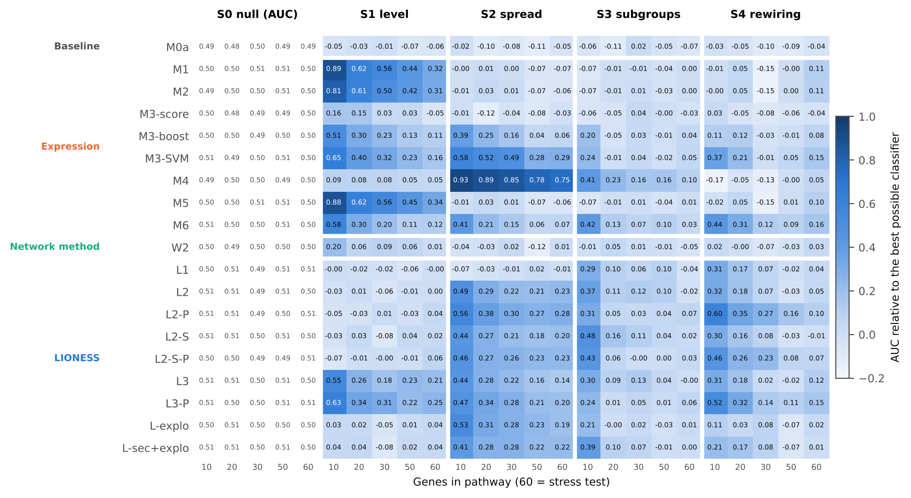
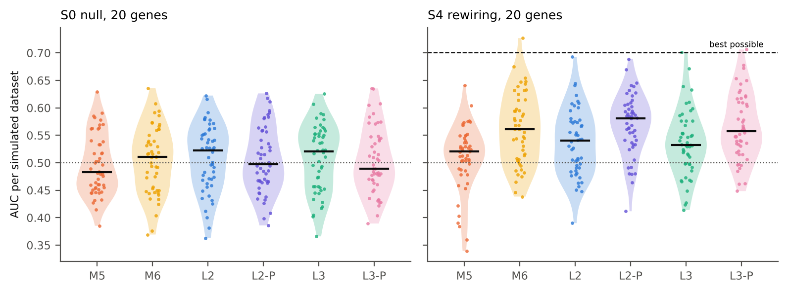
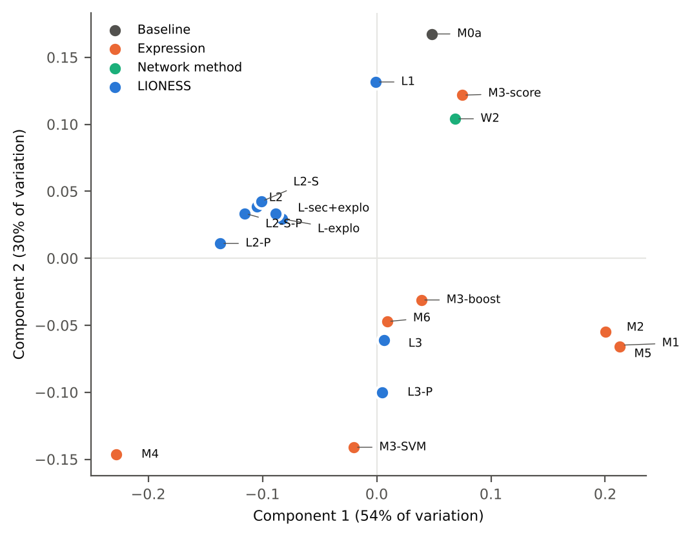
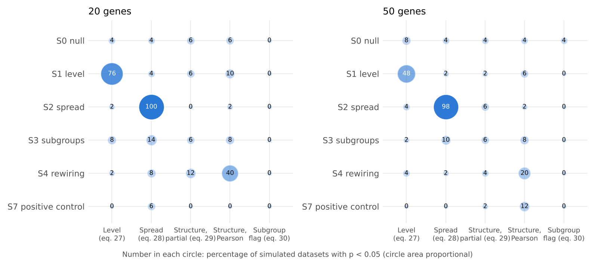
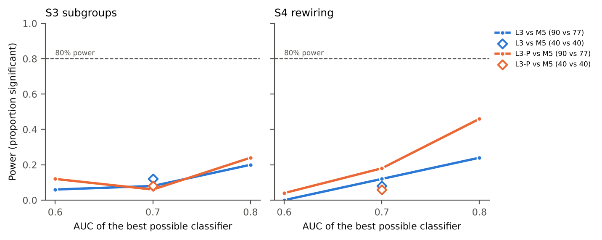
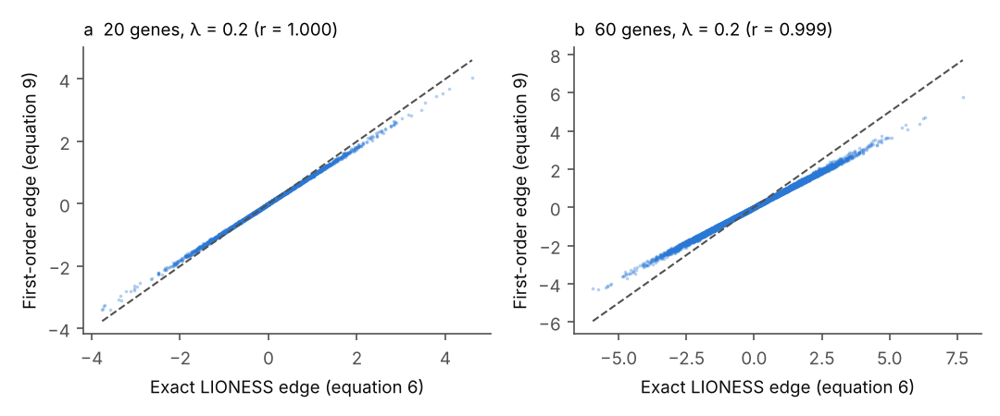

# Progress draft

**Status:** skeleton only. Sections are added one at a time.

## Title

[Not yet written]

## Key Points

[Not yet written]

## Abstract

[Not yet written]

<a id="sec-1"></a>

## 1. Introduction

<a id="sec-1-1"></a>

### 1.1 Interferon-low lupus

[Not yet written]

<a id="sec-1-2"></a>

### 1.2 Single-sample networks

[Not yet written]

<a id="sec-1-3"></a>

### 1.3 What is missing

[Not yet written]

<a id="sec-1-4"></a>

### 1.4 IFN-low lupus as a stress test

[Not yet written]

<a id="sec-1-5"></a>

### 1.5 Contributions

[Not yet written]

<a id="sec-2"></a>

## 2. Methods

<a id="sec-2-1"></a>

### 2.1 Data sources and cohort eligibility

All data were obtained from public whole-blood transcriptomic studies of systemic lupus erythematosus (SLE) deposited in the Gene Expression Omnibus (GEO) [[1]](https://pubmed.ncbi.nlm.nih.gov/23193258/). A study was eligible if it profiled peripheral whole blood, included either healthy controls (HC) or patients with another autoimmune disease, and provided enough sample annotation to infer sex and to separate patients from controls. The cohorts that met these criteria, and the role of each in the analysis, are summarized in [Supplementary Table S1](#table-s1).

[GSE319130](https://www.ncbi.nlm.nih.gov/geo/query/acc.cgi?acc=GSE319130) served as the primary cohort. It is an RNA-sequencing study of 720 SLE patients and 84 HC, of whom 679 patients and 77 controls are female [[2]](https://pubmed.ncbi.nlm.nih.gov/42039161/), and it is the only cohort expected to have enough female controls to meet the primary-cohort criteria described below. [GSE88884](https://www.ncbi.nlm.nih.gov/geo/query/acc.cgi?acc=GSE88884) was generated on the Affymetrix Human Transcriptome Array 2.0 and contains baseline blood samples from 1,760 SLE patients enrolled in the ILLUMINATE-1 and ILLUMINATE-2 phase III trials of tabalumab [[3]](https://pubmed.ncbi.nlm.nih.gov/27723281/). It contains 60 HC in total, so it could meet the requirement of 60 female controls for a primary cohort only if every control were female and none were removed by the IFN filter ([Section 2.3](#sec-2-3)); GSE88884 was therefore treated as a replication cohort.

Four smaller cohorts were included because each answers a question the primary cohort cannot. [GSE110169](https://www.ncbi.nlm.nih.gov/geo/query/acc.cgi?acc=GSE110169) profiled 82 SLE patients, 84 patients with rheumatoid arthritis (RA) and 77 HC in a single study with recorded glucocorticoid use [[4]](https://pubmed.ncbi.nlm.nih.gov/29534336/), which allows IFN-low SLE to be compared with another autoimmune disease rather than only with health. [GSE65391](https://www.ncbi.nlm.nih.gov/geo/query/acc.cgi?acc=GSE65391) followed 158 children with SLE over repeated visits with disease-activity scores, alongside 46 HC [[5]](https://pubmed.ncbi.nlm.nih.gov/27040498/), and makes it possible to observe whether patients move between IFN-low and IFN-high states over time. [GSE99967](https://www.ncbi.nlm.nih.gov/geo/query/acc.cgi?acc=GSE99967) includes adult SLE patients with and without active lupus nephritis (LN) as well as HC [[6]](https://pubmed.ncbi.nlm.nih.gov/29742110/), and [GSE224705](https://www.ncbi.nlm.nih.gov/geo/query/acc.cgi?acc=GSE224705) records the prednisone dose of each patient [[7]](https://pubmed.ncbi.nlm.nih.gov/38260685/). Because these last two cohorts contain fewer than 25 HC, neither was used for comparisons with controls: GSE99967 contributed only a descriptive comparison of patients with and without LN, and GSE224705 contributed only analyses of treatment within patients. The PRECISESADS cohort, which covers seven systemic autoimmune diseases and controls under controlled access [[8]](https://pubmed.ncbi.nlm.nih.gov/?term=Barturen+Integrative+analysis+molecular+stratification+systemic+autoimmune+diseases), was to be included only if access was granted before the analysis was registered.

Public SLE series frequently reuse the same patients, and the same individual appearing in both training and test data would inflate performance. Overlap between series was checked by comparing GEO sample identifiers, sample titles and recorded patient characteristics such as age, sex and visit date. [GSE72326](https://www.ncbi.nlm.nih.gov/geo/query/acc.cgi?acc=GSE72326) duplicates [GSE49454](https://www.ncbi.nlm.nih.gov/geo/query/acc.cgi?acc=GSE49454) and was not used. [GSE45291](https://www.ncbi.nlm.nih.gov/geo/query/acc.cgi?acc=GSE45291), [GSE121239](https://www.ncbi.nlm.nih.gov/geo/query/acc.cgi?acc=GSE121239) and GSE224705 share patients and controls; of these three, only GSE224705 was used, because it records prednisone dose. Within each cohort, a single sample was kept per patient, taken from the first visit in longitudinal studies, and technical replicates were averaged.

Whether a cohort could support the primary analysis was decided by a feasibility (go/no-go) check carried out before registration and before any model was fitted to the outcome. For each cohort, IFN-low patients and controls were counted by inferred sex ([Section 2.4](#sec-2-4)), and batch, age, ancestry and medication were tabulated by group. A cohort qualified as a primary cohort if it contained at least 80 female IFN-low patients and 60 female controls, and if batch was not confounded with group, meaning that patients and controls had not been processed in separate batches. Cohorts with at least 25 patients per group qualified as replication cohorts and were reported descriptively. As a rough guide to precision, the 95% confidence interval for an area under the receiver operating characteristic curve (AUC) of 0.70 has a half-width of about ±0.085 at the primary-cohort minimum and about ±0.15 at the replication minimum, based on the standard error of Hanley and McNeil [[9]](https://pubmed.ncbi.nlm.nih.gov/7063747/). These figures assume a single independent test set; the inference used for the actual model comparisons accounts for cross-validation and is described in [Section 2.11](#sec-2-11). Fixing these rules in advance ensured that the choice of cohorts could not be influenced by the results.

<a id="sec-2-2"></a>

### 2.2 Pre-processing and harmonization

Each cohort was processed separately, and no batch correction was applied across cohorts. Affymetrix arrays were re-processed from the raw files with robust multi-array averaging (RMA) [[10]](https://pubmed.ncbi.nlm.nih.gov/12925520/) where raw files were available; otherwise, the normalized data supplied by the submitters were used. Illumina BeadChip data (GSE65391) were taken as the submitters' normalized values and log2-transformed where this had not already been done. For RNA-sequencing data, lowly expressed genes were removed with the `filterByExpr` function of edgeR [[11]](https://pubmed.ncbi.nlm.nih.gov/19910308/), [[12]](https://f1000research.com/articles/5-1438). Because this filter can use the group labels, it was applied within each training fold, and the resulting gene list was applied unchanged to the corresponding test fold, so that test samples could not influence which genes were kept. Counts were then normalized by the trimmed mean of M-values (TMM) method [[13]](https://pubmed.ncbi.nlm.nih.gov/20196867/) and converted to log counts per million (log-CPM).

Probes were mapped to gene symbols within each platform. Where several probes mapped to the same gene, the probe with the highest variance in the training fold was kept. Known technical batches within a cohort, such as the two ILLUMINATE trials in GSE88884, were not removed by correction; instead, cross-validation folds were stratified by batch, and batch was included as an adjustment covariate in the population-level tests ([Section 2.12](#sec-2-12)). For analyses that compared cohorts, pathways were restricted to the genes measured in all cohorts involved, and the gene coverage of each pathway is reported. Before network estimation, each gene was winsorized at ±4 standard deviations (SD), using means and SDs estimated in the training fold, to limit the influence of outlying values on the correlation estimates.

<a id="sec-2-3"></a>

### 2.3 IFN score and IFN-low definition

<a id="sec-2-3-1"></a>

#### 2.3.1 IFN score

Interferon (IFN) activity was measured with a score built from four interferon-stimulated genes: IFI27, IFI44, IFI44L and RSAD2. This panel is used in clinical trials of type I IFN blockade to divide patients into IFN-high and IFN-low groups [[14]](https://pubmed.ncbi.nlm.nih.gov/31660791/). To place every sample on the scale of healthy blood, the expression of each gene was first standardized against the healthy controls (HC) of the training fold:

```math
z_{gi} = \frac{x_{gi} - \hat{\mu}_g^{\mathrm{HC}}}{\hat{\sigma}_g^{\mathrm{HC}}} \qquad\qquad (1)
```

Here, $`x_{gi}`$ is the expression of gene $`g`$ in sample $`i`$, and $`\hat{\mu}_g^{\mathrm{HC}}`$ and $`\hat{\sigma}_g^{\mathrm{HC}}`$ are the mean and standard deviation (SD) of that gene among the training-fold controls. The IFN score of sample $`i`$, written $`I_i`$, is the mean of its four standardized values over the set $`\mathcal{G}_{\mathrm{IFN}}`$ of IFN-score genes:

```math
I_i = \frac{1}{4} \sum_{g \in \mathcal{G}_{\mathrm{IFN}}} z_{gi}, \qquad \mathcal{G}_{\mathrm{IFN}} = \lbrace \mathrm{IFI27},\;\mathrm{IFI44},\;\mathrm{IFI44L},\;\mathrm{RSAD2} \rbrace \qquad\qquad (2)
```

<a id="sec-2-3-2"></a>

#### 2.3.2 IFN-low cutoff

A sample was classified as IFN-low when its score lay no more than two SD above the control mean, that is, at or below the cutoff $`\theta`$:

```math
I_i \le \theta, \qquad \theta = \hat{\mu}_I^{\mathrm{HC}} + 2\,\hat{\sigma}_I^{\mathrm{HC}} \qquad\qquad (3)
```

Here, $`\hat{\mu}_I^{\mathrm{HC}}`$ and $`\hat{\sigma}_I^{\mathrm{HC}}`$ are the mean and SD of the score among the training-fold controls. The clinical-trial assay is a qualitative polymerase chain reaction (PCR) test with its own fixed threshold [[14]](https://pubmed.ncbi.nlm.nih.gov/31660791/), which cannot be transferred to microarray or sequencing data. The cutoff was therefore defined relative to the healthy controls of each cohort, a rule that can be applied in the same way on every platform.

Because the cutoff $`\theta`$ depends on the data, it was estimated within each training fold and then applied, without change, to the test samples of that fold. Controls were filtered by the same rule, so that patients and controls entered the analysis on an equal footing; if the score were normally distributed among controls, this would remove about 2.3% of them. The cutoff is estimated from a modest number of controls (about 60 per training fold in the primary cohort), so its value varies between folds; this variation, and the number of patients classified as IFN-low in each fold, are reported. A stricter cutoff, $`\theta = \hat{\mu}_I^{\mathrm{HC}} + \hat{\sigma}_I^{\mathrm{HC}}`$, was examined in a sensitivity analysis.

<a id="sec-2-3-3"></a>

#### 2.3.3 Residual IFN signal

No cutoff can make IFN-low patients identical to controls in IFN activity, since patients who fall just below it may still carry a mildly raised signature. The residual IFN score was therefore kept as a baseline model that every other model had to outperform ([Section 2.9](#sec-2-9)). The network analysis was carried out on the interferon pathway itself ([Section 2.5](#sec-2-5)), and the four genes that make up the IFN score were removed from the network features. Because the other interferon genes move closely with these four, removing them does not by itself prevent the networks from re-measuring IFN activity, so three further safeguards were used. First, the IFN score was added to the set of variables on which each partial correlation was conditioned ([Section 2.7](#sec-2-7)), so that partial-correlation edges describe co-expression beyond the shared IFN signal; for Pearson networks, a sensitivity analysis recomputed the edges after regressing each gene on the IFN score within the training fold. Second, the primary comparison used a reference model that already contains the residual IFN score (M5, [Section 2.9](#sec-2-9)), so a network gain had to go beyond residual IFN activity. Third, a sensitivity analysis removed all genes of the *Interferon alpha/beta signaling* pathway (R-HSA-909733) [[15]](https://doi.org/10.1093/nar/gkab1028), leaving only the remaining interferon genes.

Selecting patients by their IFN score can itself change gene correlations. Restricting the range of a shared driver weakens the correlations among the genes it drives, so IFN-low patients could show weaker links between interferon genes than controls because of the selection rather than the disease. Applying the same cutoff to controls reduces this effect, and conditioning on the IFN score removes most of the shared driver from partial-correlation edges. In addition, a sensitivity analysis compared IFN-low patients with controls matched on IFN score, each patient being paired within the training fold with the control whose score was closest, so that both groups covered the same part of the IFN range. The expected size of this selection effect was also estimated by simulation ([Section 2.13](#sec-2-13)). Because LIONESS edges built from a balanced reference do not respond to differences in average expression ([Section 2.6](#sec-2-6)), a network difference that survives these safeguards indicates a change in how the interferon pathway genes are coordinated rather than in their overall level.

<a id="sec-2-3-4"></a>

#### 2.3.4 Treatment and IFN status

Hydroxychloroquine and immunosuppressants can lower the IFN signature, so some patients classified as IFN-low may be IFN-high patients whose signature has been suppressed by treatment. In the cohorts with medication records ([GSE224705](https://www.ncbi.nlm.nih.gov/geo/query/acc.cgi?acc=GSE224705), [GSE65391](https://www.ncbi.nlm.nih.gov/geo/query/acc.cgi?acc=GSE65391) and [GSE110169](https://www.ncbi.nlm.nih.gov/geo/query/acc.cgi?acc=GSE110169)), the proportion of IFN-low patients was compared between patients with and without each recorded treatment. In GSE65391, which follows patients over time, the movement of individual patients between IFN states across visits was also described. Because treated IFN-high patients could appear IFN-low while keeping the gene links of the IFN-high state, a sensitivity analysis repeated the primary comparison after excluding patients with recorded hydroxychloroquine or immunosuppressant use, in the cohorts that recorded it.

<a id="sec-2-4"></a>

### 2.4 Confounding control

Differences between IFN-low patients and controls could arise from factors other than disease. Five such factors were addressed: sex, batch, treatment, cell composition, and age and ancestry. Each was handled either by the study design or by an explicit baseline model and adjustment covariate.

The first factor, sex, was inferred from the expression of Y-chromosome genes (RPS4Y1, DDX3Y, KDM5D, UTY and EIF1AY) rather than from XIST, because XIST expression is unreliable for this purpose in SLE: in GSE319130, 54% of male patients (22 of 41) showed elevated XIST expression [[2]](https://pubmed.ncbi.nlm.nih.gov/42039161/). Inferred sex was compared with reported sex where it was available. The primary analysis was restricted to females. X-chromosome genes were retained, because removing them would delete immune genes located on the X chromosome, such as TLR7, CXCR3, CD40LG and FOXP3. A sensitivity analysis included both sexes after removing the Y-chromosome genes and XIST/TSIX.

Batch effects were controlled mainly by design. Cohorts in which patients and controls had been processed in separate batches were not eligible as primary cohorts ([Section 2.1](#sec-2-1)). Within eligible cohorts, cross-validation folds were stratified by batch, batch was included as an adjustment covariate in the population-level tests ([Section 2.2](#sec-2-2)), and the distribution of batches by group is reported.

Treatment was the third factor. Glucocorticoids change blood gene expression and could therefore create differences between patients and controls that are unrelated to disease. A glucocorticoid-response score was computed for each sample with singscore [[16]](https://doi.org/10.1186/s12859-018-2435-4) from the 64 genes that Hu et al. found to be up-regulated by glucocorticoids [[4]](https://pubmed.ncbi.nlm.nih.gov/29534336/). The score served three purposes: as a baseline model (M0b, [Section 2.9](#sec-2-9)), to define a sensitivity analysis in which its genes were removed from the network features, and as an adjustment covariate in the population-level tests. In cohorts that recorded steroid use or dose, we checked that the score was associated with the recorded treatment. Where medication was not recorded for each patient, treatment exposure could be estimated only through this score.

Cell composition required particular care, because gene co-expression in whole blood is strongly influenced by differences in the proportions of blood cell types between samples. For each sample, singscore [[16]](https://doi.org/10.1186/s12859-018-2435-4) was used to score marker gene sets for neutrophils, monocytes, B cells, plasmablasts, T cells, natural killer cells and eosinophils, with the marker sets fixed before analysis. Because each score uses only the sample being scored, it cannot carry information between training and test data. The cell-type scores served as a baseline model, as additional conditioning variables in the partial correlations ([Section 2.7](#sec-2-7)) and as adjustment covariates in the population-level tests.

Finally, age and recorded race or ancestry were tabulated by group and used both as a baseline model and as adjustment covariates. A sensitivity analysis restricted the data to the age range shared by patients and controls. The paediatric cohort ([GSE65391](https://www.ncbi.nlm.nih.gov/geo/query/acc.cgi?acc=GSE65391)) was analysed separately from the adult cohorts.

<a id="sec-2-5"></a>

### 2.5 Pathways

The primary network analysis used one pathway, REACTOME INTERFERON SIGNALING, taken from the Molecular Signatures Database (MSigDB) [[17]](https://pubmed.ncbi.nlm.nih.gov/21546393/) and accessed in R through the msigdbr package [[18]](https://cran.r-project.org/web/packages/msigdbr/index.html), with the database version recorded. It corresponds to the Reactome *Interferon Signaling* pathway (R-HSA-913531) [[15]](https://doi.org/10.1093/nar/gkab1028), which covers both type I (alpha/beta) and type II (gamma) IFN signalling. The same pathway was used in every contrast ([Section 2.10](#sec-2-10)). In the comparison of IFN-low patients with controls, the question is whether the coordination of the interferon pathway differs even when its overall activity is low. In the comparison of IFN-high patients with healthy controls, the interferon genes are both more highly expressed and more strongly co-expressed, so this contrast served as a positive control for the pipeline; because network edges respond mainly to co-expression rather than to expression level ([Section 2.6](#sec-2-6)), it was reported together with the expression-based models and the level test of [Section 2.12](#sec-2-12).

Partial correlations become unstable as the number of genes approaches the number of samples, so each network was limited to between 15 and 50 genes after filtering. This keeps the number of genes well below the smallest training set expected in a primary cohort, about 110 samples per fold (80% of 80 IFN-low patients and 60 controls). The four IFN-score genes were removed first ([Section 2.3](#sec-2-3)). Because the interferon pathway contains more than 50 genes, it was then divided into its Reactome sub-pathways, which include *Interferon alpha/beta signaling* (R-HSA-909733) and *Interferon gamma signaling* (R-HSA-877300). Sub-pathways that still exceeded 50 genes were restricted to the 50 genes with the highest variance in the training fold, sub-pathways with fewer than 15 genes were removed, and near-duplicate sub-pathways, defined as pairs with a Jaccard index of gene overlap above 0.8, were reduced to a single representative. In what follows, "pathway" refers to each of the resulting sub-pathways. The genes retained in each sub-pathway are listed, and genes shared between sub-pathways, such as signalling genes common to type I and type II IFN, are reported; a sensitivity analysis removed the shared genes so that each gene contributed to one sub-pathway only.

Restricting the analysis to the interferon pathway cannot detect disease processes outside it, such as the B-cell, neutrophil or eosinophil signatures reported in other studies. A secondary analysis therefore applied the same pipeline to pathways from the Reactome *Immune System* subtree (R-HSA-168256), excluding the *Interferon Signaling* subtree, with the same size and overlap rules. All gene lists were archived with the analysis code.

<a id="sec-2-6"></a>

### 2.6 Theory: what single-sample networks contain

This section derives a simple formula for what a LIONESS edge measures. The formula explains how the network features should be interpreted and which baseline models they must be compared with.

**Set-up.** Consider a pathway with $`G`$ genes and a reference set of $`N`$ samples. Let $`\mathbf{x}_q`$ be the expression vector of sample $`q`$, $`\boldsymbol{\mu}`$ the reference mean and $`\mathbf{d} = \mathbf{x}_q - \boldsymbol{\mu}`$ the deviation of sample $`q`$ from that mean. Let $`\mathbf{S}`$ be the reference covariance matrix (with divisor $`N`$). Because $`G`$ can be large relative to $`N`$, the covariance matrix was stabilized by shrinkage with a fixed intensity $`\lambda \in [0, 1]`$ [[19]](https://pubmed.ncbi.nlm.nih.gov/16646851/):

```math
\boldsymbol{\Sigma}_\lambda = (1-\lambda)\,\mathbf{S} + \lambda\,\mathrm{diag}(\mathbf{S}) \qquad\qquad (4)
```

where $`\mathrm{diag}(\mathbf{S})`$ keeps the variances of the genes and sets their covariances to zero. Let $`\boldsymbol{\Omega} = \boldsymbol{\Sigma}_\lambda^{-1}`$ be the precision matrix. The partial correlation between genes $`i`$ and $`j`$, that is, their association after removing the effect of the other genes in the pathway, is

```math
\rho_{ij} = -\frac{\Omega_{ij}}{\sqrt{\Omega_{ii}\,\Omega_{jj}}} \qquad\qquad (5)
```

The LIONESS edge for sample $`q`$ is [[20]](https://pubmed.ncbi.nlm.nih.gov/30981959/)

```math
e_{ij}^{(q)} = N\,\rho_{ij} - (N-1)\,\rho_{ij}^{(-q)} \qquad\qquad (6)
```

where $`\rho_{ij}^{(-q)}`$ is computed without sample $`q`$. The edge therefore measures how much sample $`q`$ changes the association between the two genes. Equation (6) has the same form as the jackknife pseudo-value of classical statistics [[21]](https://scholar.google.com/scholar?q=Tukey+1958+Bias+and+confidence+in+not-quite+large+samples), which has already been used for differential network analysis [[22]](https://pubmed.ncbi.nlm.nih.gov/36624383/).

**Conditional residuals.** Let $`\mathbf{u} = \boldsymbol{\Omega}\mathbf{d}`$, with entries $`u_i`$, and

```math
\tilde{u}_i = \frac{u_i}{\sqrt{\Omega_{ii}}} \qquad\qquad (7)
```

Up to scaling, $`\tilde{u}_i`$ is the residual of gene $`i`$ in sample $`q`$ after regression on the other genes of the pathway, divided by its standard deviation; it measures how unexpected the value of gene $`i`$ is, given the other genes. Across the reference population, each $`\tilde{u}_i`$ has variance 1, and two residuals have covariance $`-\rho_{ij}`$: when two genes are positively partially correlated, their residuals are negatively correlated.

**Result 1 (no shrinkage, $`\lambda = 0`$).** To first order in $`1/(N-1)`$,

```math
e_{ij}^{(q)} \approx \tilde{u}_i\,\tilde{u}_j + \rho_{ij}\left(1 + \frac{\tilde{u}_i^2 + \tilde{u}_j^2}{2}\right) \qquad\qquad (8)
```

An edge is therefore built from two ingredients: the product of the two genes' residuals, which is positive when both genes deviate in the same direction, and the squares of the residuals, which grow when the sample is unusual for either gene. Averaged over the reference population, the edge equals $`\rho_{ij}`$, as LIONESS requires.

**Result 2 (with shrinkage).** When $`\lambda`$ is fixed, $`\boldsymbol{\Sigma}_\lambda`$ is a linear function of $`\mathbf{S}`$, and the same expansion gives

```math
e_{ij}^{(q)} \approx \rho_{ij} + \tilde{M}_{ij} + \rho_{ij}\,\frac{\tilde{M}_{ii} + \tilde{M}_{jj}}{2}, \qquad \mathbf{M} = (1-\lambda)\,\mathbf{u}\mathbf{u}^{\top} + \lambda\,\boldsymbol{\Omega}\mathbf{D}_d\boldsymbol{\Omega} \qquad\qquad (9)
```

where $`d_g`$ is the deviation of gene $`g`$ (the $`g`$-th entry of $`\mathbf{d}`$), $`\mathbf{D}_d = \mathrm{diag}(d_1^2, \ldots, d_G^2)`$ is the diagonal matrix of squared deviations, $`M_{ij}`$ is the entry in row $`i`$ and column $`j`$ of $`\mathbf{M}`$, and $`\tilde{M}_{ij} = M_{ij} / \sqrt{\Omega_{ii}\,\Omega_{jj}}`$. The matrix $`\mathbf{M}`$ mixes the products of residuals, $`\mathbf{u}\mathbf{u}^{\top}`$, with a term built from the squared deviations of the individual genes, in proportions set by $`\lambda`$. Equation (9) reduces to equation (8) when $`\lambda = 0`$, and with shrinkage the edge is still made only of products and squares of the sample's deviations.

**Pearson analogue.** For the Pearson correlation $`r_{ij}`$ between genes $`i`$ and $`j`$ in the reference set ([Section 2.7](#sec-2-7)), and with $`z_i = d_i/\sigma_i`$ the deviation of gene $`i`$ in sample $`q`$ divided by its reference standard deviation $`\sigma_i`$, the same expansion gives

```math
e_{ij}^{(q)} \approx z_i\,z_j + r_{ij}\left(1 - \frac{z_i^2 + z_j^2}{2}\right) \qquad\qquad (10)
```

**Result 3 (SSN is an exact rescaling of LIONESS).** The sample-specific network (SSN) method defines an edge as the change in an association measure $`c`$ when sample $`q`$ is added to a reference set $`R`$ of $`n`$ samples, $`\Delta_{ij}^{(q)} = c_{ij}(R \cup \{q\}) - c_{ij}(R)`$ [[23]](https://pubmed.ncbi.nlm.nih.gov/27596597/). LIONESS with the same reference gives $`e_{ij}^{(q)} = (n+1)\,c_{ij}(R \cup \{q\}) - n\,c_{ij}(R)`$, so

```math
\Delta_{ij}^{(q)} = \frac{e_{ij}^{(q)} - c_{ij}(R)}{n+1} \qquad\qquad (11)
```

exactly, for any association measure. Equations (8)–(10) therefore also describe SSN and its partial-correlation version, P-SSN [[24]](https://pubmed.ncbi.nlm.nih.gov/32422654/). Numerical checks on simulated data confirmed that equations (8)–(10) agree closely with exact LIONESS and that equation (11) holds exactly; the check code is provided with the analysis code.

**Predictions.** Equations (8)–(11) lead to six predictions.

*P1 (no new information).* Each edge is a fixed function of $`\mathbf{d}`$, so a network contains no information beyond the sample's own expression values within the pathway; it can only represent that information differently. Network models must therefore be compared with models built directly on pathway expression ([Section 2.9](#sec-2-9)). *P2 (quadratic classifier).* A linear model on a pathway's edges is a quadratic function of $`\mathbf{d}`$, so its natural competitor is a quadratic classifier on the pathway's expression values, such as regularized quadratic discriminant analysis. *P3 (mean and spread).* Because each edge is built from products and squares, changing the sign of a deviation does not change the edge. As a result, a group that differs from the other only in how widely its values are spread produces the same average edges, and, when the reference contains equal numbers of the two groups, so does a group that differs only in its mean expression. Edges are therefore expected to separate groups mainly when the genes co-vary differently. The pilot simulation confirmed this prediction. *P4 (opposite signs).* The squared terms carry a positive sign for partial correlation (equation 8) and a negative sign for Pearson correlation (equation 10), so unusual samples strengthen partial-correlation edges but weaken Pearson edges. Partial-correlation and Pearson LIONESS (models L2 and L2-P) can therefore behave differently on the same data. *P5 (node strength).* Node strength, the sum of a gene's edges, is approximately $`\tilde{u}_i \sum_{j \ne i} \tilde{u}_j`$ plus squared terms, and is therefore closely related to how far a sample lies from the healthy centre, the distance-from-health baseline (M4). *P6 (equivalence).* By equation (11), SSN, P-SSN and LIONESS differ edge by edge only by a fixed rescaling, so any difference in their performance must come from the network summaries or the choice of reference.

 All network features were computed with exact LIONESS ([Section 2.7](#sec-2-7)), and the agreement between exact and first-order edges on the real data, including in the tails of the distribution.

<a id="sec-2-7"></a>

### 2.7 LIONESS estimation with Pearson and partial correlation

Single-sample networks were estimated with two association measures: Pearson correlation and partial correlation. Pearson correlation measures the overall association between two genes, including associations that arise because both genes are linked to other genes in the pathway. For genes $`i`$ and $`j`$ it is computed from the reference covariance matrix $`\mathbf{S}`$, whose entry in row $`i`$ and column $`j`$ is $`S_{ij}`$, as

```math
r_{ij} = \frac{S_{ij}}{\sqrt{S_{ii}\,S_{jj}}} \qquad\qquad (12)
```

Partial correlation, $`\rho_{ij}`$ in equation (5), measures the association between the two genes after removing the effect of all other genes in the pathway, so it is closer to a direct link. Using both measures with the same pipeline shows whether the choice of measure matters (models L2 and L2-P, [Section 2.9](#sec-2-9)); equations (8) and (10) predict that the two can behave differently, because unusual samples strengthen partial-correlation edges but weaken Pearson edges.

Every sample, whether patient or control and whether in a training or a test fold, was given a network by exactly the same rule, and the same rule was used for both measures. [Section 2.6](#sec-2-6) showed that the composition of the reference determines what the edges respond to: when the reference contains more samples of one group, differences in mean expression also enter the edges, whereas with equal numbers of the two groups the edges mainly reflect how the genes co-vary. Class-balanced references were therefore used. Within each training fold, $`B = 20`$ reference subsets $`R_1, \ldots, R_B`$ were formed, each containing all training samples of the smaller class and an equal-sized random sample of the larger class.

For a sample $`q`$ and a reference subset $`R_b`$, let $`R = R_b \setminus \{q\}`$ be that subset with sample $`q`$ removed if it was a member. Writing $`c_{ij}`$ for either association measure, $`r_{ij}`$ or $`\rho_{ij}`$, the edge between genes $`i`$ and $`j`$ was

```math
e_{ij}^{(q,b)} = \big(|R| + 1\big)\,c_{ij}\big(R \cup \{q\}\big) - |R|\,c_{ij}(R) \qquad\qquad (13)
```

where $`|R|`$ is the number of samples in $`R`$ and $`c_{ij}(\cdot)`$ is the association estimated from the samples shown. When sample $`q`$ belongs to $`R_b`$, equation (13) is the leave-one-out form of LIONESS in equation (6); when it does not, as for every test sample, it is the add-one-in form. The final edge was the average over the $`B`$ subsets,

```math
e_{ij}^{(q)} = \frac{1}{B} \sum_{b=1}^{B} e_{ij}^{(q,b)} \qquad\qquad (14)
```

which reduces the variation that comes from the random choice of each reference subset.

The two measures differed only in how the association was estimated. Pearson correlations were computed directly from the covariance matrix by equation (12). Shrinkage was not applied to them, because shrinking the covariances towards zero while keeping the variances fixed, as in equation (4), would multiply every Pearson correlation by the same factor $`1-\lambda`$ and would not change the network structure. Partial correlations were computed by equation (5) from the shrinkage covariance of equation (4), because inverting the covariance matrix is unstable without it. The shrinkage intensity $`\lambda`$ was chosen in the inner cross-validation from 0.5, 1 and 2 times the analytic estimate of Schäfer and Strimmer [[19]](https://pubmed.ncbi.nlm.nih.gov/16646851/), and was then held fixed within the fold. Because each pathway contains at most 50 genes, the covariance matrix could be inverted directly. In the primary analysis, the cell-composition scores of [Section 2.4](#sec-2-4) and the IFN score of [Section 2.3](#sec-2-3) were added to the set of variables on which each partial correlation was conditioned, so that partial-correlation edges describe co-expression beyond what is explained by differences in blood cell proportions and by the shared IFN signal; a sensitivity analysis conditioned on the pathway genes only. Pearson edges, being unconditional, were not adjusted in this way, and this difference is part of what the comparison between the two measures examines.

The implementation was checked against direct recomputation of equation (13) for both measures, against the `pcor.shrink` function of the R package corpcor at a fixed $`\lambda`$ for partial correlation [[19]](https://pubmed.ncbi.nlm.nih.gov/16646851/), and against the lionessR package [[25]](https://pubmed.ncbi.nlm.nih.gov/31653243/), which implements the original LIONESS method [[20]](https://pubmed.ncbi.nlm.nih.gov/30981959/), for Pearson correlation.

<a id="sec-2-8"></a>

### 2.8 Topology features

The same network features were computed from the Pearson and the partial-correlation LIONESS networks. LIONESS edges are signed, can lie outside the range $`[-1, 1]`$, and are present between every pair of genes, so each sample has a complete, weighted network for each pathway. For sample $`q`$ and a given pathway, let $`\mathbf{W}^{(q)}`$ be the $`G \times G`$ matrix of rescaled edges, with zeros on the diagonal and off-diagonal entries

```math
w_{ij}^{(q)} = \frac{e_{ij}^{(q)}}{\kappa} \qquad\qquad (15)
```

where $`\kappa`$ is the 99th percentile of $`|e_{ij}|`$ over all training samples and gene pairs of that pathway and association measure. Because the same factor $`\kappa`$ is used for every sample, the rescaling puts the edges on a common scale without removing genuine differences in edge size between samples. In what follows, the superscript $`(q)`$ is dropped, $`m = G(G-1)/2`$ is the number of gene pairs, and $`\mathbf{P}`$, with entries $`p_{ij}`$, is the reference network, the matrix of reference associations ($`r_{ij}`$ or $`\rho_{ij}`$) rescaled by the same $`\kappa`$ and with zeros on the diagonal. The features were organized in three tiers, fixed before the analysis: primary features, used in the main models; secondary features, used to examine hidden subgroups; and exploratory features, reported descriptively only.

The four primary features each answer a different question about the sample's network. The first, the differential-network score, measures how closely the sample's network follows the pattern that separates patients from controls:

```math
\mathrm{DN} = \sum_{i < j} \big(c_{ij}^{\mathrm{pat}} - c_{ij}^{\mathrm{con}}\big)\, e_{ij} \qquad\qquad (16)
```

where $`c_{ij}^{\mathrm{pat}}`$ and $`c_{ij}^{\mathrm{con}}`$ are the associations between genes $`i`$ and $`j`$ estimated separately in the training patients and the training controls. Because it uses the group labels, the score was computed inside the training folds only, and the resulting weights were applied unchanged to the test samples. The second is the mean absolute edge weight, which summarizes how strongly the genes of the pathway are connected overall:

```math
\bar{w} = \frac{1}{m} \sum_{i < j} |w_{ij}| \qquad\qquad (17)
```

The third is the largest eigenvalue of the network,

```math
\eta_{1} = \max_{\|\mathbf{v}\| = 1} \mathbf{v}^{\top} \mathbf{W} \mathbf{v} \qquad\qquad (18)
```

where $`\mathbf{v}`$ is a vector of length $`G`$ with unit length, $`\|\mathbf{v}\| = 1`$, so that $`\eta_1`$ is the largest eigenvalue of $`\mathbf{W}`$; it is large when many genes are connected in a single coordinated block. The fourth is the distance between the sample's network and the reference network,

```math
D = \big\|\mathbf{W} - \mathbf{P}\big\|_F = \sqrt{\sum_{i \ne j} \big(w_{ij} - p_{ij}\big)^2} \qquad\qquad (19)
```

where $`\|\cdot\|_F`$ is the Frobenius norm, the square root of the sum of squared entries. By equation (8), an edge departs from its reference value through the products and squares of the sample's residuals, so $`D`$ reflects how far the sample lies from the reference centre and was interpreted as a measure of distance rather than of rewiring.

The secondary features add the positive and negative strength of each gene, which sum its positive and negative edges separately so that they do not cancel:

```math
s_i^{+} = \sum_{j \ne i} \max\big(w_{ij}, 0\big), \qquad s_i^{-} = \sum_{j \ne i} \max\big(-w_{ij}, 0\big) \qquad\qquad (20)
```

Together with the four primary features, they form a secondary feature set used to examine whether IFN-low patients contain hidden subgroups, because groups of genes that shift together in a subset of patients change the strength of those genes.

The exploratory features are the classical graph measures used in earlier single-sample network studies. Most of them are defined only for networks in which weak edges have been removed, so a threshold was applied:

```math
a_{ij} = \mathbb{1}\big(|w_{ij}| > \tau\big) \qquad\qquad (21)
```

where $`\mathbb{1}(\cdot)`$ equals 1 when the condition holds and 0 otherwise, and $`\tau`$ is the 90th percentile of $`|w_{ij}|`$ over the training samples, the same for every sample. From the thresholded network, we computed the number of edges, $`\sum_{i<j} a_{ij}`$; the degree of each gene, $`k_i = \sum_{j \ne i} a_{ij}`$; the diameter, the longest shortest path between two genes; the transitivity, the proportion of connected triples of genes that form triangles; and the betweenness centrality of each gene, the proportion of shortest paths between other genes that pass through it. For path-based measures, the length of an edge was set to $`1/|w_{ij}|`$, so that strong edges count as short. Because these measures depend on the threshold, they were also computed at the 80th and 95th percentiles as a sensitivity analysis. The signed clustering coefficient [[26]](https://doi.org/10.2202/1544-6115.1128), [[27]](https://doi.org/10.1371/journal.pone.0088669), the proportion of positive edges, the entropy of the edge weights and the correlation between the sample's edges and the reference edges were also reported as exploratory features.

<a id="sec-2-9"></a>

### 2.9 Baseline and comparator models

Eighteen models were compared; they are listed in [Supplementary Table S2](#table-s2). Each model was chosen to answer one question about where any separation between IFN-low patients and controls comes from, and the models are labelled by group: M0 for baselines, M for expression-based comparators, W for established network methods and L for LIONESS models. All models were fitted within the training folds only, used the same cross-validation splits and were scored in the same way, so that differences in performance reflect the features rather than the set-up.

<a id="sec-2-9-1"></a>

#### 2.9.1 Baselines

Four baselines tested the simplest explanations for a difference between the groups. M0a used the residual IFN score of [Section 2.3](#sec-2-3) as its only feature, to test whether IFN activity below the cutoff is enough to separate the groups. M0b used the glucocorticoid-response score built from the genes of Hu et al. [[4]](https://pubmed.ncbi.nlm.nih.gov/29534336/) ([Section 2.4](#sec-2-4)), to test whether the separation merely reflects steroid treatment. M0c used the cell-composition scores of [Section 2.4](#sec-2-4), to test whether it reflects differences in the proportions of blood cell types. M0d used age and recorded ancestry, to test whether the groups differ only in these characteristics.

<a id="sec-2-9-2"></a>

#### 2.9.2 Expression-based comparators

Six comparators used gene expression without any network. M1 applied an elastic net [[28]](https://doi.org/10.1111/j.1467-9868.2005.00503.x) or a random forest [[29]](https://doi.org/10.1023/A:1010933404324) to all genes, the standard approach of entering every gene into one model. M2 fitted one model per pathway on gene expression and combined the pathway models in the same way as the network models ([Section 2.10](#sec-2-10)), to test whether any gain comes from the pathways themselves rather than from the networks. M3 summarized each pathway by a single activity score (singscore [[16]](https://doi.org/10.1186/s12859-018-2435-4), mean z-score or first principal component) and also applied gradient boosting [[30]](https://doi.org/10.1145/2939672.2939785) and a kernel support vector machine [[31]](https://doi.org/10.1007/BF00994018) to pathway expression; these methods capture general interactions between genes without using network structure. M4 measured, for each pathway, the Mahalanobis distance of a sample from the mean of the training controls, to test whether patients simply lie further from the healthy centre. M5 combined pathway expression with the residual IFN score (M2 plus M0a) and served as the reference model for the primary comparison. M6 applied regularized quadratic discriminant analysis [[32]](https://doi.org/10.2307/2289860) to the expression of each pathway. Because a linear model on network edges is a quadratic function of the sample's deviations ([Section 2.6](#sec-2-6)), M6 is the most direct competitor to the network models.

<a id="sec-2-9-3"></a>

#### 2.9.3 Established network comparators

Two comparators represented network methods already used in lupus research. W1 reproduced a typical published weighted gene co-expression network analysis (WGCNA) [[33]](https://pubmed.ncbi.nlm.nih.gov/19114008/) with hub-gene selection, with every step fitted within the training folds to avoid data leakage. W2 used WGCNA module eigengenes, the summary scores of gene modules, estimated from training data only, and was the main established-network comparator.

<a id="sec-2-9-4"></a>

#### 2.9.4 LIONESS models

Six LIONESS models used the network features of [Section 2.8](#sec-2-8), computed from the partial-correlation and the Pearson networks ([Section 2.7](#sec-2-7)). L1 used the network edges themselves. L2 used the four primary network features of each pathway from the partial-correlation networks, and L2-P used the same features from the Pearson networks; comparing the two shows whether the choice of association measure matters. L2-S used the secondary feature set, which adds the positive and negative strength of each gene, to examine hidden subgroups. L3 added the primary partial-correlation features to the reference model M5, and L3-P did the same with the Pearson features.

<a id="sec-2-9-5"></a>

#### 2.9.5 Primary comparison

The primary hypothesis was tested by comparing L3 with M5, and L3-P with M5. Because each pair of models differs only in the network features, a gain over M5 is evidence that networks carry information beyond both pathway expression and residual IFN activity. Two secondary comparisons placed the network models against their strongest competitors: L2 and L2-P were compared with M6, the quadratic classifier, and with M4, the distance from health. All other comparisons were descriptive.

<a id="sec-2-10"></a>

### 2.10 Aggregation across pathways and contrasts

Each sample has features from many pathways, and these had to be combined into a single prediction. The primary method was group lasso logistic regression [[34]](https://doi.org/10.1111/j.1467-9868.2005.00532.x), which treats the features of each pathway as a group and keeps or drops a pathway as a whole. For a model with intercept $`\beta_0`$, coefficient vector $`\boldsymbol{\beta}_k`$ for the $`p_k`$ features of pathway $`k`$, $`\boldsymbol{\beta}`$ the collection of all $`\boldsymbol{\beta}_k`$, and $`\ell`$ the log-likelihood of the logistic model on the training data, the coefficients were estimated by

```math
\hat{\boldsymbol{\beta}} = \arg\min_{\beta_0,\,\boldsymbol{\beta}} \Big\{ -\ell(\beta_0, \boldsymbol{\beta}) + \gamma \sum_{k} \sqrt{p_k}\, \big\|\boldsymbol{\beta}_k\big\|_2 \Big\} \qquad\qquad (22)
```

where $`\|\cdot\|_2`$ is the Euclidean length of a vector and $`\gamma`$ controls how many pathways are kept; $`\gamma`$ was chosen in the inner cross-validation. The factor $`\sqrt{p_k}`$ prevents larger pathways from being favoured simply because they contribute more features. The same aggregation was used for every pathway-based model (M2, M5, M6, L2, L2-P, L2-S, L3 and L3-P), so that differences between models reflect the features rather than the way they were combined. A two-level stacking approach, in which an elastic net was fitted to each pathway and the pathway predictions were combined by a non-negative elastic net, was used as a sensitivity analysis.

To identify which pathways drive a result, the group lasso was refitted on $`B_s = 100`$ random half-samples of the training data, and, with $`\hat{\boldsymbol{\beta}}_k^{(b)}`$ the estimated coefficients of pathway $`k`$ in refit $`b`$, the selection proportion of pathway $`k`$ was recorded as

```math
\hat{\Pi}_k = \frac{1}{B_s} \sum_{b=1}^{B_s} \mathbb{1}\big(\hat{\boldsymbol{\beta}}_k^{(b)} \ne \mathbf{0}\big) \qquad\qquad (23)
```

the proportion of refits in which the pathway was kept. This procedure, known as stability selection [[35]](https://doi.org/10.1111/j.1467-9868.2010.00740.x), favours pathways that are selected consistently rather than by chance. A pathway was described as implicated only if three conditions held: its selection proportion exceeded 0.6, within the range suggested by Meinshausen and Bühlmann [[35]](https://doi.org/10.1111/j.1467-9868.2010.00740.x); it differed between the groups in the population-level tests ([Section 2.12](#sec-2-12)); and both results remained after adjustment for cell composition and treatment.

The pipeline was applied to five comparisons between groups, called contrasts. C1 compared IFN-high patients with healthy controls and served as a positive control, because the interferon pathway is strongly activated in these patients and a clear network difference is expected ([Section 2.5](#sec-2-5)). C2 compared IFN-low patients with healthy controls and was the primary contrast. C3 compared IFN-low patients with patients with rheumatoid arthritis in [GSE110169](https://www.ncbi.nlm.nih.gov/geo/query/acc.cgi?acc=GSE110169). C4 compared IFN-low patients with high and low disease activity (SLEDAI-2K of at least 6 and at most 4, respectively) in cohorts that recorded disease activity. C5 compared IFN-low patients with and without lupus nephritis, using the renal involvement recorded in each cohort. For each contrast, the LIONESS reference subsets and the differential-network score were built from the two groups being compared only. Because the primary analysis contains only a few interferon sub-pathways, results were also reported for each sub-pathway separately; stability selection is most informative in the secondary analysis of Immune System pathways, which contains many more. Contrasts C3 to C5 were analysed in a cohort only if each group contained at least 25 patients after the go/no-go check ([Section 2.1](#sec-2-1)); contrasts that did not meet this rule are reported with their group sizes, without model fitting.

<a id="sec-2-11"></a>

### 2.11 Validation and statistical inference

Model performance was estimated within each eligible cohort by repeated, stratified, nested cross-validation, with one sample per patient: 10 repeats of 5 outer folds, each containing 5 inner folds. The outer folds estimated performance and the inner folds chose the tuning parameters, and repeating the whole procedure with different random splits reduced the dependence of the results on any single split. Folds were stratified by group and by batch ([Section 2.4](#sec-2-4)). Every step that learns from the data was carried out within the training folds only and then applied unchanged to the test fold: winsorizing and standardization, probe selection and gene filtering ([Section 2.2](#sec-2-2)), the IFN cutoff ([Section 2.3](#sec-2-3)), the shrinkage intensity $`\lambda`$ and the LIONESS reference subsets ([Section 2.7](#sec-2-7)), the rescaling factor $`\kappa`$, the differential-network weights and the threshold $`\tau`$ ([Section 2.8](#sec-2-8)), the WGCNA modules ([Section 2.9](#sec-2-9)), the group-lasso penalty $`\gamma`$ ([Section 2.10](#sec-2-10)) and the recalibration of predicted probabilities. Where two cohorts shared a platform and a contrast, models trained on one cohort were also applied unchanged to the other as an external validation.

The primary performance measure was the area under the receiver operating characteristic curve (AUC). Secondary measures were the Brier score, which measures the accuracy of predicted probabilities, and the calibration slope and intercept after Platt recalibration within the training folds [[36]](https://scholar.google.com/scholar?q=Platt+1999+Probabilistic+outputs+for+support+vector+machines). The area under the precision–recall curve was reported for each cohort together with the proportion of cases, because its value depends on the balance between the groups.

Three hypotheses were specified in advance for contrast C2 (IFN-low patients versus healthy controls) in the primary cohort, restricted to females ([Section 2.4](#sec-2-4)). The primary hypothesis, H1, was that the network models add information beyond pathway expression and the residual IFN score: L3 has a higher AUC than M5 (H1a), and L3-P has a higher AUC than M5 (H1b) ([Supplementary Table S2](#table-s2)). The secondary hypothesis, H2, was that the network models outperform their strongest competitors: L2 and L2-P each have a higher AUC than M6, the quadratic classifier, and than M4, the distance from health. The third hypothesis, H3, was that the ranking of the models across the simulation scenarios agrees with the predictions of [Section 2.6](#sec-2-6) ([Section 2.13](#sec-2-13)). The Holm correction for multiple testing was applied across the two comparisons of H1 and, separately, across the four comparisons of H2. All other comparisons and contrasts were treated as exploratory and reported as estimates with confidence intervals.

Each comparison between two models, A and B, was summarized by the paired difference in AUC,

```math
\Delta_{AB} = \mathrm{AUC}_A - \mathrm{AUC}_B \qquad\qquad (24)
```

computed from the out-of-fold predictions of both models on the same samples and averaged over the repeats. Predictions from different folds of the same cross-validation are not independent, so standard tests such as DeLong's test understate the uncertainty. The standard error of $`\Delta_{AB}`$ was therefore estimated with the nested cross-validation method of Bates et al. [[37]](https://doi.org/10.1080/01621459.2023.2197686), and the 95% confidence interval, with $`\widehat{\mathrm{SE}}`$ denoting this estimated standard error, was

```math
\Delta_{AB} \pm 1.96\, \widehat{\mathrm{SE}}\big(\Delta_{AB}\big) \qquad\qquad (25)
```

The corrected variance estimator of Nadeau and Bengio [[38]](https://doi.org/10.1023/A:1024068626366) was used as a sensitivity analysis. The false-positive rate of these tests was checked in the simulation scenario with no true difference ([Section 2.13](#sec-2-13)). Because differences between related models are expected to be small, results are reported mainly as estimates with confidence intervals, together with the smallest difference that each cohort could detect, which was computed by simulation before the analysis.

When more than one cohort was eligible for a contrast, the differences $`\Delta_c`$ estimated in each cohort $`c`$ were combined by fixed-effect inverse-variance pooling, in which each cohort is weighted by $`\pi_c`$, the inverse of its squared standard error, and $`\bar{\Delta}`$ is the pooled difference:

```math
\bar{\Delta} = \frac{\sum_c \pi_c\, \Delta_c}{\sum_c \pi_c}, \qquad \pi_c = \frac{1}{\widehat{\mathrm{SE}}(\Delta_c)^2}, \qquad \widehat{\mathrm{SE}}(\bar{\Delta}) = \Big(\sum_c \pi_c\Big)^{-1/2} \qquad\qquad (26)
```

A fixed-effect model was used because the variation between cohorts cannot be estimated reliably from two or three cohorts, and whether the cohorts agreed in the direction of the effect is reported. Finally, as a check for data leakage, the group labels were randomly permuted and the full pipeline was re-run 200 times; without leakage, the AUC from permuted labels should be close to 0.5.

<a id="sec-2-12"></a>

### 2.12 Population-level tests

Prediction shows whether IFN-low patients can be told apart from controls, but not how the two groups differ. To answer that question directly, each pathway ([Section 2.5](#sec-2-5)) was tested at the population level in three layers, each targeting one kind of difference: average expression, spread and correlation structure. Before testing, the expression of each gene was adjusted for age, ancestry, batch, the cell-composition scores, the glucocorticoid-response score and the IFN score ([Section 2.3](#sec-2-3), [Section 2.4](#sec-2-4)). Let $`\bar{\mathbf{x}}_{\mathrm{pat}}`$ and $`\bar{\mathbf{x}}_{\mathrm{con}}`$ denote the mean vectors of the adjusted expression of a pathway in patients and controls, and let $`\mathbf{V}`$ be the pooled within-group covariance matrix of the same genes, stabilized by the shrinkage of equation (4); the superscript $`\top`$ denotes the transpose and $`\mathbf{V}^{-1}`$ the inverse.

The first layer tested for a difference in average expression with a shrinkage-based Hotelling-type statistic,

```math
T_1 = \big(\bar{\mathbf{x}}_{\mathrm{pat}} - \bar{\mathbf{x}}_{\mathrm{con}}\big)^{\top} \mathbf{V}^{-1} \big(\bar{\mathbf{x}}_{\mathrm{pat}} - \bar{\mathbf{x}}_{\mathrm{con}}\big) \qquad\qquad (27)
```

which is large when the two group centres are far apart. The second layer tested for a difference in spread, that is, whether one group is more scattered around its own centre than the other. With $`d_i^2`$ the squared Mahalanobis distance of sample $`i`$ from the centre of its own group, computed with $`\mathbf{V}`$, the statistic was the absolute difference between the group averages $`\overline{d^2}_{\mathrm{pat}}`$ and $`\overline{d^2}_{\mathrm{con}}`$,

```math
T_2 = \Big| \overline{d^2}_{\mathrm{pat}} - \overline{d^2}_{\mathrm{con}} \Big| \qquad\qquad (28)
```

The third layer tested for a difference in correlation structure, the kind of difference that single-sample networks are designed to capture. It compared the association matrices of the two groups, estimated separately with the same method as the networks,

```math
T_3 = \big\| \mathbf{C}_{\mathrm{pat}} - \mathbf{C}_{\mathrm{con}} \big\|_F \qquad\qquad (29)
```

where $`\mathbf{C}_{\mathrm{pat}}`$ and $`\mathbf{C}_{\mathrm{con}}`$ are the association matrices of patients and controls: the partial-correlation matrix, computed with a common shrinkage intensity, or, in a parallel analysis, the Pearson correlation matrix. This follows the differential-network framework of Grimes et al. [[39]](https://pubmed.ncbi.nlm.nih.gov/30940863/), which allows any association measure and assesses significance by permutation. Both correlation measures are unchanged when a gene is rescaled, so a difference in spread alone does not affect $`T_3`$.

P-values for all three layers were obtained with 10,000 Freedman–Lane permutations [[40]](https://doi.org/10.1080/07350015.1983.10509354). In this scheme, expression is first regressed on the adjustment covariates, and the residuals rather than the raw data are permuted between groups, so that the covariates are not shuffled together with the group labels. Permutation restricted within batches was used as a sensitivity analysis. The false discovery rate was controlled within each layer by the Benjamini–Hochberg procedure [[41]](https://doi.org/10.1111/j.2517-6161.1995.tb02031.x). In the pilot simulation, each layer detected its own kind of difference and rarely responded to the others: the mean test detected level differences in all simulated datasets, the spread test detected spread differences in all datasets, and the structure test detected rewired genes in 97% of datasets, while each test responded to a difference of another kind in at most 10% of datasets, except for the hidden-subgroup scenario described below ([Section 2.13](#sec-2-13)).

A difference in structure can arise in two ways: through a genuine change in how genes are co-regulated, or through hidden subgroups of patients whose expression is shifted in different directions, which creates correlation among the shifted genes. In the pilot simulation, the structure test detected hidden subgroups in all datasets. Every pathway with a significant structure difference was therefore checked for subgroups. Gaussian mixture models with one and two components were fitted to the first three principal components of the pathway's adjusted expression, separately in patients and controls, and compared by the Bayesian information criterion (BIC) [[42]](https://doi.org/10.1214/aos/1176344136),

```math
\Delta\mathrm{BIC} = \mathrm{BIC}_{1} - \mathrm{BIC}_{2} \qquad\qquad (30)
```

where $`\mathrm{BIC}_1`$ and $`\mathrm{BIC}_2`$ are the BIC values of the one- and two-component models, and a value of $`\Delta\mathrm{BIC}`$ above 2 favours two groups. In the pilot simulation, this check flagged 80% of datasets with hidden subgroups and none of the datasets with rewired genes or with no difference. Pathways flagged in patients but not in controls were reported as showing a structure difference that may be due to subgroups. Because the check can miss weak subgroups, structure differences that were not flagged were described as differences in correlation structure, not as proof of rewiring. The same layered tests were also used to interpret the classification results ([Section 2.11](#sec-2-11)), because a network model that performs well should be accompanied by a structure difference in the same pathways.

<a id="sec-2-13"></a>

### 2.13 Simulation study

The simulated data were built to mimic the real data: the genes of the interferon sub-pathways ([Section 2.5](#sec-2-5)), their distributions and correlations, the shared IFN activity that drives the interferon genes, the selection of IFN-low patients by the in-fold cutoff ([Section 2.3](#sec-2-3)) and the group sizes of the primary cohort. Simulations started from the female healthy controls of [GSE319130](https://www.ncbi.nlm.nih.gov/geo/query/acc.cgi?acc=GSE319130), processed as in the real analysis ([Section 2.2](#sec-2-2), [Section 2.4](#sec-2-4)); because controls contain no disease signal, any difference between simulated groups is known. In a resampling design, real controls were split into pseudo-patients and pseudo-controls and a known signal was added to the pseudo-patients. In a generative design, new samples of any size were drawn from a Gaussian copula fitted to the controls,

```math
x_g = \hat{F}_g^{-1}\big(\Phi(z_g)\big), \qquad \mathbf{z} = (z_1, \ldots, z_G)^{\top} \sim \mathcal{N}\big(\mathbf{0}, \hat{\mathbf{R}}\big) \qquad\qquad (31)
```

where $`\hat{F}_g^{-1}`$ is the quantile function of gene $`g`$ in the controls, $`\Phi`$ the standard normal cumulative distribution function and $`\hat{\mathbf{R}}`$ the shrinkage correlation matrix of the controls (equation 4). The shared IFN activity was added as

```math
x_g = \mu_g + l_g\, f + \varepsilon_g \qquad\qquad (32)
```

where $`\mu_g`$ is the mean of gene $`g`$, $`f`$ the IFN activity of the sample, $`l_g`$ the loading of gene $`g`$ on IFN activity and $`\varepsilon_g`$ the remaining variation from equation (31); the IFN score and cutoff (equations 2 and 3) were then applied as in the real analysis ([Supplementary Section S1](#supp-s1)).

Eight scenarios were simulated ([Supplementary Table S3](#table-s3)): no difference (S0), a shift in average expression (S1), increased spread (S2), hidden subgroups (S3), changed partial correlations (S4), treated IFN-high patients (S5), a difference only in IFN activity, which isolates the selection effect (S6), and IFN-high patients versus controls (S7). Effect sizes were set so that the best possible classifier would reach an AUC of 0.60, 0.70 or 0.80, and group sizes matched the primary cohort or were 40 per group. Each simulated dataset was analysed with the real pipeline ([Section 2.7](#sec-2-7)–[Section 2.12](#sec-2-12)) to estimate model performance, the power and false-positive rates of the tests, the coverage of the confidence intervals of equation (25), the smallest detectable AUC difference and the effect of the safeguards of [Section 2.3](#sec-2-3) ([Supplementary Section S1](#supp-s1)).

<a id="sec-2-14"></a>

### 2.14 Application to the SLE cohorts

After the simulation study was complete and the reading guide fixed ([Section 2.13](#sec-2-13)), the pipeline was applied to the real cohorts in a fixed order, so that later steps could not influence earlier decisions. First, the go/no-go check was carried out on the IFN status, sex and group sizes of each cohort, without fitting any outcome model, and each cohort was assigned its role as primary, replication or descriptive ([Section 2.1](#sec-2-1), [Supplementary Table S1](#table-s1)). Second, the positive-control contrast C1, IFN-high patients versus healthy controls, was analysed to confirm that the pipeline detects a known difference in the real data ([Section 2.10](#sec-2-10)). Third, the primary analysis was run: contrast C2, IFN-low patients versus healthy controls, in the females of the primary cohort, [GSE319130](https://www.ncbi.nlm.nih.gov/geo/query/acc.cgi?acc=GSE319130), testing hypotheses H1 and H2 ([Section 2.11](#sec-2-11)) and applying the population-level tests and subgroup check ([Section 2.12](#sec-2-12)). Fourth, the same analysis was repeated in the replication cohort, [GSE88884](https://www.ncbi.nlm.nih.gov/geo/query/acc.cgi?acc=GSE88884), and the results were combined where possible (equation 26). Fifth, the secondary contrasts C3 to C5 were analysed in the cohorts that met the size rule, together with the secondary analysis of Immune System pathways ([Section 2.5](#sec-2-5)) and the treatment analyses ([Section 2.3](#sec-2-3)). The paediatric cohort, [GSE65391](https://www.ncbi.nlm.nih.gov/geo/query/acc.cgi?acc=GSE65391), was analysed separately.

<a id="sec-3"></a>

## 3. Results

<a id="sec-3-1"></a>

### 3.1 Simulated data

Because the real GSE319130 controls could not be obtained in the computing environment used for this analysis, all results in this section come from the generative design of [Section 2.13](#sec-2-13) applied to a synthetic stand-in: a pathway of $`G`$ genes whose gene-specific variation followed a sparse partial-correlation network, with normal margins, and whose expression also followed a shared IFN activity factor (equation 32). The resampling design, which requires the real controls, was not run. Pathways of 10, 20, 30, 50 and 60 genes were simulated; the 60-gene setting exceeds the 50-gene limit of [Section 2.5](#sec-2-5) and is reported as a stress test. Each setting was repeated 50 times. The following simplifications of the planned protocol were made to keep the computation feasible and are listed in full in [Supplementary Section S1](#supp-s1): LIONESS used 5 rather than 20 balanced reference subsets; the population-level tests used 199 rather than 10,000 permutations; the standard error of AUC differences was estimated with the corrected variance of Nadeau and Bengio rather than the method of Bates et al.; cross-validation used one repeat of 5 folds; the IFN cutoff was computed once per dataset; each dataset contained a single pathway, so no aggregation across pathways was needed; and models W1, M0b, M0c and M0d, which require real annotations, were not run. M1 used the elastic net only, M3 was run as three models (M3-score, M3-boost and M3-SVM), and W2 used a WGCNA-like module construction. Exploratory network features were computed for partial-correlation networks only. Scenarios S5–S7 used fixed effect sizes because their best possible classifier was not computed.

Model performance is reported both as the AUC and as the relative AUC,

```math
r = \frac{\mathrm{AUC} - 0.5}{\mathrm{AUC}^{*} - 0.5} \qquad\qquad (33)
```

where $`\mathrm{AUC}^{*}`$ is the AUC of the best possible classifier for that scenario; $`r = 1`$ means that a model captured all of the available signal and $`r = 0`$ that it captured none. The calibrated effect sizes reached $`\mathrm{AUC}^{*}`$ values between 0.697 and 0.701 for a target of 0.70.

In the synthetic data, the correlations between genes in 5,000 simulated control samples agreed with the target correlations of the model (correlation 0.996; largest absolute difference 0.048; [Figure 1](#figure-1)a). Under the IFN activity model, 98% of simulated controls and 37% of simulated SLE patients had IFN scores at or below the cutoff $`\theta`$ ([Figure 1](#figure-1)b).

<a id="figure-1"></a>


**Figure 1.** Check of the synthetic stand-in data. (a) Correlations between the 20 genes of a simulated pathway in 5,000 simulated controls against the target correlations of the model; the dashed line is the line of equality. (b) Distribution of the IFN score (equation 2) in simulated controls and SLE patients, with the cutoff $`\theta`$ (equation 3).

<a id="sec-3-2"></a>

### 3.2 Classification performance

[Table 1](#table-1) gives the AUC of every model in each scenario for pathways of 20 genes, and [Figure 2](#figure-2) gives the relative AUC for all pathway sizes. In the null scenario S0, the mean AUC of every model lay between 0.48 and 0.51 at all pathway sizes. In the level scenario S1 at 20 genes, the highest AUCs were obtained by M5 (0.62), M1 (0.62) and M2 (0.62); the network-only models L1, L2 and L2-P had AUCs of 0.50, 0.50 and 0.49. In the spread scenario S2, M4 had the highest AUC (0.68; $`r`$ = 0.89), followed by M3-SVM (0.60) and L2-P (0.58). In the subgroup scenario S3, no model exceeded an AUC of 0.55 at 20 genes; at 10 genes, the highest AUCs were L2-S (0.59), L2-S-P (0.59), M6 (0.58). In the rewiring scenario S4 at 20 genes, the highest AUCs were obtained by L2-P (0.57), L3-P (0.56), M6 (0.56); L2 reached 0.54 and M5 0.51. At 10 genes in S4, L2-P reached 0.62 ($`r`$ = 0.60), the highest AUC of all models in that setting. The relative AUC of the best model in each scenario did not exceed 0.93 in any setting ([Figure 2](#figure-2)). The variation of the AUC between simulated datasets is shown in [Figure 9](#figure-9); at 20 genes in S4, the AUC of individual datasets ranged from 0.41 to 0.69 for L2-P and from 0.34 to 0.64 for M5.

<a id="table-1"></a>

**Table 1. AUC of each model by scenario, pathways of 20 genes.**

| Model | S0 | S1 | S2 | S3 | S4 |
|---|---|---|---|---|---|
| M0a | 0.48 (0.01) | 0.49 (0.01) [-0.03] | 0.48 (0.01) [-0.10] | 0.48 (0.01) [-0.11] | 0.49 (0.01) [-0.05] |
| M1 | 0.50 (0.01) | 0.62 (0.01) [0.62] | 0.50 (0.01) [0.01] | 0.50 (0.01) [-0.01] | 0.51 (0.01) [0.05] |
| M2 | 0.50 (0.01) | 0.62 (0.01) [0.61] | 0.51 (0.01) [0.03] | 0.50 (0.01) [-0.01] | 0.51 (0.01) [0.05] |
| M3-score | 0.48 (0.01) | 0.53 (0.01) [0.15] | 0.48 (0.01) [-0.12] | 0.49 (0.01) [-0.05] | 0.49 (0.01) [-0.05] |
| M3-boost | 0.50 (0.01) | 0.56 (0.01) [0.30] | 0.55 (0.01) [0.25] | 0.49 (0.01) [-0.05] | 0.52 (0.01) [0.12] |
| M3-SVM | 0.49 (0.01) | 0.58 (0.01) [0.40] | 0.60 (0.01) [0.52] | 0.50 (0.01) [-0.01] | 0.54 (0.01) [0.21] |
| M4 | 0.50 (0.01) | 0.52 (0.01) [0.08] | 0.68 (0.01) [0.89] | 0.55 (0.01) [0.23] | 0.49 (0.01) [-0.05] |
| M5 | 0.50 (0.01) | 0.62 (0.01) [0.62] | 0.51 (0.01) [0.03] | 0.50 (0.01) [-0.01] | 0.51 (0.01) [0.05] |
| M6 | 0.50 (0.01) | 0.56 (0.01) [0.30] | 0.54 (0.01) [0.21] | 0.53 (0.01) [0.13] | 0.56 (0.01) [0.31] |
| W2 | 0.49 (0.01) | 0.51 (0.01) [0.06] | 0.49 (0.01) [-0.03] | 0.51 (0.01) [0.05] | 0.50 (0.01) [-0.00] |
| L1 | 0.51 (0.01) | 0.50 (0.01) [-0.02] | 0.49 (0.01) [-0.03] | 0.52 (0.01) [0.10] | 0.53 (0.01) [0.17] |
| L2 | 0.51 (0.01) | 0.50 (0.01) [0.01] | 0.56 (0.01) [0.29] | 0.52 (0.01) [0.11] | 0.54 (0.01) [0.18] |
| L2-P | 0.51 (0.01) | 0.49 (0.01) [-0.03] | 0.58 (0.01) [0.38] | 0.51 (0.01) [0.05] | 0.57 (0.01) [0.35] |
| L2-S | 0.51 (0.01) | 0.51 (0.01) [0.03] | 0.55 (0.01) [0.27] | 0.53 (0.01) [0.16] | 0.53 (0.01) [0.16] |
| L2-S-P | 0.50 (0.01) | 0.50 (0.01) [-0.01] | 0.55 (0.01) [0.27] | 0.51 (0.01) [0.06] | 0.55 (0.01) [0.26] |
| L3 | 0.51 (0.01) | 0.55 (0.01) [0.26] | 0.56 (0.01) [0.28] | 0.52 (0.01) [0.09] | 0.54 (0.01) [0.18] |
| L3-P | 0.50 (0.01) | 0.57 (0.01) [0.34] | 0.57 (0.01) [0.34] | 0.50 (0.01) [0.01] | 0.56 (0.01) [0.32] |
| L-explo | 0.51 (0.01) | 0.50 (0.01) [0.02] | 0.56 (0.01) [0.31] | 0.50 (0.01) [-0.00] | 0.51 (0.01) [0.03] |
| L-sec+explo | 0.51 (0.01) | 0.51 (0.01) [0.04] | 0.56 (0.01) [0.28] | 0.52 (0.01) [0.10] | 0.53 (0.01) [0.17] |

Values are mean AUC (Monte Carlo standard error) [relative AUC, $`r`$, equation 33] over 50 simulated datasets; 90 patients and 77 controls; best possible AUC 0.70 in S1–S4.

The corresponding tables for pathways of 10, 30, 50 and 60 genes are given in [Supplementary Table S4](#table-s4) to [Supplementary Table S7](#table-s7).

<a id="figure-2"></a>



**Figure 2.** Performance map. Each cell gives the relative AUC $`r`$ (equation 33) of one model (rows, grouped by family) in one scenario and pathway size (columns); the first block gives the AUC in the null scenario S0. Darker cells indicate a larger share of the available signal captured. The 60-gene columns are a stress test beyond the 50-gene limit of [Section 2.5](#sec-2-5).

<a id="figure-9"></a>



**Figure 9.** AUC of six models in each of the 50 simulated datasets, pathways of 20 genes, in the null scenario S0 and the rewiring scenario S4. Each point is one dataset, the shaded area shows the distribution and the horizontal bar the median; the dashed line marks the AUC of the best possible classifier.

<a id="sec-3-3"></a>

### 3.3 Effect of pathway size

[Figure 4](#figure-4) shows the AUC of six models as the pathway size increased from 10 to 60 genes, with the planted effect calibrated to the same best possible AUC (0.70) at every size. In S1, the AUC of M2 decreased from 0.66 at 10 genes to 0.58 at 50 genes and 0.56 at 60 genes. In S2, the AUC of M4 decreased from 0.69 to 0.66 at 50 genes and 0.65 at 60 genes, and that of L2-P from 0.61 to 0.56. In S4, the AUC of L2-P decreased from 0.62 at 10 genes to 0.57, 0.55, 0.53 and 0.52 at 20, 30, 50 and 60 genes, and that of M6 from 0.59 to 0.53. In S3, all six models had AUCs between 0.49 and 0.55 at 20 genes or more.

<a id="figure-4"></a>


**Figure 4.** AUC of six models against the number of genes in the pathway, for scenarios S1–S4. Shaded bands are 95% Monte Carlo intervals over 50 simulated datasets; the dashed line is the AUC of the best possible classifier (0.70) and the dotted line an AUC of 0.5. The grey area marks the 60-gene stress test.

<a id="sec-3-4"></a>

### 3.4 Network feature sets and association measures

[Table 2](#table-2) compares the network feature sets of [Section 2.8](#sec-2-8). At 20 genes, the primary features (L2) and the secondary features (L2-S) had similar AUCs in every scenario (S2: 0.56 and 0.55; S3: 0.52 and 0.53; S4: 0.54 and 0.53). The exploratory features alone had AUCs of 0.56 in S2 and 0.51 in S4, and adding them to the secondary features changed the AUC by at most 0.01. At 60 genes, all four feature sets had AUCs between 0.50 and 0.51 in S3 and S4.

[Table 3](#table-3) compares partial-correlation and Pearson LIONESS. In S4, Pearson LIONESS had higher AUCs than partial-correlation LIONESS for all three model pairs at 10 genes (L2-P 0.62 versus L2 0.56; L3-P 0.60 versus L3 0.56) and at 20 genes (L2-P 0.57 versus L2 0.54). In S3 at 10 genes, the partial-correlation models had AUCs of 0.57 (L2) and 0.59 (L2-S), and the Pearson models 0.56 (L2-P) and 0.59 (L2-S-P). In S1, L3 and L3-P had AUCs of 0.55 and 0.57 at 20 genes, compared with 0.62 for M5.

<a id="table-2"></a>

**Table 2. AUC of the network feature sets (partial-correlation networks), pathways of 20 and 60 genes.**

| Feature set (model) | Genes | S0 | S1 | S2 | S3 | S4 |
|---|---|---|---|---|---|---|
| Primary (L2) | 20 | 0.51 (0.01) | 0.50 (0.01) | 0.56 (0.01) | 0.52 (0.01) | 0.54 (0.01) |
| Primary (L2) | 60 | 0.50 (0.01) | 0.50 (0.01) | 0.55 (0.01) | 0.50 (0.01) | 0.51 (0.01) |
| Secondary (L2-S) | 20 | 0.51 (0.01) | 0.51 (0.01) | 0.55 (0.01) | 0.53 (0.01) | 0.53 (0.01) |
| Secondary (L2-S) | 60 | 0.50 (0.01) | 0.50 (0.01) | 0.54 (0.01) | 0.50 (0.01) | 0.50 (0.01) |
| Exploratory only | 20 | 0.51 (0.01) | 0.50 (0.01) | 0.56 (0.01) | 0.50 (0.01) | 0.51 (0.01) |
| Exploratory only | 60 | 0.50 (0.01) | 0.51 (0.01) | 0.54 (0.01) | 0.50 (0.01) | 0.50 (0.01) |
| Secondary + exploratory | 20 | 0.51 (0.01) | 0.51 (0.01) | 0.56 (0.01) | 0.52 (0.01) | 0.53 (0.01) |
| Secondary + exploratory | 60 | 0.50 (0.01) | 0.51 (0.01) | 0.54 (0.01) | 0.50 (0.01) | 0.50 (0.01) |

Values are mean AUC (Monte Carlo standard error) over 50 datasets.

<a id="table-3"></a>

**Table 3. AUC with partial-correlation and Pearson LIONESS, pathways of 10 and 20 genes.**

| Model pair | Genes | S0 | S1 | S2 | S3 | S4 |
|---|---|---|---|---|---|---|
| L2 / L2-P | 10 | 0.51 / 0.51 | 0.49 / 0.49 | 0.60 / 0.61 | 0.57 / 0.56 | 0.56 / 0.62 |
| L2 / L2-P | 20 | 0.51 / 0.51 | 0.50 / 0.49 | 0.56 / 0.58 | 0.52 / 0.51 | 0.54 / 0.57 |
| L2-S / L2-S-P | 10 | 0.51 / 0.50 | 0.49 / 0.49 | 0.59 / 0.59 | 0.59 / 0.59 | 0.56 / 0.59 |
| L2-S / L2-S-P | 20 | 0.51 / 0.50 | 0.51 / 0.50 | 0.55 / 0.55 | 0.53 / 0.51 | 0.53 / 0.55 |
| L3 / L3-P | 10 | 0.51 / 0.51 | 0.61 / 0.63 | 0.59 / 0.59 | 0.56 / 0.55 | 0.56 / 0.60 |
| L3 / L3-P | 20 | 0.51 / 0.50 | 0.55 / 0.57 | 0.56 / 0.57 | 0.52 / 0.50 | 0.54 / 0.56 |

Values are mean AUC over 50 datasets (partial-correlation / Pearson); Monte Carlo standard errors were at most 0.01.

<a id="sec-3-5"></a>

### 3.5 Similarity between models

[Figure 6](#figure-6) places each model on a map according to its AUC across scenarios S1–S4 and the five pathway sizes. The first two components accounted for 54% and 30% of the variation in AUC between models. The network-only models L2, L2-P, L2-S, L2-S-P, L-explo and L-sec+explo formed one group; M1, M2 and M5 formed a second group; M0a, L1, W2 and M3-score lay together in the upper part of the map; M4 and M3-SVM lay in the lower part; and L3, L3-P, M6 and M3-boost lay near the centre.

<a id="figure-6"></a>



**Figure 6.** Model similarity map. Principal component analysis of the mean AUC of each model in scenarios S1–S4 at the five pathway sizes; models close together had similar performance profiles. Colours indicate model families.

<a id="sec-3-6"></a>

### 3.6 False positives and confidence-interval coverage

[Table 4](#table-4) reports, for the null scenario S0, how often each model comparison of [Section 2.11](#sec-2-11) produced a confidence interval entirely above zero and how often the interval contained zero. Across the six comparisons and five pathway sizes, the false-positive rate ranged from 0% to 14% and the coverage from 80% to 100%. The highest false-positive rate, 14%, and the lowest coverage, 80%, occurred for L3 versus M5 at 10 genes.

<a id="table-4"></a>

**Table 4. False-positive rate and confidence-interval coverage of the model comparisons in the null scenario S0.**

| Comparison | 10 genes | 20 genes | 30 genes | 50 genes | 60 genes |
|---|---|---|---|---|---|
| L3 vs M5 | 14% / 80% | 8% / 86% | 2% / 98% | 0% / 100% | 2% / 94% |
| L3-P vs M5 | 8% / 88% | 6% / 92% | 2% / 96% | 2% / 90% | 10% / 86% |
| L2 vs M6 | 4% / 90% | 4% / 88% | 6% / 92% | 6% / 88% | 4% / 92% |
| L2-P vs M6 | 6% / 90% | 2% / 96% | 4% / 94% | 2% / 88% | 8% / 88% |
| L2 vs M4 | 6% / 92% | 2% / 96% | 6% / 90% | 0% / 98% | 0% / 98% |
| L2-P vs M4 | 4% / 92% | 8% / 86% | 4% / 92% | 4% / 96% | 4% / 94% |

Each cell gives the false-positive rate (percentage of 50 datasets in which the 95% confidence interval of equation 25 lay entirely above 0) / the coverage (percentage in which the interval contained 0, the true difference in S0). Monte Carlo standard errors were at most 6 percentage points.

<a id="sec-3-7"></a>

### 3.7 Population-level tests and subgroup check

[Table 5](#table-5) and [Figure 3](#figure-3) give the rejection rates of the three layers of [Section 2.12](#sec-2-12). In S0, the rejection rates at 20 genes were 4% (level), 4% (spread) and 6% and 6% (structure, partial and Pearson), and across all sizes they ranged from 0% to 8%. The level test rejected in 100%, 76%, 66%, 48% and 42% of datasets in S1 at 10, 20, 30, 50 and 60 genes. The spread test rejected in at least 98% of datasets in S2 at every size. In S4, the Pearson structure test rejected in 76%, 40%, 40%, 20% and 16% of datasets at the five sizes, and the partial-correlation structure test in 14%, 12%, 8%, 4% and 2%. In S3, the partial-correlation structure test rejected in 38% of datasets at 10 genes and in 6% to 8% at 20 genes or more. The subgroup check flagged 0% of S3 datasets at every size and 4% or fewer of datasets in any scenario. In the positive-control scenario S7, with expression adjusted for the IFN score, the rejection rates of all four tests were at most 12%.

<a id="table-5"></a>

**Table 5. Rejection rates of the population-level tests and flag rate of the subgroup check, pathways of 20 genes.**

| Scenario | Level | Spread | Structure (partial) | Structure (Pearson) | Subgroup flag |
|---|---|---|---|---|---|
| S0 null | 4% | 4% | 6% | 6% | 0% |
| S1 level | 76% | 4% | 6% | 10% | 0% |
| S2 spread | 2% | 100% | 0% | 2% | 0% |
| S3 subgroups | 8% | 14% | 6% | 8% | 0% |
| S4 rewiring | 2% | 8% | 12% | 40% | 0% |
| S7 positive control | 0% | 6% | 0% | 0% | 0% |

Percentage of 50 datasets with p < 0.05 (199 permutations); expression adjusted for the IFN score. Results for 50 genes are shown in Figure 3 and for all sizes in Supplementary Table S8.

<a id="figure-3"></a>



**Figure 3.** Detection fingerprint of the population-level tests. Each circle gives the percentage of 50 simulated datasets in which a test (columns) rejected at p < 0.05 in a scenario (rows), for pathways of 20 and 50 genes; circle area is proportional to the percentage.

<a id="sec-3-8"></a>

### 3.8 Treatment, selection and positive-control scenarios

[Table 6](#table-6) and [Figure 7](#figure-7) show the scenarios in which patients and controls differed only through treatment (S5) or through IFN activity before selection (S6), analysed with and without the safeguards of [Section 2.3](#sec-2-3). In S5 without safeguards, L3 had a mean AUC of 0.71 at 20 genes and between 0.70 and 0.75 across sizes, and the confidence interval for L3 versus M5 lay above zero in 60% of datasets at 20 genes and 90% at 60 genes. Conditioning on the IFN score alone gave similar values (L3 AUC 0.72; L3 above M5 in 52%). Excluding treated patients reduced the L3 AUC to 0.50 and the proportion of datasets with L3 above M5 to 4%; with both safeguards these values were 0.51 and 2%. The level test rejected in 62% of S5 datasets without safeguards and in 18% with conditioning.

In S6 without safeguards, M0a had a mean AUC of 0.64 and L3 of 0.54 at 20 genes, and the confidence interval for L3 versus M5 lay above zero in 0% to 6% of datasets across sizes. The Pearson structure test rejected in 6%, 24% and 28% of datasets at 20, 50 and 60 genes without safeguards, and in 6%, 4% and 6% with conditioning on the IFN score. The level test rejected in 50% of datasets at 20 genes without safeguards and 2% with conditioning; matching alone gave 46%.

In the positive-control scenario S7, M0a, M2, M5, M6, L3 and L3-P had mean AUCs between 0.98 and 1.00 at every pathway size, M4 between 0.76 and 0.82, and the network-only models L2 and L2-P between 0.50 and 0.51.

<a id="table-6"></a>

**Table 6. Treatment (S5) and selection (S6) scenarios with and without safeguards, pathways of 20 genes.**

| Scenario | Safeguard | Patients / controls | AUC M0a | AUC M5 | AUC L3 | AUC L3-P | Level test | Structure (Pearson) | L3 > M5 |
|---|---|---|---|---|---|---|---|---|---|
| S5 | None | 90 / 77 | 0.65 | 0.59 | 0.71 | 0.72 | 62% | 12% | 60% |
| S5 | IFN-score conditioning | 90 / 77 | 0.65 | 0.59 | 0.72 | 0.72 | 18% | 4% | 52% |
| S5 | Exclusion (S5) / matching (S6) | 45 / 77 | 0.50 | 0.50 | 0.50 | 0.51 | 4% | 2% | 4% |
| S5 | Both | 45 / 77 | 0.48 | 0.51 | 0.51 | 0.51 | 6% | 2% | 2% |
| S6 | None | 90 / 77 | 0.64 | 0.58 | 0.54 | 0.55 | 50% | 6% | 2% |
| S6 | IFN-score conditioning | 90 / 77 | 0.64 | 0.58 | 0.54 | 0.55 | 2% | 6% | 2% |
| S6 | Exclusion (S5) / matching (S6) | 77 / 77 | 0.64 | 0.58 | 0.54 | 0.56 | 46% | 4% | 4% |
| S6 | Both | 77 / 77 | 0.63 | 0.58 | 0.54 | 0.55 | 4% | 4% | 6% |

AUCs are means over 50 datasets; test columns give the percentage of datasets with p < 0.05; the last column gives the percentage in which the 95% confidence interval for the AUC difference between L3 and M5 lay entirely above 0. Neither scenario contains a difference other than treatment (S5) or IFN activity (S6). Results for all pathway sizes are shown in Figure 7.

<a id="figure-7"></a>


**Figure 7.** Effect of the safeguards in the treatment (S5, top) and selection (S6, bottom) scenarios across pathway sizes. Columns show the AUC of L3, the proportion of datasets in which L3 was significantly better than M5, and the rejection rates of the Pearson structure test and the level test. Dotted lines mark an AUC of 0.5 or a rate of 5%; the grey area marks the 60-gene stress test.

<a id="sec-3-9"></a>

### 3.9 Power and smallest detectable difference

[Table 7](#table-7) and [Figure 8](#figure-8) report the primary comparison of [Section 2.11](#sec-2-11) at 20 genes. The smallest detectable difference in AUC, defined as

```math
\mathrm{MDD} = (z_{0.975} + z_{0.80})\; \mathrm{median}\big(\widehat{\mathrm{SE}}(\Delta)\big) = 2.80\; \mathrm{median}\big(\widehat{\mathrm{SE}}(\Delta)\big) \qquad\qquad (34)
```

where $`z_{0.975}`$ and $`z_{0.80}`$ are standard normal quantiles and the median is taken over simulated datasets, ranged from 0.14 to 0.20 with 90 patients and 77 controls and from 0.20 to 0.27 with 40 per group. In S4, the power of L3 versus M5 was 0%, 12% and 24% for best possible AUCs of 0.60, 0.70 and 0.80, and that of L3-P versus M5 was 4%, 18% and 46%. In S2 at a best possible AUC of 0.80, the power was 56% for L3 and 58% for L3-P. In S1, the mean difference between L3 and M5 was negative at every best possible AUC (-0.037, -0.075 and -0.110).

<a id="table-7"></a>

**Table 7. Primary comparison (L3 and L3-P versus M5): observed AUC difference, power and smallest detectable difference, pathways of 20 genes.**

| Scenario | Best possible AUC | Patients / controls | Δ, L3 vs M5 | Power | MDD | Δ, L3-P vs M5 | Power | MDD |
|---|---|---|---|---|---|---|---|---|
| S0 | – | 90 / 77 | -0.008 | 10% | 0.18 | -0.005 | 2% | 0.17 |
| S0 | – | 90 / 77 | +0.010 | 8% | 0.16 | +0.005 | 6% | 0.18 |
| S0 | – | 40 / 40 | +0.012 | 6% | 0.25 | +0.003 | 6% | 0.22 |
| S1 | 0.6 | 90 / 77 | -0.037 | 0% | 0.19 | -0.030 | 0% | 0.17 |
| S1 | 0.7 | 90 / 77 | -0.075 | 0% | 0.16 | -0.061 | 0% | 0.16 |
| S1 | 0.8 | 90 / 77 | -0.110 | 0% | 0.14 | -0.086 | 0% | 0.14 |
| S1 | 0.7 | 40 / 40 | -0.013 | 2% | 0.20 | -0.029 | 0% | 0.22 |
| S2 | 0.6 | 90 / 77 | +0.047 | 18% | 0.18 | +0.035 | 14% | 0.16 |
| S2 | 0.7 | 90 / 77 | +0.047 | 12% | 0.20 | +0.059 | 24% | 0.16 |
| S2 | 0.8 | 90 / 77 | +0.142 | 56% | 0.18 | +0.162 | 58% | 0.18 |
| S2 | 0.7 | 40 / 40 | +0.054 | 14% | 0.26 | +0.051 | 14% | 0.23 |
| S3 | 0.6 | 90 / 77 | +0.014 | 6% | 0.19 | +0.016 | 12% | 0.17 |
| S3 | 0.7 | 90 / 77 | +0.018 | 8% | 0.20 | +0.000 | 6% | 0.17 |
| S3 | 0.8 | 90 / 77 | +0.064 | 20% | 0.19 | +0.069 | 24% | 0.19 |
| S3 | 0.7 | 40 / 40 | +0.012 | 12% | 0.25 | +0.027 | 8% | 0.21 |
| S4 | 0.6 | 90 / 77 | -0.008 | 0% | 0.19 | -0.001 | 4% | 0.18 |
| S4 | 0.7 | 90 / 77 | +0.024 | 12% | 0.16 | +0.053 | 18% | 0.14 |
| S4 | 0.8 | 90 / 77 | +0.087 | 24% | 0.19 | +0.128 | 46% | 0.19 |
| S4 | 0.7 | 40 / 40 | +0.029 | 8% | 0.27 | +0.039 | 6% | 0.22 |

Δ is the mean paired AUC difference (equation 24) over 50 datasets; power is the percentage of datasets in which the 95% confidence interval lay entirely above 0; MDD is the smallest detectable difference, 2.80 times the median standard error of Δ.

<a id="figure-8"></a>



**Figure 8.** Power of the primary comparison against the AUC of the best possible classifier, for the subgroup (S3) and rewiring (S4) scenarios, pathways of 20 genes. Lines show 90 patients versus 77 controls and diamonds 40 per group; the dashed line marks 80% power.

<a id="sec-3-10"></a>

### 3.10 Agreement with the first-order formula

[Figure 5](#figure-5) compares the exact LIONESS edges (equation 6) with the first-order approximation of equation (9) for 30 samples of a simulated control set of 167 samples. With shrinkage ($`\lambda`$ = 0.2), the correlation between exact and approximate edges was 0.9998, 0.9997, 0.9993, 0.9993 and 0.9989 for 10, 20, 30, 50 and 60 genes, and the median absolute difference was 0.010, 0.021, 0.034, 0.060 and 0.065, against a standard deviation of the exact edges of 0.67 to 0.78. Without shrinkage (equation 8), the correlations were 0.9998 to 0.9958 and the median absolute differences 0.014 to 0.199. At 60 genes, the approximate edges were smaller in absolute value than the exact edges for the largest edges ([Figure 5](#figure-5)b); the 95th percentile of the absolute difference was 0.42 with shrinkage and 1.26 without.

<a id="figure-5"></a>



**Figure 5.** Exact LIONESS edges (equation 6) against the first-order approximation (equation 9) with shrinkage intensity $`\lambda`$ = 0.2, for pathways of (a) 20 and (b) 60 genes. Each point is one edge of one sample; the dashed line is the line of equality.

<a id="sec-4"></a>

## 4. Discussion

[Not yet written]

<a id="sec-5"></a>

## 5. Conclusion

[Not yet written]

<a id="references"></a>

## References

1. Barrett T, Wilhite SE, Ledoux P, et al. NCBI GEO: archive for functional genomics data sets—update. *Nucleic Acids Res* 2013;41(Database issue):D991–D995. PMID [23193258](https://pubmed.ncbi.nlm.nih.gov/23193258/).
2. Masson HO, et al. XIST expression and hypermethylation of the X chromosome in males with systemic lupus erythematosus. *Front Immunol* 2026. PMID [42039161](https://pubmed.ncbi.nlm.nih.gov/42039161/).
3. Hoffman RW, et al. Gene expression and pharmacodynamic changes in 1,760 systemic lupus erythematosus patients from two phase III trials of BAFF blockade with tabalumab. *Arthritis Rheumatol* 2017;69(3):643–654. PMID [27723281](https://pubmed.ncbi.nlm.nih.gov/27723281/).
4. Hu Y, et al. Development of a molecular signature to monitor pharmacodynamic responses mediated by in vivo administration of glucocorticoids. *Arthritis Rheumatol* 2018;70(8):1331–1342. PMID [29534336](https://pubmed.ncbi.nlm.nih.gov/29534336/).
5. Banchereau R, et al. Personalized immunomonitoring uncovers molecular networks that stratify lupus patients. *Cell* 2016. PMID [27040498](https://pubmed.ncbi.nlm.nih.gov/27040498/).
6. Wither JE, et al. Identification of a neutrophil-related gene expression signature that is enriched in adult systemic lupus erythematosus patients with active nephritis: clinical/pathologic associations and etiologic mechanisms. *PLoS One* 2018;13(5):e0196117. PMID [29742110](https://pubmed.ncbi.nlm.nih.gov/29742110/).
7. López-Domínguez R, et al. Immune and molecular landscape behind non-response to mycophenolate mofetil and azathioprine in lupus nephritis therapy. *Res Sq* 2024 (preprint). PMID [38260685](https://pubmed.ncbi.nlm.nih.gov/38260685/).
8. Barturen G, et al. Integrative analysis reveals a molecular stratification of systemic autoimmune diseases. *Arthritis Rheumatol* 2021. [PubMed search](https://pubmed.ncbi.nlm.nih.gov/?term=Barturen+Integrative+analysis+molecular+stratification+systemic+autoimmune+diseases).
9. Hanley JA, McNeil BJ. The meaning and use of the area under a receiver operating characteristic (ROC) curve. *Radiology* 1982;143(1):29–36. PMID [7063747](https://pubmed.ncbi.nlm.nih.gov/7063747/).
10. Irizarry RA, Hobbs B, Collin F, et al. Exploration, normalization, and summaries of high density oligonucleotide array probe level data. *Biostatistics* 2003;4(2):249–264. PMID [12925520](https://pubmed.ncbi.nlm.nih.gov/12925520/).
11. Robinson MD, McCarthy DJ, Smyth GK. edgeR: a Bioconductor package for differential expression analysis of digital gene expression data. *Bioinformatics* 2010;26(1):139–140. PMID [19910308](https://pubmed.ncbi.nlm.nih.gov/19910308/).
12. Chen Y, Lun ATL, Smyth GK. From reads to genes to pathways: differential expression analysis of RNA-Seq experiments using Rsubread and the edgeR quasi-likelihood pipeline. *F1000Res* 2016;5:1438. [Article](https://f1000research.com/articles/5-1438).
13. Robinson MD, Oshlack A. A scaling normalization method for differential expression analysis of RNA-seq data. *Genome Biol* 2010;11(3):R25. PMID [20196867](https://pubmed.ncbi.nlm.nih.gov/20196867/).
14. Brohawn PZ, Streicher K, Higgs BW, et al. Type I interferon gene signature test-low and -high patients with systemic lupus erythematosus have distinct gene expression signatures. *Lupus* 2019;28(13):1524–1533. PMID [31660791](https://pubmed.ncbi.nlm.nih.gov/31660791/).
15. Gillespie M, Jassal B, Stephan R, et al. The reactome pathway knowledgebase 2022. *Nucleic Acids Res* 2022;50(D1):D687–D692. doi:[10.1093/nar/gkab1028](https://doi.org/10.1093/nar/gkab1028).
16. Foroutan M, Bhuva DD, Lyu R, et al. Single sample scoring of molecular phenotypes. *BMC Bioinformatics* 2018;19(1):404. doi:[10.1186/s12859-018-2435-4](https://doi.org/10.1186/s12859-018-2435-4).
17. Liberzon A, Subramanian A, Pinchback R, et al. Molecular signatures database (MSigDB) 3.0. *Bioinformatics* 2011;27(12):1739–1740. PMID [21546393](https://pubmed.ncbi.nlm.nih.gov/21546393/).
18. Dolgalev I. msigdbr: MSigDB gene sets for multiple organisms in a tidy data format. R package. [CRAN](https://cran.r-project.org/web/packages/msigdbr/index.html).
19. Schäfer J, Strimmer K. A shrinkage approach to large-scale covariance matrix estimation and implications for functional genomics. *Stat Appl Genet Mol Biol* 2005;4:Article32. PMID [16646851](https://pubmed.ncbi.nlm.nih.gov/16646851/).
20. Kuijjer ML, Tung MG, Yuan G, Quackenbush J, Glass K. Estimating sample-specific regulatory networks. *iScience* 2019;14:226–240. PMID [30981959](https://pubmed.ncbi.nlm.nih.gov/30981959/).
21. Tukey JW. Bias and confidence in not-quite large samples (abstract). *Ann Math Stat* 1958;29(2):614.
22. Ahn S, Grimes T, Datta S. A pseudo-value regression approach for differential network analysis of co-expression data. *BMC Bioinformatics* 2023;24(1):8. PMID [36624383](https://pubmed.ncbi.nlm.nih.gov/36624383/).
23. Liu X, et al. Personalized characterization of diseases using sample-specific networks. *Nucleic Acids Res* 2016. PMID [27596597](https://pubmed.ncbi.nlm.nih.gov/27596597/).
24. Huang Y, et al. Disease characterization using a partial correlation-based sample-specific network. *Brief Bioinform* 2021. PMID [32422654](https://pubmed.ncbi.nlm.nih.gov/32422654/).
25. Kuijjer ML, et al. lionessR: single sample network inference in R. *BMC Cancer* 2019. PMID [31653243](https://pubmed.ncbi.nlm.nih.gov/31653243/).
26. Zhang B, Horvath S. A general framework for weighted gene co-expression network analysis. *Stat Appl Genet Mol Biol* 2005;4:Article17. doi:[10.2202/1544-6115.1128](https://doi.org/10.2202/1544-6115.1128).
27. Costantini G, Perugini M. Generalization of clustering coefficients to signed correlation networks. *PLoS One* 2014;9(2):e88669. doi:[10.1371/journal.pone.0088669](https://doi.org/10.1371/journal.pone.0088669).
28. Zou H, Hastie T. Regularization and variable selection via the elastic net. *J R Stat Soc Series B Stat Methodol* 2005;67(2):301–320. doi:[10.1111/j.1467-9868.2005.00503.x](https://doi.org/10.1111/j.1467-9868.2005.00503.x).
29. Breiman L. Random forests. *Mach Learn* 2001;45:5–32. doi:[10.1023/A:1010933404324](https://doi.org/10.1023/A:1010933404324).
30. Chen T, Guestrin C. XGBoost: a scalable tree boosting system. *Proceedings of the 22nd ACM SIGKDD International Conference on Knowledge Discovery and Data Mining* 2016:785–794. doi:[10.1145/2939672.2939785](https://doi.org/10.1145/2939672.2939785).
31. Cortes C, Vapnik V. Support-vector networks. *Mach Learn* 1995;20:273–297. doi:[10.1007/BF00994018](https://doi.org/10.1007/BF00994018).
32. Friedman JH. Regularized discriminant analysis. *J Am Stat Assoc* 1989;84(405):165–175. doi:[10.2307/2289860](https://doi.org/10.2307/2289860).
33. Langfelder P, Horvath S. WGCNA: an R package for weighted correlation network analysis. *BMC Bioinformatics* 2008;9:559. PMID [19114008](https://pubmed.ncbi.nlm.nih.gov/19114008/).
34. Yuan M, Lin Y. Model selection and estimation in regression with grouped variables. *J R Stat Soc Series B Stat Methodol* 2006;68(1):49–67. doi:[10.1111/j.1467-9868.2005.00532.x](https://doi.org/10.1111/j.1467-9868.2005.00532.x).
35. Meinshausen N, Bühlmann P. Stability selection. *J R Stat Soc Series B Stat Methodol* 2010;72(4):417–473. doi:[10.1111/j.1467-9868.2010.00740.x](https://doi.org/10.1111/j.1467-9868.2010.00740.x).
36. Platt J. Probabilistic outputs for support vector machines and comparisons to regularized likelihood methods. In: Smola AJ, et al., editors. *Advances in Large Margin Classifiers*. MIT Press; 1999.
37. Bates S, Hastie T, Tibshirani R. Cross-validation: what does it estimate and how well does it do it? *J Am Stat Assoc* 2024;119(546):1434–1445. doi:[10.1080/01621459.2023.2197686](https://doi.org/10.1080/01621459.2023.2197686).
38. Nadeau C, Bengio Y. Inference for the generalization error. *Mach Learn* 2003;52:239–281. doi:[10.1023/A:1024068626366](https://doi.org/10.1023/A:1024068626366).
39. Grimes T, Potter SS, Datta S. Integrating gene regulatory pathways into differential network analysis of gene expression data. *Sci Rep* 2019;9:5479. PMID [30940863](https://pubmed.ncbi.nlm.nih.gov/30940863/).
40. Freedman D, Lane D. A nonstochastic interpretation of reported significance levels. *J Bus Econ Stat* 1983;1(4):292–298. doi:[10.1080/07350015.1983.10509354](https://doi.org/10.1080/07350015.1983.10509354).
41. Benjamini Y, Hochberg Y. Controlling the false discovery rate: a practical and powerful approach to multiple testing. *J R Stat Soc Series B Stat Methodol* 1995;57(1):289–300. doi:[10.1111/j.2517-6161.1995.tb02031.x](https://doi.org/10.1111/j.2517-6161.1995.tb02031.x).
42. Schwarz G. Estimating the dimension of a model. *Ann Stat* 1978;6(2):461–464. doi:[10.1214/aos/1176344136](https://doi.org/10.1214/aos/1176344136).

## Supplementary material

<a id="supp-s1"></a>

### Supplementary Section S1. Simulation details

**Resampling design.** The female healthy controls of [GSE319130](https://www.ncbi.nlm.nih.gov/geo/query/acc.cgi?acc=GSE319130) were randomly divided into two groups of about 38 samples, labelled pseudo-patients and pseudo-controls, and the known signal of each scenario was added to the pseudo-patients only. This design keeps the exact noise, skewness and correlation of real blood data.

**How the scenarios were generated.** In S1, a constant was added to the mean of 20% of the genes of a sub-pathway. In S2, the deviations of all genes from the patient mean were multiplied by a common factor greater than 1, which increases spread without changing correlations. In S3, half of the pseudo-patients were shifted upwards and half downwards on 20% of the genes, so that the average was unchanged. In S4, 10% of the gene pairs had their partial correlations reversed in sign, removed or created, giving a new correlation matrix $`\mathbf{R}_{\mathrm{R}}`$, adjusted where necessary to remain a valid correlation matrix. In the generative design, pseudo-patients were drawn from equation (31) with $`\mathbf{R}_{\mathrm{R}}`$ in place of $`\hat{\mathbf{R}}`$. In the resampling design, they were transformed to the new structure by

```math
\mathbf{x}^{\mathrm{R}} = \boldsymbol{\mu} + \mathbf{D}_{\sigma}\, \mathbf{R}_{\mathrm{R}}^{1/2}\, \hat{\mathbf{R}}^{-1/2}\, \mathbf{D}_{\sigma}^{-1} \big(\mathbf{x} - \boldsymbol{\mu}\big) \qquad\qquad (\mathrm{S}1)
```

where $`\mathbf{x}`$ is a pseudo-patient's expression vector, $`\boldsymbol{\mu}`$ the vector of gene means, $`\mathbf{D}_{\sigma}`$ the diagonal matrix of gene standard deviations, and the powers $`1/2`$ and $`-1/2`$ the symmetric matrix square root and its inverse; this changes the correlations exactly while keeping the means and variances. In S5, simulated patients with high IFN activity had the expression of the interferon genes reduced by a common factor, which lowered their IFN score below the cutoff while leaving the correlations of the IFN-high state in place. In S6, patients and controls differed only in the distribution of $`f`$ in equation (32).

**Interferon activity model.** In equation (32), the loadings $`l_g`$ were estimated from the first principal component of the interferon genes in all SLE patients of the primary cohort, where IFN activity varies widely, and the distribution of $`f`$ was chosen so that the simulated IFN scores of patients and controls matched those observed. The four IFN-score genes were generated from the same model, the IFN score was computed by equation (2), and the cutoff $`\theta`$ of equation (3) was estimated and applied inside each training fold, so that the simulated IFN-low group was selected in the same way as the real one.

**Outcomes.** For every scenario, the recorded outcomes were the AUC of each model, also expressed relative to the AUC of the best possible classifier; the rejection rates of the hypothesis tests and of the three population-level layers; how often the subgroup check flagged each scenario; the false-positive rates in scenarios S0 and S6, which should not exceed 5%; the coverage of the 95% confidence intervals of equation (25); and the smallest AUC difference detectable with 80% power at each sample size. Scenarios S5 and S6 were analysed with and without the safeguards of [Section 2.3](#sec-2-3). The results were used to write a reading guide linking each pattern of results to the kind of difference that causes it, which was fixed before any model was fitted to the real outcome data.

**Implementation used for the results in Section 3.** Because the real controls of GSE319130 could not be obtained in the computing environment used, the simulation results in [Section 3](#sec-3) were produced with a synthetic stand-in for the generative design: for each pathway size $`G`$, the gene-specific variation followed a sparse partial-correlation network (a chain of partial correlations of 0.3 plus $`G/2`$ random partial correlations of ±0.25), with normal margins; the loadings $`l_g`$ in equation (32) were drawn from a uniform distribution between 0.2 and 0.5; IFN activity $`f`$ had mean 0 and standard deviation 1 in controls and mean 3 in IFN-high patients; and each IFN-score gene was generated as $`0.9 f`$ plus independent noise with standard deviation 0.3. S5 contained equal numbers of untreated patients and treated IFN-high patients whose deviations were multiplied by 0.3; S6 drew patients from a population in which 75% were IFN-high; and in S7 controls were not filtered by the cutoff. Each setting was repeated 50 times. To keep the computation feasible, LIONESS used 5 balanced reference subsets, the population-level tests used 199 permutations of the group labels on expression adjusted for the IFN score, the standard error of AUC differences used the corrected variance of Nadeau and Bengio, cross-validation used one repeat of 5 folds, and the IFN cutoff and the matching on IFN score were computed once per dataset rather than within each fold. Models W1, M0b, M0c and M0d were not run because they require real annotations; M1 used the elastic net; M3 was run as a pathway-score model, gradient boosting and a kernel support vector machine; W2 used modules formed by hierarchical clustering of the adjacency $`|\mathrm{cor}|^6`$ with first principal components as eigengenes; and when a group in a training fold had fewer samples than genes, M6 used class covariance matrices shrunk towards the identity. The code is given in [Supplementary Section S2](#supp-s2).

**Repeats and computation.** Each setting was repeated 200 times when a single sub-pathway was analysed and 100 times when the full pipeline over all sub-pathways was run, giving Monte Carlo standard errors of at most 0.035 and 0.05 for estimated proportions; these are reported with every estimate. The generative design was run at both sample sizes, and the resampling design at the largest size the controls allow. The full-pipeline runs used one repeat of 5 outer folds instead of ten, with all other steps unchanged. LIONESS used $`B = 20`$ balanced reference subsets and both association measures, as in the real analysis.

**Checking the simulated data.** For each sub-pathway, simulated data without added signal were compared with the real controls in four respects: the mean and variance of each gene, the distribution of all pairwise correlations, the distribution of the LIONESS edges, and, for equation (32), the distribution of the IFN score and the proportion of patients below the cutoff. The simulated and real distributions are shown overlaid.

**Agreement with the theory.** The exact LIONESS edges were compared with the first-order formulas of [Section 2.6](#sec-2-6) in every scenario.

**Pilot simulation.** A smaller pilot, run while the study was being designed, used multivariate normal data for single pathways of 10, 20 and 30 genes with 20 to 30 repeats per setting. Its results guided the choice of network features ([Section 2.8](#sec-2-8)) and population-level tests ([Section 2.12](#sec-2-12)); its code and results are archived with the analysis code. The full simulation replaces it for all inferences.

<a id="supp-tables"></a>

### Supplementary tables

<a id="table-s1"></a>

**Supplementary Table S1.** Cohorts and their roles in the analysis. Counts are as reported in GEO and the original publications, before the go/no-go check.

| GEO series | Platform | Population | SLE | Comparator | HC | Role |
|---|---|---|---|---|---|---|
| [GSE319130](https://www.ncbi.nlm.nih.gov/geo/query/acc.cgi?acc=GSE319130) | RNA-seq | Adults | 720 (679 F) | None | 84 (77 F) | Primary cohort |
| [GSE88884](https://www.ncbi.nlm.nih.gov/geo/query/acc.cgi?acc=GSE88884) | Affymetrix HTA 2.0 | Adults, trial baseline | 1,760 | None | 60 (sex to confirm) | Replication cohort |
| [GSE110169](https://www.ncbi.nlm.nih.gov/geo/query/acc.cgi?acc=GSE110169) | Affymetrix | Adults | 82 | 84 RA | 77 | Comparison with RA; treatment checks |
| [GSE65391](https://www.ncbi.nlm.nih.gov/geo/query/acc.cgi?acc=GSE65391) | Illumina HT-12 | Children, longitudinal | 158 | None | 46 | Changes in IFN state over time; treatment checks |
| [GSE99967](https://www.ncbi.nlm.nih.gov/geo/query/acc.cgi?acc=GSE99967) | Affymetrix HuGene 2.0 | Adults | LN and non-LN (to confirm) | None | Fewer than 25 (to confirm) | Descriptive LN comparison only |
| [GSE224705](https://www.ncbi.nlm.nih.gov/geo/query/acc.cgi?acc=GSE224705) | Affymetrix | Adults with LN | 163 | None | About 20, shared (to confirm) | Treatment analyses within patients only |
| PRECISESADS | RNA-seq | Adults, seven diseases | If access granted | If access granted | If access granted | Extension, if access granted |

F, female; HC, healthy controls; HTA, Human Transcriptome Array; LN, lupus nephritis; RA, rheumatoid arthritis.

<a id="table-s2"></a>

**Supplementary Table S2.** Models compared in the study.

| Group | Model | Features | Question answered |
|---|---|---|---|
| Baselines | M0a | Residual IFN score | Is residual IFN activity enough to separate the groups? |
| | M0b | Glucocorticoid-response score | Is the separation due to steroid treatment? |
| | M0c | Cell-composition scores | Is it due to blood cell proportions? |
| | M0d | Age and ancestry | Is it due to age or ancestry? |
| Expression | M1 | All genes (elastic net or random forest) | How well does the standard all-genes approach perform? |
| | M2 | Pathway expression, combined across pathways | Do the pathways themselves carry the signal? |
| | M3 | Pathway scores; boosting and kernel SVM on pathway expression | Do general gene interactions help, without networks? |
| | M4 | Distance from the healthy centre per pathway | Do patients simply lie further from health? |
| | M5 | M2 + M0a | Reference model for the primary comparison |
| | M6 | Regularized quadratic discriminant analysis per pathway | Strongest direct competitor to network features |
| Network methods | W1 | Published WGCNA and hub-gene pipeline, without leakage | What does the usual lupus network analysis achieve? |
| | W2 | WGCNA module eigengenes from training data | Main established-network comparator |
| LIONESS | L1 | Network edges | Do the raw edges carry the signal? |
| | L2 | Four primary features, partial correlation | Main network model |
| | L2-P | Four primary features, Pearson correlation | Does the association measure matter? |
| | L2-S | Secondary features (primary + gene strengths) | Are there hidden subgroups? |
| | L3 | L2 + M5 | Do partial-correlation networks add to expression and IFN? (primary) |
| | L3-P | L2-P + M5 | Do Pearson networks add to expression and IFN? (primary) |

<a id="table-s3"></a>

**Supplementary Table S3.** Simulation scenarios.

| Scenario | How the pseudo-patients differ | What it checks |
|---|---|---|
| S0 Null | No difference | False-positive rate of all tests; AUC close to 0.5 |
| S1 Level | Mean shifted in 20% of genes | Level test; whether network features ignore level differences ([Section 2.6](#sec-2-6)) |
| S2 Spread | Deviations multiplied by a factor above 1 | Spread test; distance-from-health baseline (M4) |
| S3 Subgroups | Half shifted up, half down, on 20% of genes | Structure test; subgroup check; secondary features (L2-S) |
| S4 Rewiring | Partial correlations changed in 10% of gene pairs | Structure test; primary network models (L2, L2-P, L3, L3-P) |
| S5 Treatment | IFN-high patients with IFN genes reduced by treatment | Whether treated patients create false network differences; treatment exclusion |
| S6 Selection | Only the distribution of IFN activity differs | Size of the selection effect; IFN-score conditioning and matching |
| S7 Positive control | IFN-high patients versus controls | Whether contrast C1 detects a known difference |

<a id="table-s4"></a>

**Supplementary Table S4. AUC of each model by scenario, pathways of 10 genes.**

| Model | S0 | S1 | S2 | S3 | S4 |
|---|---|---|---|---|---|
| M0a | 0.49 (0.01) | 0.49 (0.01) [-0.05] | 0.50 (0.01) [-0.02] | 0.49 (0.01) [-0.06] | 0.49 (0.01) [-0.03] |
| M1 | 0.50 (0.01) | 0.68 (0.01) [0.89] | 0.50 (0.01) [-0.00] | 0.49 (0.01) [-0.07] | 0.50 (0.01) [-0.01] |
| M2 | 0.49 (0.01) | 0.66 (0.01) [0.81] | 0.50 (0.01) [-0.01] | 0.49 (0.01) [-0.07] | 0.50 (0.01) [-0.00] |
| M3-score | 0.50 (0.01) | 0.53 (0.01) [0.16] | 0.50 (0.01) [-0.01] | 0.49 (0.01) [-0.06] | 0.51 (0.01) [0.03] |
| M3-boost | 0.50 (0.01) | 0.60 (0.01) [0.51] | 0.58 (0.01) [0.39] | 0.54 (0.01) [0.20] | 0.52 (0.01) [0.11] |
| M3-SVM | 0.51 (0.01) | 0.63 (0.01) [0.65] | 0.62 (0.01) [0.58] | 0.55 (0.01) [0.24] | 0.57 (0.01) [0.37] |
| M4 | 0.49 (0.01) | 0.52 (0.01) [0.09] | 0.69 (0.00) [0.93] | 0.58 (0.01) [0.41] | 0.47 (0.01) [-0.17] |
| M5 | 0.50 (0.01) | 0.68 (0.01) [0.88] | 0.50 (0.01) [-0.01] | 0.49 (0.01) [-0.07] | 0.50 (0.01) [-0.02] |
| M6 | 0.51 (0.01) | 0.62 (0.01) [0.58] | 0.58 (0.01) [0.41] | 0.58 (0.01) [0.42] | 0.59 (0.01) [0.44] |
| W2 | 0.50 (0.01) | 0.54 (0.01) [0.20] | 0.49 (0.01) [-0.04] | 0.50 (0.01) [-0.01] | 0.50 (0.01) [0.02] |
| L1 | 0.50 (0.01) | 0.50 (0.01) [-0.00] | 0.49 (0.01) [-0.07] | 0.56 (0.01) [0.29] | 0.56 (0.01) [0.31] |
| L2 | 0.51 (0.01) | 0.49 (0.01) [-0.03] | 0.60 (0.01) [0.49] | 0.57 (0.01) [0.37] | 0.56 (0.01) [0.32] |
| L2-P | 0.51 (0.01) | 0.49 (0.01) [-0.05] | 0.61 (0.01) [0.56] | 0.56 (0.01) [0.31] | 0.62 (0.01) [0.60] |
| L2-S | 0.51 (0.01) | 0.49 (0.01) [-0.03] | 0.59 (0.01) [0.44] | 0.59 (0.01) [0.48] | 0.56 (0.01) [0.30] |
| L2-S-P | 0.50 (0.01) | 0.49 (0.01) [-0.07] | 0.59 (0.01) [0.46] | 0.59 (0.01) [0.43] | 0.59 (0.01) [0.46] |
| L3 | 0.51 (0.01) | 0.61 (0.01) [0.55] | 0.59 (0.01) [0.44] | 0.56 (0.01) [0.30] | 0.56 (0.01) [0.31] |
| L3-P | 0.51 (0.01) | 0.63 (0.01) [0.63] | 0.59 (0.01) [0.47] | 0.55 (0.01) [0.24] | 0.60 (0.01) [0.52] |
| L-explo | 0.50 (0.01) | 0.51 (0.01) [0.03] | 0.61 (0.01) [0.53] | 0.54 (0.01) [0.21] | 0.52 (0.01) [0.11] |
| L-sec+explo | 0.51 (0.01) | 0.51 (0.01) [0.04] | 0.58 (0.01) [0.41] | 0.58 (0.01) [0.39] | 0.54 (0.01) [0.21] |

Values are mean AUC (Monte Carlo standard error) [relative AUC, $`r`$, equation 33] over 50 simulated datasets; 90 patients and 77 controls; best possible AUC 0.70 in S1–S4.

<a id="table-s5"></a>

**Supplementary Table S5. AUC of each model by scenario, pathways of 30 genes.**

| Model | S0 | S1 | S2 | S3 | S4 |
|---|---|---|---|---|---|
| M0a | 0.50 (0.01) | 0.50 (0.01) [-0.01] | 0.48 (0.01) [-0.08] | 0.50 (0.01) [0.02] | 0.48 (0.01) [-0.10] |
| M1 | 0.51 (0.01) | 0.61 (0.01) [0.56] | 0.50 (0.01) [0.00] | 0.50 (0.01) [-0.01] | 0.47 (0.01) [-0.15] |
| M2 | 0.50 (0.01) | 0.60 (0.01) [0.50] | 0.50 (0.01) [0.01] | 0.50 (0.01) [0.01] | 0.47 (0.01) [-0.15] |
| M3-score | 0.49 (0.01) | 0.51 (0.01) [0.03] | 0.49 (0.01) [-0.04] | 0.51 (0.01) [0.04] | 0.48 (0.01) [-0.08] |
| M3-boost | 0.49 (0.01) | 0.55 (0.01) [0.23] | 0.53 (0.01) [0.16] | 0.51 (0.01) [0.03] | 0.49 (0.01) [-0.03] |
| M3-SVM | 0.50 (0.01) | 0.56 (0.01) [0.32] | 0.60 (0.01) [0.49] | 0.51 (0.01) [0.04] | 0.50 (0.01) [-0.01] |
| M4 | 0.50 (0.01) | 0.52 (0.01) [0.08] | 0.67 (0.01) [0.85] | 0.53 (0.01) [0.16] | 0.47 (0.01) [-0.13] |
| M5 | 0.51 (0.01) | 0.61 (0.01) [0.56] | 0.50 (0.01) [0.01] | 0.50 (0.01) [0.01] | 0.47 (0.01) [-0.15] |
| M6 | 0.50 (0.01) | 0.54 (0.01) [0.20] | 0.53 (0.01) [0.15] | 0.51 (0.01) [0.07] | 0.52 (0.01) [0.12] |
| W2 | 0.50 (0.01) | 0.52 (0.01) [0.09] | 0.50 (0.01) [0.02] | 0.50 (0.01) [0.01] | 0.49 (0.01) [-0.07] |
| L1 | 0.49 (0.01) | 0.50 (0.01) [-0.02] | 0.50 (0.01) [-0.01] | 0.51 (0.01) [0.06] | 0.51 (0.01) [0.07] |
| L2 | 0.49 (0.01) | 0.49 (0.01) [-0.06] | 0.54 (0.01) [0.22] | 0.52 (0.01) [0.12] | 0.51 (0.01) [0.07] |
| L2-P | 0.49 (0.01) | 0.50 (0.01) [0.01] | 0.56 (0.01) [0.30] | 0.51 (0.01) [0.03] | 0.55 (0.01) [0.27] |
| L2-S | 0.50 (0.01) | 0.48 (0.01) [-0.08] | 0.54 (0.01) [0.21] | 0.52 (0.01) [0.11] | 0.52 (0.01) [0.08] |
| L2-S-P | 0.49 (0.01) | 0.50 (0.01) [-0.00] | 0.55 (0.01) [0.26] | 0.50 (0.01) [-0.00] | 0.54 (0.01) [0.23] |
| L3 | 0.50 (0.01) | 0.54 (0.01) [0.18] | 0.54 (0.01) [0.22] | 0.53 (0.01) [0.13] | 0.50 (0.01) [0.02] |
| L3-P | 0.50 (0.01) | 0.56 (0.01) [0.31] | 0.56 (0.01) [0.28] | 0.51 (0.01) [0.05] | 0.53 (0.01) [0.14] |
| L-explo | 0.50 (0.01) | 0.49 (0.01) [-0.05] | 0.56 (0.01) [0.28] | 0.50 (0.01) [0.02] | 0.52 (0.01) [0.08] |
| L-sec+explo | 0.50 (0.01) | 0.48 (0.01) [-0.08] | 0.56 (0.01) [0.28] | 0.51 (0.01) [0.07] | 0.52 (0.01) [0.08] |

Values are mean AUC (Monte Carlo standard error) [relative AUC, $`r`$, equation 33] over 50 simulated datasets; 90 patients and 77 controls; best possible AUC 0.70 in S1–S4.

<a id="table-s6"></a>

**Supplementary Table S6. AUC of each model by scenario, pathways of 50 genes.**

| Model | S0 | S1 | S2 | S3 | S4 |
|---|---|---|---|---|---|
| M0a | 0.49 (0.01) | 0.49 (0.01) [-0.07] | 0.48 (0.01) [-0.11] | 0.49 (0.01) [-0.05] | 0.48 (0.01) [-0.09] |
| M1 | 0.51 (0.01) | 0.59 (0.01) [0.44] | 0.49 (0.01) [-0.07] | 0.49 (0.01) [-0.04] | 0.50 (0.01) [-0.00] |
| M2 | 0.51 (0.01) | 0.58 (0.01) [0.42] | 0.49 (0.01) [-0.07] | 0.49 (0.01) [-0.03] | 0.50 (0.01) [0.00] |
| M3-score | 0.49 (0.01) | 0.51 (0.01) [0.03] | 0.48 (0.01) [-0.08] | 0.50 (0.01) [-0.00] | 0.49 (0.01) [-0.06] |
| M3-boost | 0.50 (0.01) | 0.53 (0.01) [0.13] | 0.51 (0.01) [0.04] | 0.50 (0.01) [-0.01] | 0.50 (0.01) [-0.01] |
| M3-SVM | 0.51 (0.01) | 0.55 (0.01) [0.23] | 0.56 (0.01) [0.28] | 0.50 (0.01) [-0.02] | 0.51 (0.01) [0.05] |
| M4 | 0.49 (0.01) | 0.51 (0.01) [0.05] | 0.66 (0.01) [0.78] | 0.53 (0.01) [0.16] | 0.50 (0.01) [-0.00] |
| M5 | 0.51 (0.01) | 0.59 (0.01) [0.45] | 0.49 (0.01) [-0.07] | 0.49 (0.01) [-0.04] | 0.50 (0.01) [0.01] |
| M6 | 0.51 (0.01) | 0.52 (0.01) [0.11] | 0.51 (0.01) [0.06] | 0.52 (0.01) [0.10] | 0.52 (0.01) [0.09] |
| W2 | 0.50 (0.01) | 0.51 (0.01) [0.06] | 0.48 (0.01) [-0.12] | 0.50 (0.01) [-0.01] | 0.49 (0.01) [-0.03] |
| L1 | 0.51 (0.01) | 0.49 (0.01) [-0.06] | 0.50 (0.01) [0.02] | 0.52 (0.01) [0.10] | 0.50 (0.01) [-0.02] |
| L2 | 0.51 (0.01) | 0.50 (0.01) [-0.01] | 0.54 (0.01) [0.21] | 0.52 (0.01) [0.10] | 0.49 (0.01) [-0.03] |
| L2-P | 0.50 (0.01) | 0.49 (0.01) [-0.03] | 0.55 (0.01) [0.27] | 0.51 (0.01) [0.04] | 0.53 (0.01) [0.16] |
| L2-S | 0.51 (0.01) | 0.51 (0.01) [0.04] | 0.54 (0.01) [0.18] | 0.51 (0.01) [0.04] | 0.49 (0.01) [-0.03] |
| L2-S-P | 0.49 (0.01) | 0.50 (0.01) [-0.01] | 0.55 (0.01) [0.23] | 0.50 (0.01) [0.00] | 0.52 (0.01) [0.08] |
| L3 | 0.51 (0.01) | 0.55 (0.01) [0.23] | 0.53 (0.01) [0.16] | 0.51 (0.01) [0.04] | 0.50 (0.01) [-0.02] |
| L3-P | 0.51 (0.01) | 0.54 (0.01) [0.22] | 0.54 (0.01) [0.21] | 0.50 (0.01) [0.01] | 0.52 (0.01) [0.11] |
| L-explo | 0.50 (0.01) | 0.50 (0.01) [0.01] | 0.55 (0.01) [0.23] | 0.49 (0.01) [-0.03] | 0.49 (0.01) [-0.07] |
| L-sec+explo | 0.51 (0.01) | 0.50 (0.01) [0.02] | 0.54 (0.01) [0.22] | 0.50 (0.01) [-0.01] | 0.49 (0.01) [-0.07] |

Values are mean AUC (Monte Carlo standard error) [relative AUC, $`r`$, equation 33] over 50 simulated datasets; 90 patients and 77 controls; best possible AUC 0.70 in S1–S4.

<a id="table-s7"></a>

**Supplementary Table S7. AUC of each model by scenario, pathways of 60 genes (stress test).**

| Model | S0 | S1 | S2 | S3 | S4 |
|---|---|---|---|---|---|
| M0a | 0.49 (0.01) | 0.49 (0.01) [-0.06] | 0.49 (0.01) [-0.05] | 0.49 (0.01) [-0.07] | 0.49 (0.01) [-0.04] |
| M1 | 0.50 (0.01) | 0.56 (0.01) [0.32] | 0.49 (0.01) [-0.07] | 0.50 (0.01) [0.00] | 0.52 (0.01) [0.11] |
| M2 | 0.50 (0.01) | 0.56 (0.01) [0.31] | 0.49 (0.01) [-0.06] | 0.50 (0.01) [0.00] | 0.52 (0.01) [0.11] |
| M3-score | 0.50 (0.01) | 0.49 (0.01) [-0.05] | 0.49 (0.01) [-0.03] | 0.49 (0.01) [-0.03] | 0.49 (0.01) [-0.04] |
| M3-boost | 0.50 (0.01) | 0.52 (0.01) [0.11] | 0.51 (0.01) [0.06] | 0.51 (0.01) [0.04] | 0.52 (0.01) [0.08] |
| M3-SVM | 0.50 (0.01) | 0.53 (0.01) [0.16] | 0.56 (0.01) [0.29] | 0.51 (0.01) [0.05] | 0.53 (0.01) [0.15] |
| M4 | 0.50 (0.01) | 0.51 (0.01) [0.05] | 0.65 (0.01) [0.75] | 0.52 (0.01) [0.10] | 0.51 (0.01) [0.05] |
| M5 | 0.50 (0.01) | 0.57 (0.01) [0.34] | 0.49 (0.01) [-0.06] | 0.50 (0.01) [0.01] | 0.52 (0.01) [0.10] |
| M6 | 0.50 (0.01) | 0.52 (0.01) [0.12] | 0.51 (0.01) [0.07] | 0.51 (0.01) [0.03] | 0.53 (0.01) [0.16] |
| W2 | 0.50 (0.01) | 0.50 (0.01) [0.01] | 0.50 (0.01) [0.01] | 0.49 (0.01) [-0.05] | 0.51 (0.01) [0.03] |
| L1 | 0.51 (0.01) | 0.50 (0.01) [-0.00] | 0.50 (0.01) [-0.01] | 0.49 (0.01) [-0.04] | 0.51 (0.01) [0.04] |
| L2 | 0.50 (0.01) | 0.50 (0.01) [0.00] | 0.55 (0.01) [0.23] | 0.50 (0.01) [-0.02] | 0.51 (0.01) [0.05] |
| L2-P | 0.51 (0.01) | 0.51 (0.01) [0.04] | 0.56 (0.01) [0.28] | 0.51 (0.01) [0.07] | 0.52 (0.01) [0.10] |
| L2-S | 0.50 (0.01) | 0.50 (0.01) [0.02] | 0.54 (0.01) [0.20] | 0.50 (0.01) [0.02] | 0.50 (0.01) [-0.01] |
| L2-S-P | 0.51 (0.01) | 0.51 (0.01) [0.06] | 0.55 (0.01) [0.23] | 0.51 (0.01) [0.03] | 0.51 (0.01) [0.07] |
| L3 | 0.50 (0.01) | 0.54 (0.01) [0.21] | 0.53 (0.01) [0.14] | 0.50 (0.01) [-0.00] | 0.52 (0.01) [0.12] |
| L3-P | 0.51 (0.01) | 0.55 (0.01) [0.25] | 0.54 (0.01) [0.20] | 0.51 (0.01) [0.06] | 0.53 (0.01) [0.15] |
| L-explo | 0.50 (0.01) | 0.51 (0.01) [0.04] | 0.54 (0.01) [0.19] | 0.50 (0.01) [0.01] | 0.50 (0.01) [0.02] |
| L-sec+explo | 0.50 (0.01) | 0.51 (0.01) [0.04] | 0.54 (0.01) [0.22] | 0.50 (0.01) [0.00] | 0.50 (0.01) [0.01] |

Values are mean AUC (Monte Carlo standard error) [relative AUC, $`r`$, equation 33] over 50 simulated datasets; 90 patients and 77 controls; best possible AUC 0.70 in S1–S4.

<a id="table-s8"></a>

**Supplementary Table S8. Rejection rates of the population-level tests and flag rate of the subgroup check, all pathway sizes.**

| Scenario | Genes | Level | Spread | Structure (partial) | Structure (Pearson) | Subgroup flag |
|---|---|---|---|---|---|---|
| S0 null | 10 | 4% | 4% | 6% | 6% | 0% |
| S0 null | 20 | 4% | 4% | 6% | 6% | 0% |
| S0 null | 30 | 8% | 4% | 6% | 2% | 0% |
| S0 null | 50 | 8% | 4% | 4% | 4% | 4% |
| S0 null | 60 | 0% | 4% | 2% | 2% | 0% |
| S1 level | 10 | 100% | 2% | 2% | 4% | 0% |
| S1 level | 20 | 76% | 4% | 6% | 10% | 0% |
| S1 level | 30 | 66% | 2% | 2% | 4% | 0% |
| S1 level | 50 | 48% | 2% | 2% | 6% | 0% |
| S1 level | 60 | 42% | 4% | 2% | 8% | 0% |
| S2 spread | 10 | 4% | 100% | 6% | 2% | 0% |
| S2 spread | 20 | 2% | 100% | 0% | 2% | 0% |
| S2 spread | 30 | 6% | 100% | 4% | 4% | 0% |
| S2 spread | 50 | 4% | 98% | 6% | 2% | 0% |
| S2 spread | 60 | 8% | 100% | 2% | 0% | 0% |
| S3 subgroups | 10 | 4% | 30% | 38% | 22% | 0% |
| S3 subgroups | 20 | 8% | 14% | 6% | 8% | 0% |
| S3 subgroups | 30 | 0% | 10% | 6% | 6% | 0% |
| S3 subgroups | 50 | 2% | 10% | 6% | 8% | 0% |
| S3 subgroups | 60 | 8% | 6% | 8% | 2% | 0% |
| S4 rewiring | 10 | 4% | 28% | 14% | 76% | 0% |
| S4 rewiring | 20 | 2% | 8% | 12% | 40% | 0% |
| S4 rewiring | 30 | 0% | 12% | 8% | 40% | 0% |
| S4 rewiring | 50 | 4% | 2% | 4% | 20% | 0% |
| S4 rewiring | 60 | 4% | 6% | 2% | 16% | 0% |
| S7 positive control | 10 | 0% | 0% | 4% | 4% | 0% |
| S7 positive control | 20 | 0% | 6% | 0% | 0% | 0% |
| S7 positive control | 30 | 0% | 8% | 6% | 4% | 0% |
| S7 positive control | 50 | 0% | 0% | 2% | 12% | 0% |
| S7 positive control | 60 | 0% | 6% | 6% | 8% | 0% |

Percentage of 50 datasets with p < 0.05.

<a id="supp-s2"></a>

### Supplementary Section S2. Simulation code

The Python code below generated all simulation results, tables and figures in [Section 3](#sec-3). It requires NumPy, SciPy, scikit-learn, NetworkX and Matplotlib; run.py runs the simulation grid in parallel, aggregate.py summarises the results, and fig_results.py and figs_static.py draw the figures.

**simlib.py**

```python
"""Full simulation for the IFN-low LIONESS study (Section 2.13, Supplementary Section S1).

Synthetic stand-in: the real GSE319130 controls could not be downloaded in the environment
where this code was run, so all data are generated from a synthetic Gaussian model with the
structure described in Section 2.13 (interferon activity factor, equation 32; correlated
gene-specific variation, equation 31 with normal margins).
"""
import numpy as np, warnings
from scipy import stats
from sklearn.linear_model import LogisticRegression
from sklearn.discriminant_analysis import QuadraticDiscriminantAnalysis as QDA
from sklearn.ensemble import GradientBoostingClassifier
from sklearn.svm import SVC
from sklearn.model_selection import StratifiedKFold
from sklearn.metrics import roc_auc_score
from sklearn.preprocessing import StandardScaler
from sklearn.pipeline import make_pipeline
from sklearn.mixture import GaussianMixture
from sklearn.decomposition import PCA
from scipy.cluster.hierarchy import linkage, fcluster
import networkx as nx
warnings.filterwarnings("ignore")
LAM = 0.2          # fixed shrinkage intensity (equation 4)
B_REF = 5          # balanced reference subsets (Section 2.7 specifies 20; 5 used for computation)
N_PERM = 199       # permutations for population-level tests (Section 2.12 specifies 10,000)

# ---------------------------------------------------------------- structure
class Structure:
    """Synthetic interferon sub-pathway with G genes plus four IFN-score genes."""
    def __init__(self, G, seed=1):
        r = np.random.default_rng(seed)
        O = np.eye(G)
        for i in range(G - 1): O[i, i+1] = O[i+1, i] = 0.3
        extra = r.choice(len(np.triu_indices(G, 2)[0]), size=max(1, G // 2), replace=False)
        iu2 = np.triu_indices(G, 2)
        for k in extra:
            i, j = iu2[0][k], iu2[1][k]; O[i, j] = O[j, i] = r.choice([-0.25, 0.25])
        while np.linalg.eigvalsh(O).min() < 0.1: O += 0.05*np.eye(G)
        self.G, self.O0 = G, O
        self.R0 = corr(np.linalg.inv(O))                 # gene-specific correlation
        self.l = r.uniform(0.2, 0.5, G)                  # loadings on IFN activity (eq 32)
        self.Sig = self.R0 + np.outer(self.l, self.l)    # total covariance, var(f)=1
        self.lev = np.arange(int(np.ceil(0.2*G)))        # genes shifted in S1 and S3
        # rewiring target for S4: 10% of gene pairs
        iu = np.triu_indices(G, 1); m = int(np.ceil(0.1*len(iu[0])))
        sel = r.choice(len(iu[0]), m, replace=False); T = O.copy()
        for k in sel:
            i, j = iu[0][k], iu[1][k]
            if O[i, j] != 0: T[i, j] = T[j, i] = -O[i, j] if r.random() < 0.5 else 0.0
            else: T[i, j] = T[j, i] = r.choice([-0.3, 0.3])
        self.Tdir = T - O
        self.rewired = sel

def corr(S): d = np.sqrt(np.diag(S)); return S/np.outer(d, d)

def rewired_R(st, t):
    O = st.O0 + t*st.Tdir
    if np.linalg.eigvalsh(O).min() <= 0.05: return None
    return corr(np.linalg.inv(O))

# ---------------------------------------------------------------- oracle calibration (S1-S4)
def oracle_auc(st, scen, eff, rng, n=200000):
    G, Sig = st.G, st.Sig
    if scen == "S1":
        d = np.zeros(G); d[st.lev] = eff; D2 = d @ np.linalg.solve(Sig, d)
        return stats.norm.cdf(np.sqrt(D2)/np.sqrt(2))
    if scen == "S2":
        return stats.f.cdf(eff**2, G, G)
    if scen == "S3":
        d = np.zeros(G); d[st.lev] = eff; D2 = d @ np.linalg.solve(Sig, d)
        a0 = rng.normal(0, np.sqrt(D2), n); s = rng.choice([-1, 1], n); a1 = s*D2 + rng.normal(0, np.sqrt(D2), n)
        return auc_fast(np.abs(a1), np.abs(a0))
    if scen == "S4":
        RR = rewired_R(st, eff)
        if RR is None: return np.nan
        S0, S1 = Sig, RR + np.outer(st.l, st.l)
        L = np.linalg.cholesky
        x0 = rng.standard_normal((n, G)) @ L(S0).T; x1 = rng.standard_normal((n, G)) @ L(S1).T
        A = np.linalg.inv(S0) - np.linalg.inv(S1)
        q = lambda x: np.einsum('ij,jk,ik->i', x, A, x)
        return auc_fast(q(x1), q(x0))

def auc_fast(p, c):
    s = np.r_[p, c]; rk = stats.rankdata(s)
    return (rk[:len(p)].sum() - len(p)*(len(p)+1)/2)/(len(p)*len(c))

def calibrate(st, scen, target, seed=0):
    rng = np.random.default_rng(seed)
    lo, hi = {"S1": (0, 3), "S2": (1, 3), "S3": (0, 3), "S4": (0, 1)}[scen]
    if scen == "S4":                          # largest valid rewiring strength
        while rewired_R(st, hi*1.5) is not None and hi < 6: hi *= 1.5
        while rewired_R(st, hi) is None: hi *= 0.95
    if oracle_auc(st, scen, hi, rng) < target: return hi, oracle_auc(st, scen, hi, rng)
    for _ in range(30):
        mid = (lo+hi)/2
        if oracle_auc(st, scen, mid, rng) < target: lo = mid
        else: hi = mid
    return hi, oracle_auc(st, scen, hi, rng)

# ---------------------------------------------------------------- data generation
def draw(st, n, rng, f_mean=0.0, f_sd=1.0, R=None):
    """Equation 32: pathway genes x = l f + eps; score genes s = 0.9 f + 0.3 e."""
    R = st.R0 if R is None else R
    f = rng.normal(f_mean, f_sd, n)
    eps = rng.standard_normal((n, st.G)) @ np.linalg.cholesky(R).T
    X = np.outer(f, st.l) + eps
    Sg = 0.9*f[:, None] + 0.3*rng.standard_normal((n, 4))
    return X, Sg, f

def ifn_score(Sg, ctrl):
    mu, sd = Sg[ctrl].mean(0), Sg[ctrl].std(0); return ((Sg - mu)/sd).mean(1)

def generate(st, scen, eff, n_pat, n_con, rng):
    """Returns pathway expression X, IFN score I, labels y (1 = patient), treated flag."""
    G = st.G; m = 2*max(n_pat, n_con)
    Xc, Sc, _ = draw(st, m, rng)
    treated = np.zeros(m, bool)
    if scen in ("S0", "S1", "S2", "S3"):
        Xp, Sp, _ = draw(st, m, rng)
        if scen == "S1": Xp[:, st.lev] += eff
        if scen == "S2": Xp = Xp*eff; Sp = Sp
        if scen == "S3":
            s = np.where(rng.random(m) < .5, 1, -1); sh = np.zeros(G); sh[st.lev] = eff; Xp = Xp + np.outer(s, sh)
    elif scen == "S4":
        Xp, Sp, _ = draw(st, m, rng, R=rewired_R(st, eff))
    elif scen == "S5":       # half treated IFN-high (deviations x 0.3), half untreated control-like
        Xa, Sa, _ = draw(st, m, rng, f_mean=3.0); Xa, Sa = 0.3*Xa, 0.3*Sa
        Xb, Sb, _ = draw(st, m, rng)
        Xp, Sp = np.vstack([Xa, Xb]), np.vstack([Sa, Sb]); treated = np.r_[np.ones(m, bool), np.zeros(m, bool)]
    elif scen == "S6":       # SLE population: 75% IFN-high, 25% IFN-low; no other disease effect
        hi = rng.random(4*m) < 0.75
        Xp, Sp, _ = draw(st, 4*m, rng); Xh, Shh, _ = draw(st, 4*m, rng, f_mean=3.0)
        Xp[hi], Sp[hi] = Xh[hi], Shh[hi]
    elif scen == "S7":       # IFN-high patients vs all controls (no cutoff for controls)
        Xp, Sp, _ = draw(st, m, rng, f_mean=3.0)
    ctrl_ref = np.r_[np.zeros(len(Sp), bool), np.ones(len(Sc), bool)]
    Iall = ifn_score(np.vstack([Sp, Sc]), ctrl_ref); Ip, Ic = Iall[:len(Sp)], Iall[len(Sp):]
    theta = Ic.mean() + 2*Ic.std()
    if scen == "S7":
        kp = np.where(Ip > theta)[0]; kc = np.arange(len(Ic))
    else:
        kp = np.where(Ip <= theta)[0]; kc = np.where(Ic <= theta)[0]
    if scen == "S5":   # equal numbers of treated and untreated among selected patients
        kt, ku = kp[treated[kp]], kp[~treated[kp]]
        h = n_pat//2; kp = np.r_[rng.choice(kt, h, False), rng.choice(ku, n_pat-h, False)]
    else:
        kp = rng.choice(kp, n_pat, replace=False)
    kc = rng.choice(kc, n_con, replace=False)
    X = np.vstack([Xp[kp], Xc[kc]]); I = np.r_[Ip[kp], Ic[kc]]
    y = np.r_[np.ones(n_pat), np.zeros(n_con)]
    tr = np.r_[treated[kp] if scen == "S5" else np.zeros(n_pat, bool), np.zeros(n_con, bool)]
    return X, I, y, tr

# ---------------------------------------------------------------- association measures
def shrink(S): return (1-LAM)*S + LAM*np.diag(np.diag(S))
def pcor_mat(X, cond=None):
    """Partial correlation among the columns of X, optionally also conditioning on cond (eq 4-5)."""
    Z = X if cond is None else np.c_[X, cond]
    Zc = Z - Z.mean(0); S = shrink(Zc.T @ Zc/len(Z)); O = np.linalg.inv(S)
    d = np.sqrt(np.diag(O)); P = -O/np.outer(d, d); P = P[:X.shape[1], :X.shape[1]]
    np.fill_diagonal(P, 0); return P
def pear_mat(X, cond=None):
    Xc = X - X.mean(0); S = Xc.T @ Xc/len(X); R = corr(S); np.fill_diagonal(R, 0); return R

def lioness(Xtr, ytr, Xte, f, ctr, cte, rng):
    """Class-balanced, bagged LIONESS (equations 13-14); every sample treated by the same rule."""
    G = Xtr.shape[1]; iu = np.triu_indices(G, 1)
    Etr = np.zeros((len(Xtr), len(iu[0]))); Ete = np.zeros((len(Xte), len(iu[0])))
    i0, i1 = np.where(ytr == 0)[0], np.where(ytr == 1)[0]; mm = min(len(i0), len(i1))
    cc = (lambda idx: None) if ctr is None else (lambda idx: ctr[idx])
    for _ in range(B_REF):
        ref = np.r_[rng.choice(i0, mm, False), rng.choice(i1, mm, False)]
        R = Xtr[ref]; CR = None if ctr is None else ctr[ref]; N = len(R); P = f(R, CR)
        inref = np.zeros(len(Xtr), bool); inref[ref] = True
        for k, idx in enumerate(ref):
            Rm = np.delete(R, k, 0); Cm = None if CR is None else np.delete(CR, k, 0)
            Etr[idx] += (N*P - (N-1)*f(Rm, Cm))[iu]
        for idx in np.where(~inref)[0]:
            Ra = np.vstack([R, Xtr[idx]]); Ca = None if CR is None else np.r_[CR, ctr[idx]]
            Etr[idx] += ((N+1)*f(Ra, Ca) - N*P)[iu]
        for t in range(len(Xte)):
            Ra = np.vstack([R, Xte[t]]); Ca = None if CR is None else np.r_[CR, cte[t]]
            Ete[t] += ((N+1)*f(Ra, Ca) - N*P)[iu]
    return Etr/B_REF, Ete/B_REF

# ---------------------------------------------------------------- network features (Section 2.8)
def net_features(E, P, kappa, dP, G, explo=False, tau=None):
    iu = np.triu_indices(G, 1); n = len(E)
    W = np.zeros((n, G, G)); W[:, iu[0], iu[1]] = E/kappa; W = W + W.transpose(0, 2, 1)
    e = W[:, iu[0], iu[1]]; pe = (P/kappa)[iu]
    key4 = np.c_[E @ dP, np.abs(e).mean(1), np.linalg.eigvalsh(W)[:, -1], np.sqrt(2*((e - pe)**2).sum(1))]
    strg = np.c_[np.clip(W, 0, None).sum(2), np.clip(-W, 0, None).sum(2)]
    out = {"key4": key4, "sec": np.c_[strg, key4]}
    if explo:
        A = np.abs(W); m = len(iu[0])
        num = np.einsum('nij,njk,nki->ni', W, W, W); den = A.sum(2)**2 - (A**2).sum(2)
        clus = num/np.where(den == 0, 1, den)
        ae = np.abs(e); pp = ae/ae.sum(1, keepdims=True)
        H = -(pp*np.log(pp + 1e-300)).sum(1)/np.log(m); pipos = (e > 0).mean(1)
        Rr = np.array([np.corrcoef(x, pe)[0, 1] for x in e])
        g_feats = []
        for s in range(n):
            a = ae[s]; keep = a > tau
            g = nx.Graph(); g.add_nodes_from(range(G))
            g.add_weighted_edges_from([(iu[0][k], iu[1][k], 1/a[k]) for k in np.where(keep)[0]])
            lcc = g.subgraph(max(nx.connected_components(g), key=len))
            diam = nx.diameter(lcc) if lcc.number_of_nodes() > 1 else 0
            bt = nx.betweenness_centrality(g, weight='weight')
            g_feats.append(np.r_[keep.sum(), diam, nx.transitivity(g), [g.degree(i) for i in range(G)], [bt[i] for i in range(G)]])
        out["explo"] = np.c_[np.array(g_feats), clus, pipos, H, Rr]
    return out

# ---------------------------------------------------------------- models and evaluation
def rqda(Xtr, ytr, Xte, reg=0.3):
    """Regularized QDA. Uses scikit-learn's QDA; when a class has fewer samples than genes,
    falls back to class covariances shrunk towards the identity, (1-reg)*S_k + reg*I."""
    try:
        return fitpred(QDA(reg_param=reg), Xtr, ytr, Xte)
    except Exception:
        ll = []
        for k in (0, 1):
            Z = Xtr[ytr == k]; mu = Z.mean(0); Sk = (1-reg)*np.cov(Z.T) + reg*np.eye(Z.shape[1])
            sign, logdet = np.linalg.slogdet(Sk); Dd = Xte - mu
            ll.append(-0.5*(logdet + np.einsum('ij,jk,ik->i', Dd, np.linalg.inv(Sk), Dd)) + np.log((ytr == k).mean()))
        return 1/(1 + np.exp(-(ll[1] - ll[0])))

def lr(C=0.5): return make_pipeline(StandardScaler(), LogisticRegression(C=C, max_iter=3000))
def fitpred(m, A, y, B):
    m.fit(A, y)
    return m.predict_proba(B)[:, 1] if hasattr(m, "predict_proba") else m.decision_function(B)

MAIN_MODELS = ["M0a", "M1", "M2", "M3-score", "M3-boost", "M3-SVM", "M4", "M5", "M6", "W2",
               "L1", "L2", "L2-P", "L2-S", "L2-S-P", "L3", "L3-P", "L-explo", "L-sec+explo"]
CORE_MODELS = ["M0a", "M2", "M4", "M5", "M6", "L2", "L2-P", "L3", "L3-P"]
PAIRS = [("L3", "M5"), ("L3-P", "M5"), ("L2", "M6"), ("L2-P", "M6"), ("L2", "M4"), ("L2-P", "M4")]

def wgcna_like(Xtr, Xte, G):
    A = np.abs(np.corrcoef(Xtr.T))**6; D = 1 - A
    k = max(2, G//10); Z = linkage(D[np.triu_indices(G, 1)], 'average'); lab = fcluster(Z, k, 'maxclust')
    ftr, fte = [], []
    for c in np.unique(lab):
        idx = lab == c
        if idx.sum() == 1: ftr.append(Xtr[:, idx][:, 0]); fte.append(Xte[:, idx][:, 0]); continue
        p = PCA(1).fit(Xtr[:, idx]); ftr.append(p.transform(Xtr[:, idx])[:, 0]); fte.append(p.transform(Xte[:, idx])[:, 0])
    return np.c_[ftr].T if len(ftr) > 1 else np.array(ftr).T, np.c_[fte].T if len(fte) > 1 else np.array(fte).T

def analyse(X, I, y, rng, models="main", cond=True, tests=True):
    """One simulated dataset: out-of-fold predictions (one repeat of 5-fold CV), paired AUC
    differences with the Nadeau-Bengio corrected variance, population-level tests, subgroup check."""
    G = X.shape[1]; names = MAIN_MODELS if models == "main" else CORE_MODELS
    explo = models == "main"
    oof = {k: np.zeros(len(y)) for k in names}; fold_auc = {k: [] for k in names}; folds = []
    skf = StratifiedKFold(5, shuffle=True, random_state=int(rng.integers(1e9)))
    for tr, te in skf.split(X, y):
        mu, sd = X[tr].mean(0), X[tr].std(0); Xs = np.clip((X - mu)/sd, -4, 4)
        Xtr, Xte, ytr = Xs[tr], Xs[te], y[tr]; Itr, Ite = I[tr], I[te]
        pr = {}
        pr["M0a"] = fitpred(lr(), Itr[:, None], ytr, Ite[:, None])
        pr["M2"] = fitpred(lr(), Xtr, ytr, Xte)
        pr["M5"] = fitpred(lr(), np.c_[Xtr, Itr], ytr, np.c_[Xte, Ite])
        hc = Xtr[ytr == 0]; Ci = np.linalg.inv(shrink(np.cov(hc.T))); mh = hc.mean(0)
        dist = lambda Z: np.einsum('ij,jk,ik->i', Z - mh, Ci, Z - mh)[:, None]
        pr["M4"] = fitpred(lr(), dist(Xtr), ytr, dist(Xte))
        pr["M6"] = rqda(Xtr, ytr, Xte)
        if models == "main":
            pr["M1"] = fitpred(make_pipeline(StandardScaler(), LogisticRegression(penalty='elasticnet', solver='saga', l1_ratio=0.5, C=0.5, max_iter=2000, tol=1e-3)), np.c_[Xtr, Itr], ytr, np.c_[Xte, Ite])
            pc = PCA(1).fit(Xtr); sc = lambda Z: np.c_[Z.mean(1), pc.transform(Z)[:, 0]]
            pr["M3-score"] = fitpred(lr(), sc(Xtr), ytr, sc(Xte))
            pr["M3-boost"] = fitpred(GradientBoostingClassifier(n_estimators=100, max_depth=2, random_state=0), Xtr, ytr, Xte)
            pr["M3-SVM"] = fitpred(make_pipeline(StandardScaler(), SVC(kernel='rbf', C=1.0)), Xtr, ytr, Xte)
            a, b = wgcna_like(Xtr, Xte, G); pr["W2"] = fitpred(lr(), a, ytr, b)
        feats = {}
        for tag, f, ctr, cte in [("", pcor_mat, Itr if cond else None, Ite if cond else None), ("-P", pear_mat, None, None)]:
            Etr, Ete = lioness(Xtr, ytr, Xte, f, ctr, cte, rng)
            P = f(Xtr, Itr if (cond and tag == "") else None)
            kappa = np.quantile(np.abs(Etr), 0.99)
            iu = np.triu_indices(G, 1)
            c1 = f(Xtr[ytr == 1], Itr[ytr == 1] if (cond and tag == "") else None)
            c0 = f(Xtr[ytr == 0], Itr[ytr == 0] if (cond and tag == "") else None)
            dP = (c1 - c0)[iu]
            tau = np.quantile(np.abs(Etr/kappa), 0.90)
            do_ex = explo and tag == ""
            Ftr = net_features(Etr, P, kappa, dP, G, do_ex, tau); Fte = net_features(Ete, P, kappa, dP, G, do_ex, tau)
            feats[tag] = (Ftr, Fte)
            if models == "main" and tag == "":
                pr["L1"] = fitpred(lr(), Etr, ytr, Ete)
        for tag in ["", "-P"]:
            Ftr, Fte = feats[tag]
            pr["L2" + tag] = fitpred(lr(), Ftr["key4"], ytr, Fte["key4"])
            pr["L3" + tag] = fitpred(lr(), np.c_[Ftr["key4"], Xtr, Itr], ytr, np.c_[Fte["key4"], Xte, Ite])
            if models == "main":
                pr["L2-S" + tag] = fitpred(lr(), Ftr["sec"], ytr, Fte["sec"])
        if models == "main":
            Ftr, Fte = feats[""]
            pr["L-explo"] = fitpred(lr(), Ftr["explo"], ytr, Fte["explo"])
            pr["L-sec+explo"] = fitpred(lr(), np.c_[Ftr["sec"], Ftr["explo"]], ytr, np.c_[Fte["sec"], Fte["explo"]])
        for k in names:
            oof[k][te] = pr[k]; fold_auc[k].append(roc_auc_score(y[te], pr[k]))
        folds.append((len(tr), len(te)))
    res = {"auc": {k: float(roc_auc_score(y, oof[k])) for k in names}, "pairs": {}}
    ntr, nte = folds[0]
    for a, b in PAIRS:
        d = np.array(fold_auc[a]) - np.array(fold_auc[b]); K = len(d)
        se = np.sqrt((1/K + nte/ntr)*d.var(ddof=1))      # Nadeau-Bengio corrected variance
        res["pairs"][f"{a} vs {b}"] = [float(d.mean()), float(se)]
    if tests: res.update(pop_tests(X, I, y, rng, cond))
    return res

def pop_tests(X, I, y, rng, cond=True):
    """Layered tests (equations 27-29) on expression adjusted for the IFN score, label permutation
    of the adjusted data (Freedman-Lane-type), and the subgroup check (equation 30)."""
    Z = (X - X.mean(0))/X.std(0)
    if cond:
        Zd = np.c_[np.ones(len(I)), I]; Z = Z - Zd @ np.linalg.lstsq(Zd, Z, rcond=None)[0]
    def st(lab):
        a, b = Z[lab == 1], Z[lab == 0]
        V = shrink(np.cov(np.vstack([a - a.mean(0), b - b.mean(0)]).T)); Vi = np.linalg.inv(V)
        dm = a.mean(0) - b.mean(0)
        da = np.einsum('ij,jk,ik->i', a - a.mean(0), Vi, a - a.mean(0)).mean()
        db = np.einsum('ij,jk,ik->i', b - b.mean(0), Vi, b - b.mean(0)).mean()
        return np.array([dm @ Vi @ dm, abs(da - db), np.linalg.norm(pcor_mat(a) - pcor_mat(b)), np.linalg.norm(pear_mat(a) - pear_mat(b))])
    obs = st(y); c = np.zeros(4)
    for _ in range(N_PERM): c += st(rng.permutation(y)) >= obs
    p = (c + 1)/(N_PERM + 1)
    def dbic(M):
        P3 = PCA(3).fit_transform(M - M.mean(0))
        b = [GaussianMixture(k, n_init=3, random_state=0).fit(P3).bic(P3) for k in (1, 2)]
        return b[0] - b[1]
    flag = bool(dbic(Z[y == 1]) > 2 and dbic(Z[y == 0]) <= 2)
    return {"p": {"level": float(p[0]), "spread": float(p[1]), "structure": float(p[2]), "structure-P": float(p[3])}, "subgroup_flag": flag}

def match_on_ifn(I, y, rng):
    """1:1 nearest-neighbour matching of patients to controls on the IFN score, without replacement."""
    pts = np.where(y == 1)[0]; cons = list(np.where(y == 0)[0]); keep = []
    for i in rng.permutation(pts):
        if not cons: break
        j = min(cons, key=lambda c: abs(I[c] - I[i])); cons.remove(j); keep += [i, j]
    return np.array(sorted(keep))
```

**run.py**

```python
"""Runs the full simulation grid in parallel and appends one JSON line per analysed dataset."""
import json, sys, os, itertools, numpy as np
from multiprocessing import Pool
import simlib as L
SIZES = [10, 20, 30, 50, 60]; REPS = int(os.environ.get("REPS", 50))
OUT = "results.jsonl"

def calib_table():
    path = "calibration.json"
    if os.path.exists(path): return json.load(open(path))
    cal = {}
    for G in SIZES:
        st = L.Structure(G)
        for sc in ["S1", "S2", "S3", "S4"]:
            for c in [0.6, 0.7, 0.8]:
                if c != 0.7 and G != 20: continue
                e, a = L.calibrate(st, sc, c)
                cal[f"{G}|{sc}|{c}"] = [float(e), float(a)]; print("calibrated", G, sc, c, round(e, 3), round(a, 3), flush=True)
    json.dump(cal, open(path, "w"), indent=1); return cal

def tasks(cal):
    T = []
    for sc, G, r in itertools.product(["S0", "S1", "S2", "S3", "S4"], SIZES, range(REPS)):
        T.append(dict(grid="A", scen=sc, G=G, ceil=0.7, n=[90, 77], rep=r, models="main", variant="primary"))
    for sc, (c, n), r in itertools.product(["S0", "S1", "S2", "S3", "S4"], [(0.6, [90, 77]), (0.8, [90, 77]), (0.7, [40, 40])], range(REPS)):
        if sc == "S0" and c == 0.8: continue
        T.append(dict(grid="B", scen=sc, G=20, ceil=c, n=n, rep=r, models="core", variant="primary"))
    for sc, G, r in itertools.product(["S5", "S6"], SIZES, range(REPS)):
        T.append(dict(grid="C", scen=sc, G=G, ceil=None, n=[90, 77], rep=r, models="core", variant="all4"))
    for G, r in itertools.product(SIZES, range(REPS)):
        T.append(dict(grid="C", scen="S7", G=G, ceil=None, n=[90, 77], rep=r, models="core", variant="primary"))
    return T

CAL = None
def work(t):
    seed = abs(hash((t["grid"], t["scen"], t["G"], t["ceil"], tuple(t["n"]), t["rep"]))) % (2**32)
    rng = np.random.default_rng(seed); st = L.Structure(t["G"])
    eff = CAL[f'{t["G"]}|{t["scen"]}|{t["ceil"]}'][0] if t["scen"] in ("S1", "S2", "S3", "S4") else None
    X, I, y, tr = L.generate(st, t["scen"], eff, t["n"][0], t["n"][1], rng)
    out = []
    if t["variant"] == "all4":
        for v in ["none", "cond", "restrict", "both"]:
            cond = v in ("cond", "both"); idx = np.arange(len(y))
            if v in ("restrict", "both"):
                idx = np.where(~tr)[0] if t["scen"] == "S5" else L.match_on_ifn(I, y, rng)
            r = L.analyse(X[idx], I[idx], y[idx], rng, t["models"], cond=cond)
            out.append(dict(t, variant=v, n_used=[int((y[idx] == 1).sum()), int((y[idx] == 0).sum())], **r))
    else:
        r = L.analyse(X, I, y, rng, t["models"], cond=True)
        out.append(dict(t, **r))
    return out

def init(cal):
    global CAL; CAL = cal

if __name__ == "__main__":
    cal = calib_table(); T = tasks(cal)
    done = set()
    if os.path.exists(OUT):
        for line in open(OUT):
            d = json.loads(line); done.add((d["grid"], d["scen"], d["G"], d["ceil"], tuple(d["n"]), d["rep"]))
    T = [t for t in T if (t["grid"], t["scen"], t["G"], t["ceil"], tuple(t["n"]), t["rep"]) not in done]
    print("tasks to run:", len(T), flush=True)
    T.sort(key=lambda t: -t["G"])
    with Pool(4, initializer=init, initargs=(cal,)) as p, open(OUT, "a") as fh:
        for k, res in enumerate(p.imap_unordered(work, T, chunksize=1)):
            for d in res: fh.write(json.dumps(d) + "\n")
            fh.flush()
            if k % 50 == 0: print("done", k, flush=True)
    print("ALL DONE", flush=True)
```

**aggregate.py**

```python
"""Aggregates results.jsonl into result tables (Markdown + JSON) and Figures 2-4."""
import json, numpy as np, collections, matplotlib
matplotlib.use("Agg"); import matplotlib.pyplot as plt
R = [json.loads(l) for l in open("results.jsonl")]
cal = json.load(open("calibration.json"))
SIZES = [10, 20, 30, 50, 60]; SCEN = ["S0", "S1", "S2", "S3", "S4"]
def sel(**kw): return [r for r in R if all(r.get(k) == v for k, v in kw.items())]
def mse(v): v = np.asarray(v, float); return v.mean(), v.std(ddof=1)/np.sqrt(len(v)) if len(v) > 1 else np.nan
def pse(b): b = np.asarray(b, float); p = b.mean(); return p, np.sqrt(p*(1-p)/len(b))
def fmt(m, s, d=2): return f"{m:.{d}f} ({s:.{d}f})" if np.isfinite(s) else f"{m:.{d}f}"
def rel(auc, ceil): return (auc - 0.5)/(ceil - 0.5)
out = {}
# ---- Table: AUC by model x scenario (grid A) for each size
models = ["M0a", "M1", "M2", "M3-score", "M3-boost", "M3-SVM", "M4", "M5", "M6", "W2", "L1", "L2", "L2-P", "L2-S", "L2-S-P", "L3", "L3-P", "L-explo", "L-sec+explo"]
aucA = {}
for G in SIZES:
    for sc in SCEN:
        rs = sel(grid="A", scen=sc, G=G)
        if not rs: continue
        for m in models: aucA[(G, sc, m)] = mse([r["auc"][m] for r in rs]) + (len(rs),)
out["aucA"] = {f"{k[0]}|{k[1]}|{k[2]}": v for k, v in aucA.items()}
out["oracle"] = cal
def table_auc(G):
    hdr = "| Model | " + " | ".join(SCEN) + " |\n|---|" + "---|"*len(SCEN) + "\n"
    rows = ""
    for m in models:
        cells = []
        for sc in SCEN:
            if (G, sc, m) not in aucA: cells.append("–"); continue
            a, s, n = aucA[(G, sc, m)]
            if sc == "S0": cells.append(fmt(a, s))
            else:
                c = cal[f"{G}|{sc}|0.7"][1]; cells.append(f"{fmt(a, s)} [{rel(a, c):.2f}]")
        rows += f"| {m} | " + " | ".join(cells) + " |\n"
    return hdr + rows
out["table_auc_md"] = {G: table_auc(G) for G in SIZES}
# ---- pairs: false positives and coverage under S0; power under S1-S4
pairs = ["L3 vs M5", "L3-P vs M5", "L2 vs M6", "L2-P vs M6", "L2 vs M4", "L2-P vs M4"]
def sig_pos(r, p): d, se = r["pairs"][p]; return d - 1.96*se > 0
def covers0(r, p): d, se = r["pairs"][p]; return abs(d) <= 1.96*se
fp = {}
for G in SIZES:
    rs = sel(grid="A", scen="S0", G=G)
    for p in pairs: fp[(G, p)] = (pse([sig_pos(r, p) for r in rs]), pse([covers0(r, p) for r in rs]), len(rs))
out["fp"] = {f"{k[0]}|{k[1]}": v for k, v in fp.items()}
# ---- population tests (grid A)
layers = ["level", "spread", "structure", "structure-P"]
pop = {}
for G in SIZES:
    for sc in SCEN:
        rs = sel(grid="A", scen=sc, G=G)
        if not rs: continue
        pop[(G, sc)] = {l: pse([r["p"][l] < 0.05 for r in rs]) for l in layers}
        pop[(G, sc)]["flag"] = pse([r["subgroup_flag"] for r in rs])
for sc in ["S7"]:
    for G in SIZES:
        rs = sel(grid="C", scen=sc, G=G)
        if rs:
            pop[(G, sc)] = {l: pse([r["p"][l] < 0.05 for r in rs]) for l in layers}; pop[(G, sc)]["flag"] = pse([r["subgroup_flag"] for r in rs])
out["pop"] = {f"{k[0]}|{k[1]}": v for k, v in pop.items()}
# ---- grid C: S5 / S6 variants, S7
gc = {}
for sc in ["S5", "S6"]:
    for G in SIZES:
        for v in ["none", "cond", "restrict", "both"]:
            rs = sel(grid="C", scen=sc, G=G, variant=v)
            if not rs: continue
            d = {m: mse([r["auc"][m] for r in rs]) for m in ["M0a", "M5", "L2", "L2-P", "L3", "L3-P"]}
            d.update({l: pse([r["p"][l] < 0.05 for r in rs]) for l in layers})
            d["L3vsM5_sig"] = pse([sig_pos(r, "L3 vs M5") for r in rs]); d["n_used"] = np.mean([r["n_used"] for r in rs], 0).tolist()
            gc[(sc, G, v)] = d
for G in SIZES:
    rs = sel(grid="C", scen="S7", G=G)
    if rs: gc[("S7", G, "primary")] = {m: mse([r["auc"][m] for r in rs]) for m in ["M0a", "M2", "M4", "M5", "M6", "L2", "L2-P", "L3", "L3-P"]}
out["gc"] = {f"{k[0]}|{k[1]}|{k[2]}": v for k, v in gc.items()}
# ---- grid B: smallest detectable difference (MDD = 2.80 x median SE) and power
gb = {}
for sc in SCEN:
    for c, n in [(0.6, [90, 77]), (0.7, [40, 40]), (0.8, [90, 77])]:
        rs = sel(grid="B", scen=sc, ceil=c, n=n)
        if not rs: continue
        gb[(sc, c, tuple(n))] = {p: dict(mdd=float(2.80*np.median([r["pairs"][p][1] for r in rs])),
                                        delta=mse([r["pairs"][p][0] for r in rs]), power=pse([sig_pos(r, p) for r in rs])) for p in ["L3 vs M5", "L3-P vs M5"]}
for sc in SCEN:   # add the main setting from grid A at 20 genes
    rs = sel(grid="A", scen=sc, G=20)
    if rs: gb[(sc, 0.7, (90, 77))] = {p: dict(mdd=float(2.80*np.median([r["pairs"][p][1] for r in rs])),
                                             delta=mse([r["pairs"][p][0] for r in rs]), power=pse([sig_pos(r, p) for r in rs])) for p in ["L3 vs M5", "L3-P vs M5"]}
out["gb"] = {f"{k[0]}|{k[1]}|{k[2][0]}v{k[2][1]}": v for k, v in gb.items()}
json.dump(out, open("summary.json", "w"), indent=1, default=float)

# ---------------- figures
BLUE, ORANGE, AQUA, YELLOW, MAGENTA, GREEN, VIOLET, RED = "#2a78d6", "#eb6834", "#1baf7a", "#eda100", "#e87ba4", "#008300", "#6250d6", "#e34948"
INK, MUTED = "#0b0b0b", "#52514e"
plt.rcParams.update({"font.size": 8, "axes.edgecolor": MUTED, "xtick.color": MUTED, "ytick.color": MUTED,
                     "axes.spines.top": False, "axes.spines.right": False, "figure.dpi": 150})
# Figure 2: heatmaps of AUC (model x scenario) for each pathway size
fig, axes = plt.subplots(1, 5, figsize=(11, 5.2), sharey=True)
for k, G in enumerate(SIZES):
    M = np.array([[aucA[(G, sc, m)][0] if (G, sc, m) in aucA else np.nan for sc in SCEN] for m in models])
    ax = axes[k]; im = ax.imshow(M, cmap="Blues", vmin=0.4, vmax=0.85, aspect="auto")
    for i in range(M.shape[0]):
        for j in range(M.shape[1]):
            if np.isfinite(M[i, j]): ax.text(j, i, f"{M[i, j]:.2f}", ha="center", va="center", fontsize=6, color="white" if M[i, j] > 0.7 else INK)
    ax.set_xticks(range(len(SCEN))); ax.set_xticklabels(SCEN); ax.set_title(f"{G} genes" + (" (stress test)" if G == 60 else ""), fontsize=8)
    if k == 0: ax.set_yticks(range(len(models))); ax.set_yticklabels(models)
    for s in ax.spines.values(): s.set_visible(False)
cb = fig.colorbar(im, ax=axes, fraction=0.015, pad=0.01); cb.set_label("AUC")
fig.savefig("../../manuscript/figures/fig2_auc_heatmap.png", bbox_inches="tight"); plt.close()
# Figure 3: rejection rates of population tests and subgroup flag at 20 genes
labs = ["Level", "Spread", "Structure (partial)", "Structure (Pearson)", "Subgroup flag"]; keys = layers + ["flag"]
cols = [BLUE, ORANGE, AQUA, YELLOW, VIOLET]; scs = SCEN + ["S7"]
fig, ax = plt.subplots(figsize=(7.2, 3.0)); w = 0.15
for i, (lab, key, col) in enumerate(zip(labs, keys, cols)):
    vals = [pop[(20, sc)][key][0] if (20, sc) in pop else np.nan for sc in scs]
    ax.bar(np.arange(len(scs)) + (i - 2)*w, vals, w*0.9, color=col, label=lab)
ax.axhline(0.05, color=MUTED, lw=1, ls="--"); ax.text(len(scs) - 0.45, 0.07, "5%", color=MUTED, fontsize=7)
ax.set_xticks(range(len(scs))); ax.set_xticklabels(scs); ax.set_ylabel("Proportion of datasets with p < 0.05"); ax.set_ylim(0, 1.05)
ax.legend(frameon=False, ncol=5, fontsize=7, loc="upper center", bbox_to_anchor=(0.5, 1.15))
fig.tight_layout(); fig.savefig("../../manuscript/figures/fig3_population_tests.png", bbox_inches="tight"); plt.close()
# Figure 4: effect of pathway size, S1-S4
show = [("L2", BLUE), ("L2-P", ORANGE), ("L1", AQUA), ("M6", YELLOW), ("M4", MAGENTA), ("M2", GREEN)]
fig, axes = plt.subplots(1, 4, figsize=(11, 2.9), sharey=True)
for k, sc in enumerate(["S1", "S2", "S3", "S4"]):
    ax = axes[k]
    for m, col in show:
        ys = [aucA[(G, sc, m)][0] if (G, sc, m) in aucA else np.nan for G in SIZES]
        es = [aucA[(G, sc, m)][1] if (G, sc, m) in aucA else np.nan for G in SIZES]
        ax.errorbar(SIZES, ys, yerr=es, color=col, lw=2, marker="o", ms=4, capsize=0, label=m)
    ax.axvspan(55, 62, color="#e6e6e3", zorder=0); ax.text(57.5, 0.42, "stress\ntest", ha="center", fontsize=6, color=MUTED)
    ax.set_title(sc, fontsize=9, loc="left"); ax.set_xticks(SIZES); ax.set_xlabel("Genes in pathway"); ax.axhline(0.5, color=MUTED, lw=.8, ls=":")
    if k == 0: ax.set_ylabel("AUC")
axes[-1].legend(frameon=False, fontsize=7, loc="center left", bbox_to_anchor=(1.0, 0.5))
fig.tight_layout(); fig.savefig("../../manuscript/figures/fig4_pathway_size.png", bbox_inches="tight"); plt.close()
print("ok", len(R), "rows")
```

**fig_results.py**

```python
"""Publication figures for the simulation results (Figures 2-4 and 6-9). Reads summary.json and results.jsonl."""
import json, numpy as np, matplotlib
matplotlib.use("Agg"); import matplotlib.pyplot as plt
from matplotlib.colors import LinearSegmentedColormap
S = json.load(open("summary.json")); R = [json.loads(l) for l in open("results.jsonl")]
cal = S["oracle"]; FIG = "../../manuscript/figures/"
BLUE, ORANGE, AQUA, YELLOW, MAGENTA, GREEN, VIOLET, RED = "#2a78d6", "#eb6834", "#1baf7a", "#eda100", "#e87ba4", "#008300", "#6250d6", "#e34948"
INK, MUTED, GRID = "#0b0b0b", "#52514e", "#e6e6e3"
plt.rcParams.update({"font.size": 8, "font.family": "DejaVu Sans", "axes.edgecolor": MUTED, "axes.labelcolor": INK,
                     "xtick.color": MUTED, "ytick.color": MUTED, "axes.spines.top": False, "axes.spines.right": False, "figure.dpi": 200})
SEQ = LinearSegmentedColormap.from_list("seq", ["#f4f7fc", "#b9d1f1", "#5f9be3", "#2a78d6", "#123a6b"])
SIZES = [10, 20, 30, 50, 60]; SCEN = ["S0", "S1", "S2", "S3", "S4"]
FAM = [("Baseline", ["M0a"]), ("Expression", ["M1", "M2", "M3-score", "M3-boost", "M3-SVM", "M4", "M5", "M6"]),
       ("Network method", ["W2"]), ("LIONESS", ["L1", "L2", "L2-P", "L2-S", "L2-S-P", "L3", "L3-P", "L-explo", "L-sec+explo"])]
MODELS = [m for _, ms in FAM for m in ms]; FAMCOL = {"Baseline": MUTED, "Expression": ORANGE, "Network method": AQUA, "LIONESS": BLUE}
A = {tuple(k.split("|")): v for k, v in S["aucA"].items()}
def auc(G, sc, m): v = A.get((str(G), sc, m)); return (v[0], v[1]) if v else (np.nan, np.nan)
def rel(a, G, sc): return a if sc == "S0" else (a - 0.5)/(cal[f"{G}|{sc}|0.7"][1] - 0.5)

# ---------- Figure 2: performance map (model x scenario x pathway size), relative AUC
cols = [(sc, G) for sc in SCEN for G in SIZES]
M = np.array([[rel(auc(G, sc, m)[0], G, sc) if sc != "S0" else np.nan for sc, G in cols] for m in MODELS])
fig, ax = plt.subplots(figsize=(8.6, 5.6))
im = ax.imshow(M, cmap=SEQ, vmin=-0.2, vmax=1.0, aspect="auto")
for i in range(M.shape[0]):
    for j in range(M.shape[1]):
        if np.isfinite(M[i, j]): ax.text(j, i, f"{M[i, j]:.2f}", ha="center", va="center", fontsize=5, color="white" if M[i, j] > 0.6 else INK)
S0 = np.array([auc(G, "S0", m)[0] for m in MODELS for G in SIZES]).reshape(len(MODELS), 5)
for i in range(len(MODELS)):
    for j in range(5): ax.text(j, i, f"{S0[i, j]:.2f}", ha="center", va="center", fontsize=5, color=MUTED)
for b in range(1, 5): ax.axvline(b*5 - 0.5, color="white", lw=3)
row = 0
for fam, ms in FAM:
    if row: ax.axhline(row - 0.5, color="white", lw=3)
    ax.text(-4.2, row + (len(ms) - 1)/2, fam, ha="right", va="center", fontsize=7, color=FAMCOL[fam], fontweight="bold")
    row += len(ms)
ax.set_yticks(range(len(MODELS))); ax.set_yticklabels(MODELS)
ax.set_xticks(range(len(cols))); ax.set_xticklabels([str(G) for _, G in cols], fontsize=6)
for k, sc in enumerate(SCEN):
    ax.text(k*5 + 2, -1.3, {"S0": "S0 null (AUC)", "S1": "S1 level", "S2": "S2 spread", "S3": "S3 subgroups", "S4": "S4 rewiring"}[sc], ha="center", fontsize=8, fontweight="bold")
ax.set_xlabel("Genes in pathway (60 = stress test)")
for s in ax.spines.values(): s.set_visible(False)
ax.tick_params(length=0)
cb = fig.colorbar(im, ax=ax, fraction=0.02, pad=0.01); cb.set_label("AUC relative to the best possible classifier")
fig.savefig(FIG + "fig2_performance_map.png", bbox_inches="tight"); plt.close()

# ---------- Figure 3: detection fingerprint (dot matrix)
P = {tuple(k.split("|")): v for k, v in S["pop"].items()}
tests = [("level", "Level\n(eq. 27)"), ("spread", "Spread\n(eq. 28)"), ("structure", "Structure,\npartial (eq. 29)"), ("structure-P", "Structure,\nPearson"), ("flag", "Subgroup\nflag (eq. 30)")]
scs = ["S0", "S1", "S2", "S3", "S4", "S7"]; names = {"S0": "S0 null", "S1": "S1 level", "S2": "S2 spread", "S3": "S3 subgroups", "S4": "S4 rewiring", "S7": "S7 positive control"}
fig, axs = plt.subplots(1, 2, figsize=(8.0, 3.4), gridspec_kw=dict(width_ratios=[1, 1]))
for a, G in zip(axs, [20, 50]):
    for i, sc in enumerate(scs):
        for j, (t, _) in enumerate(tests):
            v = P.get((str(G), sc), {}).get(t, [np.nan])[0]
            if not np.isfinite(v): continue
            a.scatter(j, i, s=20 + 600*v, color=BLUE, alpha=0.25 + 0.75*v, edgecolor="white", linewidth=1.0, zorder=3)
            a.text(j, i, f"{100*v:.0f}", ha="center", va="center", fontsize=6, color="white" if v > 0.45 else INK, zorder=4)
    a.set_xticks(range(len(tests))); a.set_xticklabels([l for _, l in tests], fontsize=6.5)
    a.set_yticks(range(len(scs))); a.set_yticklabels([names[s] for s in scs]); a.invert_yaxis()
    a.set_xlim(-0.6, len(tests) - 0.4); a.set_ylim(len(scs) - 0.5, -0.6); a.set_title(f"{G} genes", loc="left", fontsize=9)
    a.grid(color=GRID, lw=0.6); a.set_axisbelow(True)
    for s in a.spines.values(): s.set_visible(False)
    a.tick_params(length=0)
fig.text(0.5, -0.02, "Number in each circle: percentage of simulated datasets with p < 0.05 (circle area proportional)", ha="center", fontsize=7, color=MUTED)
fig.tight_layout(); fig.savefig(FIG + "fig3_detection_fingerprint.png", bbox_inches="tight"); plt.close()

# ---------- Figure 4: effect of pathway size (lines with Monte Carlo bands, direct labels)
show = [("L2", BLUE), ("L2-P", ORANGE), ("L1", AQUA), ("M6", YELLOW), ("M4", MAGENTA), ("M2", GREEN)]
fig, axs = plt.subplots(1, 4, figsize=(10.5, 3.0), sharey=True)
for k, sc in enumerate(["S1", "S2", "S3", "S4"]):
    a = axs[k]; a.axvspan(55, 63, color=GRID, zorder=0); a.text(59, 0.405, "stress\ntest", ha="center", fontsize=6, color=MUTED)
    a.axhline(0.5, color=MUTED, lw=0.8, ls=":"); a.plot(SIZES, [0.7]*5, color=INK, lw=0.8, ls="--"); a.text(10, 0.715, "best possible", fontsize=6, color=INK)
    for m, c in show:
        y = np.array([auc(G, sc, m)[0] for G in SIZES]); e = np.array([auc(G, sc, m)[1] for G in SIZES])
        a.fill_between(SIZES, y - 1.96*e, y + 1.96*e, color=c, alpha=0.15, linewidth=0); a.plot(SIZES, y, color=c, lw=2, marker="o", ms=3.5, markeredgecolor="white", markeredgewidth=0.8)
    a.set_title({"S1": "S1 level", "S2": "S2 spread", "S3": "S3 subgroups", "S4": "S4 rewiring"}[sc], loc="left", fontsize=9)
    a.set_xticks(SIZES); a.set_xlabel("Genes in pathway"); a.set_xlim(7, 63); a.set_ylim(0.4, 0.92)
    if k == 0: a.set_ylabel("AUC")
from matplotlib.lines import Line2D
fig.legend([Line2D([0], [0], color=c, lw=2, marker="o", ms=4) for _, c in show], [m for m, _ in show], loc="lower center", ncol=6, frameon=False, bbox_to_anchor=(0.5, -0.06), fontsize=8)
fig.tight_layout(rect=(0, 0.05, 1, 1)); fig.savefig(FIG + "fig4_pathway_size.png", bbox_inches="tight"); plt.close()

# ---------- Figure 6: model similarity map (PCA of AUC profiles across scenarios and sizes)
X = np.array([[auc(G, sc, m)[0] for sc in SCEN[1:] for G in SIZES] for m in MODELS])
Xc = X - X.mean(0); U, s, Vt = np.linalg.svd(Xc, full_matrices=False); Z = U[:, :2]*s[:2]; ve = s**2/np.sum(s**2)
fig, a = plt.subplots(figsize=(5.4, 4.2))
for fam, ms in FAM:
    idx = [MODELS.index(m) for m in ms]
    a.scatter(Z[idx, 0], Z[idx, 1], s=60, color=FAMCOL[fam], edgecolor="white", linewidth=1.5, label=fam, zorder=3)
pos = Z.copy(); span = np.ptp(Z, 0); lab = pos + np.array([0.012, 0.0])*span/0.4
for _ in range(400):
    for i in range(len(lab)):
        for j in range(len(lab)):
            if i == j: continue
            d = (lab[i] - lab[j])/span; dist = np.hypot(*d)
            if dist < 0.06: lab[i] += (d/(dist + 1e-9))*0.004*span
for i, m in enumerate(MODELS):
    a.annotate(m, Z[i], xytext=lab[i] + np.array([0.02, 0])*span, fontsize=6.5, color=INK, va="center",
               arrowprops=dict(arrowstyle="-", color=MUTED, lw=0.5) if np.hypot(*((lab[i] - Z[i])/span)) > 0.03 else None)
a.axhline(0, color=GRID, lw=0.8, zorder=0); a.axvline(0, color=GRID, lw=0.8, zorder=0)
a.set_xlabel(f"Component 1 ({100*ve[0]:.0f}% of variation)"); a.set_ylabel(f"Component 2 ({100*ve[1]:.0f}% of variation)")
a.legend(frameon=False, fontsize=7, loc="best")
fig.tight_layout(); fig.savefig(FIG + "fig6_model_map.png", bbox_inches="tight"); plt.close()
json.dump({"pca_var": ve[:3].tolist(), "loadings": {f"{sc}|{G}": [float(Vt[0, i]), float(Vt[1, i])] for i, (sc, G) in enumerate([(sc, G) for sc in SCEN[1:] for G in SIZES])}}, open("pca.json", "w"), indent=1)

# ---------- Figure 7: safeguards across pathway sizes (small multiples)
C = {tuple(k.split("|")): v for k, v in S["gc"].items()}
metrics = [("L3", "AUC of L3"), ("L3vsM5_sig", "L3 significantly > M5"), ("structure-P", "Structure test (Pearson)\nrejection rate"), ("level", "Level test\nrejection rate")]
vcol = {"none": RED, "cond": YELLOW, "restrict": AQUA, "both": BLUE}
vlab = {"none": "No safeguard", "cond": "IFN-score conditioning", "restrict": "Exclusion (S5) or matching (S6)", "both": "Both safeguards"}
fig, axs = plt.subplots(2, 4, figsize=(10.5, 4.8), sharex=True)
for r, sc in enumerate(["S5", "S6"]):
    for c, (m, lab) in enumerate(metrics):
        a = axs[r, c]
        for v, col in vcol.items():
            y = [C.get((sc, str(G), v), {}).get(m, [np.nan])[0] for G in SIZES]
            a.plot(SIZES, y, color=col, lw=2, marker="o", ms=3.5, markeredgecolor="white", markeredgewidth=0.8, label=vlab[v])
        a.axhline(0.5 if m == "L3" else 0.05, color=MUTED, lw=0.8, ls=":")
        a.set_ylim(0.4, 0.82) if m == "L3" else a.set_ylim(-0.02, 1.02)
        if r == 0: a.set_title(lab, fontsize=8, loc="left")
        if c == 0: a.set_ylabel({"S5": "S5 treatment", "S6": "S6 selection"}[sc], fontsize=9)
        if r == 1: a.set_xlabel("Genes in pathway"); a.set_xticks(SIZES)
        a.axvspan(55, 63, color=GRID, zorder=0)
h, l = axs[0, 0].get_legend_handles_labels()
fig.legend(h, l, loc="lower center", ncol=4, frameon=False, fontsize=8, bbox_to_anchor=(0.5, -0.02))
fig.tight_layout(rect=(0, 0.05, 1, 1)); fig.savefig(FIG + "fig7_safeguards.png", bbox_inches="tight"); plt.close()

# ---------- Figure 8: power curves for the primary comparison
Bp = {tuple(k.split("|")): v for k, v in S["gb"].items()}
fig, axs = plt.subplots(1, 2, figsize=(7.2, 2.9), sharey=True)
for a, sc in zip(axs, ["S3", "S4"]):
    for p, c in [("L3 vs M5", BLUE), ("L3-P vs M5", ORANGE)]:
        xs = [0.6, 0.7, 0.8]; ys = [Bp.get((sc, str(x), "90v77"), {}).get(p, {}).get("power", [np.nan])[0] for x in xs]
        a.plot(xs, ys, color=c, lw=2, marker="o", ms=4, markeredgecolor="white", label=f"{p} (90 vs 77)")
        y40 = Bp.get((sc, "0.7", "40v40"), {}).get(p, {}).get("power", [np.nan])[0]
        a.scatter([0.7], [y40], marker="D", s=30, facecolor="white", edgecolor=c, linewidth=1.5, zorder=4, label=f"{p} (40 vs 40)")
    a.axhline(0.8, color=MUTED, lw=0.8, ls="--"); a.text(0.6, 0.82, "80% power", fontsize=6, color=MUTED)
    a.set_xticks([0.6, 0.7, 0.8]); a.set_xlabel("AUC of the best possible classifier"); a.set_ylim(0, 1)
    a.set_title({"S3": "S3 subgroups", "S4": "S4 rewiring"}[sc], loc="left", fontsize=9)
axs[0].set_ylabel("Power (proportion significant)"); axs[1].legend(frameon=False, fontsize=6, loc="upper left", bbox_to_anchor=(1.0, 1.0))
fig.tight_layout(); fig.savefig(FIG + "fig8_power.png", bbox_inches="tight"); plt.close()

# ---------- Figure 9: distribution of AUC across simulated datasets (violin + points), S4, 20 genes
ms = [("M5", ORANGE), ("M6", YELLOW), ("L2", BLUE), ("L2-P", VIOLET), ("L3", AQUA), ("L3-P", MAGENTA)]
fig, axs = plt.subplots(1, 2, figsize=(8.0, 3.0), sharey=True)
rng = np.random.default_rng(0)
for a, sc in zip(axs, ["S0", "S4"]):
    for k, (m, c) in enumerate(ms):
        v = np.array([r["auc"][m] for r in R if r["grid"] == "A" and r["scen"] == sc and r["G"] == 20])
        if len(v) < 2: continue
        vp = a.violinplot(v, [k], widths=0.75, showextrema=False)
        for b in vp["bodies"]: b.set_facecolor(c); b.set_alpha(0.25); b.set_edgecolor("none")
        a.scatter(k + rng.uniform(-0.12, 0.12, len(v)), v, s=6, color=c, alpha=0.8, linewidth=0)
        a.plot([k - 0.25, k + 0.25], [np.median(v)]*2, color=INK, lw=1.5)
    a.axhline(0.5, color=MUTED, lw=0.8, ls=":")
    if sc == "S4": a.axhline(cal["20|S4|0.7"][1], color=INK, lw=0.8, ls="--"); a.text(5.4, cal["20|S4|0.7"][1] + 0.01, "best possible", fontsize=6, ha="right")
    a.set_xticks(range(len(ms))); a.set_xticklabels([m for m, _ in ms]); a.set_title({"S0": "S0 null", "S4": "S4 rewiring"}[sc] + ", 20 genes", loc="left", fontsize=9)
axs[0].set_ylabel("AUC per simulated dataset")
fig.tight_layout(); fig.savefig(FIG + "fig9_auc_distribution.png", bbox_inches="tight"); plt.close()
print("figures written")
```

**figs_static.py**

```python
"""Figure 1 (synthetic data check) and Figure 5 (exact vs first-order LIONESS edges)."""
import json, numpy as np, matplotlib
matplotlib.use("Agg"); import matplotlib.pyplot as plt
import simlib as L
BLUE, ORANGE, AQUA, INK, MUTED = "#2a78d6", "#eb6834", "#1baf7a", "#0b0b0b", "#52514e"
plt.rcParams.update({"font.size": 9, "axes.edgecolor": MUTED, "axes.labelcolor": INK, "xtick.color": MUTED,
                     "ytick.color": MUTED, "axes.spines.top": False, "axes.spines.right": False, "figure.dpi": 150})
rng = np.random.default_rng(42); out = {}
# ---- Figure 1: synthetic stand-in
st = L.Structure(20); X, Sg, f = L.draw(st, 5000, rng)
target = L.corr(st.Sig)[np.triu_indices(20, 1)]; emp = np.corrcoef(X.T)[np.triu_indices(20, 1)]
Xc, Sc, _ = L.draw(st, 20000, rng); hi = rng.random(20000) < 0.75
Xp, Sp, _ = L.draw(st, 20000, rng); Xh, Sh, _ = L.draw(st, 20000, rng, f_mean=3.0); Sp[hi] = Sh[hi]
I = L.ifn_score(np.vstack([Sp, Sc]), np.r_[np.zeros(20000, bool), np.ones(20000, bool)]); Ip, Ic = I[:20000], I[20000:]
theta = Ic.mean() + 2*Ic.std()
out["fig1"] = {"max_abs_corr_error": float(np.abs(emp - target).max()), "corr_of_corr": float(np.corrcoef(emp, target)[0, 1]),
               "controls_below_cutoff": float((Ic <= theta).mean()), "patients_below_cutoff": float((Ip <= theta).mean())}
fig, ax = plt.subplots(1, 2, figsize=(7.2, 2.8))
ax[0].scatter(target, emp, s=10, color=BLUE, edgecolor="white", linewidth=0.5)
lim = [min(target.min(), emp.min()) - .05, max(target.max(), emp.max()) + .05]; ax[0].plot(lim, lim, color=MUTED, lw=1, ls="--")
ax[0].set_xlabel("Target correlation (model)"); ax[0].set_ylabel("Correlation in simulated data")
ax[0].set_title("a  Gene–gene correlations (20 genes)", loc="left", fontsize=9)
bins = np.linspace(-3, 8, 70)
ax[1].hist(Ic, bins, color=BLUE, alpha=.75, label="Controls", density=True)
ax[1].hist(Ip, bins, color=ORANGE, alpha=.65, label="SLE patients", density=True)
ax[1].axvline(theta, color=INK, lw=1); ax[1].text(theta + .15, ax[1].get_ylim()[1]*.45, "cutoff θ", fontsize=8, color=INK)
ax[1].set_xlabel("IFN score (equation 2)"); ax[1].set_ylabel("Density"); ax[1].legend(frameon=False, fontsize=8, loc="upper right")
ax[1].set_title("b  IFN score distributions", loc="left", fontsize=9)
fig.tight_layout(); fig.savefig("../../manuscript/figures/fig1_synthetic_check.png"); plt.close()
# ---- Figure 5: exact vs first-order edges
def exact_vs_approx(G, lam, n=167, nq=30):
    st = L.Structure(G); X, _, _ = L.draw(st, n, rng); iu = np.triu_indices(G, 1)
    def pc(Z):
        Zc = Z - Z.mean(0); S = Zc.T @ Zc/len(Z); S = (1-lam)*S + lam*np.diag(np.diag(S)); O = np.linalg.inv(S)
        d = np.sqrt(np.diag(O)); P = -O/np.outer(d, d); np.fill_diagonal(P, 1); return P, O
    P, O = pc(X); mu = X.mean(0); ex, ap = [], []
    for q in range(nq):
        Pm, _ = pc(np.delete(X, q, 0)); e = (n*P - (n-1)*Pm)[iu]
        d = X[q] - mu; u = O @ d; sq = np.sqrt(np.diag(O))
        M = (1-lam)*np.outer(u, u) + lam*O @ np.diag(d**2) @ O; Mt = M/np.outer(sq, sq)
        a = (P + Mt + P*(np.diag(Mt)[:, None] + np.diag(Mt)[None, :])/2)[iu]
        ex.append(e); ap.append(a)
    ex, ap = np.concatenate(ex), np.concatenate(ap)
    return ex, ap
out["fig5"] = {}
fig, ax = plt.subplots(1, 2, figsize=(7.2, 3.0))
for k, G in enumerate([10, 20, 30, 50, 60]):
    for lam in (0.0, 0.2):
        if lam == 0.0 and G >= 167: continue
        ex, ap = exact_vs_approx(G, lam)
        out["fig5"][f"G{G}_lam{lam}"] = {"r": float(np.corrcoef(ex, ap)[0, 1]), "median_abs_err": float(np.median(np.abs(ex - ap))),
                                        "p95_abs_err": float(np.quantile(np.abs(ex - ap), .95)), "sd_exact": float(ex.std())}
        if lam == 0.2 and G in (20, 60):
            a = ax[0 if G == 20 else 1]; a.scatter(ex, ap, s=3, color=BLUE, alpha=.35, linewidth=0)
            lim = [ex.min(), ex.max()]; a.plot(lim, lim, color=MUTED, lw=1, ls="--")
            a.set_title(f"{'a' if G == 20 else 'b'}  {G} genes, λ = 0.2 (r = {np.corrcoef(ex, ap)[0, 1]:.3f})", loc="left", fontsize=9)
            a.set_xlabel("Exact LIONESS edge (equation 6)"); a.set_ylabel("First-order edge (equation 9)")
fig.tight_layout(); fig.savefig("../../manuscript/figures/fig5_first_order.png"); plt.close()
json.dump(out, open("static_results.json", "w"), indent=1); print(json.dumps(out, indent=1))
```
