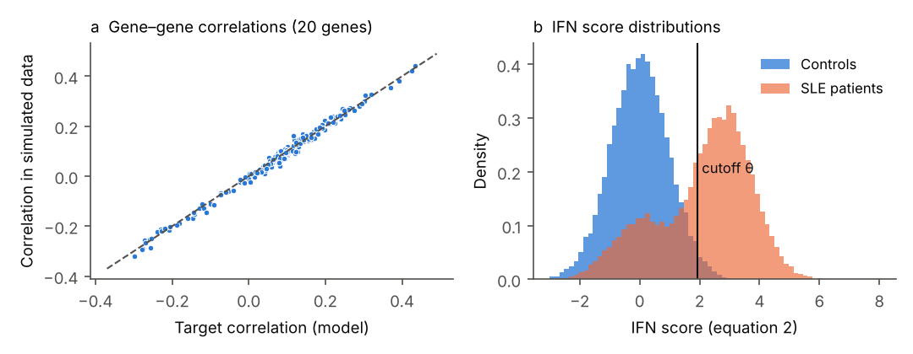
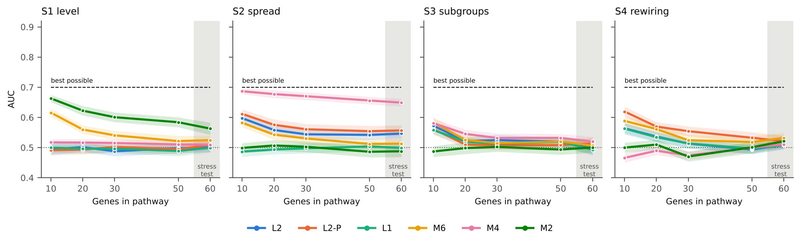
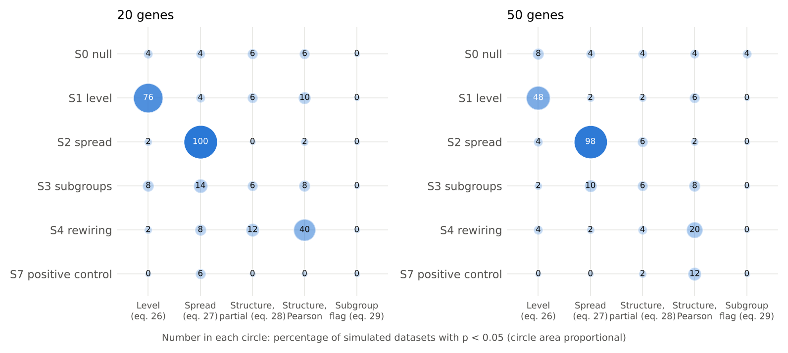
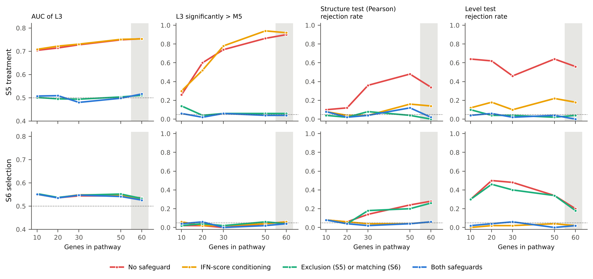

# Simulation results (archived)

This file holds the simulation results, the simulation details and the simulation code that were removed from `manuscript/progress_draft.md` on request. They are kept here unchanged, to be added back to the manuscript later. Section, table, figure and equation numbers are those of the manuscript at the time of removal.

<a id="sec-3"></a>

## 3. Results

<a id="sec-3-1"></a>

### 3.1 Simulated data

Because the real GSE319130 controls could not be obtained in the computing environment used for this analysis, all results in this section come from the generative design of [Section 2.13](#sec-2-13) applied to a synthetic stand-in: a pathway of $`G`$ genes whose gene-specific variation followed a sparse partial-correlation network, with normal margins, and whose expression also followed a shared IFN activity factor (equation 31). The resampling design, which requires the real controls, was not run. Pathways of 10, 20, 30, 50 and 60 genes were simulated; the 60-gene setting exceeds the 50-gene limit of [Section 2.5](#sec-2-5) and is reported as a stress test. Each setting was repeated 50 times. The following simplifications of the planned protocol were made to keep the computation feasible and are listed in full in [Supplementary Section S1](#supp-s1): LIONESS used 5 rather than 20 balanced reference subsets; the population-level tests used 199 rather than 10,000 permutations; the standard error of AUC differences was estimated with the corrected variance of Nadeau and Bengio rather than the method of Bates et al.; cross-validation used one repeat of 5 folds; the IFN cutoff was computed once per dataset; each dataset contained a single pathway, so no aggregation across pathways was needed; and models W1, M0b and M0c, which require real annotations, were not run. M1 used the elastic net only, M3 was run as three models (M3-score, M3-boost and M3-SVM), and W2 used a WGCNA-like module construction. Exploratory network features were computed for partial-correlation networks only. Scenarios S5–S7 used fixed effect sizes because their best possible classifier was not computed.

Model performance is reported both as the AUC and as the relative AUC,

```math
r = \frac{\mathrm{AUC} - 0.5}{\mathrm{AUC}^{*} - 0.5} \qquad\qquad (32)
```

where $`\mathrm{AUC}^{*}`$ is the AUC of the best possible classifier for that scenario; $`r = 1`$ means that a model captured all of the available signal and $`r = 0`$ that it captured none. The calibrated effect sizes reached $`\mathrm{AUC}^{*}`$ values between 0.697 and 0.701 for a target of 0.70.

In the synthetic data, the correlations between genes in 5,000 simulated control samples agreed with the target correlations of the model (correlation 0.996; largest absolute difference 0.048; [Figure 1](#figure-1)a). Under the IFN activity model, 98% of simulated controls and 37% of simulated SLE patients had IFN scores at or below the cutoff $`\theta`$ ([Figure 1](#figure-1)b).

<a id="figure-1"></a>



**Figure 1.** Check of the synthetic stand-in data. (a) Correlations between the 20 genes of a simulated pathway in 5,000 simulated controls against the target correlations of the model; the dashed line is the line of equality. (b) Distribution of the IFN score (equation 2) in simulated controls and SLE patients, with the cutoff $`\theta`$ (equation 3).

<a id="sec-3-2"></a>

### 3.2 Classification performance

[Table 1](#table-1) gives the AUC of every model in each scenario for pathways of 20 genes, and [Figure 2](#figure-2) gives the relative AUC for all pathway sizes. In the null scenario S0, the mean AUC of every model lay between 0.48 and 0.51 at all pathway sizes. In the level scenario S1 at 20 genes, the highest AUCs were obtained by M5 (0.62), M1 (0.62) and M2 (0.62); the network-only models L1, L2 and L2-P had AUCs of 0.50, 0.50 and 0.49. In the spread scenario S2, M4 had the highest AUC (0.68; $`r`$ = 0.89), followed by M3-SVM (0.60) and L2-P (0.58). In the subgroup scenario S3, no model exceeded an AUC of 0.55 at 20 genes; at 10 genes, the highest AUCs were L2-S (0.59), L2-S-P (0.59), M6 (0.58). In the rewiring scenario S4 at 20 genes, the highest AUCs were obtained by L2-P (0.57), L3-P (0.56), M6 (0.56); L2 reached 0.54 and M5 0.51. At 10 genes in S4, L2-P reached 0.62 ($`r`$ = 0.60), the highest AUC of all models in that setting. The relative AUC of the best model in each scenario did not exceed 0.93 in any setting ([Figure 2](#figure-2)). The variation of the AUC between simulated datasets is shown in [Figure 3](#figure-3); at 20 genes in S4, the AUC of individual datasets ranged from 0.41 to 0.69 for L2-P and from 0.34 to 0.64 for M5.

<a id="table-1"></a>

**Table 1. AUC of each model by scenario, pathways of 20 genes.**

| Model | S0 | S1 | S2 | S3 | S4 |
|---|---|---|---|---|---|
| M0a | 0.48 (0.01) | 0.49 (0.01) [-0.03] | 0.48 (0.01) [-0.10] | 0.48 (0.01) [-0.11] | 0.49 (0.01) [-0.05] |
| M1 | 0.50 (0.01) | 0.62 (0.01) [0.62] | 0.50 (0.01) [0.01] | 0.50 (0.01) [-0.01] | 0.51 (0.01) [0.05] |
| M2 | 0.50 (0.01) | 0.62 (0.01) [0.61] | 0.51 (0.01) [0.03] | 0.50 (0.01) [-0.01] | 0.51 (0.01) [0.05] |
| M3-score | 0.48 (0.01) | 0.53 (0.01) [0.15] | 0.48 (0.01) [-0.12] | 0.49 (0.01) [-0.05] | 0.49 (0.01) [-0.05] |
| M3-boost | 0.50 (0.01) | 0.56 (0.01) [0.30] | 0.55 (0.01) [0.25] | 0.49 (0.01) [-0.05] | 0.52 (0.01) [0.12] |
| M3-SVM | 0.49 (0.01) | 0.58 (0.01) [0.40] | 0.60 (0.01) [0.52] | 0.50 (0.01) [-0.01] | 0.54 (0.01) [0.21] |
| M4 | 0.50 (0.01) | 0.52 (0.01) [0.08] | 0.68 (0.01) [0.89] | 0.55 (0.01) [0.23] | 0.49 (0.01) [-0.05] |
| M5 | 0.50 (0.01) | 0.62 (0.01) [0.62] | 0.51 (0.01) [0.03] | 0.50 (0.01) [-0.01] | 0.51 (0.01) [0.05] |
| M6 | 0.50 (0.01) | 0.56 (0.01) [0.30] | 0.54 (0.01) [0.21] | 0.53 (0.01) [0.13] | 0.56 (0.01) [0.31] |
| W2 | 0.49 (0.01) | 0.51 (0.01) [0.06] | 0.49 (0.01) [-0.03] | 0.51 (0.01) [0.05] | 0.50 (0.01) [-0.00] |
| L1 | 0.51 (0.01) | 0.50 (0.01) [-0.02] | 0.49 (0.01) [-0.03] | 0.52 (0.01) [0.10] | 0.53 (0.01) [0.17] |
| L2 | 0.51 (0.01) | 0.50 (0.01) [0.01] | 0.56 (0.01) [0.29] | 0.52 (0.01) [0.11] | 0.54 (0.01) [0.18] |
| L2-P | 0.51 (0.01) | 0.49 (0.01) [-0.03] | 0.58 (0.01) [0.38] | 0.51 (0.01) [0.05] | 0.57 (0.01) [0.35] |
| L2-S | 0.51 (0.01) | 0.51 (0.01) [0.03] | 0.55 (0.01) [0.27] | 0.53 (0.01) [0.16] | 0.53 (0.01) [0.16] |
| L2-S-P | 0.50 (0.01) | 0.50 (0.01) [-0.01] | 0.55 (0.01) [0.27] | 0.51 (0.01) [0.06] | 0.55 (0.01) [0.26] |
| L3 | 0.51 (0.01) | 0.55 (0.01) [0.26] | 0.56 (0.01) [0.28] | 0.52 (0.01) [0.09] | 0.54 (0.01) [0.18] |
| L3-P | 0.50 (0.01) | 0.57 (0.01) [0.34] | 0.57 (0.01) [0.34] | 0.50 (0.01) [0.01] | 0.56 (0.01) [0.32] |
| L-explo | 0.51 (0.01) | 0.50 (0.01) [0.02] | 0.56 (0.01) [0.31] | 0.50 (0.01) [-0.00] | 0.51 (0.01) [0.03] |
| L-sec+explo | 0.51 (0.01) | 0.51 (0.01) [0.04] | 0.56 (0.01) [0.28] | 0.52 (0.01) [0.10] | 0.53 (0.01) [0.17] |

Values are mean AUC (Monte Carlo standard error) [relative AUC, $`r`$, equation 32] over 50 simulated datasets; 90 patients and 77 controls; best possible AUC 0.70 in S1–S4.

The corresponding tables for pathways of 10, 30, 50 and 60 genes are given in [Supplementary Table S4](#table-s4) to [Supplementary Table S7](#table-s7).

<a id="figure-2"></a>


**Figure 2.** Performance map. Each cell gives the relative AUC $`r`$ (equation 32) of one model (rows, grouped by family) in one scenario and pathway size (columns); the first block gives the AUC in the null scenario S0. Darker cells indicate a larger share of the available signal captured. The 60-gene columns are a stress test beyond the 50-gene limit of [Section 2.5](#sec-2-5).

<a id="figure-3"></a>


**Figure 3.** AUC of six models in each of the 50 simulated datasets, pathways of 20 genes, in the null scenario S0 and the rewiring scenario S4. Each point is one dataset, the shaded area shows the distribution and the horizontal bar the median; the dashed line marks the AUC of the best possible classifier.

<a id="sec-3-3"></a>

### 3.3 Effect of pathway size

[Figure 4](#figure-4) shows the AUC of six models as the pathway size increased from 10 to 60 genes, with the planted effect calibrated to the same best possible AUC (0.70) at every size. In S1, the AUC of M2 decreased from 0.66 at 10 genes to 0.58 at 50 genes and 0.56 at 60 genes. In S2, the AUC of M4 decreased from 0.69 to 0.66 at 50 genes and 0.65 at 60 genes, and that of L2-P from 0.61 to 0.56. In S4, the AUC of L2-P decreased from 0.62 at 10 genes to 0.57, 0.55, 0.53 and 0.52 at 20, 30, 50 and 60 genes, and that of M6 from 0.59 to 0.53. In S3, all six models had AUCs between 0.49 and 0.55 at 20 genes or more.

<a id="figure-4"></a>



**Figure 4.** AUC of six models against the number of genes in the pathway, for scenarios S1–S4. Shaded bands are 95% Monte Carlo intervals over 50 simulated datasets; the dashed line is the AUC of the best possible classifier (0.70) and the dotted line an AUC of 0.5. The grey area marks the 60-gene stress test.

<a id="sec-3-4"></a>

### 3.4 Network feature sets and association measures

[Table 2](#table-2) compares the network feature sets of [Section 2.8](#sec-2-8). At 20 genes, the primary features (L2) and the secondary features (L2-S) had similar AUCs in every scenario (S2: 0.56 and 0.55; S3: 0.52 and 0.53; S4: 0.54 and 0.53). The exploratory features alone had AUCs of 0.56 in S2 and 0.51 in S4, and adding them to the secondary features changed the AUC by at most 0.01. At 60 genes, all four feature sets had AUCs between 0.50 and 0.51 in S3 and S4.

[Table 3](#table-3) compares partial-correlation and Pearson LIONESS. In S4, Pearson LIONESS had higher AUCs than partial-correlation LIONESS for all three model pairs at 10 genes (L2-P 0.62 versus L2 0.56; L3-P 0.60 versus L3 0.56) and at 20 genes (L2-P 0.57 versus L2 0.54). In S3 at 10 genes, the partial-correlation models had AUCs of 0.57 (L2) and 0.59 (L2-S), and the Pearson models 0.56 (L2-P) and 0.59 (L2-S-P). In S1, L3 and L3-P had AUCs of 0.55 and 0.57 at 20 genes, compared with 0.62 for M5.

<a id="table-2"></a>

**Table 2. AUC of the network feature sets (partial-correlation networks), pathways of 20 and 60 genes.**

| Feature set (model) | Genes | S0 | S1 | S2 | S3 | S4 |
|---|---|---|---|---|---|---|
| Primary (L2) | 20 | 0.51 (0.01) | 0.50 (0.01) | 0.56 (0.01) | 0.52 (0.01) | 0.54 (0.01) |
| Primary (L2) | 60 | 0.50 (0.01) | 0.50 (0.01) | 0.55 (0.01) | 0.50 (0.01) | 0.51 (0.01) |
| Secondary (L2-S) | 20 | 0.51 (0.01) | 0.51 (0.01) | 0.55 (0.01) | 0.53 (0.01) | 0.53 (0.01) |
| Secondary (L2-S) | 60 | 0.50 (0.01) | 0.50 (0.01) | 0.54 (0.01) | 0.50 (0.01) | 0.50 (0.01) |
| Exploratory only | 20 | 0.51 (0.01) | 0.50 (0.01) | 0.56 (0.01) | 0.50 (0.01) | 0.51 (0.01) |
| Exploratory only | 60 | 0.50 (0.01) | 0.51 (0.01) | 0.54 (0.01) | 0.50 (0.01) | 0.50 (0.01) |
| Secondary + exploratory | 20 | 0.51 (0.01) | 0.51 (0.01) | 0.56 (0.01) | 0.52 (0.01) | 0.53 (0.01) |
| Secondary + exploratory | 60 | 0.50 (0.01) | 0.51 (0.01) | 0.54 (0.01) | 0.50 (0.01) | 0.50 (0.01) |

Values are mean AUC (Monte Carlo standard error) over 50 datasets.

<a id="table-3"></a>

**Table 3. AUC with partial-correlation and Pearson LIONESS, pathways of 10 and 20 genes.**

| Model pair | Genes | S0 | S1 | S2 | S3 | S4 |
|---|---|---|---|---|---|---|
| L2 / L2-P | 10 | 0.51 / 0.51 | 0.49 / 0.49 | 0.60 / 0.61 | 0.57 / 0.56 | 0.56 / 0.62 |
| L2 / L2-P | 20 | 0.51 / 0.51 | 0.50 / 0.49 | 0.56 / 0.58 | 0.52 / 0.51 | 0.54 / 0.57 |
| L2-S / L2-S-P | 10 | 0.51 / 0.50 | 0.49 / 0.49 | 0.59 / 0.59 | 0.59 / 0.59 | 0.56 / 0.59 |
| L2-S / L2-S-P | 20 | 0.51 / 0.50 | 0.51 / 0.50 | 0.55 / 0.55 | 0.53 / 0.51 | 0.53 / 0.55 |
| L3 / L3-P | 10 | 0.51 / 0.51 | 0.61 / 0.63 | 0.59 / 0.59 | 0.56 / 0.55 | 0.56 / 0.60 |
| L3 / L3-P | 20 | 0.51 / 0.50 | 0.55 / 0.57 | 0.56 / 0.57 | 0.52 / 0.50 | 0.54 / 0.56 |

Values are mean AUC over 50 datasets (partial-correlation / Pearson); Monte Carlo standard errors were at most 0.01.

<a id="sec-3-5"></a>

### 3.5 Similarity between models

[Figure 5](#figure-5) places each model on a map according to its AUC across scenarios S1–S4 and the five pathway sizes. The first two components accounted for 54% and 30% of the variation in AUC between models. The network-only models L2, L2-P, L2-S, L2-S-P, L-explo and L-sec+explo formed one group; M1, M2 and M5 formed a second group; M0a, L1, W2 and M3-score lay together in the upper part of the map; M4 and M3-SVM lay in the lower part; and L3, L3-P, M6 and M3-boost lay near the centre.

<a id="figure-5"></a>


**Figure 5.** Model similarity map. Principal component analysis of the mean AUC of each model in scenarios S1–S4 at the five pathway sizes; models close together had similar performance profiles. Colours indicate model families.

<a id="sec-3-6"></a>

### 3.6 False positives and confidence-interval coverage

[Table 4](#table-4) reports, for the null scenario S0, how often each model comparison of [Section 2.11](#sec-2-11) produced a confidence interval entirely above zero and how often the interval contained zero. Across the six comparisons and five pathway sizes, the false-positive rate ranged from 0% to 14% and the coverage from 80% to 100%. The highest false-positive rate, 14%, and the lowest coverage, 80%, occurred for L3 versus M5 at 10 genes.

<a id="table-4"></a>

**Table 4. False-positive rate and confidence-interval coverage of the model comparisons in the null scenario S0.**

| Comparison | 10 genes | 20 genes | 30 genes | 50 genes | 60 genes |
|---|---|---|---|---|---|
| L3 vs M5 | 14% / 80% | 8% / 86% | 2% / 98% | 0% / 100% | 2% / 94% |
| L3-P vs M5 | 8% / 88% | 6% / 92% | 2% / 96% | 2% / 90% | 10% / 86% |
| L2 vs M6 | 4% / 90% | 4% / 88% | 6% / 92% | 6% / 88% | 4% / 92% |
| L2-P vs M6 | 6% / 90% | 2% / 96% | 4% / 94% | 2% / 88% | 8% / 88% |
| L2 vs M4 | 6% / 92% | 2% / 96% | 6% / 90% | 0% / 98% | 0% / 98% |
| L2-P vs M4 | 4% / 92% | 8% / 86% | 4% / 92% | 4% / 96% | 4% / 94% |

Each cell gives the false-positive rate (percentage of 50 datasets in which the 95% confidence interval of equation 25 lay entirely above 0) / the coverage (percentage in which the interval contained 0, the true difference in S0). Monte Carlo standard errors were at most 6 percentage points.

<a id="sec-3-7"></a>

### 3.7 Population-level tests and subgroup check

[Table 5](#table-5) and [Figure 6](#figure-6) give the rejection rates of the three layers of [Section 2.12](#sec-2-12). In S0, the rejection rates at 20 genes were 4% (level), 4% (spread) and 6% and 6% (structure, partial and Pearson), and across all sizes they ranged from 0% to 8%. The level test rejected in 100%, 76%, 66%, 48% and 42% of datasets in S1 at 10, 20, 30, 50 and 60 genes. The spread test rejected in at least 98% of datasets in S2 at every size. In S4, the Pearson structure test rejected in 76%, 40%, 40%, 20% and 16% of datasets at the five sizes, and the partial-correlation structure test in 14%, 12%, 8%, 4% and 2%. In S3, the partial-correlation structure test rejected in 38% of datasets at 10 genes and in 6% to 8% at 20 genes or more. The subgroup check flagged 0% of S3 datasets at every size and 4% or fewer of datasets in any scenario. In the positive-control scenario S7, with expression adjusted for the IFN score, the rejection rates of all four tests were at most 12%.

<a id="table-5"></a>

**Table 5. Rejection rates of the population-level tests and flag rate of the subgroup check, pathways of 20 genes.**

| Scenario | Level | Spread | Structure (partial) | Structure (Pearson) | Subgroup flag |
|---|---|---|---|---|---|
| S0 null | 4% | 4% | 6% | 6% | 0% |
| S1 level | 76% | 4% | 6% | 10% | 0% |
| S2 spread | 2% | 100% | 0% | 2% | 0% |
| S3 subgroups | 8% | 14% | 6% | 8% | 0% |
| S4 rewiring | 2% | 8% | 12% | 40% | 0% |
| S7 positive control | 0% | 6% | 0% | 0% | 0% |

Percentage of 50 datasets with p < 0.05 (199 permutations); expression adjusted for the IFN score. Results for 50 genes are shown in Figure 6 and for all sizes in Supplementary Table S8.

<a id="figure-6"></a>



**Figure 6.** Detection fingerprint of the population-level tests. Each circle gives the percentage of 50 simulated datasets in which a test (columns) rejected at p < 0.05 in a scenario (rows), for pathways of 20 and 50 genes; circle area is proportional to the percentage.

<a id="sec-3-8"></a>

### 3.8 Treatment, selection and positive-control scenarios

[Table 6](#table-6) and [Figure 7](#figure-7) show the scenarios in which patients and controls differed only through treatment (S5) or through IFN activity before selection (S6), analysed with and without the safeguards of [Section 2.3](#sec-2-3). In S5 without safeguards, L3 had a mean AUC of 0.71 at 20 genes and between 0.70 and 0.75 across sizes, and the confidence interval for L3 versus M5 lay above zero in 60% of datasets at 20 genes and 90% at 60 genes. Conditioning on the IFN score alone gave similar values (L3 AUC 0.72; L3 above M5 in 52%). Excluding treated patients reduced the L3 AUC to 0.50 and the proportion of datasets with L3 above M5 to 4%; with both safeguards these values were 0.51 and 2%. The level test rejected in 62% of S5 datasets without safeguards and in 18% with conditioning.

In S6 without safeguards, M0a had a mean AUC of 0.64 and L3 of 0.54 at 20 genes, and the confidence interval for L3 versus M5 lay above zero in 0% to 6% of datasets across sizes. The Pearson structure test rejected in 6%, 24% and 28% of datasets at 20, 50 and 60 genes without safeguards, and in 6%, 4% and 6% with conditioning on the IFN score. The level test rejected in 50% of datasets at 20 genes without safeguards and 2% with conditioning; matching alone gave 46%.

In the positive-control scenario S7, M0a, M2, M5, M6, L3 and L3-P had mean AUCs between 0.98 and 1.00 at every pathway size, M4 between 0.76 and 0.82, and the network-only models L2 and L2-P between 0.50 and 0.51.

<a id="table-6"></a>

**Table 6. Treatment (S5) and selection (S6) scenarios with and without safeguards, pathways of 20 genes.**

| Scenario | Safeguard | Patients / controls | AUC M0a | AUC M5 | AUC L3 | AUC L3-P | Level test | Structure (Pearson) | L3 > M5 |
|---|---|---|---|---|---|---|---|---|---|
| S5 | None | 90 / 77 | 0.65 | 0.59 | 0.71 | 0.72 | 62% | 12% | 60% |
| S5 | IFN-score conditioning | 90 / 77 | 0.65 | 0.59 | 0.72 | 0.72 | 18% | 4% | 52% |
| S5 | Exclusion (S5) / matching (S6) | 45 / 77 | 0.50 | 0.50 | 0.50 | 0.51 | 4% | 2% | 4% |
| S5 | Both | 45 / 77 | 0.48 | 0.51 | 0.51 | 0.51 | 6% | 2% | 2% |
| S6 | None | 90 / 77 | 0.64 | 0.58 | 0.54 | 0.55 | 50% | 6% | 2% |
| S6 | IFN-score conditioning | 90 / 77 | 0.64 | 0.58 | 0.54 | 0.55 | 2% | 6% | 2% |
| S6 | Exclusion (S5) / matching (S6) | 77 / 77 | 0.64 | 0.58 | 0.54 | 0.56 | 46% | 4% | 4% |
| S6 | Both | 77 / 77 | 0.63 | 0.58 | 0.54 | 0.55 | 4% | 4% | 6% |

AUCs are means over 50 datasets; test columns give the percentage of datasets with p < 0.05; the last column gives the percentage in which the 95% confidence interval for the AUC difference between L3 and M5 lay entirely above 0. Neither scenario contains a difference other than treatment (S5) or IFN activity (S6). Results for all pathway sizes are shown in Figure 7.

<a id="figure-7"></a>



**Figure 7.** Effect of the safeguards in the treatment (S5, top) and selection (S6, bottom) scenarios across pathway sizes. Columns show the AUC of L3, the proportion of datasets in which L3 was significantly better than M5, and the rejection rates of the Pearson structure test and the level test. Dotted lines mark an AUC of 0.5 or a rate of 5%; the grey area marks the 60-gene stress test.

<a id="sec-3-9"></a>

### 3.9 Power and smallest detectable difference

[Table 7](#table-7) and [Figure 8](#figure-8) report the primary comparison of [Section 2.11](#sec-2-11) at 20 genes. The smallest detectable difference in AUC, defined as

```math
\mathrm{MDD} = (z_{0.975} + z_{0.80})\; \mathrm{median}\big(\widehat{\mathrm{SE}}(\Delta)\big) = 2.80\; \mathrm{median}\big(\widehat{\mathrm{SE}}(\Delta)\big) \qquad\qquad (33)
```

where $`z_{0.975}`$ and $`z_{0.80}`$ are standard normal quantiles and the median is taken over simulated datasets, ranged from 0.14 to 0.20 with 90 patients and 77 controls and from 0.20 to 0.27 with 40 per group. In S4, the power of L3 versus M5 was 0%, 12% and 24% for best possible AUCs of 0.60, 0.70 and 0.80, and that of L3-P versus M5 was 4%, 18% and 46%. In S2 at a best possible AUC of 0.80, the power was 56% for L3 and 58% for L3-P. In S1, the mean difference between L3 and M5 was negative at every best possible AUC (-0.037, -0.075 and -0.110).

<a id="table-7"></a>

**Table 7. Primary comparison (L3 and L3-P versus M5): observed AUC difference, power and smallest detectable difference, pathways of 20 genes.**

| Scenario | Best possible AUC | Patients / controls | Δ, L3 vs M5 | Power | MDD | Δ, L3-P vs M5 | Power | MDD |
|---|---|---|---|---|---|---|---|---|
| S0 | – | 90 / 77 | -0.008 | 10% | 0.18 | -0.005 | 2% | 0.17 |
| S0 | – | 90 / 77 | +0.010 | 8% | 0.16 | +0.005 | 6% | 0.18 |
| S0 | – | 40 / 40 | +0.012 | 6% | 0.25 | +0.003 | 6% | 0.22 |
| S1 | 0.6 | 90 / 77 | -0.037 | 0% | 0.19 | -0.030 | 0% | 0.17 |
| S1 | 0.7 | 90 / 77 | -0.075 | 0% | 0.16 | -0.061 | 0% | 0.16 |
| S1 | 0.8 | 90 / 77 | -0.110 | 0% | 0.14 | -0.086 | 0% | 0.14 |
| S1 | 0.7 | 40 / 40 | -0.013 | 2% | 0.20 | -0.029 | 0% | 0.22 |
| S2 | 0.6 | 90 / 77 | +0.047 | 18% | 0.18 | +0.035 | 14% | 0.16 |
| S2 | 0.7 | 90 / 77 | +0.047 | 12% | 0.20 | +0.059 | 24% | 0.16 |
| S2 | 0.8 | 90 / 77 | +0.142 | 56% | 0.18 | +0.162 | 58% | 0.18 |
| S2 | 0.7 | 40 / 40 | +0.054 | 14% | 0.26 | +0.051 | 14% | 0.23 |
| S3 | 0.6 | 90 / 77 | +0.014 | 6% | 0.19 | +0.016 | 12% | 0.17 |
| S3 | 0.7 | 90 / 77 | +0.018 | 8% | 0.20 | +0.000 | 6% | 0.17 |
| S3 | 0.8 | 90 / 77 | +0.064 | 20% | 0.19 | +0.069 | 24% | 0.19 |
| S3 | 0.7 | 40 / 40 | +0.012 | 12% | 0.25 | +0.027 | 8% | 0.21 |
| S4 | 0.6 | 90 / 77 | -0.008 | 0% | 0.19 | -0.001 | 4% | 0.18 |
| S4 | 0.7 | 90 / 77 | +0.024 | 12% | 0.16 | +0.053 | 18% | 0.14 |
| S4 | 0.8 | 90 / 77 | +0.087 | 24% | 0.19 | +0.128 | 46% | 0.19 |
| S4 | 0.7 | 40 / 40 | +0.029 | 8% | 0.27 | +0.039 | 6% | 0.22 |

Δ is the mean paired AUC difference (equation 24) over 50 datasets; power is the percentage of datasets in which the 95% confidence interval lay entirely above 0; MDD is the smallest detectable difference, 2.80 times the median standard error of Δ.

<a id="figure-8"></a>


**Figure 8.** Power of the primary comparison against the AUC of the best possible classifier, for the subgroup (S3) and rewiring (S4) scenarios, pathways of 20 genes. Lines show 90 patients versus 77 controls and diamonds 40 per group; the dashed line marks 80% power.

<a id="sec-3-10"></a>

### 3.10 Agreement with the first-order formula

[Figure 9](#figure-9) compares the exact LIONESS edges (equation 6) with the first-order approximation of equation (9) for 30 samples of a simulated control set of 167 samples. With shrinkage ($`\lambda`$ = 0.2), the correlation between exact and approximate edges was 0.9998, 0.9997, 0.9993, 0.9993 and 0.9989 for 10, 20, 30, 50 and 60 genes, and the median absolute difference was 0.010, 0.021, 0.034, 0.060 and 0.065, against a standard deviation of the exact edges of 0.67 to 0.78. Without shrinkage (equation 8), the correlations were 0.9998 to 0.9958 and the median absolute differences 0.014 to 0.199. At 60 genes, the approximate edges were smaller in absolute value than the exact edges for the largest edges ([Figure 9](#figure-9)b); the 95th percentile of the absolute difference was 0.42 with shrinkage and 1.26 without.

<a id="figure-9"></a>


**Figure 9.** Exact LIONESS edges (equation 6) against the first-order approximation (equation 9) with shrinkage intensity $`\lambda`$ = 0.2, for pathways of (a) 20 and (b) 60 genes. Each point is one edge of one sample; the dashed line is the line of equality.


# Supplementary material (simulation)

<a id="supp-s1"></a>

### Supplementary Section S1. Simulation details

**Resampling design.** The female healthy controls of [GSE319130](https://www.ncbi.nlm.nih.gov/geo/query/acc.cgi?acc=GSE319130) were randomly divided into two groups of about 38 samples, labelled pseudo-patients and pseudo-controls, and the known signal of each scenario was added to the pseudo-patients only. This design keeps the exact noise, skewness and correlation of real blood data.

**How the scenarios were generated.** In S1, a constant was added to the mean of 20% of the genes of a sub-pathway. In S2, the deviations of all genes from the patient mean were multiplied by a common factor greater than 1, which increases spread without changing correlations. In S3, half of the pseudo-patients were shifted upwards and half downwards on 20% of the genes, so that the average was unchanged. In S4, 10% of the gene pairs had their partial correlations reversed in sign, removed or created, giving a new correlation matrix $`\mathbf{R}_{\mathrm{R}}`$, adjusted where necessary to remain a valid correlation matrix. In the generative design, pseudo-patients were drawn from equation (30) with $`\mathbf{R}_{\mathrm{R}}`$ in place of $`\hat{\mathbf{R}}`$. In the resampling design, they were transformed to the new structure by

```math
\mathbf{x}^{\mathrm{R}} = \boldsymbol{\mu} + \mathbf{D}_{\sigma}\, \mathbf{R}_{\mathrm{R}}^{1/2}\, \hat{\mathbf{R}}^{-1/2}\, \mathbf{D}_{\sigma}^{-1} \big(\mathbf{x} - \boldsymbol{\mu}\big) \qquad\qquad (\mathrm{S}1)
```

where $`\mathbf{x}`$ is a pseudo-patient's expression vector, $`\boldsymbol{\mu}`$ the vector of gene means, $`\mathbf{D}_{\sigma}`$ the diagonal matrix of gene standard deviations, and the powers $`1/2`$ and $`-1/2`$ the symmetric matrix square root and its inverse; this changes the correlations exactly while keeping the means and variances. In S5, simulated patients with high IFN activity had the expression of the interferon genes reduced by a common factor, which lowered their IFN score below the cutoff while leaving the correlations of the IFN-high state in place. In S6, patients and controls differed only in the distribution of $`f`$ in equation (31).

**Interferon activity model.** In equation (31), the loadings $`l_g`$ were estimated from the first principal component of the interferon genes in all SLE patients of the primary cohort, where IFN activity varies widely, and the distribution of $`f`$ was chosen so that the simulated IFN scores of patients and controls matched those observed. The four IFN-score genes were generated from the same model, the IFN score was computed by equation (2), and the cutoff $`\theta`$ of equation (3) was estimated and applied inside each training fold, so that the simulated IFN-low group was selected in the same way as the real one.

**Outcomes.** For every scenario, the recorded outcomes were the AUC of each model, also expressed relative to the AUC of the best possible classifier; the rejection rates of the hypothesis tests and of the three population-level layers; how often the subgroup check flagged each scenario; the false-positive rates in scenarios S0 and S6, which should not exceed 5%; the coverage of the 95% confidence intervals of equation (25); and the smallest AUC difference detectable with 80% power at each sample size. Scenarios S5 and S6 were analysed with and without the safeguards of [Section 2.3](#sec-2-3). The results were used to write a reading guide linking each pattern of results to the kind of difference that causes it, which was fixed before any model was fitted to the real outcome data.

**Implementation used for the results in Section 3.** Because the real controls of GSE319130 could not be obtained in the computing environment used, the simulation results in [Section 3](#sec-3) were produced with a synthetic stand-in for the generative design: for each pathway size $`G`$, the gene-specific variation followed a sparse partial-correlation network (a chain of partial correlations of 0.3 plus $`G/2`$ random partial correlations of ±0.25), with normal margins; the loadings $`l_g`$ in equation (31) were drawn from a uniform distribution between 0.2 and 0.5; IFN activity $`f`$ had mean 0 and standard deviation 1 in controls and mean 3 in IFN-high patients; and each IFN-score gene was generated as $`0.9 f`$ plus independent noise with standard deviation 0.3. S5 contained equal numbers of untreated patients and treated IFN-high patients whose deviations were multiplied by 0.3; S6 drew patients from a population in which 75% were IFN-high; and in S7 controls were not filtered by the cutoff. Each setting was repeated 50 times. To keep the computation feasible, LIONESS used 5 balanced reference subsets, the population-level tests used 199 permutations of the group labels on expression adjusted for the IFN score, the standard error of AUC differences used the corrected variance of Nadeau and Bengio, cross-validation used one repeat of 5 folds, and the IFN cutoff and the matching on IFN score were computed once per dataset rather than within each fold. Models W1, M0b and M0c were not run because they require real annotations; M1 used the elastic net; M3 was run as a pathway-score model, gradient boosting and a kernel support vector machine; W2 used modules formed by hierarchical clustering of the adjacency $`|\mathrm{cor}|^6`$ with first principal components as eigengenes; and when a group in a training fold had fewer samples than genes, M6 used class covariance matrices shrunk towards the identity. The code is given in [Supplementary Section S2](#supp-s2).

**Repeats and computation.** Each setting was repeated 200 times when a single sub-pathway was analysed and 100 times when the full pipeline over all sub-pathways was run, giving Monte Carlo standard errors of at most 0.035 and 0.05 for estimated proportions; these are reported with every estimate. The generative design was run at both sample sizes, and the resampling design at the largest size the controls allow. The full-pipeline runs used one repeat of 5 outer folds instead of ten, with all other steps unchanged. LIONESS used $`B = 20`$ balanced reference subsets and both association measures, as in the real analysis.

**Checking the simulated data.** For each sub-pathway, simulated data without added signal were compared with the real controls in four respects: the mean and variance of each gene, the distribution of all pairwise correlations, the distribution of the LIONESS edges, and, for equation (31), the distribution of the IFN score and the proportion of patients below the cutoff. The simulated and real distributions are shown overlaid.

**Agreement with the theory.** The exact LIONESS edges were compared with the first-order formulas of [Section 2.6](#sec-2-6) in every scenario.

**Pilot simulation.** A smaller pilot, run while the study was being designed, used multivariate normal data for single pathways of 10, 20 and 30 genes with 20 to 30 repeats per setting. Its results guided the choice of network features ([Section 2.8](#sec-2-8)) and population-level tests ([Section 2.12](#sec-2-12)); its code and results are archived with the analysis code. The full simulation replaces it for all inferences.


<a id="table-s3"></a>

**Supplementary Table S3.** Simulation scenarios.

| Scenario | How the pseudo-patients differ | What it checks |
|---|---|---|
| S0 Null | No difference | False-positive rate of all tests; AUC close to 0.5 |
| S1 Level | Mean shifted in 20% of genes | Level test; whether network features ignore level differences ([Section 2.6](#sec-2-6)) |
| S2 Spread | Deviations multiplied by a factor above 1 | Spread test; distance-from-health baseline (M4) |
| S3 Subgroups | Half shifted up, half down, on 20% of genes | Structure test; subgroup check; secondary features (L2-S) |
| S4 Rewiring | Partial correlations changed in 10% of gene pairs | Structure test; primary network models (L2, L2-P, L3, L3-P) |
| S5 Treatment | IFN-high patients with IFN genes reduced by treatment | Whether treated patients create false network differences; treatment exclusion |
| S6 Selection | Only the distribution of IFN activity differs | Size of the selection effect; IFN-score conditioning and matching |
| S7 Positive control | IFN-high patients versus controls | Whether contrast C1 detects a known difference |

<a id="table-s4"></a>

**Supplementary Table S4. AUC of each model by scenario, pathways of 10 genes.**

| Model | S0 | S1 | S2 | S3 | S4 |
|---|---|---|---|---|---|
| M0a | 0.49 (0.01) | 0.49 (0.01) [-0.05] | 0.50 (0.01) [-0.02] | 0.49 (0.01) [-0.06] | 0.49 (0.01) [-0.03] |
| M1 | 0.50 (0.01) | 0.68 (0.01) [0.89] | 0.50 (0.01) [-0.00] | 0.49 (0.01) [-0.07] | 0.50 (0.01) [-0.01] |
| M2 | 0.49 (0.01) | 0.66 (0.01) [0.81] | 0.50 (0.01) [-0.01] | 0.49 (0.01) [-0.07] | 0.50 (0.01) [-0.00] |
| M3-score | 0.50 (0.01) | 0.53 (0.01) [0.16] | 0.50 (0.01) [-0.01] | 0.49 (0.01) [-0.06] | 0.51 (0.01) [0.03] |
| M3-boost | 0.50 (0.01) | 0.60 (0.01) [0.51] | 0.58 (0.01) [0.39] | 0.54 (0.01) [0.20] | 0.52 (0.01) [0.11] |
| M3-SVM | 0.51 (0.01) | 0.63 (0.01) [0.65] | 0.62 (0.01) [0.58] | 0.55 (0.01) [0.24] | 0.57 (0.01) [0.37] |
| M4 | 0.49 (0.01) | 0.52 (0.01) [0.09] | 0.69 (0.00) [0.93] | 0.58 (0.01) [0.41] | 0.47 (0.01) [-0.17] |
| M5 | 0.50 (0.01) | 0.68 (0.01) [0.88] | 0.50 (0.01) [-0.01] | 0.49 (0.01) [-0.07] | 0.50 (0.01) [-0.02] |
| M6 | 0.51 (0.01) | 0.62 (0.01) [0.58] | 0.58 (0.01) [0.41] | 0.58 (0.01) [0.42] | 0.59 (0.01) [0.44] |
| W2 | 0.50 (0.01) | 0.54 (0.01) [0.20] | 0.49 (0.01) [-0.04] | 0.50 (0.01) [-0.01] | 0.50 (0.01) [0.02] |
| L1 | 0.50 (0.01) | 0.50 (0.01) [-0.00] | 0.49 (0.01) [-0.07] | 0.56 (0.01) [0.29] | 0.56 (0.01) [0.31] |
| L2 | 0.51 (0.01) | 0.49 (0.01) [-0.03] | 0.60 (0.01) [0.49] | 0.57 (0.01) [0.37] | 0.56 (0.01) [0.32] |
| L2-P | 0.51 (0.01) | 0.49 (0.01) [-0.05] | 0.61 (0.01) [0.56] | 0.56 (0.01) [0.31] | 0.62 (0.01) [0.60] |
| L2-S | 0.51 (0.01) | 0.49 (0.01) [-0.03] | 0.59 (0.01) [0.44] | 0.59 (0.01) [0.48] | 0.56 (0.01) [0.30] |
| L2-S-P | 0.50 (0.01) | 0.49 (0.01) [-0.07] | 0.59 (0.01) [0.46] | 0.59 (0.01) [0.43] | 0.59 (0.01) [0.46] |
| L3 | 0.51 (0.01) | 0.61 (0.01) [0.55] | 0.59 (0.01) [0.44] | 0.56 (0.01) [0.30] | 0.56 (0.01) [0.31] |
| L3-P | 0.51 (0.01) | 0.63 (0.01) [0.63] | 0.59 (0.01) [0.47] | 0.55 (0.01) [0.24] | 0.60 (0.01) [0.52] |
| L-explo | 0.50 (0.01) | 0.51 (0.01) [0.03] | 0.61 (0.01) [0.53] | 0.54 (0.01) [0.21] | 0.52 (0.01) [0.11] |
| L-sec+explo | 0.51 (0.01) | 0.51 (0.01) [0.04] | 0.58 (0.01) [0.41] | 0.58 (0.01) [0.39] | 0.54 (0.01) [0.21] |

Values are mean AUC (Monte Carlo standard error) [relative AUC, $`r`$, equation 32] over 50 simulated datasets; 90 patients and 77 controls; best possible AUC 0.70 in S1–S4.

<a id="table-s5"></a>

**Supplementary Table S5. AUC of each model by scenario, pathways of 30 genes.**

| Model | S0 | S1 | S2 | S3 | S4 |
|---|---|---|---|---|---|
| M0a | 0.50 (0.01) | 0.50 (0.01) [-0.01] | 0.48 (0.01) [-0.08] | 0.50 (0.01) [0.02] | 0.48 (0.01) [-0.10] |
| M1 | 0.51 (0.01) | 0.61 (0.01) [0.56] | 0.50 (0.01) [0.00] | 0.50 (0.01) [-0.01] | 0.47 (0.01) [-0.15] |
| M2 | 0.50 (0.01) | 0.60 (0.01) [0.50] | 0.50 (0.01) [0.01] | 0.50 (0.01) [0.01] | 0.47 (0.01) [-0.15] |
| M3-score | 0.49 (0.01) | 0.51 (0.01) [0.03] | 0.49 (0.01) [-0.04] | 0.51 (0.01) [0.04] | 0.48 (0.01) [-0.08] |
| M3-boost | 0.49 (0.01) | 0.55 (0.01) [0.23] | 0.53 (0.01) [0.16] | 0.51 (0.01) [0.03] | 0.49 (0.01) [-0.03] |
| M3-SVM | 0.50 (0.01) | 0.56 (0.01) [0.32] | 0.60 (0.01) [0.49] | 0.51 (0.01) [0.04] | 0.50 (0.01) [-0.01] |
| M4 | 0.50 (0.01) | 0.52 (0.01) [0.08] | 0.67 (0.01) [0.85] | 0.53 (0.01) [0.16] | 0.47 (0.01) [-0.13] |
| M5 | 0.51 (0.01) | 0.61 (0.01) [0.56] | 0.50 (0.01) [0.01] | 0.50 (0.01) [0.01] | 0.47 (0.01) [-0.15] |
| M6 | 0.50 (0.01) | 0.54 (0.01) [0.20] | 0.53 (0.01) [0.15] | 0.51 (0.01) [0.07] | 0.52 (0.01) [0.12] |
| W2 | 0.50 (0.01) | 0.52 (0.01) [0.09] | 0.50 (0.01) [0.02] | 0.50 (0.01) [0.01] | 0.49 (0.01) [-0.07] |
| L1 | 0.49 (0.01) | 0.50 (0.01) [-0.02] | 0.50 (0.01) [-0.01] | 0.51 (0.01) [0.06] | 0.51 (0.01) [0.07] |
| L2 | 0.49 (0.01) | 0.49 (0.01) [-0.06] | 0.54 (0.01) [0.22] | 0.52 (0.01) [0.12] | 0.51 (0.01) [0.07] |
| L2-P | 0.49 (0.01) | 0.50 (0.01) [0.01] | 0.56 (0.01) [0.30] | 0.51 (0.01) [0.03] | 0.55 (0.01) [0.27] |
| L2-S | 0.50 (0.01) | 0.48 (0.01) [-0.08] | 0.54 (0.01) [0.21] | 0.52 (0.01) [0.11] | 0.52 (0.01) [0.08] |
| L2-S-P | 0.49 (0.01) | 0.50 (0.01) [-0.00] | 0.55 (0.01) [0.26] | 0.50 (0.01) [-0.00] | 0.54 (0.01) [0.23] |
| L3 | 0.50 (0.01) | 0.54 (0.01) [0.18] | 0.54 (0.01) [0.22] | 0.53 (0.01) [0.13] | 0.50 (0.01) [0.02] |
| L3-P | 0.50 (0.01) | 0.56 (0.01) [0.31] | 0.56 (0.01) [0.28] | 0.51 (0.01) [0.05] | 0.53 (0.01) [0.14] |
| L-explo | 0.50 (0.01) | 0.49 (0.01) [-0.05] | 0.56 (0.01) [0.28] | 0.50 (0.01) [0.02] | 0.52 (0.01) [0.08] |
| L-sec+explo | 0.50 (0.01) | 0.48 (0.01) [-0.08] | 0.56 (0.01) [0.28] | 0.51 (0.01) [0.07] | 0.52 (0.01) [0.08] |

Values are mean AUC (Monte Carlo standard error) [relative AUC, $`r`$, equation 32] over 50 simulated datasets; 90 patients and 77 controls; best possible AUC 0.70 in S1–S4.

<a id="table-s6"></a>

**Supplementary Table S6. AUC of each model by scenario, pathways of 50 genes.**

| Model | S0 | S1 | S2 | S3 | S4 |
|---|---|---|---|---|---|
| M0a | 0.49 (0.01) | 0.49 (0.01) [-0.07] | 0.48 (0.01) [-0.11] | 0.49 (0.01) [-0.05] | 0.48 (0.01) [-0.09] |
| M1 | 0.51 (0.01) | 0.59 (0.01) [0.44] | 0.49 (0.01) [-0.07] | 0.49 (0.01) [-0.04] | 0.50 (0.01) [-0.00] |
| M2 | 0.51 (0.01) | 0.58 (0.01) [0.42] | 0.49 (0.01) [-0.07] | 0.49 (0.01) [-0.03] | 0.50 (0.01) [0.00] |
| M3-score | 0.49 (0.01) | 0.51 (0.01) [0.03] | 0.48 (0.01) [-0.08] | 0.50 (0.01) [-0.00] | 0.49 (0.01) [-0.06] |
| M3-boost | 0.50 (0.01) | 0.53 (0.01) [0.13] | 0.51 (0.01) [0.04] | 0.50 (0.01) [-0.01] | 0.50 (0.01) [-0.01] |
| M3-SVM | 0.51 (0.01) | 0.55 (0.01) [0.23] | 0.56 (0.01) [0.28] | 0.50 (0.01) [-0.02] | 0.51 (0.01) [0.05] |
| M4 | 0.49 (0.01) | 0.51 (0.01) [0.05] | 0.66 (0.01) [0.78] | 0.53 (0.01) [0.16] | 0.50 (0.01) [-0.00] |
| M5 | 0.51 (0.01) | 0.59 (0.01) [0.45] | 0.49 (0.01) [-0.07] | 0.49 (0.01) [-0.04] | 0.50 (0.01) [0.01] |
| M6 | 0.51 (0.01) | 0.52 (0.01) [0.11] | 0.51 (0.01) [0.06] | 0.52 (0.01) [0.10] | 0.52 (0.01) [0.09] |
| W2 | 0.50 (0.01) | 0.51 (0.01) [0.06] | 0.48 (0.01) [-0.12] | 0.50 (0.01) [-0.01] | 0.49 (0.01) [-0.03] |
| L1 | 0.51 (0.01) | 0.49 (0.01) [-0.06] | 0.50 (0.01) [0.02] | 0.52 (0.01) [0.10] | 0.50 (0.01) [-0.02] |
| L2 | 0.51 (0.01) | 0.50 (0.01) [-0.01] | 0.54 (0.01) [0.21] | 0.52 (0.01) [0.10] | 0.49 (0.01) [-0.03] |
| L2-P | 0.50 (0.01) | 0.49 (0.01) [-0.03] | 0.55 (0.01) [0.27] | 0.51 (0.01) [0.04] | 0.53 (0.01) [0.16] |
| L2-S | 0.51 (0.01) | 0.51 (0.01) [0.04] | 0.54 (0.01) [0.18] | 0.51 (0.01) [0.04] | 0.49 (0.01) [-0.03] |
| L2-S-P | 0.49 (0.01) | 0.50 (0.01) [-0.01] | 0.55 (0.01) [0.23] | 0.50 (0.01) [0.00] | 0.52 (0.01) [0.08] |
| L3 | 0.51 (0.01) | 0.55 (0.01) [0.23] | 0.53 (0.01) [0.16] | 0.51 (0.01) [0.04] | 0.50 (0.01) [-0.02] |
| L3-P | 0.51 (0.01) | 0.54 (0.01) [0.22] | 0.54 (0.01) [0.21] | 0.50 (0.01) [0.01] | 0.52 (0.01) [0.11] |
| L-explo | 0.50 (0.01) | 0.50 (0.01) [0.01] | 0.55 (0.01) [0.23] | 0.49 (0.01) [-0.03] | 0.49 (0.01) [-0.07] |
| L-sec+explo | 0.51 (0.01) | 0.50 (0.01) [0.02] | 0.54 (0.01) [0.22] | 0.50 (0.01) [-0.01] | 0.49 (0.01) [-0.07] |

Values are mean AUC (Monte Carlo standard error) [relative AUC, $`r`$, equation 32] over 50 simulated datasets; 90 patients and 77 controls; best possible AUC 0.70 in S1–S4.

<a id="table-s7"></a>

**Supplementary Table S7. AUC of each model by scenario, pathways of 60 genes (stress test).**

| Model | S0 | S1 | S2 | S3 | S4 |
|---|---|---|---|---|---|
| M0a | 0.49 (0.01) | 0.49 (0.01) [-0.06] | 0.49 (0.01) [-0.05] | 0.49 (0.01) [-0.07] | 0.49 (0.01) [-0.04] |
| M1 | 0.50 (0.01) | 0.56 (0.01) [0.32] | 0.49 (0.01) [-0.07] | 0.50 (0.01) [0.00] | 0.52 (0.01) [0.11] |
| M2 | 0.50 (0.01) | 0.56 (0.01) [0.31] | 0.49 (0.01) [-0.06] | 0.50 (0.01) [0.00] | 0.52 (0.01) [0.11] |
| M3-score | 0.50 (0.01) | 0.49 (0.01) [-0.05] | 0.49 (0.01) [-0.03] | 0.49 (0.01) [-0.03] | 0.49 (0.01) [-0.04] |
| M3-boost | 0.50 (0.01) | 0.52 (0.01) [0.11] | 0.51 (0.01) [0.06] | 0.51 (0.01) [0.04] | 0.52 (0.01) [0.08] |
| M3-SVM | 0.50 (0.01) | 0.53 (0.01) [0.16] | 0.56 (0.01) [0.29] | 0.51 (0.01) [0.05] | 0.53 (0.01) [0.15] |
| M4 | 0.50 (0.01) | 0.51 (0.01) [0.05] | 0.65 (0.01) [0.75] | 0.52 (0.01) [0.10] | 0.51 (0.01) [0.05] |
| M5 | 0.50 (0.01) | 0.57 (0.01) [0.34] | 0.49 (0.01) [-0.06] | 0.50 (0.01) [0.01] | 0.52 (0.01) [0.10] |
| M6 | 0.50 (0.01) | 0.52 (0.01) [0.12] | 0.51 (0.01) [0.07] | 0.51 (0.01) [0.03] | 0.53 (0.01) [0.16] |
| W2 | 0.50 (0.01) | 0.50 (0.01) [0.01] | 0.50 (0.01) [0.01] | 0.49 (0.01) [-0.05] | 0.51 (0.01) [0.03] |
| L1 | 0.51 (0.01) | 0.50 (0.01) [-0.00] | 0.50 (0.01) [-0.01] | 0.49 (0.01) [-0.04] | 0.51 (0.01) [0.04] |
| L2 | 0.50 (0.01) | 0.50 (0.01) [0.00] | 0.55 (0.01) [0.23] | 0.50 (0.01) [-0.02] | 0.51 (0.01) [0.05] |
| L2-P | 0.51 (0.01) | 0.51 (0.01) [0.04] | 0.56 (0.01) [0.28] | 0.51 (0.01) [0.07] | 0.52 (0.01) [0.10] |
| L2-S | 0.50 (0.01) | 0.50 (0.01) [0.02] | 0.54 (0.01) [0.20] | 0.50 (0.01) [0.02] | 0.50 (0.01) [-0.01] |
| L2-S-P | 0.51 (0.01) | 0.51 (0.01) [0.06] | 0.55 (0.01) [0.23] | 0.51 (0.01) [0.03] | 0.51 (0.01) [0.07] |
| L3 | 0.50 (0.01) | 0.54 (0.01) [0.21] | 0.53 (0.01) [0.14] | 0.50 (0.01) [-0.00] | 0.52 (0.01) [0.12] |
| L3-P | 0.51 (0.01) | 0.55 (0.01) [0.25] | 0.54 (0.01) [0.20] | 0.51 (0.01) [0.06] | 0.53 (0.01) [0.15] |
| L-explo | 0.50 (0.01) | 0.51 (0.01) [0.04] | 0.54 (0.01) [0.19] | 0.50 (0.01) [0.01] | 0.50 (0.01) [0.02] |
| L-sec+explo | 0.50 (0.01) | 0.51 (0.01) [0.04] | 0.54 (0.01) [0.22] | 0.50 (0.01) [0.00] | 0.50 (0.01) [0.01] |

Values are mean AUC (Monte Carlo standard error) [relative AUC, $`r`$, equation 32] over 50 simulated datasets; 90 patients and 77 controls; best possible AUC 0.70 in S1–S4.

<a id="table-s8"></a>

**Supplementary Table S8. Rejection rates of the population-level tests and flag rate of the subgroup check, all pathway sizes.**

| Scenario | Genes | Level | Spread | Structure (partial) | Structure (Pearson) | Subgroup flag |
|---|---|---|---|---|---|---|
| S0 null | 10 | 4% | 4% | 6% | 6% | 0% |
| S0 null | 20 | 4% | 4% | 6% | 6% | 0% |
| S0 null | 30 | 8% | 4% | 6% | 2% | 0% |
| S0 null | 50 | 8% | 4% | 4% | 4% | 4% |
| S0 null | 60 | 0% | 4% | 2% | 2% | 0% |
| S1 level | 10 | 100% | 2% | 2% | 4% | 0% |
| S1 level | 20 | 76% | 4% | 6% | 10% | 0% |
| S1 level | 30 | 66% | 2% | 2% | 4% | 0% |
| S1 level | 50 | 48% | 2% | 2% | 6% | 0% |
| S1 level | 60 | 42% | 4% | 2% | 8% | 0% |
| S2 spread | 10 | 4% | 100% | 6% | 2% | 0% |
| S2 spread | 20 | 2% | 100% | 0% | 2% | 0% |
| S2 spread | 30 | 6% | 100% | 4% | 4% | 0% |
| S2 spread | 50 | 4% | 98% | 6% | 2% | 0% |
| S2 spread | 60 | 8% | 100% | 2% | 0% | 0% |
| S3 subgroups | 10 | 4% | 30% | 38% | 22% | 0% |
| S3 subgroups | 20 | 8% | 14% | 6% | 8% | 0% |
| S3 subgroups | 30 | 0% | 10% | 6% | 6% | 0% |
| S3 subgroups | 50 | 2% | 10% | 6% | 8% | 0% |
| S3 subgroups | 60 | 8% | 6% | 8% | 2% | 0% |
| S4 rewiring | 10 | 4% | 28% | 14% | 76% | 0% |
| S4 rewiring | 20 | 2% | 8% | 12% | 40% | 0% |
| S4 rewiring | 30 | 0% | 12% | 8% | 40% | 0% |
| S4 rewiring | 50 | 4% | 2% | 4% | 20% | 0% |
| S4 rewiring | 60 | 4% | 6% | 2% | 16% | 0% |
| S7 positive control | 10 | 0% | 0% | 4% | 4% | 0% |
| S7 positive control | 20 | 0% | 6% | 0% | 0% | 0% |
| S7 positive control | 30 | 0% | 8% | 6% | 4% | 0% |
| S7 positive control | 50 | 0% | 0% | 2% | 12% | 0% |
| S7 positive control | 60 | 0% | 6% | 6% | 8% | 0% |

Percentage of 50 datasets with p < 0.05.


<a id="supp-s2"></a>

### Supplementary Section S2. Simulation code

The Python code below generated all simulation results, tables and figures in [Section 3](#sec-3). It requires NumPy, SciPy, scikit-learn, NetworkX and Matplotlib; run.py runs the simulation grid in parallel, aggregate.py summarises the results, and fig_results.py and figs_static.py draw the figures.

**simlib.py**

```python
"""Full simulation for the IFN-low LIONESS study (Section 2.13, Supplementary Section S1).

Synthetic stand-in: the real GSE319130 controls could not be downloaded in the environment
where this code was run, so all data are generated from a synthetic Gaussian model with the
structure described in Section 2.13 (interferon activity factor, equation 31; correlated
gene-specific variation, equation 30 with normal margins).
"""
import numpy as np, warnings
from scipy import stats
from sklearn.linear_model import LogisticRegression
from sklearn.discriminant_analysis import QuadraticDiscriminantAnalysis as QDA
from sklearn.ensemble import GradientBoostingClassifier
from sklearn.svm import SVC
from sklearn.model_selection import StratifiedKFold
from sklearn.metrics import roc_auc_score
from sklearn.preprocessing import StandardScaler
from sklearn.pipeline import make_pipeline
from sklearn.mixture import GaussianMixture
from sklearn.decomposition import PCA
from scipy.cluster.hierarchy import linkage, fcluster
import networkx as nx
warnings.filterwarnings("ignore")
LAM = 0.2          # fixed shrinkage intensity (equation 4)
B_REF = 5          # balanced reference subsets (Section 2.7 specifies 20; 5 used for computation)
N_PERM = 199       # permutations for population-level tests (Section 2.12 specifies 10,000)

# ---------------------------------------------------------------- structure
class Structure:
    """Synthetic interferon sub-pathway with G genes plus four IFN-score genes."""
    def __init__(self, G, seed=1):
        r = np.random.default_rng(seed)
        O = np.eye(G)
        for i in range(G - 1): O[i, i+1] = O[i+1, i] = 0.3
        extra = r.choice(len(np.triu_indices(G, 2)[0]), size=max(1, G // 2), replace=False)
        iu2 = np.triu_indices(G, 2)
        for k in extra:
            i, j = iu2[0][k], iu2[1][k]; O[i, j] = O[j, i] = r.choice([-0.25, 0.25])
        while np.linalg.eigvalsh(O).min() < 0.1: O += 0.05*np.eye(G)
        self.G, self.O0 = G, O
        self.R0 = corr(np.linalg.inv(O))                 # gene-specific correlation
        self.l = r.uniform(0.2, 0.5, G)                  # loadings on IFN activity (eq 32)
        self.Sig = self.R0 + np.outer(self.l, self.l)    # total covariance, var(f)=1
        self.lev = np.arange(int(np.ceil(0.2*G)))        # genes shifted in S1 and S3
        # rewiring target for S4: 10% of gene pairs
        iu = np.triu_indices(G, 1); m = int(np.ceil(0.1*len(iu[0])))
        sel = r.choice(len(iu[0]), m, replace=False); T = O.copy()
        for k in sel:
            i, j = iu[0][k], iu[1][k]
            if O[i, j] != 0: T[i, j] = T[j, i] = -O[i, j] if r.random() < 0.5 else 0.0
            else: T[i, j] = T[j, i] = r.choice([-0.3, 0.3])
        self.Tdir = T - O
        self.rewired = sel

def corr(S): d = np.sqrt(np.diag(S)); return S/np.outer(d, d)

def rewired_R(st, t):
    O = st.O0 + t*st.Tdir
    if np.linalg.eigvalsh(O).min() <= 0.05: return None
    return corr(np.linalg.inv(O))

# ---------------------------------------------------------------- oracle calibration (S1-S4)
def oracle_auc(st, scen, eff, rng, n=200000):
    G, Sig = st.G, st.Sig
    if scen == "S1":
        d = np.zeros(G); d[st.lev] = eff; D2 = d @ np.linalg.solve(Sig, d)
        return stats.norm.cdf(np.sqrt(D2)/np.sqrt(2))
    if scen == "S2":
        return stats.f.cdf(eff**2, G, G)
    if scen == "S3":
        d = np.zeros(G); d[st.lev] = eff; D2 = d @ np.linalg.solve(Sig, d)
        a0 = rng.normal(0, np.sqrt(D2), n); s = rng.choice([-1, 1], n); a1 = s*D2 + rng.normal(0, np.sqrt(D2), n)
        return auc_fast(np.abs(a1), np.abs(a0))
    if scen == "S4":
        RR = rewired_R(st, eff)
        if RR is None: return np.nan
        S0, S1 = Sig, RR + np.outer(st.l, st.l)
        L = np.linalg.cholesky
        x0 = rng.standard_normal((n, G)) @ L(S0).T; x1 = rng.standard_normal((n, G)) @ L(S1).T
        A = np.linalg.inv(S0) - np.linalg.inv(S1)
        q = lambda x: np.einsum('ij,jk,ik->i', x, A, x)
        return auc_fast(q(x1), q(x0))

def auc_fast(p, c):
    s = np.r_[p, c]; rk = stats.rankdata(s)
    return (rk[:len(p)].sum() - len(p)*(len(p)+1)/2)/(len(p)*len(c))

def calibrate(st, scen, target, seed=0):
    rng = np.random.default_rng(seed)
    lo, hi = {"S1": (0, 3), "S2": (1, 3), "S3": (0, 3), "S4": (0, 1)}[scen]
    if scen == "S4":                          # largest valid rewiring strength
        while rewired_R(st, hi*1.5) is not None and hi < 6: hi *= 1.5
        while rewired_R(st, hi) is None: hi *= 0.95
    if oracle_auc(st, scen, hi, rng) < target: return hi, oracle_auc(st, scen, hi, rng)
    for _ in range(30):
        mid = (lo+hi)/2
        if oracle_auc(st, scen, mid, rng) < target: lo = mid
        else: hi = mid
    return hi, oracle_auc(st, scen, hi, rng)

# ---------------------------------------------------------------- data generation
def draw(st, n, rng, f_mean=0.0, f_sd=1.0, R=None):
    """Equation 32: pathway genes x = l f + eps; score genes s = 0.9 f + 0.3 e."""
    R = st.R0 if R is None else R
    f = rng.normal(f_mean, f_sd, n)
    eps = rng.standard_normal((n, st.G)) @ np.linalg.cholesky(R).T
    X = np.outer(f, st.l) + eps
    Sg = 0.9*f[:, None] + 0.3*rng.standard_normal((n, 4))
    return X, Sg, f

def ifn_score(Sg, ctrl):
    mu, sd = Sg[ctrl].mean(0), Sg[ctrl].std(0); return ((Sg - mu)/sd).mean(1)

def generate(st, scen, eff, n_pat, n_con, rng):
    """Returns pathway expression X, IFN score I, labels y (1 = patient), treated flag."""
    G = st.G; m = 2*max(n_pat, n_con)
    Xc, Sc, _ = draw(st, m, rng)
    treated = np.zeros(m, bool)
    if scen in ("S0", "S1", "S2", "S3"):
        Xp, Sp, _ = draw(st, m, rng)
        if scen == "S1": Xp[:, st.lev] += eff
        if scen == "S2": Xp = Xp*eff; Sp = Sp
        if scen == "S3":
            s = np.where(rng.random(m) < .5, 1, -1); sh = np.zeros(G); sh[st.lev] = eff; Xp = Xp + np.outer(s, sh)
    elif scen == "S4":
        Xp, Sp, _ = draw(st, m, rng, R=rewired_R(st, eff))
    elif scen == "S5":       # half treated IFN-high (deviations x 0.3), half untreated control-like
        Xa, Sa, _ = draw(st, m, rng, f_mean=3.0); Xa, Sa = 0.3*Xa, 0.3*Sa
        Xb, Sb, _ = draw(st, m, rng)
        Xp, Sp = np.vstack([Xa, Xb]), np.vstack([Sa, Sb]); treated = np.r_[np.ones(m, bool), np.zeros(m, bool)]
    elif scen == "S6":       # SLE population: 75% IFN-high, 25% IFN-low; no other disease effect
        hi = rng.random(4*m) < 0.75
        Xp, Sp, _ = draw(st, 4*m, rng); Xh, Shh, _ = draw(st, 4*m, rng, f_mean=3.0)
        Xp[hi], Sp[hi] = Xh[hi], Shh[hi]
    elif scen == "S7":       # IFN-high patients vs all controls (no cutoff for controls)
        Xp, Sp, _ = draw(st, m, rng, f_mean=3.0)
    ctrl_ref = np.r_[np.zeros(len(Sp), bool), np.ones(len(Sc), bool)]
    Iall = ifn_score(np.vstack([Sp, Sc]), ctrl_ref); Ip, Ic = Iall[:len(Sp)], Iall[len(Sp):]
    theta = Ic.mean() + 2*Ic.std()
    if scen == "S7":
        kp = np.where(Ip > theta)[0]; kc = np.arange(len(Ic))
    else:
        kp = np.where(Ip <= theta)[0]; kc = np.where(Ic <= theta)[0]
    if scen == "S5":   # equal numbers of treated and untreated among selected patients
        kt, ku = kp[treated[kp]], kp[~treated[kp]]
        h = n_pat//2; kp = np.r_[rng.choice(kt, h, False), rng.choice(ku, n_pat-h, False)]
    else:
        kp = rng.choice(kp, n_pat, replace=False)
    kc = rng.choice(kc, n_con, replace=False)
    X = np.vstack([Xp[kp], Xc[kc]]); I = np.r_[Ip[kp], Ic[kc]]
    y = np.r_[np.ones(n_pat), np.zeros(n_con)]
    tr = np.r_[treated[kp] if scen == "S5" else np.zeros(n_pat, bool), np.zeros(n_con, bool)]
    return X, I, y, tr

# ---------------------------------------------------------------- association measures
def shrink(S): return (1-LAM)*S + LAM*np.diag(np.diag(S))
def pcor_mat(X, cond=None):
    """Partial correlation among the columns of X, optionally also conditioning on cond (eq 4-5)."""
    Z = X if cond is None else np.c_[X, cond]
    Zc = Z - Z.mean(0); S = shrink(Zc.T @ Zc/len(Z)); O = np.linalg.inv(S)
    d = np.sqrt(np.diag(O)); P = -O/np.outer(d, d); P = P[:X.shape[1], :X.shape[1]]
    np.fill_diagonal(P, 0); return P
def pear_mat(X, cond=None):
    Xc = X - X.mean(0); S = Xc.T @ Xc/len(X); R = corr(S); np.fill_diagonal(R, 0); return R

def lioness(Xtr, ytr, Xte, f, ctr, cte, rng):
    """Class-balanced, bagged LIONESS (equations 13-14); every sample treated by the same rule."""
    G = Xtr.shape[1]; iu = np.triu_indices(G, 1)
    Etr = np.zeros((len(Xtr), len(iu[0]))); Ete = np.zeros((len(Xte), len(iu[0])))
    i0, i1 = np.where(ytr == 0)[0], np.where(ytr == 1)[0]; mm = min(len(i0), len(i1))
    cc = (lambda idx: None) if ctr is None else (lambda idx: ctr[idx])
    for _ in range(B_REF):
        ref = np.r_[rng.choice(i0, mm, False), rng.choice(i1, mm, False)]
        R = Xtr[ref]; CR = None if ctr is None else ctr[ref]; N = len(R); P = f(R, CR)
        inref = np.zeros(len(Xtr), bool); inref[ref] = True
        for k, idx in enumerate(ref):
            Rm = np.delete(R, k, 0); Cm = None if CR is None else np.delete(CR, k, 0)
            Etr[idx] += (N*P - (N-1)*f(Rm, Cm))[iu]
        for idx in np.where(~inref)[0]:
            Ra = np.vstack([R, Xtr[idx]]); Ca = None if CR is None else np.r_[CR, ctr[idx]]
            Etr[idx] += ((N+1)*f(Ra, Ca) - N*P)[iu]
        for t in range(len(Xte)):
            Ra = np.vstack([R, Xte[t]]); Ca = None if CR is None else np.r_[CR, cte[t]]
            Ete[t] += ((N+1)*f(Ra, Ca) - N*P)[iu]
    return Etr/B_REF, Ete/B_REF

# ---------------------------------------------------------------- network features (Section 2.8)
def net_features(E, P, kappa, dP, G, explo=False, tau=None):
    iu = np.triu_indices(G, 1); n = len(E)
    W = np.zeros((n, G, G)); W[:, iu[0], iu[1]] = E/kappa; W = W + W.transpose(0, 2, 1)
    e = W[:, iu[0], iu[1]]; pe = (P/kappa)[iu]
    key4 = np.c_[E @ dP, np.abs(e).mean(1), np.linalg.eigvalsh(W)[:, -1], np.sqrt(2*((e - pe)**2).sum(1))]
    strg = np.c_[np.clip(W, 0, None).sum(2), np.clip(-W, 0, None).sum(2)]
    out = {"key4": key4, "sec": np.c_[strg, key4]}
    if explo:
        A = np.abs(W); m = len(iu[0])
        num = np.einsum('nij,njk,nki->ni', W, W, W); den = A.sum(2)**2 - (A**2).sum(2)
        clus = num/np.where(den == 0, 1, den)
        ae = np.abs(e); pp = ae/ae.sum(1, keepdims=True)
        H = -(pp*np.log(pp + 1e-300)).sum(1)/np.log(m); pipos = (e > 0).mean(1)
        Rr = np.array([np.corrcoef(x, pe)[0, 1] for x in e])
        g_feats = []
        for s in range(n):
            a = ae[s]; keep = a > tau
            g = nx.Graph(); g.add_nodes_from(range(G))
            g.add_weighted_edges_from([(iu[0][k], iu[1][k], 1/a[k]) for k in np.where(keep)[0]])
            lcc = g.subgraph(max(nx.connected_components(g), key=len))
            diam = nx.diameter(lcc) if lcc.number_of_nodes() > 1 else 0
            bt = nx.betweenness_centrality(g, weight='weight')
            g_feats.append(np.r_[keep.sum(), diam, nx.transitivity(g), [g.degree(i) for i in range(G)], [bt[i] for i in range(G)]])
        out["explo"] = np.c_[np.array(g_feats), clus, pipos, H, Rr]
    return out

# ---------------------------------------------------------------- models and evaluation
def rqda(Xtr, ytr, Xte, reg=0.3):
    """Regularized QDA. Uses scikit-learn's QDA; when a class has fewer samples than genes,
    falls back to class covariances shrunk towards the identity, (1-reg)*S_k + reg*I."""
    try:
        return fitpred(QDA(reg_param=reg), Xtr, ytr, Xte)
    except Exception:
        ll = []
        for k in (0, 1):
            Z = Xtr[ytr == k]; mu = Z.mean(0); Sk = (1-reg)*np.cov(Z.T) + reg*np.eye(Z.shape[1])
            sign, logdet = np.linalg.slogdet(Sk); Dd = Xte - mu
            ll.append(-0.5*(logdet + np.einsum('ij,jk,ik->i', Dd, np.linalg.inv(Sk), Dd)) + np.log((ytr == k).mean()))
        return 1/(1 + np.exp(-(ll[1] - ll[0])))

def lr(C=0.5): return make_pipeline(StandardScaler(), LogisticRegression(C=C, max_iter=3000))
def fitpred(m, A, y, B):
    m.fit(A, y)
    return m.predict_proba(B)[:, 1] if hasattr(m, "predict_proba") else m.decision_function(B)

MAIN_MODELS = ["M0a", "M1", "M2", "M3-score", "M3-boost", "M3-SVM", "M4", "M5", "M6", "W2",
               "L1", "L2", "L2-P", "L2-S", "L2-S-P", "L3", "L3-P", "L-explo", "L-sec+explo"]
CORE_MODELS = ["M0a", "M2", "M4", "M5", "M6", "L2", "L2-P", "L3", "L3-P"]
PAIRS = [("L3", "M5"), ("L3-P", "M5"), ("L2", "M6"), ("L2-P", "M6"), ("L2", "M4"), ("L2-P", "M4")]

def wgcna_like(Xtr, Xte, G):
    A = np.abs(np.corrcoef(Xtr.T))**6; D = 1 - A
    k = max(2, G//10); Z = linkage(D[np.triu_indices(G, 1)], 'average'); lab = fcluster(Z, k, 'maxclust')
    ftr, fte = [], []
    for c in np.unique(lab):
        idx = lab == c
        if idx.sum() == 1: ftr.append(Xtr[:, idx][:, 0]); fte.append(Xte[:, idx][:, 0]); continue
        p = PCA(1).fit(Xtr[:, idx]); ftr.append(p.transform(Xtr[:, idx])[:, 0]); fte.append(p.transform(Xte[:, idx])[:, 0])
    return np.c_[ftr].T if len(ftr) > 1 else np.array(ftr).T, np.c_[fte].T if len(fte) > 1 else np.array(fte).T

def analyse(X, I, y, rng, models="main", cond=True, tests=True):
    """One simulated dataset: out-of-fold predictions (one repeat of 5-fold CV), paired AUC
    differences with the Nadeau-Bengio corrected variance, population-level tests, subgroup check."""
    G = X.shape[1]; names = MAIN_MODELS if models == "main" else CORE_MODELS
    explo = models == "main"
    oof = {k: np.zeros(len(y)) for k in names}; fold_auc = {k: [] for k in names}; folds = []
    skf = StratifiedKFold(5, shuffle=True, random_state=int(rng.integers(1e9)))
    for tr, te in skf.split(X, y):
        mu, sd = X[tr].mean(0), X[tr].std(0); Xs = np.clip((X - mu)/sd, -4, 4)
        Xtr, Xte, ytr = Xs[tr], Xs[te], y[tr]; Itr, Ite = I[tr], I[te]
        pr = {}
        pr["M0a"] = fitpred(lr(), Itr[:, None], ytr, Ite[:, None])
        pr["M2"] = fitpred(lr(), Xtr, ytr, Xte)
        pr["M5"] = fitpred(lr(), np.c_[Xtr, Itr], ytr, np.c_[Xte, Ite])
        hc = Xtr[ytr == 0]; Ci = np.linalg.inv(shrink(np.cov(hc.T))); mh = hc.mean(0)
        dist = lambda Z: np.einsum('ij,jk,ik->i', Z - mh, Ci, Z - mh)[:, None]
        pr["M4"] = fitpred(lr(), dist(Xtr), ytr, dist(Xte))
        pr["M6"] = rqda(Xtr, ytr, Xte)
        if models == "main":
            pr["M1"] = fitpred(make_pipeline(StandardScaler(), LogisticRegression(penalty='elasticnet', solver='saga', l1_ratio=0.5, C=0.5, max_iter=2000, tol=1e-3)), np.c_[Xtr, Itr], ytr, np.c_[Xte, Ite])
            pc = PCA(1).fit(Xtr); sc = lambda Z: np.c_[Z.mean(1), pc.transform(Z)[:, 0]]
            pr["M3-score"] = fitpred(lr(), sc(Xtr), ytr, sc(Xte))
            pr["M3-boost"] = fitpred(GradientBoostingClassifier(n_estimators=100, max_depth=2, random_state=0), Xtr, ytr, Xte)
            pr["M3-SVM"] = fitpred(make_pipeline(StandardScaler(), SVC(kernel='rbf', C=1.0)), Xtr, ytr, Xte)
            a, b = wgcna_like(Xtr, Xte, G); pr["W2"] = fitpred(lr(), a, ytr, b)
        feats = {}
        for tag, f, ctr, cte in [("", pcor_mat, Itr if cond else None, Ite if cond else None), ("-P", pear_mat, None, None)]:
            Etr, Ete = lioness(Xtr, ytr, Xte, f, ctr, cte, rng)
            P = f(Xtr, Itr if (cond and tag == "") else None)
            kappa = np.quantile(np.abs(Etr), 0.99)
            iu = np.triu_indices(G, 1)
            c1 = f(Xtr[ytr == 1], Itr[ytr == 1] if (cond and tag == "") else None)
            c0 = f(Xtr[ytr == 0], Itr[ytr == 0] if (cond and tag == "") else None)
            dP = (c1 - c0)[iu]
            tau = np.quantile(np.abs(Etr/kappa), 0.90)
            do_ex = explo and tag == ""
            Ftr = net_features(Etr, P, kappa, dP, G, do_ex, tau); Fte = net_features(Ete, P, kappa, dP, G, do_ex, tau)
            feats[tag] = (Ftr, Fte)
            if models == "main" and tag == "":
                pr["L1"] = fitpred(lr(), Etr, ytr, Ete)
        for tag in ["", "-P"]:
            Ftr, Fte = feats[tag]
            pr["L2" + tag] = fitpred(lr(), Ftr["key4"], ytr, Fte["key4"])
            pr["L3" + tag] = fitpred(lr(), np.c_[Ftr["key4"], Xtr, Itr], ytr, np.c_[Fte["key4"], Xte, Ite])
            if models == "main":
                pr["L2-S" + tag] = fitpred(lr(), Ftr["sec"], ytr, Fte["sec"])
        if models == "main":
            Ftr, Fte = feats[""]
            pr["L-explo"] = fitpred(lr(), Ftr["explo"], ytr, Fte["explo"])
            pr["L-sec+explo"] = fitpred(lr(), np.c_[Ftr["sec"], Ftr["explo"]], ytr, np.c_[Fte["sec"], Fte["explo"]])
        for k in names:
            oof[k][te] = pr[k]; fold_auc[k].append(roc_auc_score(y[te], pr[k]))
        folds.append((len(tr), len(te)))
    res = {"auc": {k: float(roc_auc_score(y, oof[k])) for k in names}, "pairs": {}}
    ntr, nte = folds[0]
    for a, b in PAIRS:
        d = np.array(fold_auc[a]) - np.array(fold_auc[b]); K = len(d)
        se = np.sqrt((1/K + nte/ntr)*d.var(ddof=1))      # Nadeau-Bengio corrected variance
        res["pairs"][f"{a} vs {b}"] = [float(d.mean()), float(se)]
    if tests: res.update(pop_tests(X, I, y, rng, cond))
    return res

def pop_tests(X, I, y, rng, cond=True):
    """Layered tests (equations 26-28) on expression adjusted for the IFN score, label permutation
    of the adjusted data (Freedman-Lane-type), and the subgroup check (equation 29)."""
    Z = (X - X.mean(0))/X.std(0)
    if cond:
        Zd = np.c_[np.ones(len(I)), I]; Z = Z - Zd @ np.linalg.lstsq(Zd, Z, rcond=None)[0]
    def st(lab):
        a, b = Z[lab == 1], Z[lab == 0]
        V = shrink(np.cov(np.vstack([a - a.mean(0), b - b.mean(0)]).T)); Vi = np.linalg.inv(V)
        dm = a.mean(0) - b.mean(0)
        da = np.einsum('ij,jk,ik->i', a - a.mean(0), Vi, a - a.mean(0)).mean()
        db = np.einsum('ij,jk,ik->i', b - b.mean(0), Vi, b - b.mean(0)).mean()
        return np.array([dm @ Vi @ dm, abs(da - db), np.linalg.norm(pcor_mat(a) - pcor_mat(b)), np.linalg.norm(pear_mat(a) - pear_mat(b))])
    obs = st(y); c = np.zeros(4)
    for _ in range(N_PERM): c += st(rng.permutation(y)) >= obs
    p = (c + 1)/(N_PERM + 1)
    def dbic(M):
        P3 = PCA(3).fit_transform(M - M.mean(0))
        b = [GaussianMixture(k, n_init=3, random_state=0).fit(P3).bic(P3) for k in (1, 2)]
        return b[0] - b[1]
    flag = bool(dbic(Z[y == 1]) > 2 and dbic(Z[y == 0]) <= 2)
    return {"p": {"level": float(p[0]), "spread": float(p[1]), "structure": float(p[2]), "structure-P": float(p[3])}, "subgroup_flag": flag}

def match_on_ifn(I, y, rng):
    """1:1 nearest-neighbour matching of patients to controls on the IFN score, without replacement."""
    pts = np.where(y == 1)[0]; cons = list(np.where(y == 0)[0]); keep = []
    for i in rng.permutation(pts):
        if not cons: break
        j = min(cons, key=lambda c: abs(I[c] - I[i])); cons.remove(j); keep += [i, j]
    return np.array(sorted(keep))
```

**run.py**

```python
"""Runs the full simulation grid in parallel and appends one JSON line per analysed dataset."""
import json, sys, os, itertools, numpy as np
from multiprocessing import Pool
import simlib as L
SIZES = [10, 20, 30, 50, 60]; REPS = int(os.environ.get("REPS", 50))
OUT = "results.jsonl"

def calib_table():
    path = "calibration.json"
    if os.path.exists(path): return json.load(open(path))
    cal = {}
    for G in SIZES:
        st = L.Structure(G)
        for sc in ["S1", "S2", "S3", "S4"]:
            for c in [0.6, 0.7, 0.8]:
                if c != 0.7 and G != 20: continue
                e, a = L.calibrate(st, sc, c)
                cal[f"{G}|{sc}|{c}"] = [float(e), float(a)]; print("calibrated", G, sc, c, round(e, 3), round(a, 3), flush=True)
    json.dump(cal, open(path, "w"), indent=1); return cal

def tasks(cal):
    T = []
    for sc, G, r in itertools.product(["S0", "S1", "S2", "S3", "S4"], SIZES, range(REPS)):
        T.append(dict(grid="A", scen=sc, G=G, ceil=0.7, n=[90, 77], rep=r, models="main", variant="primary"))
    for sc, (c, n), r in itertools.product(["S0", "S1", "S2", "S3", "S4"], [(0.6, [90, 77]), (0.8, [90, 77]), (0.7, [40, 40])], range(REPS)):
        if sc == "S0" and c == 0.8: continue
        T.append(dict(grid="B", scen=sc, G=20, ceil=c, n=n, rep=r, models="core", variant="primary"))
    for sc, G, r in itertools.product(["S5", "S6"], SIZES, range(REPS)):
        T.append(dict(grid="C", scen=sc, G=G, ceil=None, n=[90, 77], rep=r, models="core", variant="all4"))
    for G, r in itertools.product(SIZES, range(REPS)):
        T.append(dict(grid="C", scen="S7", G=G, ceil=None, n=[90, 77], rep=r, models="core", variant="primary"))
    return T

CAL = None
def work(t):
    seed = abs(hash((t["grid"], t["scen"], t["G"], t["ceil"], tuple(t["n"]), t["rep"]))) % (2**32)
    rng = np.random.default_rng(seed); st = L.Structure(t["G"])
    eff = CAL[f'{t["G"]}|{t["scen"]}|{t["ceil"]}'][0] if t["scen"] in ("S1", "S2", "S3", "S4") else None
    X, I, y, tr = L.generate(st, t["scen"], eff, t["n"][0], t["n"][1], rng)
    out = []
    if t["variant"] == "all4":
        for v in ["none", "cond", "restrict", "both"]:
            cond = v in ("cond", "both"); idx = np.arange(len(y))
            if v in ("restrict", "both"):
                idx = np.where(~tr)[0] if t["scen"] == "S5" else L.match_on_ifn(I, y, rng)
            r = L.analyse(X[idx], I[idx], y[idx], rng, t["models"], cond=cond)
            out.append(dict(t, variant=v, n_used=[int((y[idx] == 1).sum()), int((y[idx] == 0).sum())], **r))
    else:
        r = L.analyse(X, I, y, rng, t["models"], cond=True)
        out.append(dict(t, **r))
    return out

def init(cal):
    global CAL; CAL = cal

if __name__ == "__main__":
    cal = calib_table(); T = tasks(cal)
    done = set()
    if os.path.exists(OUT):
        for line in open(OUT):
            d = json.loads(line); done.add((d["grid"], d["scen"], d["G"], d["ceil"], tuple(d["n"]), d["rep"]))
    T = [t for t in T if (t["grid"], t["scen"], t["G"], t["ceil"], tuple(t["n"]), t["rep"]) not in done]
    print("tasks to run:", len(T), flush=True)
    T.sort(key=lambda t: -t["G"])
    with Pool(4, initializer=init, initargs=(cal,)) as p, open(OUT, "a") as fh:
        for k, res in enumerate(p.imap_unordered(work, T, chunksize=1)):
            for d in res: fh.write(json.dumps(d) + "\n")
            fh.flush()
            if k % 50 == 0: print("done", k, flush=True)
    print("ALL DONE", flush=True)
```

**aggregate.py**

```python
"""Aggregates results.jsonl into result tables (Markdown + JSON) and Figures 2-4."""
import json, numpy as np, collections, matplotlib
matplotlib.use("Agg"); import matplotlib.pyplot as plt
R = [json.loads(l) for l in open("results.jsonl")]
cal = json.load(open("calibration.json"))
SIZES = [10, 20, 30, 50, 60]; SCEN = ["S0", "S1", "S2", "S3", "S4"]
def sel(**kw): return [r for r in R if all(r.get(k) == v for k, v in kw.items())]
def mse(v): v = np.asarray(v, float); return v.mean(), v.std(ddof=1)/np.sqrt(len(v)) if len(v) > 1 else np.nan
def pse(b): b = np.asarray(b, float); p = b.mean(); return p, np.sqrt(p*(1-p)/len(b))
def fmt(m, s, d=2): return f"{m:.{d}f} ({s:.{d}f})" if np.isfinite(s) else f"{m:.{d}f}"
def rel(auc, ceil): return (auc - 0.5)/(ceil - 0.5)
out = {}
# ---- Table: AUC by model x scenario (grid A) for each size
models = ["M0a", "M1", "M2", "M3-score", "M3-boost", "M3-SVM", "M4", "M5", "M6", "W2", "L1", "L2", "L2-P", "L2-S", "L2-S-P", "L3", "L3-P", "L-explo", "L-sec+explo"]
aucA = {}
for G in SIZES:
    for sc in SCEN:
        rs = sel(grid="A", scen=sc, G=G)
        if not rs: continue
        for m in models: aucA[(G, sc, m)] = mse([r["auc"][m] for r in rs]) + (len(rs),)
out["aucA"] = {f"{k[0]}|{k[1]}|{k[2]}": v for k, v in aucA.items()}
out["oracle"] = cal
def table_auc(G):
    hdr = "| Model | " + " | ".join(SCEN) + " |\n|---|" + "---|"*len(SCEN) + "\n"
    rows = ""
    for m in models:
        cells = []
        for sc in SCEN:
            if (G, sc, m) not in aucA: cells.append("–"); continue
            a, s, n = aucA[(G, sc, m)]
            if sc == "S0": cells.append(fmt(a, s))
            else:
                c = cal[f"{G}|{sc}|0.7"][1]; cells.append(f"{fmt(a, s)} [{rel(a, c):.2f}]")
        rows += f"| {m} | " + " | ".join(cells) + " |\n"
    return hdr + rows
out["table_auc_md"] = {G: table_auc(G) for G in SIZES}
# ---- pairs: false positives and coverage under S0; power under S1-S4
pairs = ["L3 vs M5", "L3-P vs M5", "L2 vs M6", "L2-P vs M6", "L2 vs M4", "L2-P vs M4"]
def sig_pos(r, p): d, se = r["pairs"][p]; return d - 1.96*se > 0
def covers0(r, p): d, se = r["pairs"][p]; return abs(d) <= 1.96*se
fp = {}
for G in SIZES:
    rs = sel(grid="A", scen="S0", G=G)
    for p in pairs: fp[(G, p)] = (pse([sig_pos(r, p) for r in rs]), pse([covers0(r, p) for r in rs]), len(rs))
out["fp"] = {f"{k[0]}|{k[1]}": v for k, v in fp.items()}
# ---- population tests (grid A)
layers = ["level", "spread", "structure", "structure-P"]
pop = {}
for G in SIZES:
    for sc in SCEN:
        rs = sel(grid="A", scen=sc, G=G)
        if not rs: continue
        pop[(G, sc)] = {l: pse([r["p"][l] < 0.05 for r in rs]) for l in layers}
        pop[(G, sc)]["flag"] = pse([r["subgroup_flag"] for r in rs])
for sc in ["S7"]:
    for G in SIZES:
        rs = sel(grid="C", scen=sc, G=G)
        if rs:
            pop[(G, sc)] = {l: pse([r["p"][l] < 0.05 for r in rs]) for l in layers}; pop[(G, sc)]["flag"] = pse([r["subgroup_flag"] for r in rs])
out["pop"] = {f"{k[0]}|{k[1]}": v for k, v in pop.items()}
# ---- grid C: S5 / S6 variants, S7
gc = {}
for sc in ["S5", "S6"]:
    for G in SIZES:
        for v in ["none", "cond", "restrict", "both"]:
            rs = sel(grid="C", scen=sc, G=G, variant=v)
            if not rs: continue
            d = {m: mse([r["auc"][m] for r in rs]) for m in ["M0a", "M5", "L2", "L2-P", "L3", "L3-P"]}
            d.update({l: pse([r["p"][l] < 0.05 for r in rs]) for l in layers})
            d["L3vsM5_sig"] = pse([sig_pos(r, "L3 vs M5") for r in rs]); d["n_used"] = np.mean([r["n_used"] for r in rs], 0).tolist()
            gc[(sc, G, v)] = d
for G in SIZES:
    rs = sel(grid="C", scen="S7", G=G)
    if rs: gc[("S7", G, "primary")] = {m: mse([r["auc"][m] for r in rs]) for m in ["M0a", "M2", "M4", "M5", "M6", "L2", "L2-P", "L3", "L3-P"]}
out["gc"] = {f"{k[0]}|{k[1]}|{k[2]}": v for k, v in gc.items()}
# ---- grid B: smallest detectable difference (MDD = 2.80 x median SE) and power
gb = {}
for sc in SCEN:
    for c, n in [(0.6, [90, 77]), (0.7, [40, 40]), (0.8, [90, 77])]:
        rs = sel(grid="B", scen=sc, ceil=c, n=n)
        if not rs: continue
        gb[(sc, c, tuple(n))] = {p: dict(mdd=float(2.80*np.median([r["pairs"][p][1] for r in rs])),
                                        delta=mse([r["pairs"][p][0] for r in rs]), power=pse([sig_pos(r, p) for r in rs])) for p in ["L3 vs M5", "L3-P vs M5"]}
for sc in SCEN:   # add the main setting from grid A at 20 genes
    rs = sel(grid="A", scen=sc, G=20)
    if rs: gb[(sc, 0.7, (90, 77))] = {p: dict(mdd=float(2.80*np.median([r["pairs"][p][1] for r in rs])),
                                             delta=mse([r["pairs"][p][0] for r in rs]), power=pse([sig_pos(r, p) for r in rs])) for p in ["L3 vs M5", "L3-P vs M5"]}
out["gb"] = {f"{k[0]}|{k[1]}|{k[2][0]}v{k[2][1]}": v for k, v in gb.items()}
json.dump(out, open("summary.json", "w"), indent=1, default=float)

# ---------------- figures
BLUE, ORANGE, AQUA, YELLOW, MAGENTA, GREEN, VIOLET, RED = "#2a78d6", "#eb6834", "#1baf7a", "#eda100", "#e87ba4", "#008300", "#6250d6", "#e34948"
INK, MUTED = "#0b0b0b", "#52514e"
plt.rcParams.update({"font.size": 8, "axes.edgecolor": MUTED, "xtick.color": MUTED, "ytick.color": MUTED,
                     "axes.spines.top": False, "axes.spines.right": False, "figure.dpi": 150})
# Figure 2: heatmaps of AUC (model x scenario) for each pathway size
fig, axes = plt.subplots(1, 5, figsize=(11, 5.2), sharey=True)
for k, G in enumerate(SIZES):
    M = np.array([[aucA[(G, sc, m)][0] if (G, sc, m) in aucA else np.nan for sc in SCEN] for m in models])
    ax = axes[k]; im = ax.imshow(M, cmap="Blues", vmin=0.4, vmax=0.85, aspect="auto")
    for i in range(M.shape[0]):
        for j in range(M.shape[1]):
            if np.isfinite(M[i, j]): ax.text(j, i, f"{M[i, j]:.2f}", ha="center", va="center", fontsize=6, color="white" if M[i, j] > 0.7 else INK)
    ax.set_xticks(range(len(SCEN))); ax.set_xticklabels(SCEN); ax.set_title(f"{G} genes" + (" (stress test)" if G == 60 else ""), fontsize=8)
    if k == 0: ax.set_yticks(range(len(models))); ax.set_yticklabels(models)
    for s in ax.spines.values(): s.set_visible(False)
cb = fig.colorbar(im, ax=axes, fraction=0.015, pad=0.01); cb.set_label("AUC")
fig.savefig("../../manuscript/figures/fig2_auc_heatmap.png", bbox_inches="tight"); plt.close()
# Figure 6: rejection rates of population tests and subgroup flag at 20 genes
labs = ["Level", "Spread", "Structure (partial)", "Structure (Pearson)", "Subgroup flag"]; keys = layers + ["flag"]
cols = [BLUE, ORANGE, AQUA, YELLOW, VIOLET]; scs = SCEN + ["S7"]
fig, ax = plt.subplots(figsize=(7.2, 3.0)); w = 0.15
for i, (lab, key, col) in enumerate(zip(labs, keys, cols)):
    vals = [pop[(20, sc)][key][0] if (20, sc) in pop else np.nan for sc in scs]
    ax.bar(np.arange(len(scs)) + (i - 2)*w, vals, w*0.9, color=col, label=lab)
ax.axhline(0.05, color=MUTED, lw=1, ls="--"); ax.text(len(scs) - 0.45, 0.07, "5%", color=MUTED, fontsize=7)
ax.set_xticks(range(len(scs))); ax.set_xticklabels(scs); ax.set_ylabel("Proportion of datasets with p < 0.05"); ax.set_ylim(0, 1.05)
ax.legend(frameon=False, ncol=5, fontsize=7, loc="upper center", bbox_to_anchor=(0.5, 1.15))
fig.tight_layout(); fig.savefig("../../manuscript/figures/fig3_population_tests.png", bbox_inches="tight"); plt.close()
# Figure 4: effect of pathway size, S1-S4
show = [("L2", BLUE), ("L2-P", ORANGE), ("L1", AQUA), ("M6", YELLOW), ("M4", MAGENTA), ("M2", GREEN)]
fig, axes = plt.subplots(1, 4, figsize=(11, 2.9), sharey=True)
for k, sc in enumerate(["S1", "S2", "S3", "S4"]):
    ax = axes[k]
    for m, col in show:
        ys = [aucA[(G, sc, m)][0] if (G, sc, m) in aucA else np.nan for G in SIZES]
        es = [aucA[(G, sc, m)][1] if (G, sc, m) in aucA else np.nan for G in SIZES]
        ax.errorbar(SIZES, ys, yerr=es, color=col, lw=2, marker="o", ms=4, capsize=0, label=m)
    ax.axvspan(55, 62, color="#e6e6e3", zorder=0); ax.text(57.5, 0.42, "stress\ntest", ha="center", fontsize=6, color=MUTED)
    ax.set_title(sc, fontsize=9, loc="left"); ax.set_xticks(SIZES); ax.set_xlabel("Genes in pathway"); ax.axhline(0.5, color=MUTED, lw=.8, ls=":")
    if k == 0: ax.set_ylabel("AUC")
axes[-1].legend(frameon=False, fontsize=7, loc="center left", bbox_to_anchor=(1.0, 0.5))
fig.tight_layout(); fig.savefig("../../manuscript/figures/fig4_pathway_size.png", bbox_inches="tight"); plt.close()
print("ok", len(R), "rows")
```

**fig_results.py**

```python
"""Publication figures for the simulation results (Figures 2-4 and 6-9). Reads summary.json and results.jsonl."""
import json, numpy as np, matplotlib
matplotlib.use("Agg"); import matplotlib.pyplot as plt
from matplotlib.colors import LinearSegmentedColormap
S = json.load(open("summary.json")); R = [json.loads(l) for l in open("results.jsonl")]
cal = S["oracle"]; FIG = "../../manuscript/figures/"
BLUE, ORANGE, AQUA, YELLOW, MAGENTA, GREEN, VIOLET, RED = "#2a78d6", "#eb6834", "#1baf7a", "#eda100", "#e87ba4", "#008300", "#6250d6", "#e34948"
INK, MUTED, GRID = "#0b0b0b", "#52514e", "#e6e6e3"
plt.rcParams.update({"font.size": 8, "font.family": "DejaVu Sans", "axes.edgecolor": MUTED, "axes.labelcolor": INK,
                     "xtick.color": MUTED, "ytick.color": MUTED, "axes.spines.top": False, "axes.spines.right": False, "figure.dpi": 200})
SEQ = LinearSegmentedColormap.from_list("seq", ["#f4f7fc", "#b9d1f1", "#5f9be3", "#2a78d6", "#123a6b"])
SIZES = [10, 20, 30, 50, 60]; SCEN = ["S0", "S1", "S2", "S3", "S4"]
FAM = [("Baseline", ["M0a"]), ("Expression", ["M1", "M2", "M3-score", "M3-boost", "M3-SVM", "M4", "M5", "M6"]),
       ("Network method", ["W2"]), ("LIONESS", ["L1", "L2", "L2-P", "L2-S", "L2-S-P", "L3", "L3-P", "L-explo", "L-sec+explo"])]
MODELS = [m for _, ms in FAM for m in ms]; FAMCOL = {"Baseline": MUTED, "Expression": ORANGE, "Network method": AQUA, "LIONESS": BLUE}
A = {tuple(k.split("|")): v for k, v in S["aucA"].items()}
def auc(G, sc, m): v = A.get((str(G), sc, m)); return (v[0], v[1]) if v else (np.nan, np.nan)
def rel(a, G, sc): return a if sc == "S0" else (a - 0.5)/(cal[f"{G}|{sc}|0.7"][1] - 0.5)

# ---------- Figure 2: performance map (model x scenario x pathway size), relative AUC
cols = [(sc, G) for sc in SCEN for G in SIZES]
M = np.array([[rel(auc(G, sc, m)[0], G, sc) if sc != "S0" else np.nan for sc, G in cols] for m in MODELS])
fig, ax = plt.subplots(figsize=(8.6, 5.6))
im = ax.imshow(M, cmap=SEQ, vmin=-0.2, vmax=1.0, aspect="auto")
for i in range(M.shape[0]):
    for j in range(M.shape[1]):
        if np.isfinite(M[i, j]): ax.text(j, i, f"{M[i, j]:.2f}", ha="center", va="center", fontsize=5, color="white" if M[i, j] > 0.6 else INK)
S0 = np.array([auc(G, "S0", m)[0] for m in MODELS for G in SIZES]).reshape(len(MODELS), 5)
for i in range(len(MODELS)):
    for j in range(5): ax.text(j, i, f"{S0[i, j]:.2f}", ha="center", va="center", fontsize=5, color=MUTED)
for b in range(1, 5): ax.axvline(b*5 - 0.5, color="white", lw=3)
row = 0
for fam, ms in FAM:
    if row: ax.axhline(row - 0.5, color="white", lw=3)
    ax.text(-4.2, row + (len(ms) - 1)/2, fam, ha="right", va="center", fontsize=7, color=FAMCOL[fam], fontweight="bold")
    row += len(ms)
ax.set_yticks(range(len(MODELS))); ax.set_yticklabels(MODELS)
ax.set_xticks(range(len(cols))); ax.set_xticklabels([str(G) for _, G in cols], fontsize=6)
for k, sc in enumerate(SCEN):
    ax.text(k*5 + 2, -1.3, {"S0": "S0 null (AUC)", "S1": "S1 level", "S2": "S2 spread", "S3": "S3 subgroups", "S4": "S4 rewiring"}[sc], ha="center", fontsize=8, fontweight="bold")
ax.set_xlabel("Genes in pathway (60 = stress test)")
for s in ax.spines.values(): s.set_visible(False)
ax.tick_params(length=0)
cb = fig.colorbar(im, ax=ax, fraction=0.02, pad=0.01); cb.set_label("AUC relative to the best possible classifier")
fig.savefig(FIG + "fig2_performance_map.png", bbox_inches="tight"); plt.close()

# ---------- Figure 6: detection fingerprint (dot matrix)
P = {tuple(k.split("|")): v for k, v in S["pop"].items()}
tests = [("level", "Level\n(eq. 26)"), ("spread", "Spread\n(eq. 27)"), ("structure", "Structure,\npartial (eq. 28)"), ("structure-P", "Structure,\nPearson"), ("flag", "Subgroup\nflag (eq. 29)")]
scs = ["S0", "S1", "S2", "S3", "S4", "S7"]; names = {"S0": "S0 null", "S1": "S1 level", "S2": "S2 spread", "S3": "S3 subgroups", "S4": "S4 rewiring", "S7": "S7 positive control"}
fig, axs = plt.subplots(1, 2, figsize=(8.0, 3.4), gridspec_kw=dict(width_ratios=[1, 1]))
for a, G in zip(axs, [20, 50]):
    for i, sc in enumerate(scs):
        for j, (t, _) in enumerate(tests):
            v = P.get((str(G), sc), {}).get(t, [np.nan])[0]
            if not np.isfinite(v): continue
            a.scatter(j, i, s=20 + 600*v, color=BLUE, alpha=0.25 + 0.75*v, edgecolor="white", linewidth=1.0, zorder=3)
            a.text(j, i, f"{100*v:.0f}", ha="center", va="center", fontsize=6, color="white" if v > 0.45 else INK, zorder=4)
    a.set_xticks(range(len(tests))); a.set_xticklabels([l for _, l in tests], fontsize=6.5)
    a.set_yticks(range(len(scs))); a.set_yticklabels([names[s] for s in scs]); a.invert_yaxis()
    a.set_xlim(-0.6, len(tests) - 0.4); a.set_ylim(len(scs) - 0.5, -0.6); a.set_title(f"{G} genes", loc="left", fontsize=9)
    a.grid(color=GRID, lw=0.6); a.set_axisbelow(True)
    for s in a.spines.values(): s.set_visible(False)
    a.tick_params(length=0)
fig.text(0.5, -0.02, "Number in each circle: percentage of simulated datasets with p < 0.05 (circle area proportional)", ha="center", fontsize=7, color=MUTED)
fig.tight_layout(); fig.savefig(FIG + "fig6_detection_fingerprint.png", bbox_inches="tight"); plt.close()

# ---------- Figure 4: effect of pathway size (lines with Monte Carlo bands, direct labels)
show = [("L2", BLUE), ("L2-P", ORANGE), ("L1", AQUA), ("M6", YELLOW), ("M4", MAGENTA), ("M2", GREEN)]
fig, axs = plt.subplots(1, 4, figsize=(10.5, 3.0), sharey=True)
for k, sc in enumerate(["S1", "S2", "S3", "S4"]):
    a = axs[k]; a.axvspan(55, 63, color=GRID, zorder=0); a.text(59, 0.405, "stress\ntest", ha="center", fontsize=6, color=MUTED)
    a.axhline(0.5, color=MUTED, lw=0.8, ls=":"); a.plot(SIZES, [0.7]*5, color=INK, lw=0.8, ls="--"); a.text(10, 0.715, "best possible", fontsize=6, color=INK)
    for m, c in show:
        y = np.array([auc(G, sc, m)[0] for G in SIZES]); e = np.array([auc(G, sc, m)[1] for G in SIZES])
        a.fill_between(SIZES, y - 1.96*e, y + 1.96*e, color=c, alpha=0.15, linewidth=0); a.plot(SIZES, y, color=c, lw=2, marker="o", ms=3.5, markeredgecolor="white", markeredgewidth=0.8)
    a.set_title({"S1": "S1 level", "S2": "S2 spread", "S3": "S3 subgroups", "S4": "S4 rewiring"}[sc], loc="left", fontsize=9)
    a.set_xticks(SIZES); a.set_xlabel("Genes in pathway"); a.set_xlim(7, 63); a.set_ylim(0.4, 0.92)
    if k == 0: a.set_ylabel("AUC")
from matplotlib.lines import Line2D
fig.legend([Line2D([0], [0], color=c, lw=2, marker="o", ms=4) for _, c in show], [m for m, _ in show], loc="lower center", ncol=6, frameon=False, bbox_to_anchor=(0.5, -0.06), fontsize=8)
fig.tight_layout(rect=(0, 0.05, 1, 1)); fig.savefig(FIG + "fig4_pathway_size.png", bbox_inches="tight"); plt.close()

# ---------- Figure 5: model similarity map (PCA of AUC profiles across scenarios and sizes)
X = np.array([[auc(G, sc, m)[0] for sc in SCEN[1:] for G in SIZES] for m in MODELS])
Xc = X - X.mean(0); U, s, Vt = np.linalg.svd(Xc, full_matrices=False); Z = U[:, :2]*s[:2]; ve = s**2/np.sum(s**2)
fig, a = plt.subplots(figsize=(5.4, 4.2))
for fam, ms in FAM:
    idx = [MODELS.index(m) for m in ms]
    a.scatter(Z[idx, 0], Z[idx, 1], s=60, color=FAMCOL[fam], edgecolor="white", linewidth=1.5, label=fam, zorder=3)
pos = Z.copy(); span = np.ptp(Z, 0); lab = pos + np.array([0.012, 0.0])*span/0.4
for _ in range(400):
    for i in range(len(lab)):
        for j in range(len(lab)):
            if i == j: continue
            d = (lab[i] - lab[j])/span; dist = np.hypot(*d)
            if dist < 0.06: lab[i] += (d/(dist + 1e-9))*0.004*span
for i, m in enumerate(MODELS):
    a.annotate(m, Z[i], xytext=lab[i] + np.array([0.02, 0])*span, fontsize=6.5, color=INK, va="center",
               arrowprops=dict(arrowstyle="-", color=MUTED, lw=0.5) if np.hypot(*((lab[i] - Z[i])/span)) > 0.03 else None)
a.axhline(0, color=GRID, lw=0.8, zorder=0); a.axvline(0, color=GRID, lw=0.8, zorder=0)
a.set_xlabel(f"Component 1 ({100*ve[0]:.0f}% of variation)"); a.set_ylabel(f"Component 2 ({100*ve[1]:.0f}% of variation)")
a.legend(frameon=False, fontsize=7, loc="best")
fig.tight_layout(); fig.savefig(FIG + "fig5_model_map.png", bbox_inches="tight"); plt.close()
json.dump({"pca_var": ve[:3].tolist(), "loadings": {f"{sc}|{G}": [float(Vt[0, i]), float(Vt[1, i])] for i, (sc, G) in enumerate([(sc, G) for sc in SCEN[1:] for G in SIZES])}}, open("pca.json", "w"), indent=1)

# ---------- Figure 7: safeguards across pathway sizes (small multiples)
C = {tuple(k.split("|")): v for k, v in S["gc"].items()}
metrics = [("L3", "AUC of L3"), ("L3vsM5_sig", "L3 significantly > M5"), ("structure-P", "Structure test (Pearson)\nrejection rate"), ("level", "Level test\nrejection rate")]
vcol = {"none": RED, "cond": YELLOW, "restrict": AQUA, "both": BLUE}
vlab = {"none": "No safeguard", "cond": "IFN-score conditioning", "restrict": "Exclusion (S5) or matching (S6)", "both": "Both safeguards"}
fig, axs = plt.subplots(2, 4, figsize=(10.5, 4.8), sharex=True)
for r, sc in enumerate(["S5", "S6"]):
    for c, (m, lab) in enumerate(metrics):
        a = axs[r, c]
        for v, col in vcol.items():
            y = [C.get((sc, str(G), v), {}).get(m, [np.nan])[0] for G in SIZES]
            a.plot(SIZES, y, color=col, lw=2, marker="o", ms=3.5, markeredgecolor="white", markeredgewidth=0.8, label=vlab[v])
        a.axhline(0.5 if m == "L3" else 0.05, color=MUTED, lw=0.8, ls=":")
        a.set_ylim(0.4, 0.82) if m == "L3" else a.set_ylim(-0.02, 1.02)
        if r == 0: a.set_title(lab, fontsize=8, loc="left")
        if c == 0: a.set_ylabel({"S5": "S5 treatment", "S6": "S6 selection"}[sc], fontsize=9)
        if r == 1: a.set_xlabel("Genes in pathway"); a.set_xticks(SIZES)
        a.axvspan(55, 63, color=GRID, zorder=0)
h, l = axs[0, 0].get_legend_handles_labels()
fig.legend(h, l, loc="lower center", ncol=4, frameon=False, fontsize=8, bbox_to_anchor=(0.5, -0.02))
fig.tight_layout(rect=(0, 0.05, 1, 1)); fig.savefig(FIG + "fig7_safeguards.png", bbox_inches="tight"); plt.close()

# ---------- Figure 8: power curves for the primary comparison
Bp = {tuple(k.split("|")): v for k, v in S["gb"].items()}
fig, axs = plt.subplots(1, 2, figsize=(7.2, 2.9), sharey=True)
for a, sc in zip(axs, ["S3", "S4"]):
    for p, c in [("L3 vs M5", BLUE), ("L3-P vs M5", ORANGE)]:
        xs = [0.6, 0.7, 0.8]; ys = [Bp.get((sc, str(x), "90v77"), {}).get(p, {}).get("power", [np.nan])[0] for x in xs]
        a.plot(xs, ys, color=c, lw=2, marker="o", ms=4, markeredgecolor="white", label=f"{p} (90 vs 77)")
        y40 = Bp.get((sc, "0.7", "40v40"), {}).get(p, {}).get("power", [np.nan])[0]
        a.scatter([0.7], [y40], marker="D", s=30, facecolor="white", edgecolor=c, linewidth=1.5, zorder=4, label=f"{p} (40 vs 40)")
    a.axhline(0.8, color=MUTED, lw=0.8, ls="--"); a.text(0.6, 0.82, "80% power", fontsize=6, color=MUTED)
    a.set_xticks([0.6, 0.7, 0.8]); a.set_xlabel("AUC of the best possible classifier"); a.set_ylim(0, 1)
    a.set_title({"S3": "S3 subgroups", "S4": "S4 rewiring"}[sc], loc="left", fontsize=9)
axs[0].set_ylabel("Power (proportion significant)"); axs[1].legend(frameon=False, fontsize=6, loc="upper left", bbox_to_anchor=(1.0, 1.0))
fig.tight_layout(); fig.savefig(FIG + "fig8_power.png", bbox_inches="tight"); plt.close()

# ---------- Figure 3: distribution of AUC across simulated datasets (violin + points), S4, 20 genes
ms = [("M5", ORANGE), ("M6", YELLOW), ("L2", BLUE), ("L2-P", VIOLET), ("L3", AQUA), ("L3-P", MAGENTA)]
fig, axs = plt.subplots(1, 2, figsize=(8.0, 3.0), sharey=True)
rng = np.random.default_rng(0)
for a, sc in zip(axs, ["S0", "S4"]):
    for k, (m, c) in enumerate(ms):
        v = np.array([r["auc"][m] for r in R if r["grid"] == "A" and r["scen"] == sc and r["G"] == 20])
        if len(v) < 2: continue
        vp = a.violinplot(v, [k], widths=0.75, showextrema=False)
        for b in vp["bodies"]: b.set_facecolor(c); b.set_alpha(0.25); b.set_edgecolor("none")
        a.scatter(k + rng.uniform(-0.12, 0.12, len(v)), v, s=6, color=c, alpha=0.8, linewidth=0)
        a.plot([k - 0.25, k + 0.25], [np.median(v)]*2, color=INK, lw=1.5)
    a.axhline(0.5, color=MUTED, lw=0.8, ls=":")
    if sc == "S4": a.axhline(cal["20|S4|0.7"][1], color=INK, lw=0.8, ls="--"); a.text(5.4, cal["20|S4|0.7"][1] + 0.01, "best possible", fontsize=6, ha="right")
    a.set_xticks(range(len(ms))); a.set_xticklabels([m for m, _ in ms]); a.set_title({"S0": "S0 null", "S4": "S4 rewiring"}[sc] + ", 20 genes", loc="left", fontsize=9)
axs[0].set_ylabel("AUC per simulated dataset")
fig.tight_layout(); fig.savefig(FIG + "fig3_auc_distribution.png", bbox_inches="tight"); plt.close()
print("figures written")
```

**figs_static.py**

```python
"""Figure 1 (synthetic data check) and Figure 9 (exact vs first-order LIONESS edges)."""
import json, numpy as np, matplotlib
matplotlib.use("Agg"); import matplotlib.pyplot as plt
import simlib as L
BLUE, ORANGE, AQUA, INK, MUTED = "#2a78d6", "#eb6834", "#1baf7a", "#0b0b0b", "#52514e"
plt.rcParams.update({"font.size": 9, "axes.edgecolor": MUTED, "axes.labelcolor": INK, "xtick.color": MUTED,
                     "ytick.color": MUTED, "axes.spines.top": False, "axes.spines.right": False, "figure.dpi": 150})
rng = np.random.default_rng(42); out = {}
# ---- Figure 1: synthetic stand-in
st = L.Structure(20); X, Sg, f = L.draw(st, 5000, rng)
target = L.corr(st.Sig)[np.triu_indices(20, 1)]; emp = np.corrcoef(X.T)[np.triu_indices(20, 1)]
Xc, Sc, _ = L.draw(st, 20000, rng); hi = rng.random(20000) < 0.75
Xp, Sp, _ = L.draw(st, 20000, rng); Xh, Sh, _ = L.draw(st, 20000, rng, f_mean=3.0); Sp[hi] = Sh[hi]
I = L.ifn_score(np.vstack([Sp, Sc]), np.r_[np.zeros(20000, bool), np.ones(20000, bool)]); Ip, Ic = I[:20000], I[20000:]
theta = Ic.mean() + 2*Ic.std()
out["fig1"] = {"max_abs_corr_error": float(np.abs(emp - target).max()), "corr_of_corr": float(np.corrcoef(emp, target)[0, 1]),
               "controls_below_cutoff": float((Ic <= theta).mean()), "patients_below_cutoff": float((Ip <= theta).mean())}
fig, ax = plt.subplots(1, 2, figsize=(7.2, 2.8))
ax[0].scatter(target, emp, s=10, color=BLUE, edgecolor="white", linewidth=0.5)
lim = [min(target.min(), emp.min()) - .05, max(target.max(), emp.max()) + .05]; ax[0].plot(lim, lim, color=MUTED, lw=1, ls="--")
ax[0].set_xlabel("Target correlation (model)"); ax[0].set_ylabel("Correlation in simulated data")
ax[0].set_title("a  Gene–gene correlations (20 genes)", loc="left", fontsize=9)
bins = np.linspace(-3, 8, 70)
ax[1].hist(Ic, bins, color=BLUE, alpha=.75, label="Controls", density=True)
ax[1].hist(Ip, bins, color=ORANGE, alpha=.65, label="SLE patients", density=True)
ax[1].axvline(theta, color=INK, lw=1); ax[1].text(theta + .15, ax[1].get_ylim()[1]*.45, "cutoff θ", fontsize=8, color=INK)
ax[1].set_xlabel("IFN score (equation 2)"); ax[1].set_ylabel("Density"); ax[1].legend(frameon=False, fontsize=8, loc="upper right")
ax[1].set_title("b  IFN score distributions", loc="left", fontsize=9)
fig.tight_layout(); fig.savefig("../../manuscript/figures/fig1_synthetic_check.png"); plt.close()
# ---- Figure 9: exact vs first-order edges
def exact_vs_approx(G, lam, n=167, nq=30):
    st = L.Structure(G); X, _, _ = L.draw(st, n, rng); iu = np.triu_indices(G, 1)
    def pc(Z):
        Zc = Z - Z.mean(0); S = Zc.T @ Zc/len(Z); S = (1-lam)*S + lam*np.diag(np.diag(S)); O = np.linalg.inv(S)
        d = np.sqrt(np.diag(O)); P = -O/np.outer(d, d); np.fill_diagonal(P, 1); return P, O
    P, O = pc(X); mu = X.mean(0); ex, ap = [], []
    for q in range(nq):
        Pm, _ = pc(np.delete(X, q, 0)); e = (n*P - (n-1)*Pm)[iu]
        d = X[q] - mu; u = O @ d; sq = np.sqrt(np.diag(O))
        M = (1-lam)*np.outer(u, u) + lam*O @ np.diag(d**2) @ O; Mt = M/np.outer(sq, sq)
        a = (P + Mt + P*(np.diag(Mt)[:, None] + np.diag(Mt)[None, :])/2)[iu]
        ex.append(e); ap.append(a)
    ex, ap = np.concatenate(ex), np.concatenate(ap)
    return ex, ap
out["fig5"] = {}
fig, ax = plt.subplots(1, 2, figsize=(7.2, 3.0))
for k, G in enumerate([10, 20, 30, 50, 60]):
    for lam in (0.0, 0.2):
        if lam == 0.0 and G >= 167: continue
        ex, ap = exact_vs_approx(G, lam)
        out["fig5"][f"G{G}_lam{lam}"] = {"r": float(np.corrcoef(ex, ap)[0, 1]), "median_abs_err": float(np.median(np.abs(ex - ap))),
                                        "p95_abs_err": float(np.quantile(np.abs(ex - ap), .95)), "sd_exact": float(ex.std())}
        if lam == 0.2 and G in (20, 60):
            a = ax[0 if G == 20 else 1]; a.scatter(ex, ap, s=3, color=BLUE, alpha=.35, linewidth=0)
            lim = [ex.min(), ex.max()]; a.plot(lim, lim, color=MUTED, lw=1, ls="--")
            a.set_title(f"{'a' if G == 20 else 'b'}  {G} genes, λ = 0.2 (r = {np.corrcoef(ex, ap)[0, 1]:.3f})", loc="left", fontsize=9)
            a.set_xlabel("Exact LIONESS edge (equation 6)"); a.set_ylabel("First-order edge (equation 9)")
fig.tight_layout(); fig.savefig("../../manuscript/figures/fig9_first_order.png"); plt.close()
json.dump(out, open("static_results.json", "w"), indent=1); print(json.dumps(out, indent=1))
```
